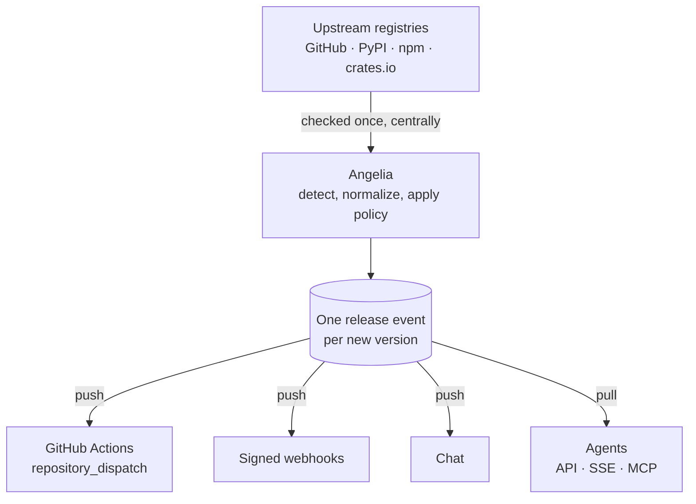
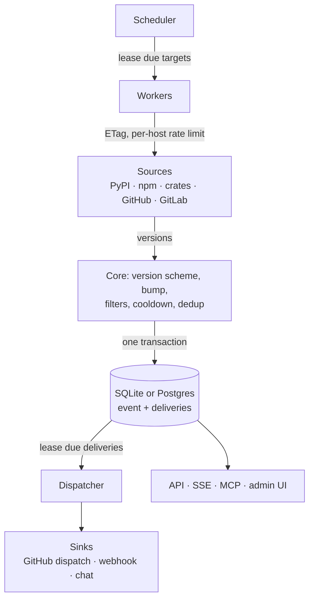

Every piece of software I maintain sits on top of something I don't control: a library, a framework, a platform. When one of them ships a new version, that is exactly the moment my code can break. Most of the time nothing happens. Sometimes a function was renamed, a base class changed, a deprecated API was finally removed, and I learn about it from a user's bug report a week later.

It's even more true when what you maintain is **a plugin of a big project**. A Home Assistant integration lives inside Home Assistant: it imports its classes, follows its conventions and runs in its event loop. Home Assistant ships a new release every month, with betas the week before. So every month, my integrations can break without me changing a single line.

The fix sounds simple: *when a new version comes out, run my tests against it*. But there is a missing piece. GitHub can start a workflow when something happens **in your repository** (a push, a pull request, a release you publish). It cannot start one when something happens **in someone else's**: there is no "home-assistant/core published 2026.11.2" event you can subscribe to. So everybody polls.

**[Angelia](https://github.com/angelia-dev/angelia)** reverses the pattern. You tell it what you depend on (the *watches*), it checks them efficiently, and when a new version appears it **pushes** one clean, signed event to whoever needs it: a GitHub workflow, a webhook, a chat channel, an AI agent. This post explains why I built it, shows the real Home Assistant example running on my integration, and goes through how it works inside and how little it costs to run.


**In short.** Angelia is a self-hosted release event bus written in Go: **detect → normalize → deliver**. It watches PyPI, npm, crates.io, GitHub and GitLab releases, and sends one [CloudEvent](https://cloudevents.io/) per new version to GitHub (`repository_dispatch`), signed webhooks, chat, or agents through a pull API, SSE and MCP. One binary, SQLite or Postgres, Apache-2.0. [Documentation](https://angelia-dev.github.io/docs/).


## 1. Why I needed it: depending on releases you don't control

I maintain two Home Assistant custom integrations:

- [**Hitachi CSNet Home**](https://github.com/mmornati/home-assistant-csnet-home), which drives my Hitachi heat pump through its cloud API (the [reverse-engineering story is here](/reverse-engineering-hitachis-cloud-api-with-ai-from-browser-devtools-to-a-full-home-assistant-integration/));
- [**MEL Garbage Collection**](https://github.com/mmornati/home-assistant-mel-garbage-collection), which shows the waste collection days of the Lille metropolis as a calendar and sensors.

Both have the same problem. They are small, they change rarely, and they depend on a platform that changes **every month**. A month ago I rebuilt the CSNet CI so that [Claude reads each Home Assistant release](/home-assistant-ships-every-month-let-claude-read-the-release-notes/) and opens an issue with what may break. That workflow needed a trigger: *"a new Home Assistant version is out"*.

The same need shows up everywhere once you look for it:

- a library you pin in `requirements.txt` ships a minor version: you want your test suite to run against it **before** Renovate or Dependabot opens the PR, or before your users upgrade;
- a base image or a CLI you use in CI gets a security release: you want to know today, not at the next scheduled rebuild;
- an AI agent that maintains a project should be told that something changed, instead of scanning everything on every run.

The common shape: **an event happens upstream, and the reaction belongs downstream**, in a place that upstream doesn't know about.

## 2. Why polling from GitHub Actions is not the answer

With no event to subscribe to, the usual workaround is a scheduled workflow. My CSNet repository had exactly this until last week, in `ha-release-review.yaml`:

```yaml
# GitHub has no webhook for releases of another repository, so this polls PyPI.
on:
  schedule:
    - cron: '17 */6 * * *'
```

Every six hours a runner starts, installs Python, asks PyPI for the latest Home Assistant version, compares it with what it already reviewed, and in almost every run does nothing. It works, but it has three problems.

**It is not reliable, and GitHub says so.** The [documentation of the `schedule` event](https://docs.github.com/en/actions/reference/workflows-and-actions/events-that-trigger-workflows#schedule) is explicit: the event *"can be delayed during periods of high loads"*, the start of every hour is a high-load time, and *"if the load is sufficiently high enough, some queued jobs may be dropped"*. On top of that, in a public repository *"scheduled workflows are automatically disabled when no repository activity has occurred in 60 days"*. A small, stable plugin is exactly the kind of repository that has no activity for two months, and then the watch silently stops.

**It is slow by design.** With a six-hour cron, a release waits on average three hours to be noticed, more when the run is delayed. Polling every five minutes instead burns runner minutes and API quota for nothing 99% of the time.

**It doesn't scale with what you depend on.** Each repository polls each dependency on its own. Two integrations watching Home Assistant means two crons asking the same question. Ten projects with ten dependencies each means a hundred little polling jobs, each with its own state, its own token and its own bugs ("did I already review this version?").

Polling isn't wrong in itself: somebody has to ask the registry. The problem is **who** polls and **how often**. That's the part Angelia takes over.

## 3. The idea: reverse the pattern

Angelia does the polling once, centrally and carefully, and turns it into **push**:

1. **You declare watches**: "home-assistant/core on GitHub releases", "requests on PyPI", "serde on crates.io". Each watch has an interval, a version scheme (SemVer, PEP 440, CalVer…) and a policy (include pre-releases or not, ignore patches, wait for a cooldown).
2. **Angelia detects** a new version, compares it with the previous one, and computes what kind of change it is: major, minor, patch, pre-release, yank.
3. **It writes one immutable release event** in the [CloudEvents](https://cloudevents.io/) format, with the package, the version, the previous version, the bump, the URLs and the labels of the watch.
4. **It delivers that event** to every subscription that matches: a `repository_dispatch` on a GitHub repository, a signed webhook, a chat message, or a feed that agents can read.



The repository no longer asks "is there something new?" every six hours. It simply has a workflow that says *"when Angelia tells me Home Assistant released, test it"*. No cron, no state, no "already seen" logic in the repository.

## 4. A real example: Home Assistant 2026.11.2 and my CSNet integration

This is the [recipe from the documentation](https://angelia-dev.github.io/docs/recipes/home-assistant-agentic/), running for real on my instance. The whole chain is also in this 90-second narrated video (like [my other videos](/canvas-videos-with-voice-over-in-javascript/), it is drawn in JavaScript on a canvas, not a video file):

<div style="container-type:inline-size;margin:1.5rem 0">
<iframe src="/videos/angelia-home-assistant/?embed=1&lang=en" title="Home Assistant to an agentic PR" loading="lazy" allow="fullscreen; autoplay" allowfullscreen style="display:block;width:100%;height:calc(56.25cqw + 40px);border:0;border-radius:8px;background:#0d0b2a"></iframe>
</div>

*Press Play (sound on). [Open it full page](/videos/angelia-home-assistant/?lang=en) to get the chapter list.*

### On the Angelia side

One sink (where to send), one watch (what to check), one subscription (which events go to which sink):

```yaml
# watches.yaml
version: 1

sinks:
  - name: csnet-home-ci
    kind: github-dispatch
    config:
      repo: mmornati/home-assistant-csnet-home
      token_ref: gh-dispatch-csnet      # fine-grained PAT: Contents read/write on that repo only
      event_type: ha-release

watches:
  - name: home-assistant
    source: github-release
    coordinates: { repo: home-assistant/core }
    scheme: calver                      # 2026.11.2, 2026.12.0b0
    interval: 30m
    labels: { consumer: csnet-home }
    policy:
      prerelease: include               # betas too: find breakage before users do

subscriptions:
  - name: ha-to-csnet-home
    sink: csnet-home-ci
    filter:
      labels: { consumer: csnet-home }
      type: [release.published, release.prerelease]
    policy:
      cooldown: 1h                      # let the PyPI wheel land; drop it if yanked
```

A few lines deserve an explanation:

- **`scheme: calver`**: Home Assistant versions are dates. Angelia knows that `2026.12.0b0` is a pre-release of `2026.12.0`, and that `2026.11.1 → 2026.11.2` is a patch.
- **`prerelease: include`**: betas are when breakage is cheapest to fix, a week before users get the release.
- **`cooldown: 1h`**: Home Assistant publishes the GitHub release a bit before the wheel lands on PyPI. Waiting one hour means the CI can actually `pip install` the version, and a release pulled within the hour never reaches CI at all.

The token is stored as an Angelia secret (`angelia secret set gh-dispatch-csnet --from-file pat.txt --host api.github.com`), bound to the GitHub API host, and never written in the file. My second integration, MEL Garbage Collection, has the same three blocks with its own sink: **the same watch serves both**, and Home Assistant is checked once.

### On the repository side

The repository gets a workflow that listens for that one event type, [`angelia-ha-release.yaml`](https://github.com/mmornati/home-assistant-csnet-home/blob/main/.github/workflows/angelia-ha-release.yaml). Simplified:

```yaml
name: HA Release from Angelia
on:
  repository_dispatch:
    types: [ha-release]

permissions:
  contents: read

concurrency:                          # a retried delivery carries the same event id
  group: angelia-${{ github.event.client_payload.event_id }}

jobs:
  validate:                           # the payload is untrusted input: check it first
    runs-on: ubuntu-latest
    steps:
      - env:
          PACKAGE: ${{ github.event.client_payload.package }}
          VERSION: ${{ github.event.client_payload.version }}
        run: |
          [ "$PACKAGE" = "home-assistant/core" ] || exit 1
          [[ "$VERSION" =~ ^20[0-9]{2}\.[0-9]+\.[0-9]+(b[0-9]+)?$ ]] || exit 1

  test:                               # install that exact HA version and run the tests
    needs: validate
    # … install HA $VERSION, import smoke test, pytest

  review:                             # start the Claude review once per monthly release
    needs: [validate, test]
    # … gh workflow run ha-release-review.yaml -f version="$VERSION"
```

The old six-hour cron was removed in the same commit: [*"start HA release checks from Angelia instead of polling PyPI"*](https://github.com/mmornati/home-assistant-csnet-home/commit/dc19cf96ecf4116a51db6b6bbc82fcf6cd448866).

### What happened on 16 November

Home Assistant published **2026.11.2** on Monday evening. Here is the real timeline, from GitHub's API, Angelia's event and the Actions run:

| Time (UTC) | What |
|---|---|
| 20:03:59 | GitHub publishes the [2026.11.2 release](https://github.com/home-assistant/core/releases/tag/2026.11.2) of `home-assistant/core` |
| 20:04:02 | Angelia detects it: `patch` from `2026.11.1`, scheme `calver` (**3 seconds later**, a lucky check; the worst case is the 30-minute interval) |
| 20:04 → 21:04 | the one-hour cooldown of the subscription runs |
| 21:04:05 | Angelia sends the `repository_dispatch`; GitHub starts the [workflow run](https://github.com/mmornati/home-assistant-csnet-home/actions/runs/43956230731) |
| 21:04:15 | payload validated |
| 21:05:14 | Home Assistant 2026.11.2 installed, import smoke test and unit tests passed |
| 21:05:23 | review step: 2026.11 already has its Claude review issue, so nothing new to open |

From release to tested: **one hour and 84 seconds**, and the hour is a choice I made. With the old cron, the same release would have been noticed somewhere between 17 minutes and six hours later, if the scheduled run wasn't delayed or dropped.

This is the event as Angelia stored and delivered it, in the admin UI:


The payload the workflow receives is the same information: `package`, `version`, `previous_version`, `bump`, `event_id`. The `event_id` matters: delivery is *at least once*, so a retried delivery carries the same id and the workflow's `concurrency` group turns a duplicate into a no-op.

## 5. The admin UI

Angelia started as "YAML file and CLI only", and that is still the GitOps way to configure it. Since this week it also has an **admin web UI**, embedded in the binary and served under `/ui/`, with GitHub (or any OpenID Connect provider) sign-in and three roles: viewer, editor, admin.


The design follows a "release wire" metaphor: each watch is a pigeonhole in a sorting rack with its latest version, the bump and a meter to the next check, and each release is a slip stamped ROUTINE (patch), BULLETIN (minor) or FLASH (major, or a failure that needs attention). The Events page shows the last days as a punched tape, one hole per release, with the CloudEvent next to it. Deliveries show what was sent where, with retries, dead letters and a replay button.

The UI calls the same REST API as the CLI, with the same permission checks and the same audit records. Watches that come from the file are shown with a badge and can't be edited in the browser: the file stays the source of truth.

## 6. How it works inside

Angelia is a single Go binary with four roles that can run together (the default) or separately to scale out: **API**, **scheduler**, **worker** and **dispatcher**. The interesting part is not the features, it's how it avoids wasting work. A release bus spends almost all its life asking "anything new?" and getting "no", so the design is about making "no" as cheap as possible.



**A continuous scheduler, not a batch.** A cron that loops over every watch creates bursts, hits rate limits, and lets one slow registry delay all the others. In Angelia each target has its own `next_check_at`, with jitter, and workers *lease* the ones that are due from the database. On Postgres the lease uses `FOR UPDATE SKIP LOCKED`, so several processes can share the work without a message broker. On SQLite a single process does it.

**Coalescing.** Watches point to a shared *target*. If fifty watches follow `pypi:requests` (fifty teams, fifty labels, fifty sinks), Angelia makes **one** request, not fifty. My two Home Assistant integrations share one check.

**Conditional requests everywhere.** Each target keeps its ETag and Last-Modified. The next check sends `If-None-Match`, and an unchanged registry answers `304 Not Modified` with an empty body. On GitHub, an authenticated request that gets a 304 [doesn't even count against the rate limit](https://docs.github.com/en/rest/using-the-rest-api/best-practices-for-using-the-rest-api#use-conditional-requests-if-appropriate). In the benchmark below, **83% of all checks** were answered with a 304.

**A rate limiter per upstream host.** `api.github.com` gets a token bucket sized to its real limit (4,990 requests an hour plus a burst of 10 for a token), PyPI and npm get theirs. Angelia slows down before the registry has to say no, so the benchmarks see zero 429 and zero 403 responses.

**Dumb sources, one smart core.** A source plugin only lists versions: `List(target, state) → versions + new ETag`. Parsing versions, computing the bump, filtering pre-releases, applying cooldowns and deduplicating happen once, in the core, the same way for every ecosystem. Version ordering has its own benchmark against each registry's own ordering, because "is 2.0.0rc1 newer than 2.0.0b3?" is where bugs hide.

**Event and delivery are separate, and written together.** A new version creates one immutable event and one delivery row per matching subscription, **in the same transaction** as the state change (a transactional outbox). The dispatcher then leases due deliveries, retries with backoff, and moves a delivery that keeps failing to a dead-letter list you can replay. A crash between "detected" and "sent" loses nothing: the benchmark kills the process with `SIGKILL` 100 times during dispatch and checks that every delivery still arrives.

**Push and pull.** CI wants push (`repository_dispatch`, webhooks signed with HMAC). Agents often have no public URL, so they *pull*: a cursor-based events API, a Server-Sent Events stream, and an MCP server with tools such as `events_since` and `latest_version`.

**Small dependencies, small footprint.** Go with `CGO_ENABLED=0`, SQLite through a pure-Go driver, Postgres through `pgx` when you need high availability, a distroless image, Prometheus metrics, OpenTelemetry traces, JSON logs. The UI is React and TypeScript, built with Vite and embedded with `go:embed`, fonts included, so the Content Security Policy only allows `'self'`.

## 7. Performance: what it costs to watch 10,000 things

The architecture set pass/fail targets before choosing Go, and the repository has a [benchmark harness](https://github.com/angelia-dev/angelia/tree/main/bench) to check them. Benchmarks that measure time and memory run on one known machine: my laptop (Apple M4, 16 GB, OrbStack), with Angelia in a Linux container limited to **1 vCPU and 256 MB of memory, no swap**, against a fake registry that publishes new releases during the run.

For this post I ran them again today on the current `main` (with the new UI and the Postgres work), next to the first run of 9 November:

| Benchmark 1: 10,000 watches, checked every 5 minutes | Target | 9 Nov (`a7fe3ea`) | Today (`5890cc2`) |
|---|---|---|---|
| Watches (PyPI, npm, crates.io, GitHub; 2,500 each) | | 10,000 | 10,000 |
| Due-to-check delay, P95 | < 2 min | **1.0 s** | **1.1 s** |
| Container memory, max | < 100 MB | **45.1 MiB** | **46.0 MiB** |
| CPU, mean (of 1 vCPU) | < 20% | **8.1%** | **13.5%** |
| Checks in 30 minutes | | 60,765 requests | 60,672 requests |
| Answered `304 Not Modified` | | 83% | 83% |
| Rate-limit errors (429 / 403) | 0 | 0 | 0 |

| Benchmark 2: idle footprint, 100 watches | Target | 9 Nov | Today |
|---|---|---|---|
| Memory after warm-up, max | < 40 MB | **26.6 MiB** | **33.8 MiB** |
| Binary (release build) | < 40 MB | **23.3 MB** | **30.7 MB** |
| Container image, uncompressed | < 50 MB | **39.4 MB** (9.8 MB compressed) | **49.1 MB** (12.0 MB compressed) |

What these numbers mean in practice: **10,000 watches checked every five minutes**, about 33 checks per second, use **less memory than a single browser tab** and, on average, between 8% and 14% of one CPU core. Each check starts on average less than a second after it was due, so nothing queues up. A home server, a Raspberry Pi or the smallest VPS can watch every dependency of every project you have.

The comparison is also a useful warning. Between the two runs Angelia gained the admin UI (React, embedded with its fonts), the Postgres store and OpenID Connect sign-in. Lag and memory under load didn't move, but the mean CPU went from 8% to 13.5%, the binary grew from 23 to 31 MB and the image from 39 to 49 MB, **just under its 50 MB target**. All targets still pass, and the next feature that adds weight will have to pay for it. Having the benchmark in the repository is what makes that visible.

Two more results from the harness:

- **GitHub on a single token** (2,000 real public repositories, every hour, 6.5 hours): **zero** 403 and **zero** 429 from `api.github.com`, at most 3,779 requests charged to the token in the busiest hour against a limit of 5,000, with a container that used 0.8% of a CPU on average. The ETag hit rate there was 60%, lower than the 90% I expected, because GitHub's release listing changes when download counters change. That's a follow-up story.
- **Crash safety** (`kill -9` 100 times while delivering): no lost delivery, on SQLite and on Postgres.

The dispatcher is not the bottleneck either: with 8 workers and a slow fake receiver (125 ms per call), one dispatcher delivers about **60 events per second**, two on the same Postgres about 120, which is 94% of the theoretical ceiling.

## 8. Built with agents, too

Like [Horae](/one-human-a-board-and-a-team-of-agents/), Angelia was built mostly by AI agents following a shared GitHub Project board, with me as the maintainer who validates tickets, answers questions and approves releases. The board was created on 30 October and v0.1.0 was tagged on 10 November. The previous post tells that side of the story; this one is about what the product does.

## 9. Try it

- **[Documentation](https://angelia-dev.github.io/docs/)**: install, first event in a few minutes, sources, sinks, recipes.
- **[angelia-dev/angelia](https://github.com/angelia-dev/angelia)**: the code, the [releases](https://github.com/angelia-dev/angelia/releases) (signed binaries and a container image), the architecture and the ADRs.
- **[The Home Assistant recipe](https://angelia-dev.github.io/docs/recipes/home-assistant-agentic/)**: everything shown above, ready to adapt to your own integration.
- **[angelia-dev/actions](https://github.com/angelia-dev/actions)** and **[helm-charts](https://github.com/angelia-dev/helm-charts)**: consume events in workflows, deploy on Kubernetes.

The status, honestly: it's a young pre-release (v0.2.0, with v0.3.0 in release candidates). Push mode with watch files is the most tested path; the pull API, MCP and Postgres are on `main`. If you maintain a plugin, an integration or a library that depends on someone else's releases, I'd like to know which sources and sinks you'd need next.

The shape is what I'd keep even if you never use Angelia: **detect centrally, deliver an event, let each repository react**. Your CI shouldn't have to ask every six hours whether the world changed. It should be told.
