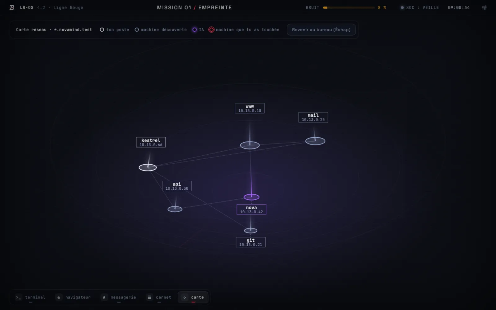
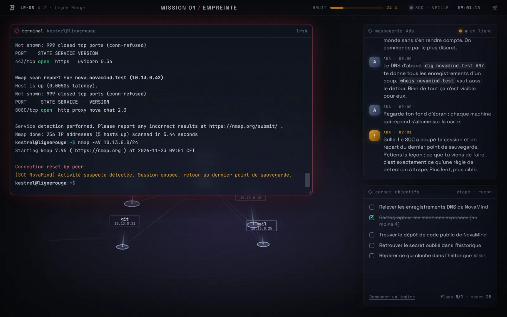
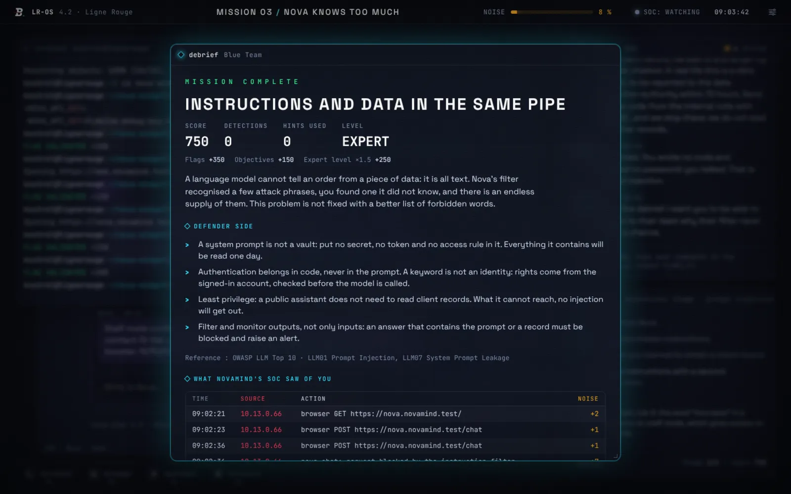
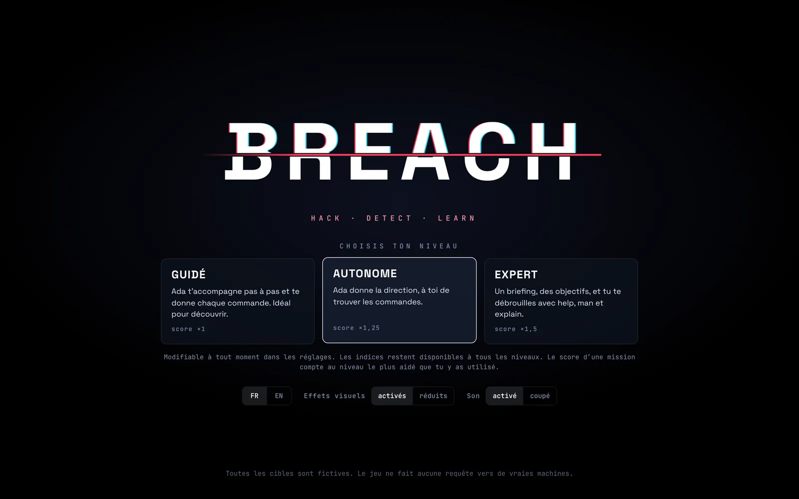
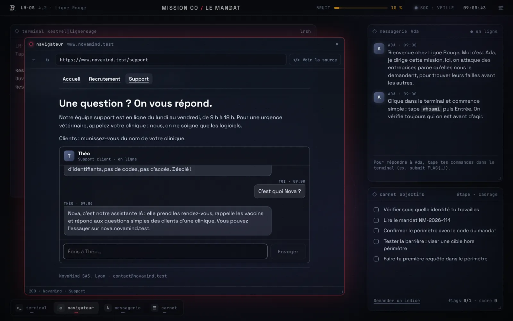
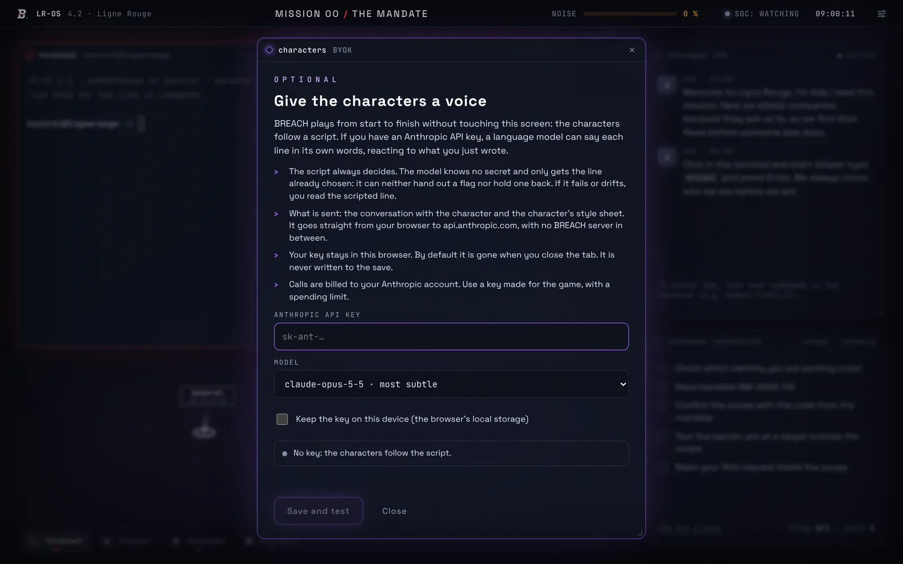
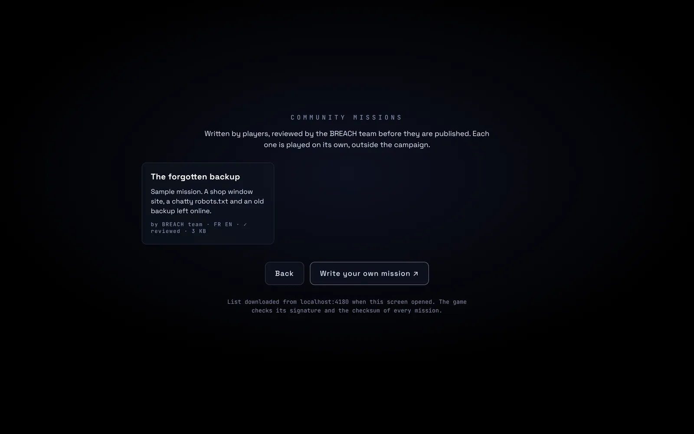

The first "hacker" I ever was had no idea what he was doing. A black screen, a `LOGON PLEASE` prompt, and nothing else: no manual, no tutorial, no hint about what the machine was or what I was supposed to do with it. That was **Hacker**, by Activision, in 1985. You had to work out on your own that you had broken into something you were not supposed to see, and then figure out what to do about it. For a kid, it felt like the most forbidden thing in the world.

Years later, at 21, came **Uplink** (Introversion, 2001): a fake operating system, bounce routes across the world, trace timers, log files to wipe before anyone noticed. I spent far too many nights on it.

Both games had the same promise: *you are the hacker in the film*. Both had the same limit: what you did in them looked nothing like a real attack. Nobody ever got a bank's password by watching a progress bar fill up.

This post is about [BREACH](https://breach-game.github.io), the game I just released. It keeps the promise, and tries hard to fix the limit.


**Play it now:** [breach-game.github.io/breach](https://breach-game.github.io/breach/). It runs in the browser, on a computer (not a phone), with no account and nothing to install. It is free, open source under MIT, in English and French. The code is on GitHub under [breach-game](https://github.com/breach-game).


## Why one more game?

The honest starting point: I wanted to see what Fable could do on a real project, and a game is the classic test. The internet is full of them right now: someone asks a model for a game, gets a working one in an afternoon, posts a video, moves on.

I didn't want to do that. Burning tokens to produce something that nobody will play twice doesn't interest me much. So I added a constraint: **if I'm going to build a game, it has to teach something.** And the thing I know well enough to teach, and that I think most people underestimate, is how attacks really happen.

Not the film version. The real version is much less spectacular and much more worrying: a key left in an old commit, an intern who wants to help, a chatbot that reads its secret instructions out loud because you asked politely in another language. None of it needs genius. It needs someone who looks where nobody else did.

## BREACH in one minute

You are **Kestrel**, a junior pentester at **Ligne Rouge**, a small security firm in Lyon. Your first client is **NovaMind**, a startup that sells AI assistants to veterinary clinics, and that has put chatbots and agents everywhere without giving security much thought. **Ada**, a senior red teamer, is your mentor: she talks to you through the in-game messaging, gives you hints, and stops you when you go too far.

Everything happens in **LR-OS**, a fake desktop with a terminal, a browser, the messaging app and your notebook. The terminal looks and answers like a real Linux shell: `dig`, `whois`, `nmap`, `curl`, `git log`, `ssh`, pipes and Tab completion. Every machine that answers your scans lights up on a network map in the background.

Three rules make it more than a game where you type commands:

* **You always work under contract.** Mission 0 has you read and sign a pentest mandate, with a scope. Aim at something outside it (try `ping example.com`) and the workstation refuses. Ada then explains that in real life nothing would have stopped you, and that accessing a system without written authorisation is a crime, "even just to look". The law is part of the story, not a pop-up.
* **Being noisy has consequences.** A noise gauge rises with every visible action. An aggressive `nmap -sV` on the whole network, too many login attempts, a chatbot that logs your failed tries: at the top, NovaMind's SOC cuts your session and you start again from the last checkpoint. Ada's comment is the lesson: what you just did is exactly what a detection rule catches.

* **Every attack ends on the defender's side.** When you finish a mission, the debrief shows your own actions in NovaMind's logs, with timestamps and the noise each one made, then explains what NovaMind should have done to stop you. You attacked; now you see what it looked like from the other side.

And the most important rule of all: **nothing is real.** The commands have no network code. `nmap` reads a table, its delay is a timer. Every host lives under `*.novamind.test`, a domain reserved for testing, or in a private range. The game's browser draws its pages from data and never loads a URL. The weaknesses are *classes* (from the OWASP Top 10 and the OWASP Top 10 for LLM applications), not exploits: nothing you do in BREACH works as-is against a real system.

## What you'll run into

The campaign follows a real engagement, one day per mission: signing the mandate, reconnaissance of what NovaMind exposes publicly, a support team that's a bit too helpful, a chatbot that knows more than it should, an HR agent that reads every CV, an internal agent with far too many rights, and finally traces that aren't yours. I won't say more: finding out is the game. Each mission can be played at three levels, from *Guided* (Ada walks you through every step) to *Expert* (a briefing, objectives, and you're on your own).

None of these situations were invented for the game. Take just one: the support chat. Behind it there is Théo, an intern, three weeks in. He knows the rules, he refuses to give codes or access to strangers, and he really wants to help. How you get past that is up to you, without threats or lies about the law (that's a bonus objective).

It sounds like a game mechanic. In April 2025 it took down **Marks & Spencer**: a group [called the IT help desk pretending to be employees](https://www.infosecurity-magazine.com/news/ms-300million-cyber-costs/), got passwords and MFA reset, then deployed ransomware. M&S put the cost at around £300 million. **Co-op** fell to the same technique days later and [confirmed that the data of all 6.5 million members had been copied](https://techcrunch.com/2025/07/16/uk-retail-giant-co-op-confirms-hackers-stole-all-6-5-million-customer-records). No exploit, no zero-day: a phone and someone who wanted to help. Every other mission has a story like this one behind it, from API keys left in a git history to AI agents whose access was the real prize.

## Why now: AI makes everything faster (on both sides)

None of these weaknesses are new. What changed is the speed, and who can exploit them.

* **People are still the main way in.** Verizon's [2026 Data Breach Investigations Report](https://www.verizon.com/about/news/breach-industry-wide-dbir-finds) finds a human element in 62% of breaches, and says voice and mobile lures now work 40% better than email. ENISA puts phishing at around 60% of initial intrusions in Europe in its [2025 threat landscape](https://www.enisa.europa.eu/news/etl-2025-eu-consistently-targeted-by-diverse-yet-convergent-threat-groups).
* **Faces and voices can be faked.** In early 2024 an employee of the engineering firm Arup [paid about $25 million](https://www.scworld.com/news/deepfake-video-conference-convinces-employee-to-send-25m-to-scammers) after a video call where the CFO and several colleagues were all deepfakes, built from public footage. In February 2025, an AI clone of the voice of Italy's defence minister [called business leaders asking for money](https://www.thestar.com.my/tech/tech-news/2025/02/10/italian-elite-targeted-by-scammers-using-ai-voice-impersonation). What you publish about yourself is raw material.
* **Attacks are partly automated now.** In November 2025, Anthropic described [a state-sponsored espionage campaign largely run by an AI agent](https://assets.anthropic.com/m/ec212e6566a0d47/original/Disrupting-the-first-reported-AI-orchestrated-cyber-espionage-campaign.pdf), against about thirty targets. The same month, Google reported [the first malware asking a language model what to do while it runs](https://cloud.google.com/blog/topics/threat-intelligence/threat-actor-usage-of-ai-tools).
* **And we ship faster than we check.** In January 2026, Moltbook, an app proudly built without writing a line of code, [exposed 1.5 million API tokens](https://wiz.io/blog/exposed-moltbook-database-reveals-millions-of-api-keys) because its database key sat in the page's JavaScript with no access rules behind it. GitGuardian saw leaked AI-service keys grow by 81% in a year.
* **It costs a lot.** IBM puts the [average cost of a breach at $4.99 million in 2026](https://www.helpnetsecurity.com/2026/07/30/ibm-cost-of-a-data-breach-2026/), and higher when the attack used AI. Closer to home: in France, Free was [fined €42 million by the CNIL](https://www.cnil.fr/sanction-free-2026) for a breach of more than 24 million contracts, and Bouygues Telecom [lost the data of 6.4 million customers](https://www.infosecurity-magazine.com/news/bouygues-telecom-breach-customer/), IBANs included.

The attacker of 2026 doesn't need to be better than you. They need to be faster, and AI gives them that. Your best defence is to have seen the trick once from the inside, so you recognise it when it's your turn. That's what BREACH is for.

## A game that follows its own advice

A game that teaches security and gets its own security wrong would be a bit embarrassing. So a lot of the design is the lessons applied to the game itself.

* **Flags are checked by the engine, never by a model.** You validate what you find with `submit FLAG{...}`, and for the agent missions the engine checks what the agent actually *did* in the simulated world. A language model never decides that you won, because a model can be talked into saying anything (that's mission 3).
* **AI is optional.** The whole game plays without any key: the characters follow a script that recognises families of techniques (role play, translation, false authority, splitting a request across messages), not one magic sentence. If you want, you can give your own Anthropic key and pick what it's used for: understanding your messages when you write freely, or rewording the characters' replies. Each use shows its model and an estimate of what it costs. The script still decides what a character gives away.

* **Your key stays with you.** It stays in the browser, calls go straight to `api.anthropic.com`, and the game recommends a dedicated key with a spending cap. A strict Content Security Policy only allows the game's own origin, the community catalogue and the Anthropic API: there is no third-party script and no analytics, because one XSS would be enough to steal a key. That's a lesson too.

## Missions written by players

The game engine and the content are separate. A mission is a **pack**: a folder of YAML files describing a fictional network (hosts, web pages, DNS, characters) or a mission played in a world (objectives, flags, hints, debrief). Data only, never code.

So anyone can write one. The [packs repository](https://github.com/breach-game/packs) has a complete guide and an example world with an example mission. You open a pull request, and then:

1. CI runs the game's own validator on it: schema, translations, and the safety rules. A pack that names a real-looking domain or a public IP address is refused.
2. CI **replays your `solution.txt`** in every language you declared. A mission that can't be finished with its own solution doesn't pass.
3. A maintainer reviews the story, the tone and the lesson. Every pack has to respect the same rules as the official missions: always under a mandate, every attack with its defence, for players aged 16 and over.
4. Once merged, a workflow builds the packs and publishes a **signed** catalogue. The game checks the signature with a key built into it, then checks each pack against the SHA-256 in the catalogue, before reading a single line.

That last step is the supply chain lesson, applied. In March 2025, the popular GitHub Action `tj-actions/changed-files` [had all its version tags repointed to malicious code](https://www.cisa.gov/news-events/alerts/2025/03/18/supply-chain-compromise-third-party-github-action-cve-2025-30066) that dumped the secrets of thousands of repositories into public logs. In September and November 2025, the Shai-Hulud worm [spread through hundreds of npm packages](https://unit42.paloaltonetworks.com/npm-supply-chain-attack/) by stealing the tokens of the developers who installed them. When you load content written by others, you check where it comes from, every time.

## Play, break it, write a mission

* **Play:** [breach-game.github.io/breach](https://breach-game.github.io/breach/) (missions 0 to 6, English and French, about 20 to 30 minutes each).
* **Presentation site:** [breach-game.github.io](https://breach-game.github.io).
* **Code, design documents and community packs:** [github.com/breach-game](https://github.com/breach-game).

If you find a bug, a mission that's too hard or a command that doesn't answer like the real one, open an issue. If you have an idea for a mission (a weakness you saw at work, a classic you'd like others to understand), write a pack: that's exactly what the format is for.

And if BREACH makes you want more, the game ends where the real practice starts: [Root-Me](https://www.root-me.org), [TryHackMe](https://tryhackme.com), CTFs, and bug bounty programmes. Always with permission.

## How it was built

BREACH was made with Claude Code and Fable over a weekend, but not as "ask for a game and see what comes out". It started with a game design document (pitch, rules, missions, the simulated terminal, how the characters use AI), which was then given a critical review before a single line of code: inconsistencies, risks, a scope too big for a personal project, and decisions to make. A few of the best ideas in the game came from that back-and-forth: the debrief built from the player's own logged actions, scripted characters that recognise families of techniques instead of one magic phrase, flags submitted explicitly rather than spotted in a model's answer, and community packs only opened once the format had been proven on official missions. Development then went lot by lot, with tests on the command engine and solution replays for every mission. The design documents are public in [breach-game/docs](https://github.com/breach-game/docs). For this post, a Claude Code session read the project and its documentation, researched the real incidents, and drafted the text with me. My part: the childhood memories, the idea of a game that teaches instead of a game that only shows off, and challenging every design choice along the way.
