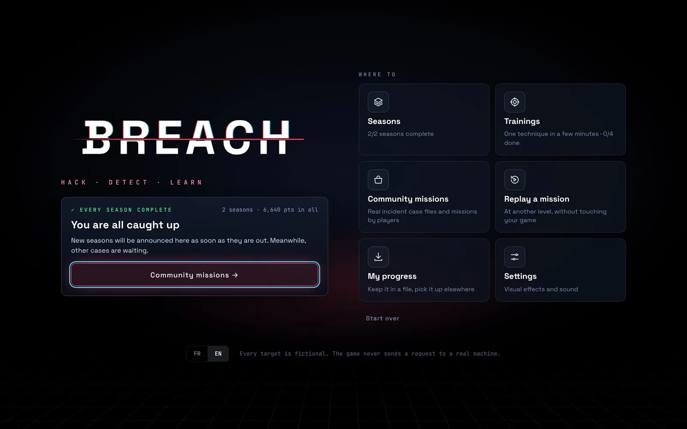
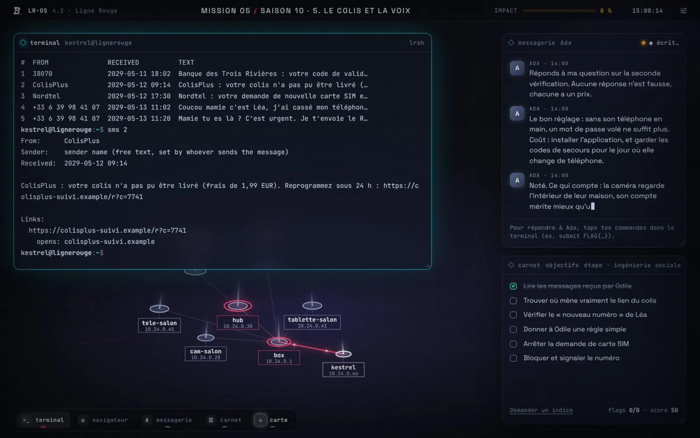
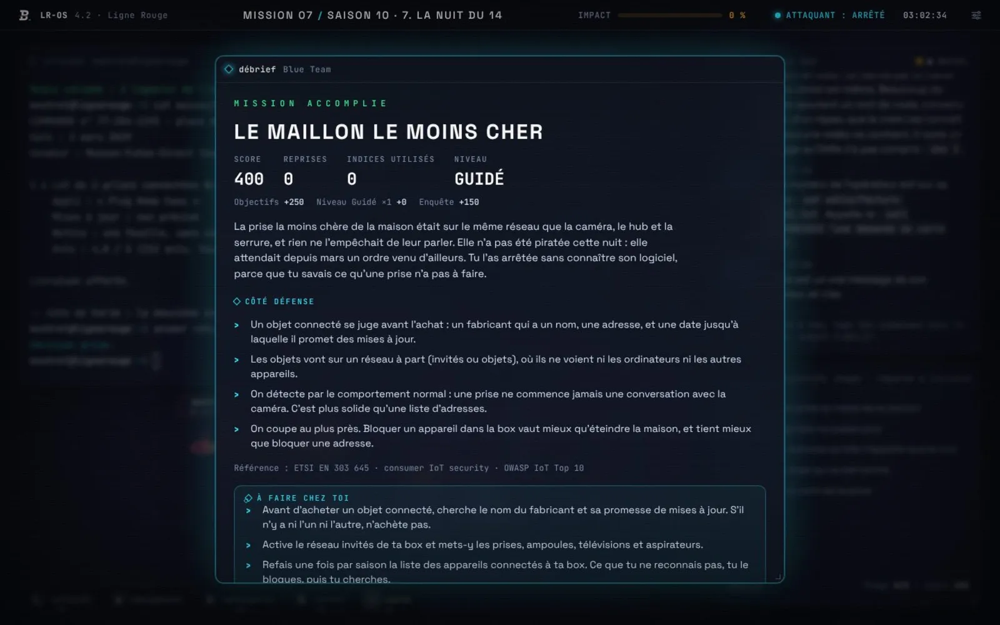
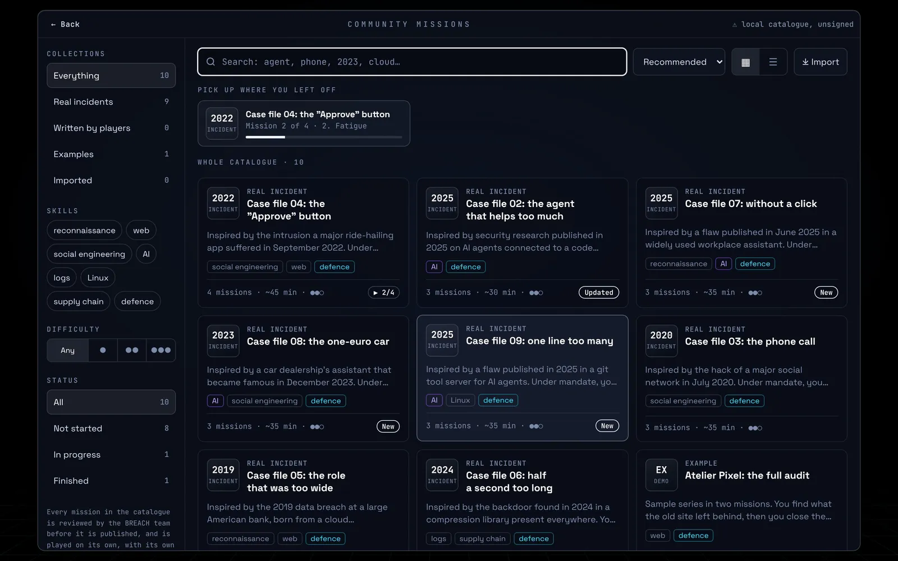
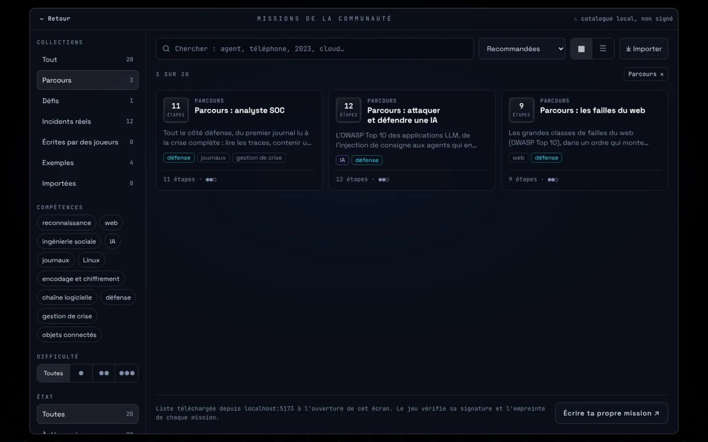

A week ago I wrote about [BREACH](/breach-a-new-hacking-game/), the hacking game I made to show how easy real attacks have become: a key left in a git history, an intern who wants to help, a chatbot that recites its secret instructions if you ask nicely. At the time it was one campaign of seven missions, all at NovaMind, the startup full of AI agents.

It's not really the same game any more. Right after the launch I asked Fable to map out everyday security and company security, and to propose everything the game was still missing. Then I let it work in the background for most of the week, while I was at my actual job. It's a strange feeling, a bit like having two jobs at once: one at the office, and one running on the PC at home after a few prompts in the morning. A week later, the title screen looks like this.

I won't go through everything (and I still won't give any solutions). Here are the three changes that, I think, make it worth a second look.

## What changed, in numbers

| | A week ago | Today |
| --- | --- | --- |
| Main campaign | 7 missions | 10, the last three on the defender's side |
| Seasons | none | 11 more, about 50 missions |
| Trainings | none | 15 short missions, one technique each |
| Community missions | 1 example | 46 case files, 15 side series, 11 challenges, 6 paths |

The debrief changed too. It used to explain how to defend. Now you also **replay the defence**: you find your own lines in the logs, pick the detection rule that would have caught you, write the fix, and the game replays your attack against it to check that it really fails. And a little career on the side: the more you play on your own, the more you get promoted at Ligne Rouge (with a nicer desktop, which is obviously the main motivation).

The seasons now go well beyond AI: a build chain and dependency confusion, the classic web flaws, a ransomware response at a town hall, a cloud account, a bug bounty programme, a vertical farm with forty sensors, a neobank API, and a finale where the intruder you've been chasing since day one attacks your own firm.

## Season 10: the house

This is the one I'm proudest of, because it's the one that speaks to everybody, not just to people who work in IT.

No company this time. Élise invites you for a weekend because she'd like to know who is watching her home. You're on the defender's side, with the family's consent: the router and its list of devices, the Wi-Fi, a living-room camera, a home automation hub, smart bulbs and a lock, the grandmother's phone, and everybody's accounts.

If you have parents, you've probably seen these messages. A parcel stuck for €1.99, a "new number" from a grandchild who needs money urgently, a bank code nobody asked for. In the game, as in real life, they aren't sophisticated. They work because they arrive at the right moment, and because nobody told the grandmother she was allowed to hang up and call back.

The part I like the most is the end of each debrief: a **"To do at home"** card. Not a lecture, three or four things you can do the same evening on your own router, your own camera, your parents' phone.

## Season 12: the prototype

In the first post I mentioned Moltbook, the app "built without writing a line of code" that exposed 1.5 million tokens. It became a season.

Three volunteers write a neighbourhood help app in a weekend with a coding assistant, and four hundred people sign up. Your job: a week of audit on what the assistant did fast and nobody reviewed. Then you review the generated code, write the rules that were missing, and you tell the neighbours, with the facts of a real vulnerability that hit apps built exactly this way in 2025.

I find it a good mirror. I build things with coding agents every day, and this season is a reminder that "it works" and "it's safe" are two different reviews.

## Forty-six case files, forty-six real stories

In the first post, every mission was linked to a real incident in the text. Now it's the other way round: whole series are built *from* real incidents.

The **case files** in the community store are short series of two to four missions, each inspired by a publicly documented incident, played at a fictional company so it stays a game, and closed by a sourced card telling what really happened. Some you'll know: Log4Shell, Heartbleed, MOVEit, Equifax, Colonial Pipeline, the deepfake video call at Arup, the July 2024 worldwide outage, the tj-actions GitHub Action. Some are less famous and just as instructive.

Next to them there are **side series** on everyday situations (a lost badge, public Wi-Fi on the road, a QR code sticker on a parking meter, an AI tool used without anyone knowing), **challenges** played at Expert level only, and **paths** that put missions in order around a theme: securing your home, the OWASP Top 10 for LLM applications, a day as a SOC analyst, first steps.

## The one thing missing: you

Here's the honest part. All of these community missions were written by me. The store is full, the validator, the solution replays and the signed catalogue all work, there's an author kit and an example world. What it doesn't have yet is a mission written by **someone else**.

So if you've seen a weakness at work that everybody should understand, or if a news story made you think "people would get it if they played it", the [packs repository](https://github.com/breach-game/packs) explains how to write one. It's YAML, no code, and the game can import a mission from a file so you can test it before opening a pull request. The first mission from outside will get a proper mention here.

* **Play:** [breach-game.github.io/breach](https://breach-game.github.io/breach/) (English and French, free, no account).
* **Presentation site:** [breach-game.github.io](https://breach-game.github.io).
* **Code and packs:** [github.com/breach-game](https://github.com/breach-game).

And if you only have twenty minutes this weekend, play season 10. Then go and check the list of devices on your router. You'll probably find a plug you'd forgotten about.
