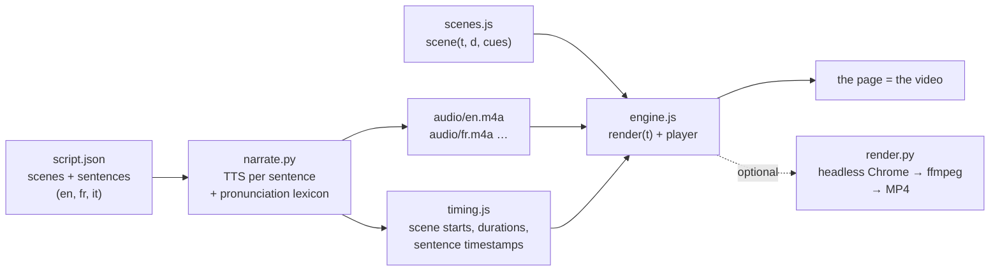

Less than two weeks ago, [ai-running-coach](/ai-running-coach-five-days-later-chat-gear-map-videos/) got a video series: **"The Trail"**, a trailer and 20 episodes, one per feature, narrated in French and English. That is roughly 35 minutes of video per language. I never opened a video editor, never recorded my screen and never spoke into a microphone.

None of them is a video file. Each "video" is a web page: **every frame is drawn in JavaScript on a canvas** from the elapsed time alone, over a narration track produced by a text-to-speech engine. Claude Code wrote most of the code, from prompts like "make me a video that explains this feature".

People asked how it works, so this post is the method. It covers the idea, the free voice-over options (and the licence traps, which matter more than voice quality), what 21 episodes taught me, and prompts you can reuse. Everything is now packaged as two Claude Code skills in **[canvas-video-skill](https://github.com/mmornati/canvas-video-skill)**, and section 6 walks through the example below, made on a different project, step by step with the skill's commands.

## 0. The result first

Here is the example built for this post: an 80-second explainer of [leanproxy-mcp](https://github.com/mmornati/leanproxy-mcp), my token firewall for MCP. It is narrated in English, French and Italian, and it runs inside this page:

<div style="container-type:inline-size;margin:1.5rem 0">
<iframe src="https://mmornati.github.io/canvas-video-skill/leanproxy-mcp/?embed=1&lang=en" title="leanproxy-mcp in 80 seconds" loading="lazy" allow="fullscreen; autoplay" allowfullscreen style="display:block;width:100%;height:calc(56.25cqw + 40px);border:0;border-radius:8px;background:#f3f5f1"></iframe>
</div>

*Press Play (sound on). Switch the language in the control bar, or turn on the subtitles. [Open it full page](https://mmornati.github.io/canvas-video-skill/leanproxy-mcp/?lang=en) to get the chapter list.*

Some numbers about it:

- **2 MB** for the three languages: about 40 KB of JavaScript and JSON, plus about 600 KB of AAC audio per language. An MP4 export of the English version alone weighs 3.6 MB.
- **About 900 lines of JavaScript**: the reusable engine (about 500 lines, no dependencies) and the eight scenes of this video (389).
- **0 euros**: the voice is [Kokoro](https://huggingface.co/hexgrad/Kokoro-82M), an open-weight model (Apache-2.0) that runs on a laptop CPU.
- **Hosting:** a folder of static files on GitHub Pages, next to the skill that made it ([`docs/leanproxy-mcp/`](https://github.com/mmornati/canvas-video-skill/tree/main/docs/leanproxy-mcp)). No YouTube, no third-party player.

### Get it: canvas-video-skill

The engine, the scripts, the template, the pronunciation workflow and the licence notes below are all in **[canvas-video-skill](https://github.com/mmornati/canvas-video-skill)**, a Claude Code plugin with two skills:

- **`canvas-video`** walks the agent through the whole method: facts, storyboard, scaffold, voice, scenes, visual check, embed.
- **`narration-lexicon`** finds and fixes mispronounced words with Whisper instead of your ears.

```text
/plugin marketplace add mmornati/canvas-video-skill
/plugin install canvas-video@canvas-video-skill
```

Then ask for a video. The scripts also work without an agent, or with another one: they are plain Python files run with `uv`, and the video itself is HTML and JavaScript.

## 1. The idea: a video is a function of time

The whole technique rests on one rule: **every frame is a pure function of time**. A scene is a function `scene(t, d, cues)` that draws, from scratch, what the screen looks like `t` seconds into the scene. It keeps no hidden state and uses no unseeded randomness. The same `t` always gives the same pixels.

That single rule gives you everything a video player needs:

- **Playing** is calling `render(t)` on every animation frame.
- **Seeking** is calling `render(t)` with another `t`.
- **Exporting** to MP4 is calling `render(t)` 30 times per second of video in a headless browser and piping the PNGs into ffmpeg. It is never real time, so no frame is ever dropped.

Then the voice. The narration is written in a `script.json`, sentence by sentence, scene by scene. A script synthesises each sentence, measures how long it lasts, and computes the timeline: **the voice sets the pace, the animation adapts to it**. A scene lasts as long as what is said in it, plus a little air.



Two details make it feel like a real video.

**Animations hook onto sentences, not seconds.** `timing.js` gives each scene the start and end of every sentence. A scene never says "show the counter at 3.2 s". It says "show the counter when the second sentence starts". So the same scene works in English, French and Italian, even though the Italian narration is 13 seconds longer:

```js
function sTax(t, d, cues) {
  const a2 = at(cues, 1, 7.7);              // start of the 2nd sentence (fallback 7.7 s)
  const k = seg(t, a2, a2 + 0.8);            // 0 → 1 over 0.8 s from that moment
  panel(700, 470, 500, 46, { alpha: k });    // the "context window" fades in
  // …
}
```

**The audio is the master clock.** While the narration plays, the player reads its time from the `<audio>` element instead of the system clock, so voice and image never drift apart, even on a slow machine or a hidden tab:

```js
if (soundOn && !a.paused && a.readyState >= 3) { t = a.currentTime; t0 = now - t * 1000; }
```

Why not just make an MP4? You can, it's one command (section 7). But the page version has real advantages for documentation:

- **Languages are cheap.** Translate the sentences in `script.json` and regenerate: the scenes re-time themselves. On the leanproxy video, most of the effort per language went into checking pronunciation.
- **It is reviewable.** A change to a video is a diff in a pull request. When a feature changes, the agent edits a sentence and a scene, and CI checks that the narration was regenerated.
- **It is tiny and self-hosted**, as seen above.
- **Text stays text.** Subtitles, chapters and the transcript come from the same script.

## 2. Anatomy of a video

The engine lives in the skill, in [`skills/canvas-video/engine/`](https://github.com/mmornati/canvas-video-skill/tree/main/skills/canvas-video/engine). It is a smaller, generic version of the ai-running-coach one, without the series-specific parts (the race bib intro, the finish arch, the screenshot manager). A video is a folder next to it:

| File | Written by | Role |
|---|---|---|
| `index.html` | hand (10 lines) | loads the engine, the timing and the scenes |
| `script.json` | you or the agent | scenes, chapters, and what is said, per language |
| `lexicon.json` | you or the agent | pronunciation fixes (spoken text only, subtitles untouched) |
| `scenes.js` | the agent, mostly | one drawing function per scene, then `VIDEO.create({...})` |
| `timing.js` | **generated** | scene durations and sentence timestamps, per language |
| `audio/<lang>.m4a` | **generated** | the narration track |

The script is the contract between the voice and the image:

```json
{"id": "router", "min": 6,
 "en": ["Clients without their own tool search get a router: four tools, three hundred and eighteen tokens.",
        "The model searches every server, and loads only the tool it needs."],
 "fr": ["Les clients sans recherche d'outils intégrée reçoivent un routeur : quatre outils, trois cent dix-huit tokens.", "…"],
 "it": ["I client senza una ricerca degli strumenti integrata ricevono un router: quattro strumenti, trecentodiciotto token.", "…"]}
```

Numbers are written out in words on purpose. TTS engines read "318" correctly most of the time, but "10,049" can come out as "ten, zero forty-nine" in French, where the comma is a decimal separator. Words are never ambiguous.

The engine gives scenes a small vocabulary: `text`, `para`, `panel`, `pill`, `terminal` (with typed lines and a cursor), `arrow`, `packets` (dots flowing along a wire), `highlight`, `callout`, `check`, plus easing functions and a seeded random generator. That is enough for explainers. For anything more, the scene has the raw canvas `ctx`.

The tooling is a handful of Python scripts run with `uv`, so nothing gets installed in your project:

- [`new_video.py`](https://github.com/mmornati/canvas-video-skill/blob/main/skills/canvas-video/scripts/new_video.py) scaffolds a video that plays before you write a single scene.
- [`narrate.py`](https://github.com/mmornati/canvas-video-skill/blob/main/skills/canvas-video/scripts/narrate.py) does the voice, the timing and the `--check` used by CI.
- [`render.py`](https://github.com/mmornati/canvas-video-skill/blob/main/skills/canvas-video/scripts/render.py) does contact sheets, PNG stills and MP4 export.
- [`verify.py`](https://github.com/mmornati/canvas-video-skill/blob/main/skills/narration-lexicon/scripts/verify.py) and [`try_words.py`](https://github.com/mmornati/canvas-video-skill/blob/main/skills/narration-lexicon/scripts/try_words.py) check and fix the pronunciation.

The video itself is 100% HTML, CSS and JavaScript.

## 3. The voice: free options, and which ones you may publish

This is where most of the time went on ai-running-coach, and where the landscape changed again **yesterday**.

### What happened to the series

- The first narration used **Kokoro**. It runs offline, but its single French voice sounds robotic.
- PR #161 switched to **edge-tts**, which gives you the Microsoft neural voices of Edge's "Read aloud" for free, without an account. Remy and Andrew Multilingual sound great, and the trailer plus episodes 1 to 15 use them.
- Yesterday, while narrating episodes 16 to 20, edge-tts started answering **HTTP 403**. It is not just me: [issue #490 of edge-tts](https://github.com/rany2/edge-tts/issues/490) was opened on October 10. Reports come from France, Central Europe and the UK; it still works from North America. Edge's new version talks to a new host with a new token format, and there is no fix yet.
- Episodes 16 to 20 were narrated with Kokoro, so the series now mixes two voices.

That outage was a reminder of something I had glossed over. **edge-tts was never licensed.** It uses a private endpoint of the browser. The audio sounded professional, but nothing allowed me to publish it. So I redid the research properly, with one constraint: **free, and publishable**.

### The options in October 2026

**Local, open-weight models** (run on your machine, no account, no quota):

| Engine | Licence of the audio you publish | EN / FR / IT | Notes |
|---|---|---|---|
| [Kokoro-82M](https://huggingface.co/hexgrad/Kokoro-82M) | Apache-2.0: OK, commercial included | EN excellent, FR 1 voice (B-), IT 2 voices (C) | Tiny, fast on CPU. Best quality for its size in English. Python (`kokoro`, `kokoro-onnx`) and JavaScript ([`kokoro-js`](https://www.npmjs.com/package/kokoro-js), Node and browser, English voices only). |
| [Chatterbox Multilingual](https://github.com/resemble-ai/chatterbox) | MIT: OK. Every file carries an inaudible "Perth" watermark | EN, FR, IT and 20 more | Voice cloning from a sample. Runs on Apple Silicon (MPS). |
| [Kyutai Pocket TTS](https://huggingface.co/kyutai/pocket-tts) | CC-BY-4.0: OK **with credit to Kyutai**; cloning someone without consent forbidden | EN, FR, IT, DE, ES, PT | New in 2026: 100M parameters, real time on a laptop CPU. Gated download. |
| [Kyutai TTS 1.6B](https://huggingface.co/kyutai/tts-1.6b-en_fr) | CC-BY-4.0 (credit) | EN, FR | Very good French. On a Mac through MLX. |
| [Qwen3-TTS](https://huggingface.co/Qwen/Qwen3-TTS-12Hz-1.7B-CustomVoice) | Apache-2.0 | EN, FR, IT and 7 more | Strong, cloning from 3 s of audio, but it wants a GPU. |
| [Piper](https://github.com/OHF-Voice/piper1-gpl) | Engine GPL-3.0 (doesn't cover your audio), but **each voice has its own dataset licence**: check its model card | Many voices | Reliable, a bit robotic, runs on a Raspberry Pi. |

Look out for the **non-commercial traps**: some of the best-sounding open models forbid exactly the use we want (a product or marketing video). These include Fish Audio S2, Voxtral TTS, F5-TTS (the weights), Spark-TTS, XTTS-v2 (and Coqui no longer exists to sell you a licence), OuteTTS 1B and Breeze TTS 2 (currently #1 on the open-weights leaderboard). Read the licence of the *weights*, not only the code.

**Official cloud free tiers** (an account is required, and the audio is licensed):

| Service | Free allowance | Notes |
|---|---|---|
| [Azure AI Speech F0](https://azure.microsoft.com/en-us/pricing/details/cognitive-services/speech-services/) | 500,000 characters per month | **The same voices edge-tts was using**, legally. The whole ai-running-coach series is about 31,000 characters. |
| [Google Cloud TTS](https://cloud.google.com/text-to-speech/pricing) | 1M characters/month of Chirp 3 HD (its best voices), 4M Standard, 4M WaveNet | Requires a billing account (a card on file). |
| [Gemini API TTS](https://ai.google.dev/gemini-api/docs/pricing) | Free tier on the Flash TTS models | Voices steered by a text prompt; tight rate limits. |
| [Amazon Polly](https://aws.amazon.com/polly/pricing/) | Credits for new accounts (up to $200) | The old "12 months free" quotas only apply to accounts created before July 2025. |
| [Cloudflare Workers AI](https://developers.cloudflare.com/workers-ai/models/melotts/) | 10,000 neurons/day, about 9 hours of MeloTTS audio | French and English, no Italian; dated quality. |

The commercial services' free plans are not an option for this use: **ElevenLabs Free** forbids commercial use and requires "elevenlabs.io" in the title of what you publish, Cartesia's free plan has no commercial licence, and OpenAI has no free TTS tier at all.

**Built into your computer**, the fallback when nothing else works:

- **macOS `say`** is great for drafts and timing passes: zero install, decent voices in every language. But the macOS licence (section 2F of the Tahoe SLA) only allows system voices "for your personal, non-commercial use" and explicitly forbids publishing recordings of them. **Use it, don't publish it.**
- **Windows** natural voices have no publishing grant that I could find.
- **espeak-ng** (Linux, macOS, Windows) sounds like 1995, but it is GPL software with no claim on your audio: it is the zero-cost fallback you are actually allowed to publish.

The skill's `narrate.py` supports four engines: `kokoro` (default), `azure` (the official free tier), `espeak` (the publishable fallback) and `say` (drafts). The ai-running-coach one also has `edge`, `chatterbox` and `kyutai`. Adding an engine is a 15-line class: take a sentence, write a WAV.

### What I would pick

- **English only:** Kokoro. It is hard to beat for 82M parameters, and it is the only one that also runs in JavaScript.
- **French and Italian, local:** Chatterbox Multilingual, or Pocket TTS if you can credit Kyutai.
- **The best voices for free:** Azure F0, 500k characters a month, officially. It is the natural way to re-narrate the ai-running-coach series with a single voice again.
- **Drafts:** `say`, then switch engines for the final version. Since the timing is computed from the real audio, switching engines just re-flows the scenes.

For this post I deliberately used Kokoro in all three languages, so you can hear where it is excellent (English) and where it shows its limits (the French and Italian voices are graded B- and C by its own author).

## 4. What 21 episodes taught me

**Pronunciation is the real work, and you can't check it by ear.** After three listens you hear what you expect. Transcribe the track with Whisper (`faster-whisper` runs locally) and diff it against the script. The `narration-lexicon` skill automates this: it cuts every sentence out of the track using the timestamps, transcribes it on its own, and compares it with the script. On the leanproxy video it caught:

- "your AI client" heard as "your iClient";
- "binaire Go" heard as "binergo";
- "LeanProxy" in Italian heard as "L'improxia";
- "Homebrew" in French heard as "Chromebook". I had missed that one listening to the whole track.

Each one was fixed with a one-line entry in `lexicon.json` (a respelling, or raw IPA phonemes for Kokoro: `"AI": "[[ˌeɪˈaɪ]]"`) or by rewording the sentence. Subtitles keep the original text.

**Not every diff is a voice problem.** In the final report, all 15 English sentences match. The French and Italian diffs that remain are homophones ("surcoût" heard as "sur coût", "Mesuré" as "Mesurée") or Whisper's own language priors: in an Italian sentence, "LeanProxy" comes back as an Italian-looking word even when the voice says it right. The skill teaches the agent to sort these out instead of "fixing" a correct voice.

**Kokoro reads its own language flags aloud.** When a French sentence contains an English word, espeak (which Kokoro uses for phonemes) wraps it in language-switch markers: `(en)kˈoʊtʃ(fr)`. kokoro-onnx strips the brackets but not the letters, so the voice literally said "en coach fr". The fix is one parameter (`language_switch="remove-flags"`), and it is in `narrate.py`.

**Let the voice set the timing, never the reverse.** The first trailer was silent, with hand-tuned scene durations. When narration arrived, durations started being computed from the audio instead: no sentence is ever cut, and a translation or an engine switch just re-flows the scenes.

**Make determinism a test.** ai-running-coach has a lint test that fails if a scene uses `Math.random()` or `Date.now()`. One nondeterministic frame and the MP4 export no longer matches what people see in the browser.

**Make stale narration a CI failure.** `narrate.py --check` uses only the standard library. It compares a fingerprint of the script, the voice and the lexicon with the one stored in `timing.js`. Change a sentence and forget to regenerate, and CI says so.

**Write the audio atomically.** With several agents regenerating in parallel, a track could be read while half-written. The script writes it to a temporary file and moves it into place.

**Parallel agents and shared files don't mix.** Episodes were built by several Claude Code sessions in parallel. Each added its line to the shared episode list in `engine.js`, so every branch conflicted with every other. Keep shared registries tiny, or generate them.

**Use fictional data, and say so on screen.** The ai-running-coach videos use "Camille", a demo athlete generated by the test fixtures, so I never publish my own health data. The leanproxy video uses only numbers from the project's own benchmark, with the test conditions printed next to them.

## 5. Prompts you can reuse

The sessions that built "The Trail" are gone: the first one ran in a cloud sandbox, and the local ones have since been cleaned up. What follows is rewritten from the pull request descriptions and generalised, so it works on any project.

With the skill installed you mostly don't need them: its instructions encode exactly these steps, and the last prompt is enough. They are still useful without the skill, with another agent, or to understand what the skill makes the agent do.

**Start the engine** (the very first video):

```text
I want a ~80 s presentation video of this project that is NOT a video file:
a single HTML page where every frame is drawn on a 16:9 canvas by a pure
function render(t) of the elapsed time. No framework, no build step, no
third-party requests (bundle the fonts with their licences). Expose
window.renderFrame(t) and window.videoReady so a script can export an MP4
frame by frame with headless Chrome + ffmpeg. Read the README and the docs
first, use the project's real colours, and never invent a feature.
```

**Turn it into a narrated series:**

```text
Turn the trailer into a series: one short episode per feature, half demo,
half documentation, sharing one engine (player, chapters, subtitles,
drawing helpers). Each episode has a script.json with the scenes and the
narration in FR and EN. Generate the voice offline, compute each scene's
duration from the audio (the voice sets the pace), and expose the sentence
timestamps so animations can start when a sentence starts. Add a CI check
that fails when the narration is stale. Propose the episode list first.
```

**When the voice sounds wrong:**

```text
The French voice sounds robotic. Make the narration script support several
TTS engines behind a --engine flag, render one scene with each engine for
A/B listening (--sample), and tell me the licence of the audio each one
produces: I must be allowed to publish it.
```

**Fix pronunciation without guessing:**

```text
Transcribe every narration track with faster-whisper and diff it against
script.json. For each word that comes out wrong, add an entry to
lexicon.json (respelling, or IPA for Kokoro), regenerate, and transcribe
again until the transcript matches. Don't change the subtitles.
```

**Add an episode** (the one I used most):

```text
New episode for the feature in PR #<n>: read the PR and the docs page,
propose 6-8 scenes with the narration in FR and EN, wait for my OK, then
build it, regenerate the narration, render stills of every scene so you
can check the layout yourself, and update the gallery.
```

**A video of someone else's project** (the example below):

```text
Make an ~80 s narrated explainer of github.com/<owner>/<repo> for my blog,
in EN, FR and IT, with a free voice I'm allowed to publish. Use only facts
and numbers from the repo (README, docs, benchmarks), with their test
conditions on screen. Use the project's visual identity. Check the
pronunciation with Whisper, render stills of every scene and fix the
layout before showing me anything.
```

The part that matters in all of them: **ask the agent to look at its own output.** Rendering stills of every scene and reading them back as images, and transcribing the audio, is what turns "it compiles" into "it looks and sounds right".

## 6. Step by step: the leanproxy-mcp video with the skill

Here is how the video at the top of this post was made. I built it with Claude Code first, then packaged the steps, the scripts and the checks into the skill, so this is exactly what the skill now makes an agent do. Paths are relative to the plugin's `skills/` folder; the agent runs these commands itself, and you can run them by hand.

**1. Install the skill and ask.**

```text
/plugin marketplace add mmornati/canvas-video-skill
/plugin install canvas-video@canvas-video-skill

> Make an ~80 s narrated explainer of github.com/mmornati/leanproxy-mcp, in EN, FR and IT,
  with a free voice I'm allowed to publish. Only facts from the repo.
```

**2. Facts first.** The skill makes the agent read the repository, the docs site and the benchmark results before anything else. The first thing it found was a trap: the GitHub description still says "50-80%", while the current, measured figures are *65 to 94% fewer tokens per session*, *10,049 → 318 tokens* of static load, and *0 of 3* planted secrets leaked. My two older blog posts about the project carried even older numbers. The video only uses the current harness results, and prints the conditions ("make harness · 5 mock servers · 118 tools · upper bounds") on screen.

**3. Storyboard, approved before building.** Eight scenes: the schema tax, the cost, the proxy, router mode, the response governor, the firewall, the measurements, the install. About 170 words in English, numbers written out in words, opt-in features said to be opt-in. Once approved, it becomes `script.json`.

**4. Scaffold.**

```bash
python3 canvas-video/scripts/new_video.py docs/leanproxy-mcp --title "leanproxy-mcp in 80 seconds" --langs en,fr,it
```

This copies the shared `engine/` next to the video and a template that already plays.

**5. Generate the voice.**

```bash
uv run --with kokoro-onnx --with soundfile canvas-video/scripts/narrate.py docs/leanproxy-mcp
```

```text
leanproxy-mcp [en] 77.9 s (kokoro/af_heart)
leanproxy-mcp [fr] 81.8 s (kokoro/ff_siwis)
leanproxy-mcp [it] 90.9 s (kokoro/im_nicola)
```

**6. Check the pronunciation** with the `narration-lexicon` skill:

```bash
uv run --with faster-whisper --with num2words narration-lexicon/scripts/verify.py docs/leanproxy-mcp
uv run --with kokoro-onnx --with soundfile --with faster-whisper --with num2words \
  narration-lexicon/scripts/try_words.py docs/leanproxy-mcp --lang fr \
  "Installez-le avec Homebrew, lancez" "Installez-le avec Home Brew, lancez"
```

`verify.py` lists the sentences that don't come back right, with the word-level diff. `try_words.py` speaks a few candidate spellings in the video's own voice and transcribes them back. The winner goes into `lexicon.json`, then narrate and verify again. For the three languages this took a few rounds and roughly a quarter of an hour.

**7. Write the scenes, then look at them.** The visual identity comes from the project's own `DESIGN.md`: the "checkpoint scanner" palette, with amber for the tokens you pay for, teal for what cleared, and red only for corner brackets around something caught. The logo, a scanner arch, is redrawn in eight lines of canvas code. Then the agent renders a contact sheet of every scene in every language and reads the images back:

```bash
uv run --with playwright canvas-video/scripts/render.py docs/leanproxy-mcp --sheet
```

That pass caught an amber block covering the gate, a percentage overlapping a bar label, and code ligatures turning `--stdio` into "—stdio" in the terminal scene. None of them would have shown up in a code review.

**8. Publish.** The folder is static files: it lives in the skill repository's `docs/`, served by GitHub Pages, and this post embeds it with an `iframe` pointing at `?embed=1&lang=en` (`lang=fr` and `lang=it` in the French and Italian versions of the post). `narrate.py --check` runs in the repository's CI, so a sentence changed without regenerating the voice fails the build.

## 7. And when you need an MP4

YouTube, LinkedIn or a release page can't run your JavaScript. For those:

```bash
uv run --with playwright canvas-video/scripts/render.py docs/leanproxy-mcp --lang en              # 1080p MP4
uv run --with playwright canvas-video/scripts/render.py docs/leanproxy-mcp --lang en --burn-subs  # social media
```

On my MacBook it renders the 2,337 frames of the English version in **24 seconds** and produces a 3.6 MB file, the narration muxed in without re-encoding. Same pixels as the browser, by construction.

## What's next

- Get a single, licensed voice back across the 21 episodes of "The Trail" (Azure F0 is the obvious candidate).
- Try Pocket TTS and Chatterbox for French and Italian on the next video.
- Possibly a Node version of `narrate.py` with `kokoro-js`, for projects that want zero Python (English voices only, for now).
- New engines in the skill: each is a 15-line class, and pull requests are welcome.

Links:

- 🧩 [canvas-video-skill](https://github.com/mmornati/canvas-video-skill): the two skills, the engine, the scripts and the examples ([live demo](https://mmornati.github.io/canvas-video-skill/))
- 🎬 [The leanproxy-mcp video, full page](https://mmornati.github.io/canvas-video-skill/leanproxy-mcp/?lang=en)
- 🏃 ["The Trail", the ai-running-coach series](https://mmornati.github.io/ai-running-coach/videos/)
- 🛡️ [leanproxy-mcp on GitHub](https://github.com/mmornati/leanproxy-mcp)
