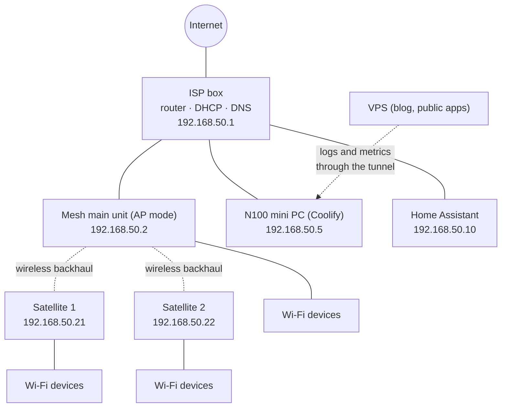
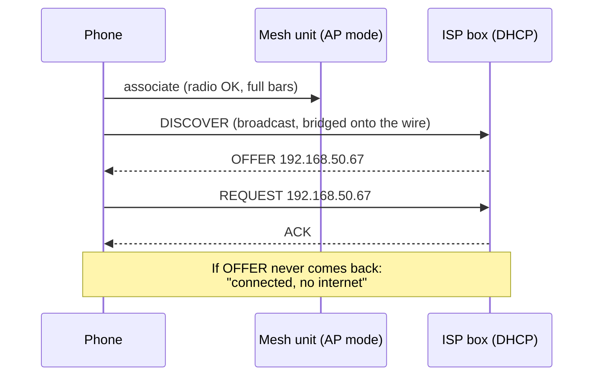
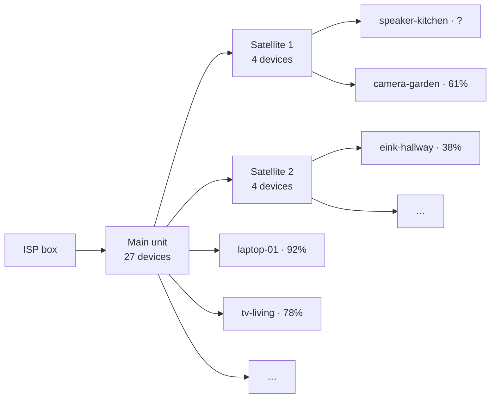

Every household has an IT department. In mine, it's me, and the tickets arrive in person: *"The Wi-Fi isn't working."* *"Plex is stuck again."* *"The TV says no internet but my phone is fine."*

For years my standard answer was the one Roy gives in *The IT Crowd*: **"Have you tried turning it off and on again?"** Reboot the box, reboot the mesh, reboot the server if that's not enough. It works surprisingly often. But it has one big problem: when it works, **you never learn what was broken**. And sometimes the reboot *is* what breaks things.

Over the last few weeks, with Claude Code doing most of the typing, I turned my home server into something that can answer three questions before I touch a power button:

1.  **Is it up?** — Uptime Kuma, organized by "what to look at when this turns red".
2.  **Why is it down?** — OpenObserve, with logs and metrics from the server, the containers and Home Assistant.
3.  **Why can't that device connect?** — a small DHCP watcher on the wire, and Home Assistant's view of the Wi-Fi mesh.

And then a fourth thing I didn't plan: once all that data was in one place, Claude could read it through MCP. The last section of this post is a real alert that fired *while I was writing it*, debugged from the chat.


**Everything in this post is pseudonymized.** The network addresses, MAC addresses, host names, domain names and device names below are not the real ones. I replaced them consistently (the same device keeps the same fake name throughout), so the stories and the numbers still add up. Latencies, signal levels, counts and traffic volumes are the real measurements. I also left out a few services that run on the same box but have nothing to do with the network.


## The setup at a glance

Nothing exotic, and probably close to what many people have at home:

*   **The ISP box** is the router, the DHCP server and the DNS forwarder for the whole house.
*   **A Wi-Fi mesh** (one main unit and two satellites) runs in **access point mode**: it bridges Wi-Fi clients onto the wired LAN and does no routing and no DHCP of its own. One network, one DHCP server, no double NAT.
*   **A mini PC with an Intel N100** (16 GB of RAM) runs everything self-hosted, managed with [Coolify](/migrating-from-hashnode-to-hugo-with-coolify/): Plex and its companions, a VPN container, a few personal apps, the reverse proxy, Authentik for single sign-on, and a Cloudflare tunnel for the parts reachable from outside.
*   **Home Assistant** runs on its own box and knows a lot about the network without anybody asking it to (more on that later).
*   **A small VPS** hosts this blog and a few public apps. It ships its logs home too.



## Layer 1: Uptime Kuma, organized by what to look at

[Uptime Kuma](https://github.com/louislam/uptime-kuma) is the easiest monitoring tool I know: a container, a web UI, and a monitor is three fields. The trap is that it's *so* easy that you end up with eighty monitors in one flat list, and when six of them turn red at once you still don't know where to start.

So I reorganized mine around a single question: **when this is red, what do I go and look at?**

| Group | What's in it |
|---|---|
| 🌐 Internet & network | ISP box ping, internet ping, DNS through the box, public name resolution, the mesh unit and both satellites, DHCP health, "Wi-Fi clients getting IPs", "internet traffic normal" |
| 🚪 Public access | End-to-end checks through Cloudflare → tunnel → proxy → SSO: the login page must contain its keyword, a protected app must answer with a redirect to the login |
| 🔐 Edge | The reverse proxy, the tunnel container, the SSO server, worker and database |
| 🎬 Media | Plex (HTTP **and** container), Tautulli, the request manager, the e-book servers |
| 🔒 VPN | The VPN container, and the health of what depends on it |
| 🤖 Apps | My own apps and their background workers |
| 🧰 Platform | Coolify, the notification server, the Docker socket proxy, file sharing, the weekly backup |
| 💾 Server health | Disk usage of every mount, memory |
| 🏡 Smart home | Home Assistant (local and remote), MQTT |

Two tags cut across the groups: `public` for anything internet-facing and `critical` for the handful of things that take everything else down with them (router, internet, proxy, tunnel, SSO, VPN, disks, memory, backup). Alerts go to a self-hosted [ntfy](https://ntfy.sh), so they arrive as push notifications on my phone.

The order of the groups matters more than it looks. If "ISP box ping" is red, nothing below it means anything. If the network is green but "Public access" is red, it's the tunnel or the proxy. If only one app is red, it's that app. **The dashboard reads top to bottom like a troubleshooting tree.**

A few things I learned along the way:

*   **Check end to end, not just "the container is running".** A container can be up while the proxy route to it is broken. My public checks go through the real path, from outside, and they expect the *right* answer: a protected app must redirect to the SSO login. A `200` there would actually be a security problem.
*   **Plex gets two monitors.** An HTTP check on the web endpoint *and* a Docker check on the container. Plex runs on the host network with hardware transcoding, and it has more than one way of being "half alive".
*   **The VPN is a dependency, not a service.** The containers that should only talk through the VPN share its network namespace: **no VPN, no network**, by design. So the monitor that matters isn't "is the VPN container running" but "can the things behind it actually reach the outside". If the tunnel drops, they go dark instead of leaking onto my real connection, and Kuma tells me.
*   **Push monitors are dead-man switches.** Disk usage, memory, the weekly backup and the update job don't get polled: they *push* to Kuma, and Kuma goes red when the push doesn't arrive in time. That catches both "the backup failed" and "the backup job is dead and nobody noticed".
*   **A green check can lie.** My weekly update job reported success while two image pulls had actually failed (a registry rate limit), because it read the service status 30 seconds after asking for a restart, when the old containers were still running. The fix wasn't a new monitor but a better question: check the containers' creation time, not just "is it running".

## Layer 2: OpenObserve, for the "why"

Uptime Kuma tells me *that* something is red. It doesn't tell me *why*, and it has no memory of what happened at 3 a.m. For that I installed [OpenObserve](https://openobserve.ai), a single binary that stores logs, metrics and traces and has a decent UI and SQL on top.

Three agents feed it, all running next to it on the mini PC:

| Agent | What it ships |
|---|---|
| **Vector** | Every container's logs (tagged with the container and the Coolify resource), and the reverse proxy's access log |
| **OpenTelemetry Collector** | Host metrics (CPU, memory, disks, network), per-container metrics, the proxy's and the SSO server's Prometheus metrics, Home Assistant's Prometheus endpoint, and an OTLP endpoint for my own apps |
| **A small Home Assistant event shipper** | Every state change and event from Home Assistant, as one JSON record each |

The VPS runs the same Vector and Collector configuration and pushes over HTTPS through the tunnel, to an ingest route that only accepts `POST` to a few paths, with a write-only token.

Some choices that turned out to matter:

*   **Redact before you ship.** Vector strips query strings, tokens in URLs and common secret patterns from *every* field before anything is written. Logs are where secrets go to be forgotten.
*   **Retention per stream.** Container logs and access logs keep 30 days, Home Assistant events 30 days, everything else 90. The data lives on the server's NVMe and is explicitly *disposable*: the dashboards and the SLO definitions are Python scripts in a git repository, so I can rebuild them in a minute.
*   **Measure the volume first.** Before installing anything, I measured the raw log volume: about 25 MB a day for all the home containers, plus 6 for the proxy. A home server is not a big data problem, and that's what made a single-binary tool reasonable.
*   **Alerts stay in Uptime Kuma.** OpenObserve has alerts too, and I use them for a few SLO burn-rate notifications, but the main paging path is still Kuma → ntfy. One place to look when the phone buzzes.

## Layer 3: "My phone says connected, but nothing works"

This is the most frustrating ticket, and the one that rebooting "fixes" most often.

When a device joins a Wi-Fi network, it first talks to the access point (the radio part) and then asks the network for an address with **DHCP**: it broadcasts a `DISCOVER`, a DHCP server answers with an `OFFER`, the device sends a `REQUEST`, and the server confirms with an `ACK`. If that second step fails, the phone shows full Wi-Fi bars and a "no internet" warning. From the phone's point of view, the Wi-Fi is fine. **It's the network that isn't answering.**



The things that go wrong there are classic, and invisible from the device:

*   the DHCP server is slow, overloaded, or stuck (more on that below);
*   **a second DHCP server** shows up — for example a mesh unit that went back to router mode after a firmware update or a factory reset — and hands out addresses on a different subnet;
*   the address pool is full;
*   the device is at the edge of the radio coverage and its broadcasts don't make it.

None of these show up in a ping. So I built a small agent, `netwatch`, that sits **on the wire** (host network on the mini PC, because it has to send and hear broadcasts) and does three things:

| Check | How | What it catches |
|---|---|---|
| **Active DHCP probe**, every 60 s | Sends a `DISCOVER` from a fake, locally administered MAC, collects every `OFFER`, and never sends a `REQUEST` (no lease is taken) | The ISP box not answering or answering slowly; **any other DHCP server answering** |
| **Passive DHCP watch** | Listens to every DHCP broadcast on the LAN. The mesh bridges Wi-Fi clients' broadcasts onto the cable, so they're visible from there | A client sending 3 `DISCOVER`s within 2 minutes ("connected but no IP"), `NAK`s, a rogue server answering a real client |
| **Ping and DNS** | The ISP box, the mesh unit, both satellites, Home Assistant, the internet; DNS through the box and through the system resolver | A unit dropping off the LAN, packet loss, a slow satellite |

Every result goes to an OpenObserve stream (one record per event, with a `kind`), and two of them drive Uptime Kuma push monitors: **"DHCP healthy"** and **"Wi-Fi clients getting IPs"**. Both have a 2-minute heartbeat, so they also turn red if the agent itself dies.

On a normal day it looks boring, which is the point. Over the last week: 313 probes, each answered by exactly one server, in about 5 ms (the very first one after a restart takes about a second, while the box checks that the address is free); every pinged unit answered, every time.

| Target | Average RTT | Worst | Down |
|---|---|---|---|
| ISP box | 1.1 ms | 16.6 ms | 0 |
| Mesh main unit | 0.7 ms | 13.6 ms | 0 |
| Satellite 1 | **17.5 ms** | 52.0 ms | 0 |
| Satellite 2 | 4.0 ms | 9.2 ms | 0 |
| Home Assistant | 0.2 ms | 0.4 ms | 0 |

Satellite 1 being four times slower than satellite 2 is the kind of thing you never notice until you graph it. Both use a wireless backhaul; satellite 1 is simply further away, through more walls. Nothing is broken, but now I know which one to move if someone complains about that end of the house.


**Device names are attacker-controlled input.** A DHCP watcher reads host names that devices announce about themselves, and those end up in logs, alerts and dashboards. An automated security review of the first version found three real problems: a fake DHCP server could pass as the ISP box by claiming its IP (now the MAC is pinned too), a flood of random MACs could grow the client table forever (now bounded), and host names went into alerts unchanged (now reduced to letters, digits, `.`, `_` and `-`, 32 characters at most). A week later the same review caught that the dashboard's map tooltip rendered device names as HTML. Anyone on your Wi-Fi can pick their device's name.


A Mac script complements it for the radio side, which a cable can't see: it logs which mesh unit the laptop is on, its signal and its latency every 10 seconds, and can capture every DHCP server answering from the Wi-Fi side.

## The reset that "fixed" everything

Here is the story that convinced me all of this was worth it.

One morning, several devices couldn't get on the Wi-Fi. Full bars, no address. I did what everybody does: factory reset of the ISP box, reconfiguration, and everything worked again. Ticket closed, Roy would be proud.

Except this time the network was being watched, and the graph of the box's internet traffic (from Home Assistant's UPnP integration, which reads the box's own counters every 30 seconds) told a much stranger story:

| Period | Download | Upload |
|---|---|---|
| Sunday daytime | 230–350 Mbit/s | 270–375 Mbit/s |
| Sunday night | ~120 Mbit/s | ~150 Mbit/s |
| Monday morning, before the reset | ~50 Mbit/s | ~70 Mbit/s |
| **After the reset** | **~3 Mbit/s** | **~1.5 Mbit/s** |

That's **2 to 3 TB a day**, with **upload higher than download, even at 3 a.m.** No household does that. I asked Claude to check it against everything else that was collected, and it ruled out the obvious suspects one by one: the server's containers had moved a few Mbit/s, the VPN traffic was tiny, and the mesh in AP mode only counts its own management traffic. It rebuilt the throughput from the raw byte counter to rule out a units bug: the numbers were real.

The most likely explanation is traffic going *through* the box in both directions — a loop between the box and the mesh, or local traffic being routed through it — and counted twice. The reset cleared whatever configuration caused it, and very possibly the DHCP trouble too. I can't prove it: there was only one day of history before the reset, and nothing shows traffic per device.

But the important part is this: **without the graph, the reboot would have "fixed" the Wi-Fi, and I would never have known that the box had been pushing terabytes a day for who knows how long.** So now there's a monitor for it. Every 5 minutes, a script averages the box's throughput over the last 30 minutes, and the Kuma monitor "internet traffic normal" turns red above 50 Mbit/s of sustained upload or 200 of download. I replayed it on the old data before trusting it: green now, red on Sunday afternoon, red on Monday at 4 a.m.


**Why my speed test didn't show up.** Right after the reset I ran a speed test at about 400 Mbit/s, and the graph showed… 205. The UPnP sensor is the difference between two readings of a counter, 30 seconds apart: a 15-second burst averaged over 30 seconds is half its height. Know your sensor's resolution before you trust a spike, or a missing one.


### …and the reboot that broke everything

Turning things off and on again can also be the cause. A few days earlier, after a restart, **every public service went down at once.** The tunnel was up, the containers were up, but the reverse proxy was simply gone.

The logs said it in one line: `all predefined address pools have been fully subnetted`. Docker's default configuration only has room for 31 bridge networks, and Coolify creates one per resource, plus extra ones for some compose networks. While the proxy was running, nobody noticed that all 31 were in use. When it restarted, it couldn't get a network back, and it didn't come back. The fix was a larger address pool in Docker's `daemon.json` (256 small networks in a range that doesn't overlap the LAN) and a cleanup of networks left by old setups. The lesson went into the monitoring: the proxy is in the `critical` group, and after any reboot there's a short checklist of things that are known not to come back by themselves.

## Home Assistant is a network sensor

I didn't expect this part to be the most useful one. Home Assistant already talks to the box and to the mesh for its own reasons, so it already **knows** a lot about the network:

*   the **UPnP integration** on the ISP box gives internet throughput and counters (the graph above);
*   the **mesh vendor's integration**, even with the mesh in AP mode, gives per device: whether it's connected, its signal, its link rate and **which access point it's on**, plus the units' CPU and memory;
*   and every device with an IP and an integration (cameras, plugs, displays, speakers) reports its own Wi-Fi signal.

All of that ends up in OpenObserve through two paths: Home Assistant's Prometheus endpoint (scraped by the collector, with per-entity bookkeeping dropped, about 2,400 series), and the event shipper, which writes **every state change**. The second one needs care: it contains presence, locations and routines. It uses an admin token (only admins can subscribe to every event), masks tokens, passwords and alarm PINs, keeps attributes as one JSON string so 4,000 entities don't become 4,000 columns, and the stream only lives 30 days, behind SSO.

On top of that I built a "Network" dashboard. My favourite tab answers the question the mesh vendor's app answers on my phone, but with history: **who is on which unit?**



In OpenObserve it's a radial tree (an ECharts custom panel) where each device is coloured by signal, next to a table and the list of **recent moves between units**. Two things came out of it in the first hour:

*   **A smart speaker was ping-ponging** between satellite 1 and satellite 2 every few minutes. It sits almost exactly halfway between them. That's a good candidate for its occasional dropouts, and moving it a little towards one of them is a better fix than any reboot.
*   **The mesh reports 0% signal when it doesn't know**, which happens a lot for devices on satellites. My first "weakest Wi-Fi signal" table had a minimum of 0 forever. Zero now means "not reported" and shows in grey.

## Debugging with Claude, through MCP

This is the part that changed how I work. Both OpenObserve and Home Assistant expose an **MCP server**, so Claude can query them directly: SQL on any OpenObserve stream, and the live state of Home Assistant entities. No copy-pasting of screenshots, no exporting CSVs. I ask the question, Claude writes the query, reads the answer, and writes the next query.

The traffic investigation above was done that way. But the best example happened while I was writing this post: **"Wi-Fi clients getting IPs" went red.**

Here is, slightly condensed, how that went.

**1. What does netwatch say?** The latest `clients_status` record listed one stuck client, a device announcing itself as `eink-hallway`. Its events just before:

```sql
SELECT _timestamp, msg, requested_ip, server_id
FROM netwatch
WHERE client_mac = 'aa:bb:cc:00:00:2a'
ORDER BY _timestamp
```

| Time | Event |
|---|---|
| 16:07:38.7 | `discover` |
| 16:07:39.2 | `discover` |
| 16:07:40.2 | `discover` → **client_stuck** (3 in 120 s) |
| 16:07:40.6 | `request` 192.168.50.41 from server 192.168.50.1 |
| 16:07:40.7 | `request` 192.168.50.41 from server 192.168.50.1 |

So it wasn't really stuck: two seconds and three tries later, it was requesting an address *from the ISP box*, which means it had received an offer. Slow, but not failing. The DHCP probe a minute later was answered in 5 ms: the server was fine.

**2. Is this a one-off?** Since late morning, the same device had done exactly the same thing, `discover` then `request` for the same address, **every 20 minutes like clockwork**. That's not a network problem, that's a schedule.

**3. What does Home Assistant know about this device?** Claude switched to the Home Assistant events in OpenObserve:

```sql
SELECT _timestamp, entity_id, state
FROM home_assistant
WHERE str_match(entity_id, 'eink_hallway')
ORDER BY _timestamp DESC
```

| Time | Sensor | Value |
|---|---|---|
| 16:07:51 | `boot_count` | 1341 |
| 16:07:51 | `wifi_signal` | **−82 dBm** |
| 15:47:32 | `boot_count` | 1340 |
| 15:47:32 | `wifi_signal` | −81 dBm |
| 15:06:56 | `wifi_signal` | −61 dBm |
| 13:25:32 | `wifi_signal` | −57 dBm |
| earlier | `boot_reason` | `timer` |
| earlier | `battery` | 38% |

There it is. `eink-hallway` is a **battery-powered e-paper display**, an ESP32 that wakes up from deep sleep every 20 minutes (`boot_reason: timer`, boot count going up by one each time), joins the Wi-Fi from scratch, asks for an address, refreshes the screen and goes back to sleep. A fresh DHCP exchange 72 times a day. Most of the time its signal is between −57 and −67 dBm and the exchange takes milliseconds. At −82 dBm, which is the edge of usable, it needed three `DISCOVER`s, and that's exactly the "3 in 2 minutes" rule netwatch uses to flag a stuck client.

**4. So what's the fix?** Not a reboot. The options Claude laid out:

*   give the display a **static IP and the access point's BSSID/channel** in its firmware, so it skips most of the DHCP and scanning work after waking up — faster, and better for the battery too;
*   move it, or the satellite, a little: −82 dBm on a device that's on a wall is a placement problem;
*   teach netwatch about **known sleepers**, devices that legitimately do a full DHCP exchange on every wake, so a slow one doesn't page me.

The whole thing took a few minutes, most of it spent reading. Without the data, the honest answer to "why did the alert fire?" would have been "no idea, it's green again now". Without MCP, it would have been me flipping between two UIs, writing SQL by hand and squinting at timestamps in two different time zones.


**Giving an AI access to your monitoring is giving it access to your house.** The Home Assistant event stream contains when people come and go. I keep the MCP connections on my own machine, the OpenObserve one uses a dedicated service account, and the dashboards and data are behind SSO. Before you connect anything, decide what you're comfortable for a model to read, and pseudonymize before you publish, like this post does.


## If you want to start

You don't need all of this. If I had to start again, in order:

1.  **Uptime Kuma and ntfy.** An afternoon. Group your monitors by "what to look at when it's red", put the router and the internet at the top, and add **push monitors** for anything that runs on a schedule (backups, updates). This alone answers most "is it me or is it broken?" questions.
2.  **Check the full path.** At least one monitor that goes through exactly what an outside user goes through, and expects the *right* answer, not just a `200`.
3.  **Turn on what Home Assistant already knows.** If you have it, its router and mesh integrations are free network monitoring. Graph throughput and per-device signal, even with the built-in history.
4.  **Logs and metrics in one place**, once you have a "why" you can't answer. OpenObserve was the right size for a home server; Grafana with Loki and Prometheus is the other obvious choice.
5.  **Watch DHCP from the wire** if you have a mesh and people complain about "connected but no internet". It's the one failure that nothing else sees.
6.  **Then plug an assistant into the data.** It's much better at correlating two streams and noticing a 20-minute rhythm than I am at 11 p.m.

And keep the reboot. It's still a perfectly good fix. Just make sure that, next time, you know what it fixed.

## How it was built

Several Claude Code sessions with Opus 5.5, over about three weeks, against a git repository that holds the Coolify configuration of the server. Claude worked over SSH on the server (without sudo) and in a browser I logged into myself whenever a UI was needed; it wrote the compose files, the Vector and Collector configurations, the netwatch agent (from a first version drafted in a chat), the dashboards as Python scripts, and the Uptime Kuma monitors. An automated security review ran on each change, and its findings are the warning box above. Claude also investigated the traffic anomaly and the address-pool outage from the data. For this post, a separate session read those sessions and the repository, queried OpenObserve and Home Assistant through MCP (that's where the e-paper display investigation comes from, live), and drafted the text with every identifier pseudonymized. My part: choosing what to monitor and what to leave out, logging in where needed, deciding the thresholds, and doing the factory reset. Some habits die hard.
