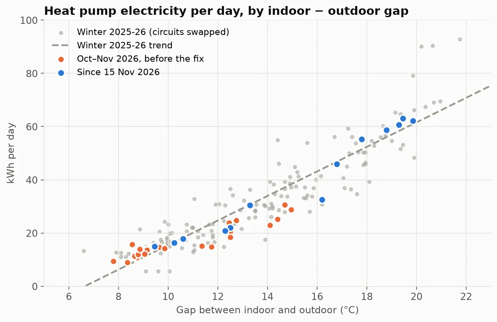
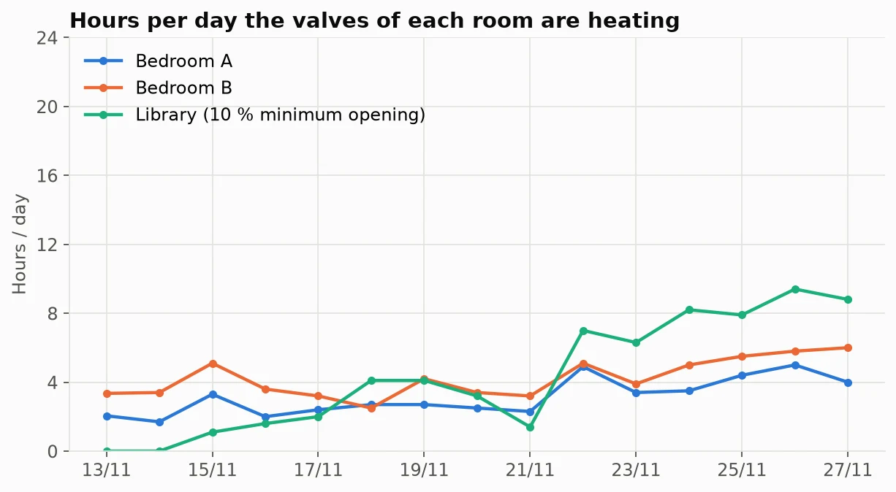

Three weeks ago I told the story of how [Claude and I found out that my heat pump's two circuits had been swapped for five years](/five-years-of-swapped-circuits-my-heat-pump-reviewed-with-claude/). The ground floor underfloor heating was controlled by the upstairs thermostat, the radiators were getting 25 °C water, and the mixing valve that "didn't work in auto" was obeying the wrong circuit. Once the configuration was put right, the house finally heated the way it should.

But fixing the circuits was only the first step. With a heat pump, every extra degree of water costs you efficiency, and now that I had clean data I wanted to know **what water temperature was just enough**. That's what this short series is about:

1.  **The heating curve, tuned with data** (this post): how a heating curve works, which signals tell you the water is too hot, what we changed.
2.  **One valve per room, and a heat pump that only listens to demand**: the Home Assistant automations that control each upstairs bedroom and drive the heat pump, with how often the valves move and what that costs in batteries.
3.  **The winter's verdict**: comfort and consumption over the whole season, compared with last winter. This post already gives a first comparison with last winter.

## The heating curve, in two minutes

A heat pump doesn't make heat: it **moves** it from the outside air into the heating water. The bigger the gap between the two, the harder it works for each kWh of heat. That's why you always want the coldest water you can get away with: the figure often quoted is **2 to 3% of efficiency (COP) gained per degree of water less**.

But a house loses more heat when it's cold outside. The **heating curve** (*OTC* at Hitachi) links the two: it gives the water temperature to produce for a given outdoor temperature. When it's mild the water can be lukewarm; when it freezes you need hotter water.

On my Yutaki each circuit has its own curve, and it comes in two forms:

*   **by points**: two points (for example "50 °C water when it's −10 °C" and "21 °C water when it's +20 °C"), a straight line between them, and a flat section beyond;
*   **by curve**: a straight line starting from 20 °C water at 20 °C outside, rising by a **slope** (0.2 to 2.2) for every degree the outdoor temperature drops. With a slope of 0.6 you ask for 32 °C water when it's 0 °C.

Both can be shifted up or down as a whole (*offset*), and the heat pump adds **room compensation**: when the thermostat's room is below its set point, it pushes the water a bit higher. We measured the effect on 17 Nov: **about 2 °C more water per degree of set point** (set point 17-18 °C → water at 32-33 °C, 19 °C → 36 °C, 20 °C → 37 °C).

One last point changes everything in a house with two circuits: **there's only one compressor**. The heat pump produces water for whichever circuit asks for the hottest, and the floor (C2) then cools its own down by mixing it with its return, through its three-way valve. In my house it's therefore the **upstairs radiators (C1) that set the water temperature for the whole house**. The floor only needs about 31 °C at 0 °C outside. Every extra degree the radiators ask for is a degree the heat pump produces for nothing.

The green dots are the heat pump's actual water set points, averaged per day, during the cold spell at the end of November: they follow the radiator curve almost to the degree. That curve really is the one in charge.

A practical detail: CSNet tells you which *type* of curve each circuit uses, but not its values. Since version 2.14 of the [CSNet integration](https://github.com/mmornati/home-assistant-csnet-home), you can copy the values from the controller into the options, and Home Assistant then shows, for each circuit, the water temperature the curve is asking for right now. That's what lets you see on a chart whether the heat pump is following its curve or whether something else is pushing it.

## The signals that tell you the water is too hot

Nobody tells you "your heating curve is too high". But a well-instrumented house shows it in several ways, and it's by cross-checking these signals that we made progress.

**1. Valve opening time.** Since 11 Nov every upstairs radiator has a connected valve that regulates on its room's sensor (more on that in the next post). If the rooms hold their set point while the valves are closed most of the time, every minute of opening brings in a lot of heat: the water is hotter than it needs to be. From 12 to 14 Nov the bedroom valves were open only **6 to 13% of the time**.

**2. Short heating bursts that overshoot the set point.** When a valve opens, a bedroom gains half a degree in a quarter of an hour, then keeps climbing after it closes, because the radiator stays hot. The result: a sawtooth of nearly a degree around the set point. With cooler water the openings are longer and the temperature steadier.

**3. How fast each room heats up.** Home Assistant now records every heating episode (start, duration, temperature at the start and at the end, outdoor temperature) and derives a median heating rate per room. Today: **2.4 °C/h for one bedroom, 1.3 °C/h for the other, 0.9 °C/h for the library**. The slowest room sets the lower limit: if the water gets too cold, it's the one that won't reach its set point in the morning.

**4. Morning preheat time.** The bedrooms go from 18 °C at night to 19 °C at wake-up. With a 90-minute preheat they get there in about an hour. There's still headroom.

**5. The gap between what the floor asks for and what the heat pump produces.** At the end of November, at 0 °C outside, the heat pump was producing 40 °C water for a floor that asked for 31. The whole difference was for the radiators.

## What we changed, in order

Four changes in two weeks. The chart below places them against the outdoor temperature, the heat pump's water set point and its COP for each day (heat produced divided by the electricity measured by the heat pump's meter).

| Date | Change | Why |
|---|---|---|
| 11 Nov | Circulation pump: fixed 100% speed → ΔT control | Flow too high, supply/return difference of 1 to 2 °C instead of 5. Standby consumption went from about 240 W to 130 W. |
| 11 Nov | Circuits put the right way round | See [the previous post](/five-years-of-swapped-circuits-my-heat-pump-reviewed-with-claude/). Water goes up by about 12 °C at the same outdoor temperature: the radiators finally get enough to heat. |
| 14 Nov | Radiator curve: **60 → 50 °C at −10 °C** (21 °C at +20 °C unchanged) | Valves open 6 to 13% of the time, library at 21 °C for a set point of 19. |
| 16 Nov | Home Assistant drives the upstairs CSNet set point | The wall thermostat was calling for heat all night while every valve was closed. |
| 25 Nov | Heat pump margin: **1 → 0.5 °C** | The valves were heating 3 to 5 h a day, but the heat pump stayed in demand for 15 to 17 h. |

On 11 Nov the water set point jumps all at once: that's the price of radiators that finally heat. On the 14th the new curve brings it back down by 4 to 5 °C. From the 21st it's the cold that pushes it back up, following the new curve.

What stands out on the COP line is above all the **outdoor temperature**: a little over 3 at 9-10 °C outside (17-20 Nov), around 2.2 at 0 °C. To isolate the effect of a change you have to compare days at the same temperature. 14 and 22 Nov both averaged 2.2 °C outside:

| | 14 Nov (curve at 60 °C) | 22 Nov (curve at 50 °C) |
|---|---|---|
| Average water set point | 38.6 °C | 37.7 °C |
| Daily COP | 2.12 | 2.28 (+7.5%) |
| Heat pump electricity | 53.0 kWh | 46.0 kWh (−13%) |
| Upstairs (average) | 20.1 °C | 18.5 °C |
| Ground floor (average) | 19.3 °C | 19.5 °C |

This table needs reading honestly. The gap in water set point is smaller than the curve would suggest (0.9 °C), because on the 14th Home Assistant wasn't yet driving the thermostat set point and room compensation was kicking in. And a good part of the 13% comes from the fact that **upstairs was overheating on the 14th**: 20.1 °C on average, with the library at 21 °C. On the 22nd upstairs is at its set point, with nights at 18 °C. That's exactly the point: stop producing heat nobody asked for.

For the 25 Nov margin change I have **no measurable effect yet**: the average water set point went from 40.3 °C on the 24th to 39.7 °C on the 25th, then 40.2 and 40.1 °C the following days, with a bit colder outside each day. At that scale the day-to-day noise wins. We'll see over several weeks.

## And compared with last winter?

Last winter the house was still running with the circuits swapped: the heat pump made its water for the curve meant for the floor, the three-way valve was on manual, and the circulation pump ran at 100% day and night. What did all these changes really change, compared with that?

**First, a trap.** My first comparison said that last winter the heat pump used **twice as much** at the same outdoor temperature. That was wrong: the "average outdoor temperature" sensor I had built in Home Assistant read **3 to 5 °C too high** last winter (an 8.9 °C average in January, when my Netatmo station and the Ecojoko probe, which agree with each other, said 3.4 to 4 °C). Last winter's "mild" days were actually cold ones. Everything below uses the Netatmo station.

**Water temperature.** Home Assistant did not record the heat pump's water temperatures last winter (those sensors only exist since June 2026). But October and early November 2026, before the fix, had exactly the same configuration: the water was at **24-28 °C** with 5 to 10 °C outside. Today it is at 30-34 °C in the same weather, and around 40 °C when it freezes. The water is therefore **6 to 10 °C hotter** than before: that is the price of radiators that finally heat.

**Consumption.** The heat pump's meter has been the same since October 2024. At the same outdoor temperature:

| Outside | Winter 2025-26 | Since 15 Nov 2026 |
|---|---|---|
| −2 to 0 °C | 69.2 kWh/day · house at 18.5 / 20.0 °C | 62.0 kWh/day · 18.6 / 19.3 °C |
| 0 to 2 °C | 58.0 kWh/day · 19.1 / 19.7 °C | 56.9 kWh/day · 18.7 / 19.4 °C |
| 2 to 4 °C | 43.8 kWh/day · 19.9 / 20.8 °C | 39.3 kWh/day · 19.2 / 19.6 °C |
| 6 to 8 °C | 31.4 kWh/day · 20.5 / 21.5 °C | 24.5 kWh/day · 19.2 / 19.7 °C |
| 8 to 10 °C | 21.8 kWh/day · 20.0 / 20.9 °C | 16.4 kWh/day · 19.0 / 19.8 °C |

*(temperatures: upstairs / ground floor, daily averages)*

We use 10 to 25% less in mild weather, and about the same when it freezes. But the house is not the same: last winter it was **0.5 to 1.5 °C warmer**, and the ground floor climbed to 21-21.5 °C as soon as it was mild, because the floor got its water with no regulation. To compare honestly, consumption has to be set against the gap between inside and outside:

At the same gap, the days since 15 November fall **on last winter's trend**: 501 kWh measured over 13 days, against 510 kWh predicted (−2%, well inside the day-to-day scatter). A little less in mild weather, a little more when it freezes.

In other words: the water is 6 to 10 °C hotter, which costs efficiency, and yet the heat pump does not use more per degree of gap. That extra cost is offset by everything else: the pump that modulates, the heat pump that only heats upstairs when a room asks, nights at 18 °C, and the end of the ground floor overheating. And the house is now **at its setpoint in every room**, instead of 21 °C downstairs and an upstairs that depended on the floor's curve. And now that everything else is in place, every degree of water saved would be a net gain. The question was whether it's worth it.

**And last winter's COP?** CSNet keeps a monthly heat counter since October 2025. Divided by the electricity from the heat pump's meter, it would give a COP of **3.2 to 3.6** last winter, against 2.7 in November 2026. I don't trust it: with the pump at 100% and a supply/return gap of 1 to 2 °C, that counter clearly overstated the heat. It counted 9 to 14 kWh of heat a day in mid-summer, with no heating needed at all, and from 1 to 10 November 2026 it reported 64 to 113 kWh a day, where flow × temperature difference gave 30 to 72. Since the pump went to ΔT mode, the two agree within a few percent over a week. So the wrong pump setting did not only cost electricity: it **also skewed the measurement**. Today's COPs (around 2.2 at 0 °C, 3 at 10 °C) are the first reliable figures for this heat pump.

## Should we go lower?

The best indicator is still the first one: how long do the valves heat each day?

Even during the coldest week (around 0 °C on average, −3 °C at night), the bedroom valves only heat **4 to 6 hours a day**. The library goes up to 8-9 hours, but it's also the room that heats up the slowest, and its valve never closes completely (it keeps 10% open so the water always has somewhere to circulate). In other words, the radiators stay closed three quarters of the time while it's freezing outside. 40 °C water is still hotter than it needs to be.

So there is headroom. For anyone who wants to use it, the method is simple, rather than one big jump:

1.  **Lower the cold point of the radiator curve by 2 to 3 °C at a time** (50 → 47 °C at −10 °C, then maybe 45 °C), leaving the +20 °C point as it is.
2.  **Wait at least a week**, to get both cold and mild days.
3.  **Watch three numbers**: the valves' heating hours (they'll go up, that's the idea), the slowest bedroom at wake-up (it has to reach 19 °C within the 90-minute preheat), and the COP at the same outdoor temperature.
4.  **Stop when the slowest room starts falling behind** on frosty mornings, and go back up one step.

Before doing it, I wanted to know what it would bring. Going from 50 to 47 °C means 1 °C less water at 10 °C outside, 2 °C at 0 °C and 2.5 °C at −5 °C. With the rule of 2 to 3% of COP per degree, that is **4 to 6% less consumption**, mostly when it's cold. Over a heating season of about 5,500 kWh for this heat pump, that's **200 to 300 kWh a year, or 50 to 80 €**. It's an estimate, not a measurement.

On the other side, what we lose: radiators that heat 10 to 15% more slowly, a slightly longer morning preheat, and the risk of a cool room on very cold mornings. The rooms most at risk are precisely the slowest ones: one of the bedrooms (1.3 °C/h) and the library (0.9 °C/h), where the heat pump's thermostat is. Downstairs, nothing would change: the heat pump would still make water hotter than the floor asks for, and the three-way valve would simply open a little more.

**I decided to stay at 50 °C.** 80 € a year isn't nothing, but a house at the right temperature at the right time matters more to us, especially on winter mornings. Today every room holds its setpoint, even at −3 °C, and at the same temperature gap the heat pump uses as much as last winter, but for a house that is finally balanced. The big work was elsewhere: the circuits, the pump, the valves, driving the heat pump. What's left is fine-tuning at the margin, and I prefer to keep it in reserve.

There's also a flaw the heating curve won't fix on its own: the compressor starts **2 to 3 times an hour** for cycles of 8 to 13 minutes. The heat pump (20 kW) is oversized for a house that needs 5 to 6 kW on average when it freezes. Cooler water stretches the cycles a little, but that's a topic for another day.

## What I take away

A heating curve isn't something you set once and for all from the installer's table. The one on my radiators (60 °C at −10 °C) had been there since installation and nobody had ever questioned it: with the circuits swapped, it was useless anyway.

What changed is having **signals that answer the question**: valves that tell you how long they heat, sensors that measure how fast each room warms up, a meter that gives the daily COP. With that, tuning the heating curve is no longer a matter of feel ("it's a bit chilly tonight"), it's a loop: lower it, measure, keep it or roll back.

## Do the same at home, with your AI assistant

My numbers are specific to my house: my radiators, my underfloor heating, an oversized heat pump and bedrooms we like at 19 °C. Copying my curve would not get you far, yours has no reason to land on 50 °C. What travels from one house to another is the recipe below: the signals to look for, the order of the changes, the safeguards, and my real cases as tests. Give it to your own assistant (Claude, ChatGPT, whichever you use), ideally connected to your Home Assistant, and let it start from your history instead of mine.



## How it was done

Several Claude Code sessions with Opus 5.5, spread over two weeks, in the CSNet integration repository and in my Home Assistant configuration repository. Claude read Home Assistant's history (through OpenObserve, which receives all of HA's events and metrics, and through a read-only copy of the recorder database for long-term statistics), computed the valve opening times and the daily COPs, proposed each change with the numbers that justified it, and wrote the automations and sensors (heating rate, heat pump set point, heating curve in the integration). The settings on the heat pump itself I changed by hand on the controller, photographing every screen first. This post was written in a separate session, from that data and the notes from those sessions; the charts were generated from the same data.
