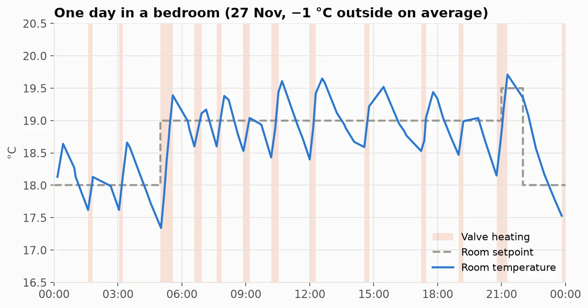
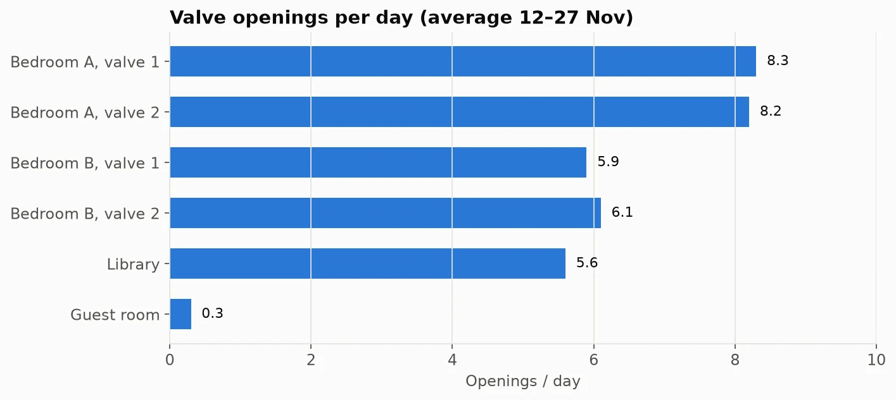
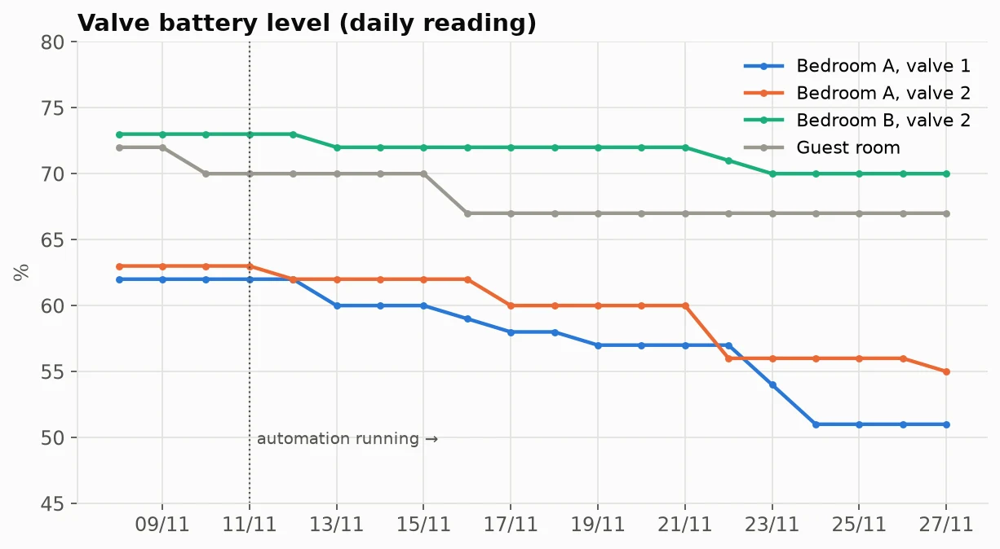

In [the first post of this series](/my-heat-pump-heating-curve-tuned-with-data/), I explained how we tuned my heat pump's heating curve from the data. Quite a lot of that data came from the **upstairs radiator valves**: how long they heat, how fast each room warms up. Three weeks ago those valves gave none of that. This post is about how they became the heart of the upstairs heating.

As a reminder, the house has two circuits on a single Hitachi heat pump: underfloor heating on the ground floor (C2) and radiators upstairs (C1), [put the right way round on 11 November](/five-years-of-swapped-circuits-my-heat-pump-reviewed-with-claude/). Upstairs there are four heated rooms: two children's bedrooms (two radiators each), a guest room and a library, which is where the heat pump's wall thermostat for this circuit lives.

## The starting point: valves that regulated nothing

Each of the six upstairs radiators has a **Sonoff TRVZB** Zigbee thermostatic valve, connected to Home Assistant through Zigbee2MQTT. On paper, then, every room could have its own temperature. In practice, on 11 November, the data told a different story:

*   the valves measured temperature with **their own sensor, right next to the radiator**. It read 22 to 25 °C in bedrooms that were at 19 °C. To get the rooms to heat anyway, their setpoints had been pushed up to 22-27 °C: they were simply **wide open, all the time**;
*   the library's wall thermostat, set to 19.5 °C, read 18-18.5 °C at night and **called for heat almost constantly**. The upstairs temperature depended on nothing but the heating curve;
*   every bedroom sat at 18.5-19.5 °C day and night, occupied or not.

The idea was to make the two levels work together: **each room controls its own temperature**, and **the heat pump only heats upstairs if a room needs it**.

```
room sensors ──► setpoint per room ──► TRVZB valves (room sensor)
                     │
                     └──► upstairs demand ──► CSNet setpoint ──► heat pump
```

## First level: each valve regulates on its room

### The room's sensor, not the radiator's

The TRVZB can use an external temperature: you switch its sensor selector to `remote_temperature` and write the room temperature into its `external_temperature_input`. An automation does this for each valve, from the Zigbee sensor in its room (both valves in a bedroom get the same value):

*   every time the sensor changes by 0.1 °C or more;
*   **every 30 minutes**, even without a change: without this heartbeat, the valve treats the value as stale and falls back to its internal sensor on its own (`remote_source_offline`);
*   when Home Assistant starts, and as soon as a valve falls back to its internal sensor (which happens a few minutes after a Zigbee2MQTT restart).

If the room sensor fails (unavailable, silent, or reporting nonsense), the valve goes back to its internal sensor with a fallback setpoint of 24 °C, since that sensor reads 3 to 6 °C too high, and Home Assistant sends me an alert.

### The reopening gap

The TRVZB is all or nothing: open or closed. By default it reopens when the temperature drops **1 °C below the setpoint**. A bedroom set to 18 °C at night would therefore drop to 17 °C before heating. The automation keeps this parameter (`temperature_accuracy`) at **−0.4 °C** on the bedroom valves. The temperature then swings between the setpoint minus 0.4 °C and a little above the setpoint, since the radiator keeps heating after the valve closes.

### A setpoint per room, based on time and presence

For each room, a template sensor computes the setpoint, along with a mode and the reason for the choice, taking the first rule that applies:

| Order | Situation | Mode | Default setpoint |
|---|---|---|---|
| 1 | House in holiday mode | eco | 16 °C |
| 2 | Guest room not occupied | eco | 16 °C |
| 3 | Window open (sudden temperature drop) | frost protection | 12 °C |
| 4 | From 22:00 until wake-up minus preheat | night | 18 °C |
| 5 | One hour before night (bedrooms) | bedtime | 19.5 °C |
| 6 | Otherwise | comfort | 19 °C |

Wake-up is at 06:30 on school days (a sensor follows the zone B French school calendar) and at 08:30 otherwise. The **preheat** starts 90 minutes earlier: at first it was 45 minutes, and the bedrooms only reached 19 °C an hour to an hour and a half after wake-up. The guest room stays at 16 °C until a "guest room occupied" switch is turned on; it then follows the profile of a child's bedroom on a day without school.

One detail that mattered: a child's "holidays" switch means "they're at home and not leaving early for school", not "their room is empty". Their room then follows the 08:30 wake-up instead of dropping to 16 °C. Only the whole-house holiday mode empties it.

All the settings (temperatures, times, preheat, gap) are helpers that can be changed from the dashboard, and the automations have no hard-coded numbers. To spare the batteries, a setpoint is only sent to a valve if it changes by at least 0.25 °C.

### The library, the odd room out

There is **no hydraulic bypass** upstairs. If every valve closes while the heat pump is pushing water through the circuit, the water has nowhere to go. And the heat pump's wall thermostat is in the library: it needs to feel the heat. So the library valve regulates on its sensor like the others, but **never closes completely**. The minimum opening went from 30% to 20%, then to **10%**: at 30%, the room stayed at 20.5-21.4 °C for a 19 °C setpoint, with the valve "closed".

Here is what a day looks like in a bedroom, on 27 November, with an average of −1 °C outside:



The whole system is there: the preheat at 05:00 that takes the bedroom from 17.4 to 19.4 °C in half an hour, the sawtooth during the day (the valve opens for a quarter of an hour, the room gains almost a degree, then slowly drifts back down), the "bedtime" setpoint at 21:00 and the night at 18 °C. You can also see that the water is still a bit too hot: openings this short and an overshoot like that are the headroom the [first post](/my-heat-pump-heating-curve-tuned-with-data/) talks about, and that I chose to keep for comfort.

## Second level: the heat pump only heats upstairs if a room asks for it

With valves that actually regulated, one problem remained: the library's wall thermostat was still deciding on its own when the heat pump heated upstairs. Between 13 and 16 November it **called for heat all night**, while every bedroom valve was closed. The heat pump's water then stayed 6 °C hotter than the floor needed, for nothing.

Since 16 November, Home Assistant drives that thermostat's setpoint:

*   a binary sensor `chauffage_etage_demande` (upstairs heating demand) turns on when **a valve in an active room is heating** (with, as a fallback, a room more than 0.7 °C below its setpoint). It only turns off after **15 minutes without demand**, so the radiators can finish their cycle and the circuit doesn't short-cycle;
*   when there is demand, the CSNet setpoint becomes **the temperature read by the thermostat + 0.5 °C** (1 °C until 25 November);
*   without demand, it becomes **the reading − 1 °C**;
*   it is only rewritten if it moves by at least 0.5 °C.

Why "reading ± something" rather than a fixed setpoint? Because the wall thermostat is no longer there to measure comfort: the library has its own valve and its own setpoint. It works **as a switch**, and the most reliable way to turn it on or off is to put its setpoint just above or just below what it reads.

The next day, the data brought a surprise: lowering the setpoint **doesn't stop circuit C1**. The circuit's demand and its circulation pump stayed on all night. What the setpoint does do is shift the water temperature, by about 2 °C per degree: 37 °C water for a 20 °C setpoint, 32-33 °C for 17-18 °C. So the control is less "on/off" than planned, but it lowers the water temperature when nobody is cold, and that's what matters for efficiency. The first version also counted a room as "in demand" as soon as it dropped 0.4 °C below its setpoint, which kept the demand on too often: since 17 November, the valve decides.

The automation has three modes: `actif` (it writes to CSNet), `observation` (it computes without writing) and `manuel` (it doesn't touch anything). When leaving active mode, it puts back a fallback setpoint of 19 °C. It never changes the heat pump's mode, and writes nothing if the thermostat isn't in heating mode. In practice it sends **22 to 31 setpoints a day** to the CSNet cloud, a bit more than one an hour, and every write is recorded in the Home Assistant logbook with its reason.

## What the house learns along the way

Two sensors record what happens, without controlling anything for now:

*   **wake-up times**: for each bedroom, the first light switched on in the morning (bathroom excluded: the dog sets off the motion sensors every night, so they're left out), sorted by day of the week and by type of day (school or not). The sensor gives the median of the last six mornings of each type. The November data showed that one child gets up around 06:00-06:15 on school days, not 06:30 as planned, and around 07:35 at the weekend, not 08:30;
*   **the heating rate** of each room: every heating episode is recorded (start, duration, temperature at the start and the end, outdoor temperature, minutes to gain 0.5 °C), and the sensor keeps the median of the last twelve. Today: **2.4 °C/h** for one bedroom, **1.3 °C/h** for the other, **0.9 °C/h** for the library. The ground-floor underfloor heating is too slow to gain 0.5 °C during an episode: its inertia is counted in hours.

The next step is to use them: a preheat computed for each bedroom from its learned wake-up time and its heating rate, instead of 90 minutes for everyone. A bedroom that warms up at 2.4 °C/h doesn't need an hour and a half to gain one degree.

## And when we open the windows?

A question I had: when we air the rooms, while cleaning for example, the automation cuts the room's heating. Fine, we don't heat the street. But if the room then takes hours to get back to temperature, that's a shame, and maybe not even that economical overall.

**How it works.** There are no contact sensors on the upstairs windows. In the two children's bedrooms, a Home Assistant trend sensor watches the room temperature: if it sees it fall by more than **3.6 °C in 30 minutes**, it assumes a window is open, and the room's setpoint switches to frost protection (12 °C). As soon as the temperature stops falling (window closed), the sensor drops back and the normal setpoint returns immediately. So the cut lasts as long as the airing, no longer.

**What the data says.** I looked for every fast temperature drop in the four upstairs rooms since 12 November. Result: **no real airing** detected in 16 days, and only two triggers, both false:

*   on 14 November at 07:58, in one bedroom, the room sensor dropped off the Zigbee network for a minute and came back with a lower value. The trend sensor saw a drop, and since the temperature then barely moved, it **stayed on for two hours**. The room went from 18.1 to 17.9 °C in that time, then climbed back to 19 °C **in 53 minutes** once the setpoint came back;
*   on the evening of 22 November, in the living room, a 0.1 °C change was enough to trigger it. Downstairs, this sensor does not drive the heating.

The 3.6 °C in 30 minutes threshold is therefore quite strict: a wide-open window in winter crosses it, a window left ajar probably doesn't. And the real flaw isn't how long the recovery takes, but a sensor that stays stuck when readings become sparse. A time limit (30 to 45 minutes of frost protection at most) would fix that.

**How long to recover?** With no real airing measured, the heating rates give an order of magnitude. For **2 °C lost**, it takes about **50 minutes** for the fastest bedroom (2.4 °C/h), **1 h 30** for the other one (1.3 °C/h) and a little over **2 hours** for the library (0.9 °C/h). In practice, after a short airing it's often faster: the air cools quickly, but the walls and furniture keep their heat and give it back to the room. That's a long way from the 10 hours I was afraid of, at least upstairs. Downstairs is another story: the underfloor heating takes hours to react, and there is no automatic cut. I don't yet have a clean measurement of an airing downstairs.

**And the savings?** Cutting the heat while airing is still the right choice. The air in a bedroom holds very little heat: warming it by 3 °C takes a few hundredths of a kWh. What costs is heating while the window is open, since the heat goes straight outside, and walls cooling down when the airing goes on. And a room that has cooled loses less heat while it's cool: bringing it back never costs more than what was saved by letting it cool. The only real price is comfort during the recovery. Good practice doesn't change: **air wide and short** rather than leaving a window ajar for a long time.

Next step: log a few real airings, cleaning included, to measure the actual recovery, downstairs as well as upstairs, and add that time limit to the frost protection mode.

## How often the valves move, and what it costs in batteries

This was the question that worried me most: a valve that really regulates moves much more than a valve stuck wide open, and every motor movement is paid for in batteries.



On average over the first 16 days, each bedroom valve opens **6 to 8 times a day** (and closes as many). Bedroom A, which heats up fastest, does the most cycles and the shortest ones. The guest room, at 16 °C and unoccupied, almost never opens. The setpoints, on the other hand, only change **2 to 3 times a day** (night, preheat, bedtime). The rest of the radio traffic is the room temperature, sent on every 0.1 °C change and every 30 minutes.



The result is fairly clear, even if these valves' battery percentage is coarse and moves in steps:

*   the two valves in bedroom A, the busiest ones, lose **about 0.5% a day** since the automation started (from 62-63% to 51% and 55% in two weeks). At the same pace, the lowest one will be empty in about three months, so towards the end of winter;
*   the valves that move less lose 0.1 to 0.2% a day;
*   before 11 November, when the valves stayed open, the levels barely moved.

That's the price of fine-grained control, and I find it reasonable: one set of batteries per winter for the hardest-working valves. There are two levers if it becomes a nuisance: widening the reopening gap (−0.4 °C → −0.6 °C: fewer cycles, a bit more swing), and spacing out the external temperature heartbeat. A lower heating curve would help too: longer heating cycles mean fewer openings.

## And comfort?

This is the easiest part to sum up. Since mid-November, the bedrooms have stayed between **18.5 and 19.5 °C** during the day and around **18 °C at night**, right on the setpoint, including during the freezing week at the end of November (−3 °C early in the morning). Downstairs, the living room is between 19 and 20 °C **87% of the time**, against 69% on 9 and 10 November. The library, which used to be at 21 °C all day, is back to its setpoint.

## What I take away

Connected thermostatic valves regulate nothing on their own if they measure the temperature in the wrong place. I thought I had "room by room" heating: in reality, I had six open valves and a wall thermostat deciding everything. It took three things to make it work: **the room's sensor** in each valve, **a setpoint that depends on how the house is lived in**, and **a heat pump that listens to the rooms** rather than to a single thermostat.

And, as often happens, the most useful part wasn't planned: these valves have become the best sensor in the house for telling whether the water is too hot.

The third and last post will be the winter's verdict: comfort and consumption over the whole season, compared with last winter (the [first post](/my-heat-pump-heating-curve-tuned-with-data/) already gives a first comparison).

## Do the same at home, with your AI assistant

My configuration is specific to my house: my valves, my wall thermostat, my children's schedules, an upstairs circuit with no bypass. Copying it would not get you far, you would have to rewrite most of it. What travels from one house to another is the recipe below: the intent, the rules, the safeguards, and my real cases as tests. Give it to your own assistant (Claude, ChatGPT, whichever you use), ideally connected to your Home Assistant, and let it start from your devices instead of mine.



## How it was done

Several Claude Code sessions with Opus 5.5, between 11 and 25 November, in the repository of my Home Assistant configuration. Claude analysed the history (valves, room sensors, CSNet thermostat, lights for the wake-up times), proposed the two-level plan, and wrote the `chauffage_etage` package and the Jinja macros, with tests that replay real data in the production Home Assistant image before every pull request. Each correction (reopening gap, library minimum opening, preheat, valve-based demand, heat pump margin) started from a review of the previous days' data. The answers to questions about life in the house (what time the children get up, the dog, the holidays) came from me. The numbers and charts in this post were pulled from the Home Assistant history in a separate session.
