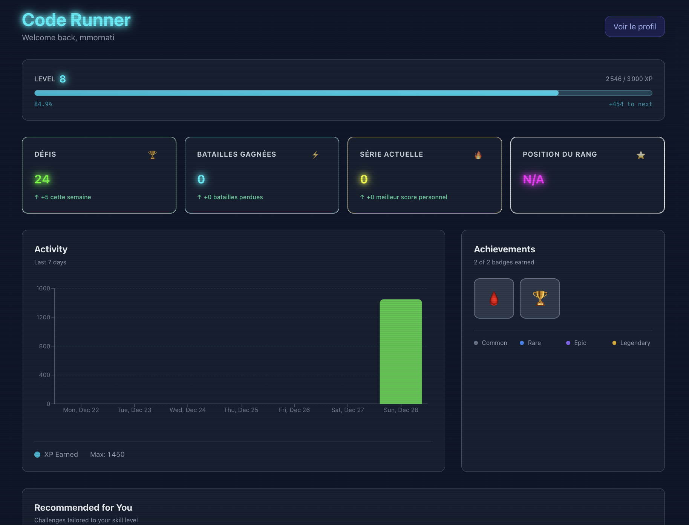
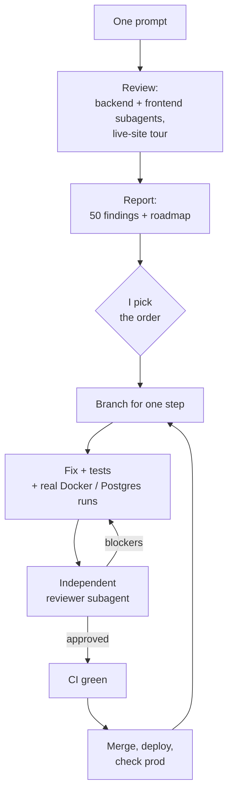

In December 2025 I built [Cyber Code Academy](https://play.pygame.ovh/), a small game to learn Python, for my son and his classmates. I built it in five days with **Cursor** and **GitHub Copilot**, in what I called ["pure vibe coding"](/building-cyber-code-academy-a-pure-vibe-coding-experiment/). Then, in January, I used **Antigravity** to [write custom penetration tests](/vibe-coding-custom-penetration-tests-when-ai-becomes-your-security-partner/) and wrote a whole post on [how the Python sandbox was secured](/securing-python-code-execution-how-we-protected-our-server-from-untrusted-code/).

My goal was security first, even if the stakes are low. There's no personal data in the app (only a username), and nothing valuable on the server. I wanted to see how well AI does at security checks, and I checked what it produced myself. In the first post I even wrote that security *"seemed to be auto-managed"*.

The app is about to turn one. Before deciding whether to keep it running, I looked at the numbers. They're small (49 accounts, 756 submissions), but a few people still use it. So I tried something: **what does a model one year younger, and much stronger, think of this code?** I opened Claude Code with **Opus 5.5** and wrote one prompt.

The answer was, more or less, *WTF*.

## 1. What "the models of one year ago" means

I don't remember exactly which model was behind each Cursor or Copilot session. I switched often, and the tools sometimes chose for me. This is what was on the menu in December 2025:

| Vendor | Models available in December 2025 |
|---|---|
| Anthropic | Claude Sonnet 4.5 (September), Haiku 4.5 (October), **Opus 4.5** (24 November) |
| OpenAI | GPT-5 (August), GPT-5.1 and GPT-5.1-Codex-Max (November), **GPT-5.2** (11 December) |
| Google | **Gemini 3 Pro** (18 November), the default model of Antigravity, launched the same day |
| Cursor | Composer 1, Cursor's own coding model (October) |
| China | DeepSeek V3.2, Kimi K2 Thinking (Moonshot), MiniMax M2, GLM-4.6 (Z.ai, with GLM-4.7 on 22 December), Qwen3-Coder (Alibaba) |

Those were the best models of their time. Opus 4.5 was the first model above 80% on SWE-bench Verified (80.9%). So this isn't a story about weak tools. It's about how much changed in one year.


**What "one prompt" means here.** One message started each session. I still answered the questions the model asked: which redesign to pick, in what order to fix things, and signing in to Coolify myself when it needed the server logs (it can't type passwords). Every bug below is fixed and merged (the gameplay plan at the end is still to do), and nothing was ever tested against production as an attack.


## 2. The prompt

This is the full prompt, typos included:

> Make a full review of the project to identify all the improvements, security fix, ...
> Then using the /impeccable:impeccable skill propose a complete graphical refactor in a WOW effect mode in line with the style of the project.
> You can see the pages on https://play.pygame.ovh/ (I can log you in to make a check everywhere)

Impeccable is a design skill for Claude Code. The second half of the prompt is about the redesign, which I'll come back to. The first half produced this.

About ten minutes later, the session had:

- run two code reviews in parallel, one on the backend and one on the frontend, each by its own subagent;
- toured the live site, public and logged-in pages;
- published a report with **50 findings: 2 critical, 12 high, 22 medium, 14 low**, plus a roadmap.

Here are the first lines of its summary:

> **Anyone can manage challenges without logging in.** [...] I confirmed this in the code but did not try it against production.
>
> **User code can fake its own test results.** It can break out of the restricted builtins, print a fake `{"passed": true}` line, and pass any challenge or battle.

## 3. The two critical bugs

### Anyone could edit the catalogue

`POST`, `PUT` and `DELETE /api/v1/challenges` had **no authentication at all**. Anyone with `curl` could delete every challenge, or publish a 1000 XP challenge with no tests. A challenge without tests always passed.

There's no clever exploit here, just three endpoints with no `Depends(require_admin)`. The admin section had its own [blog post](/behind-the-scenes-the-admin-section-of-cyber-code-academy/), and the admin *pages* checked the role. The API behind them didn't. The custom pen tests from January covered JWT manipulation, SQL injection and sandbox escapes. None of them tried calling the endpoint without a token.

### Any learner could fake their own results

This one hurts more, because I wrote a whole post about it. The sandbox runs the learner's code with a restricted `__builtins__` dictionary. The post explained why `getattr(__builtins__, 'exec')` fails: `__builtins__` is a dict with only safe functions, not the real module. That's true. But a built-in function remembers the module it comes from:

```python
print.__self__   # the real builtins module, with exec, __import__, open...
```

On top of that, the learner's code ran **in the same interpreter as the tests**, and the backend read **the last JSON line printed** as the result. So the code didn't even need to escape the sandbox. It could print a result line that said every test passed. The same trick could read the hidden tests.

The January pen tests checked exactly the attack the January post described, and that attack failed. Nobody, human or AI, asked the next question.

The fix rebuilt the harness:

- the learner's program and each test run in **separate child processes**;
- for comparisons like `assert add(2, 3) == 5`, the value is compared **in the parent**, so the expected answer never reaches user code;
- the final result carries a **per-run nonce**, and the backend ignores every other line;
- the harness marks itself non-dumpable, so a child can't read its memory through `/proc`;
- containers get a PID limit, `no-new-privileges`, a `noexec` tmpfs, and are killed on timeout.

The session then attacked its own fix in a real container. A forged result was rejected. `/proc/1/mem` returned `PermissionError`. Fork bombs were killed, with no containers left behind. All of this is now a smoke test in CI.

## 4. The "stupid" bugs

The critical bugs have a story. Most of the others are bugs any careful reviewer would have caught. The older models, and I, didn't.

| Bug | What it did |
|---|---|
| The rate limiter used the **first** `X-Forwarded-For` entry | That entry comes from the client, so changing the header gave unlimited login attempts |
| …and turned itself **off** when Redis was unreachable | Redis was unreachable in production: it had a password, and the backend connected without one |
| 15 challenges seeded with `padawan`, `knight`, `master` | The API only accepts `initiate`/`hacker`/`elite`/`legend`, so those pages returned HTTP 500 |
| `get_current_user` loaded the user in a DB session that was already closed | Every change to the current user was **silently lost** |
| Streaks were **never computed** | The streak badges were impossible to earn (my December screenshot below shows "current streak: 0") |
| A battle could be won with a 0 ms time | The time came from the client, and skipping `/start` meant no time at all |
| Two passing submissions at the same moment | Both counted as the first success: double XP |
| A free hint route next to the paid one | It marked hints as revealed without charging, then the paid route served them for free |
| Login tokens in `localStorage` | Any XSS could steal a long-lived refresh token |
| `create_admin.py` without `--password` | It fell back to a hardcoded `admin123` hash |
| The API container ran as root with the Docker socket mounted | Root on the API was root on the host |
| No CI, 158 failing tests on `main` | One test file even had committed merge-conflict markers, so pytest couldn't load it |
| Battle history | Every battle was listed twice |
| The dashboard | It showed raw keys like `dashboard.dashboardActivity.title` |
| Ctrl+Enter in the editor | Wrong keycode, and a stale closure behind it |



Two of the production problems (the 500s and the empty leaderboard) only made sense with the server logs. The session asked me to sign in to Coolify in the browser pane, then read the tracebacks itself: `input_value='padawan'` for one, `redis.exceptions.AuthenticationError` for the other. It also counted, through the public API, how many challenges were affected (15 of 180).

## 5. How it fixed everything

I asked for one pull request per roadmap step, each reviewed by **a separate subagent** that gets the diff and the goals but not the author's conclusions, then a merge once CI is green. The session followed that loop for a day:



The steps, in order:

1. **Security hotfix:** auth on challenge CRUD, the new sandbox harness, the rate limiter, and the first CI.
2. **Security follow-ups:** what the independent reviewer found in step 1.
3. **Production fixes:** a migration for the 15 broken challenges plus a `CHECK` constraint, the translations, the security headers (HSTS, CSP), and readable API errors.
4. **Game integrity:** row locks and SQL increments for XP, server-measured battle times, single-use refresh tokens, case-insensitive unique usernames, streaks, and the same bcrypt work at login whether or not the username exists.
5. **Backend hardening:** refusing to start with placeholder JWT secrets, a migration script that stops the boot instead of "continuing anyway", no more `str(e)` in 29 error responses, and `bcrypt` in place of the unmaintained passlib.
6. **An executor gateway:** the only container with the Docker socket. Its options are fixed (no network, read-only, `cap-drop ALL`), so even a leaked token can only run sandboxed code. With the gateway, the API runs as an unprivileged user with no socket. The session also *rejected* the obvious fix, a generic Docker socket proxy, because anything that can reach one can start a privileged container.
7. **Auth:** the refresh token moved to an `HttpOnly; Secure; SameSite=Strict` cookie and the access token is kept in memory, with a migration that logs nobody out.
8. **Tests:** the 158 quarantined backend tests fixed and back in CI (431 passing), and every frontend suite running too.
9. **The redesign:** the design foundations, then four slices (more below).

That's **13 merged pull requests in about 24 hours**, each with tests, a review, and a list of what was checked by hand, like the migration run on a real Postgres 15 or the race conditions replayed on Postgres 16.

### Where the stronger model was wrong

It wasn't perfect, and I want to be precise about that.

- **Fixing one bug made another one live.** Once `get_current_user` used the request's DB session, user changes were finally saved. That included a hint penalty that was charged on *every* reveal. Step 1 had been merged with its first commit only, so this was live in production for about two hours. The session noticed it from the deployed version and made the follow-up PR urgent.
- **Its first lock didn't lock.** In the integrity step, the independent reviewer proved on a real Postgres that a battle could still be completed twice: `SELECT ... FOR UPDATE` returned the object already loaded in SQLAlchemy's identity map, without reloading it. It was fixed and re-checked with concurrent runs.
- **A process clean-up race** in the new sandbox was flagged by the automated security review that runs on each commit. It was fixed with an atomic `kill(-1)` loop.
- **The first production dry-run of a data script crashed**, before writing anything, because one database model wasn't imported.

None of these reached users for long, because of how the work was set up: a reviewer that didn't write the code, real databases instead of mocks, and nothing merged on red. A stronger model still makes mistakes. You need that setup to catch them.

## 6. The redesign

The second half of the prompt asked for a "WOW" redesign. The design skill asked me a few questions about who uses the app (teenagers and adult beginners), then proposed three directions on a decision page. I picked **Holo Deck**:

- every challenge is a collectible card;
- difficulty is the card's rarity;
- solving a challenge turns the card holographic, with a foil that follows the cursor;
- the tests light up one by one before the card flips.

First came the design foundations (tokens, an accessible dialog, WCAG AA contrast). Then four slices: the landing page, the challenge catalogue as a binder, the challenge player as a card table, and the ghost battles. Each slice had a design review and a code review. The landing page now looks like the cover of this post. Compare it with the December screenshot above.

There's one disclosure: the skill's image generation failed (its API key had no credit left), so the whole redesign was built from code, not from generated mockups.

## 7. The second prompt: the exercises themselves

The first session fixed the platform. Today I opened a second session about the content:

> can you make a review on the list of challenges, tests, ... review and fix several if needed and then propose a full rework, additions, ... to have a good an complete website making a cool way to learn python.

It connected to the production database, dumped the **198 challenges**, and wrote a harness that grades every reference solution and every starter code with the real executor. Then it replayed all **756 historical submissions**.

The reference solutions were all correct. **The tests and the instructions were not.** Every one of those exercises had been generated by AI and reviewed (too fast) by me.

- **The instructions didn't say what the tests checked.** *String with Spaces* tests a variable called `message` that nobody was told to create: 6 of 41 attempts passed. *AND Operator* expects the text `In range`, which appears nowhere in the instructions: 2 of 10 passed. *Grade Calculator* never says what the grade thresholds are. The French text of one exercise asks for `'Hello, World !'`, with the French space before the `!`, and the test expects the English version.
- **Many exercises could be passed without solving them.** 87 of the 180 published challenges passed if you just printed the expected answer. None had a hidden test. *Print Empty Line* passed with an empty file.
- **The grader was too strict.** A trailing space at the end of a line failed a correct answer, for example the `print('*', end=' ')` grid in *Nested Loops*.
- **Old grading bugs.** In December and January, correct code was marked as failed (23 identical correct submissions on *Fix Indentation Error*). That was already fixed in today's code, but 8 learners never got the credit.
- **Run and Submit disagreed.** The browser's Run button allows `import math`, but the grader on Submit doesn't, so code could work and then fail.
- **The daily challenge has never run.** Six badges depend on it, but its feature flag is off and no background worker is deployed.

The fixes are as careful as the first session's: one shared `normalize_output()` used by both Run and Submit, and **83 content fixes** with **115 new hidden tests**. The expected values are computed from the reference solutions under the sandbox's builtins. Before writing to the database, the script grades each patched challenge: the solution must pass and the starter code must fail. It took a backup of the table, did a dry-run against production, then applied the fixes and ran a second dry-run, which found nothing left to change.

Replaying old submissions against the new tests found one more thing I like a lot: a learner's `find_max` that starts from `0` and fails on a list of only negative numbers. It had passed, because the old tests only used positive numbers. That's a classic beginner mistake, and the exercise is supposed to teach it.

The session ended with a plan in four phases to make the game worth coming back to: turning on the daily challenge, safe imports, a guided first lesson, "predict the output" exercises, mastery stars, a story campaign, weekly leagues. Those are next.

## 8. A weaker driver, and models that needed driving

To be fair to the older models, the person driving them was learning too. In December 2025 I was new to this way of working, and I wasn't a strong "AI driver". Those models needed a lot of guidance to do good work:

- rules files and long `AGENTS.md` instructions;
- small, precise prompts, one task at a time;
- an explicit list of what to check ("test the `getattr` escape", "try SQL injection on login").

I gave them some of that, not all of it. They did what I asked, and what I asked was too narrow. The January pen tests are a good example: they found and fixed every attack *I* listed.

The prompts in this post are the opposite: one vague message, with typos, and "..." where the details should be. The model filled in the method by itself. It split the review across subagents, read the logs, checked the data in production, wrote a roadmap, asked me the questions that mattered, and attacked its own fixes. A year ago, I would have had to write all of that into the prompt, or into a skill.

Benchmarks tell the same story:

| | End of 2025 | Today (November 2026) |
|---|---|---|
| SWE-bench Verified | Opus 4.5: 80.9%, the first model above 80% | Saturated: Opus 5 is reported at about 96% |
| SWE-bench Pro, harder and less contaminated | Gemini 3 Pro: about 43% | Opus 5.5: 89.9% |
| METR time horizon (length of task a model completes half the time) | Opus 4.5: about 5 hours | About 12 hours already in early 2026, doubling about every 3–4 months |

Anthropic presents Opus 5.5, released on 22 September 2026, as especially good at long jobs like codebase-wide audits. Testers say it keeps digging past the first plausible answer. That matches what I saw here. The table mixes sources, and benchmarks aren't my app, so read it as a direction, not a measurement. Sources: [Anthropic, Opus 4.5](https://www.anthropic.com/claude/opus), [Anthropic, Opus 5.5](https://www.anthropic.com/claude-opus-5-5), [BenchLM, Opus 5.5](https://benchlm.ai/models/claude-opus-5-5), [Developers Digest, SWE-bench boards](https://www.developersdigest.tech/benchmarks/swe-bench), [Vals.ai SWE-bench Verified](https://www.vals.ai/benchmarks/swebench), [METR, Time Horizon 1.1](https://metr.org/blog/2026-01-29-time-horizon-1-1/) and [METR, Frontier Risk Report](https://metr.org/blog/2026-05-19-frontier-risk-report/).

## 9. What I take from it

- **"Security seemed to be auto-managed"** was wrong, and the way it was wrong is interesting. The older models secured exactly what I asked about (the namespace escape, JWT, SQL injection) and tested exactly that. The critical holes were one step to the side: an endpoint without a check, and a result that came from the attacker's own output.
- **The stronger model didn't stay on my threat model.** It read the whole code, the deployment, the logs and the data, and asked "who can reach this, and what does the backend trust?" for each piece.
- **The method mattered as much as the model.** One PR per step, an independent reviewer, real Postgres and Docker instead of mocks, and a dry-run before touching production. That's what caught the new model's own mistakes.
- **The content was AI-generated too, and nobody checked it against real learners.** The session that looked at real submissions found more problems than any review of the code.
- **Less guidance, not no guidance.** I gave one prompt, but I still chose the order, set the review rules, made the server changes and followed the PRs. The difference is that I now steer the work instead of writing the method.
- **The verdict:** the app stays online. With 13 PRs, a sandbox I now trust, fairer exercises and a new design, it's a much better app than it was a year ago.

## How it was built

Two Claude Code sessions with Opus 5.5, each started from the one prompt quoted above. The first (*Project review and graphical refactor*) ran from the evening of 2 November to the evening of 3 November and produced the report and 13 pull requests (fixes and redesign), with independent reviewer subagents and a separate session for the last redesign slices. The second (*Python learning platform review and rework*) took about half an hour and produced the content review, the grader fix and the 83 challenge fixes applied to production. My part was answering its questions, signing in where it needed me, making the configuration changes on the server, and following the pull requests as they went by.
