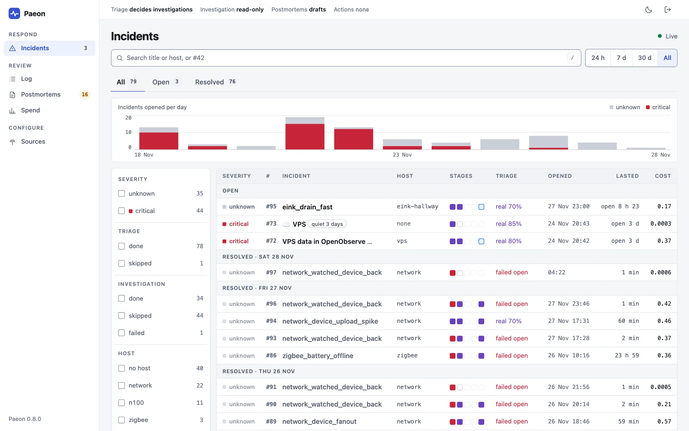
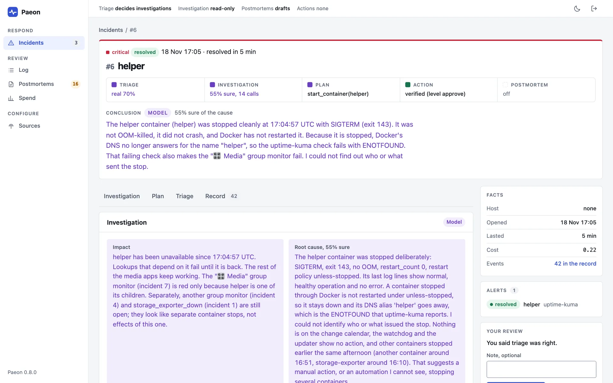
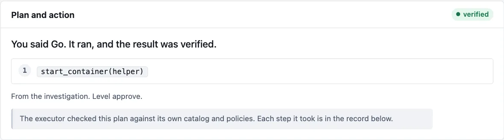
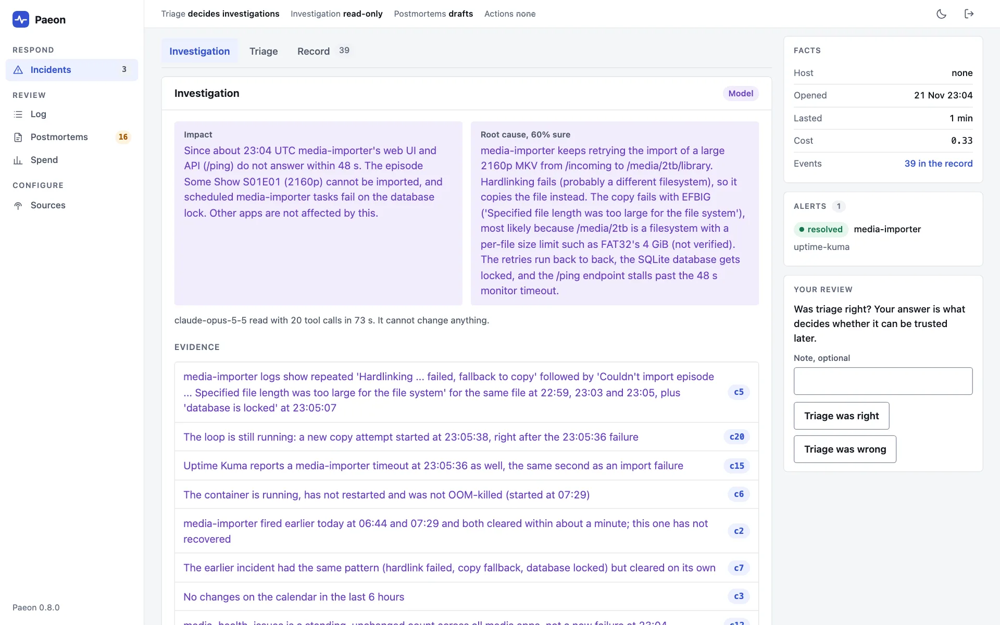
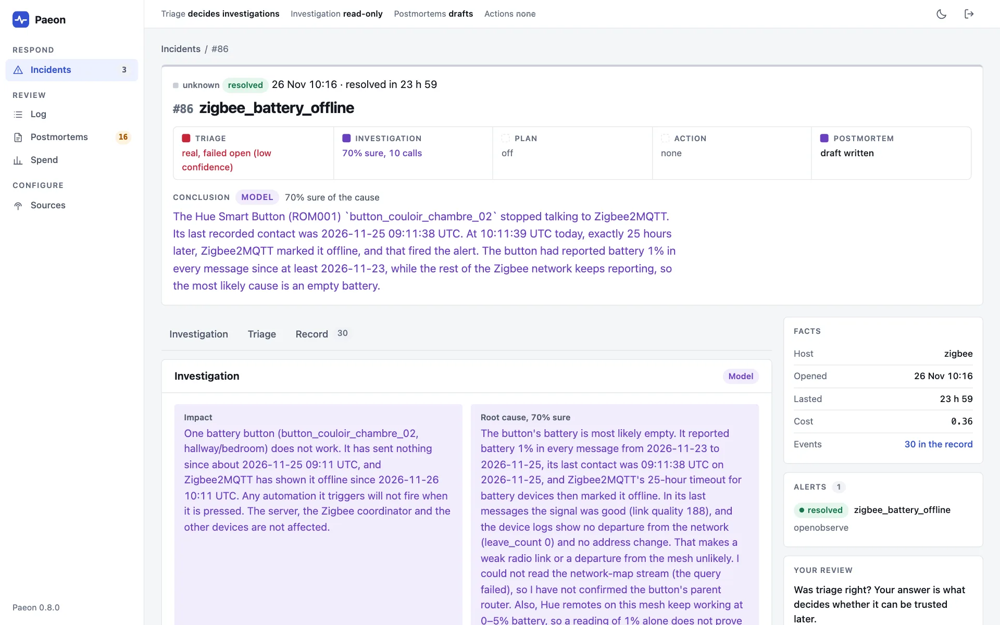
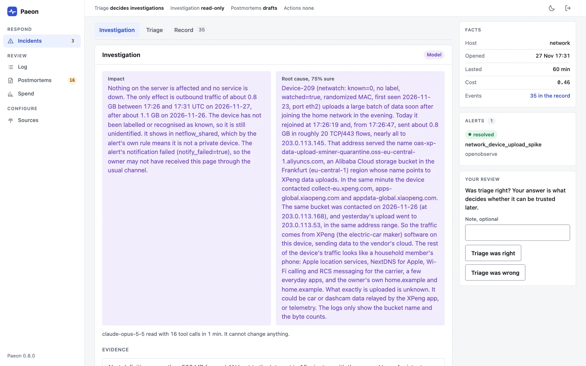

Ten days ago I wrote about [Paeon](/paeon-an-on-call-colleague-for-my-home-server/), the on-call colleague I built for my home server. That post was careful: every screenshot came from demo data, and I said clearly that the part that *acts* had not run long enough to call it proven.

Now it has. Paeon has been running on my server since 18 November, with real alerts, real models and real money. This post is the report: what it caught, what it missed, what it cost, and what I changed because of it. Spoiler: most of what I changed was not Paeon. It was my alerts.


**The screenshots below come from the real server**, not from demo data. I ran the console locally on a copy of the event log in which I removed or renamed what is private: addresses, domain names, device names, and a part of my media stack that I'd rather keep to myself. So `media-importer` or `helper` are not the real names of the containers. Their story is real.


## The numbers first

Between 18 and 28 November:

| | |
|---|---|
| Incidents | **97** (from 107 alert firings) |
| Investigations | **42**, by Claude Opus, with read-only tools |
| Triage verdicts | **89**, by Claude Haiku |
| Plans proposed | 13, of which **2 ran after my Go**, both verified |
| Postmortem drafts | 37 |
| Model cost, all stages | **13.48 USD**, of which **0.04 USD** for triage |

Two things jump out of this table, and they are the whole post in short.

**Triage is almost free.** 89 verdicts for four cents. All the money goes to investigation. So the job of triage is not to be clever, it's to decide well *who deserves an investigation*.

**The 97 incidents were not 97 problems.** Far from it.

## The weekend that went wrong (on purpose, almost)

On Saturday 21 November I did some maintenance by hand: a restart in the morning, a deployment, then a redeployment of my media apps at 07:29 that I didn't announce to Paeon. On Sunday the weekly updates ran. Add a Wi-Fi blip, a busy CPU and a Zigbee sensor in a bad mood, and Paeon opened **39 incidents in two days**.

On Sunday morning I asked Claude Code to read all of them, with their triage and their investigations, and to sort them by cause. The answer was humbling:

* **3 of 34** (the weekend's incidents from #24 to #57) actually needed me;
* 12 came from my own maintenance, done by hand and not announced;
* 11 were uptime-kuma *group* monitors, repeating what a child monitor already said, so Paeon triaged (and sometimes investigated) the same failure twice;
* 5 were short DHCP blips of the ISP router;
* 4 were alerts with thresholds that were simply too low.

And the money followed: 2.23 USD on Saturday and 2.25 on Sunday, above my 2 USD daily budget. The storm guard (at most 2 investigations an hour) had to skip 13 of them.

The model was not the problem. The investigations were mostly *right*: when an alert fired because a container restarted during my maintenance, the investigation said exactly that. The problem was that I was paying a strong model to tell me things I knew already, or things that were not worth knowing.

## What I changed in my alerts

This is the part I'd recommend to anyone, with or without an AI on call. Paeon reads every alert as if it mattered, and writes down why it fired. After a week, that's a brutally honest review of your monitoring.

* **DHCP probe:** one missed answer was paging as an outage. Looking at the data, 55 of the 61 "failures" between 9 and 19 November were a single missed probe. The probe now retries once, like a real client does.
* **`netwatch_errors`:** it fired on *one* error in 30 minutes. Now it needs three.
* **CPU alert:** it had a 6-hour silence, so Paeon kept the incident open for 6 hours, and every network triage in that window saw a "related open incident" and got nervous. Now the silence is 1 hour.
* **Router traffic alert:** removed. The ISP router's fibre counter reads 600 to 1,400 Mbit/s hour after hour while the house uses a few. An alert on a broken counter is only noise. I keep the data, not the alert.
* **Group monitors:** they no longer notify Paeon. The child monitor is enough.
* **Planned work is announced, with an end.** My update and backup scripts already told Paeon "weekly updates started". They never said when it *ended*, so triage kept reading every restart as "change still going on". Now each announcement carries an end time.

## What Paeon learned too

The same review gave three changes to Paeon itself, released as 0.7.0 and 0.8.0 on the 22nd:

* **Maintenance windows hold their incidents.** On that Sunday, the identity provider restarted during the weekly updates at 05:07, opened two incidents, sent two notifications and paid for two investigations, for a service that was healthy one minute later. Now an incident that opens in a maintenance window waits until the window closes; then Paeon re-checks each alert with its source. If it's over, it closes quietly. If not, the investigation starts and is told what was still broken after the maintenance.
* **Triage is told what it can't see.** 39 of the first 56 verdicts were under the confidence threshold, so they *failed open* to "real", as designed. Reading the reasons, the small model kept saying it could not see "the alert's query result", because the code told it that this result was missing. Now triage gets the alert's query, and is told that the result is never part of what it sees, so its absence is no reason to doubt.
* **No more repeated investigations.** `investigation.repeat_hours`: an alert investigated recently is not investigated again, and the skip says which incident was.

## The week after

From 23 to 27 November, with the new alerts and Paeon 0.8:

| | 21–22 Nov | 23–27 Nov |
|---|---|---|
| Incidents per day | **19.5** | **6.8** |
| Model cost per day | **2.24 USD** | **1.26 USD** |
| Verdicts that failed open (low confidence) | 65 % | 41 % |
| Investigations skipped by the storm guard | 13 | 1 |
| Investigations skipped as repeats | – | 5 |

The DHCP blips, the `netwatch_errors`, the group monitors and the Zigbee "storm" simply disappeared from the list. And half of what is left is a story of its own, further down.

## What it actually caught

Statistics are nice, but what convinced me were a few incidents where Paeon did exactly what I built it for.

### A container started from my phone

On the evening of the 18th, a small helper container used by my media apps went down. Paeon grouped the two alerts (the container's own check and its group monitor), the triage said *real*, and the investigation found something I would have needed a few minutes and a laptop for: the container had been **stopped cleanly** (SIGTERM, exit code 143), not crashed, not killed for memory, and Docker would not restart it by itself because of its `unless-stopped` policy. It also ruled out the updater and the watchdog, and said honestly that it could not find *who* sent the stop.

The plan had one step that matched my catalog, `start_container(helper)`. I tapped **Go** on my phone, the executor started it, checked it was healthy, and the alert resolved by itself. Five minutes from the first alert, without opening a laptop.

It's the only time in ten days that a model-proposed action actually ran on my server. That's fine. It's what the first post promised, and it worked the first time.

### The FAT32 disk I had forgotten about

On the evening of the 21st, an app that imports large video files into my library stopped answering its health check. The investigation read its logs and found a loop: every 90 seconds, the app tried to import the same 4K file, the copy failed with *"Specified file length was too large for the file system"*, its SQLite database got locked, and the health check timed out.

The root cause it proposed, at 60 %: *"most likely because the destination is a filesystem with a per-file size limit such as FAT32's 4 GiB (not verified)"*. It could not verify it, because Paeon has no access to the host. So the first step of its plan was a sentence for me: run `df -T` and check the filesystem. I did, the next morning. The disk was indeed `vfat`, an old USB disk formatted a long time ago, and I had completely forgotten about it.

Here is the uncomfortable part. **Paeon found it four times.** Incidents #44 and #56, and again through their group monitors #45 and #57: the same diagnosis each time, about 1.20 USD of investigations, while I was doing other things. The diagnosis was right the first time, and nobody acted. That's what gave `repeat_hours`: if the answer is the same, don't pay for it again, point to the previous incident. On the 22nd at 10:58 the folder moved to an ext4 disk, the import went through, and the errors stopped.

### A dead battery? Not so sure

Not everything is dramatic. On the 26th, a Zigbee button in the hallway went offline. The investigation noticed that it had been reporting 1 % battery in every message for three days, that its radio signal was good until the end, and that the rest of the mesh was fine: *"the most likely cause is an empty battery"*, 70 % sure.

I didn't change any battery, though. And the investigation had already written the caveat itself, at the end of its root cause: *"Hue remotes on this mesh keep working at 0–5 % battery, so a reading of 1 % alone does not prove the battery is dead."* Its plan even listed seven other switches reading between 0 and 7 %, all working. The battery percentage these switches report is just not very reliable, and a careful investigation says so instead of turning it into a certainty.

One more detail from the record: the incident "resolved" exactly 24 hours after it opened. Not because the button came back, but because the alert's window ended. A resolved incident is not always a fixed problem.

## The device that kept coming back (it was me)

On 24 November I added new alerts on top of the [traffic mirror](/who-is-really-using-my-fibre-mirroring-home-traffic-to-a-raspberry-pi/): an unknown device on the network, a watched device coming back, a device uploading more than 500 MB in 15 minutes. Paeon is allowed to investigate them with the flow data, except for a few devices in the house that are deliberately left out of what it can read.

Almost at once, an unknown device with a random MAC address started showing up. It joined the network in the evening, left, came back. And twice, right after joining, it **uploaded about 1 GB** to a single address on port 443.

The investigation did what I would have done, only better. It looked up the names the device resolved and the TLS names in its traffic, and found the destination: a storage bucket in Alibaba Cloud's Frankfurt region, whose name contains **"xp-data-upload"**, contacted together with the servers of **XPeng**, the electric car maker. The rest of the traffic looked like a phone: Apple services, a carrier's Wi-Fi calling, a few everyday apps.

The unknown device was **my own iPhone**. iOS gives each Wi-Fi network a private, random MAC address, so to my network monitor it was a stranger. And it fits perfectly: I drive an XPeng. Every time I come home and the phone joins the Wi-Fi, the XPeng app sends hundreds of megabytes to the maker's cloud.

What is in it? I don't know yet. XPeng's European privacy notice talks about "telematics data" (battery and charging status, mileage, speed, location) and device identifiers, but nothing that explains a gigabyte through the phone after each drive. Driving metrics? Camera data? Logs? This deserves its own investigation, with a request under the EU Data Act (which lets a car owner ask for the data the car produces) and a look at what goes out of the phone. **That will be a future post.**

For Paeon, the lesson is simpler. The model was right, the alerts were right, and it was still most of the week's 17 network incidents, and about 3 USD of investigations, for a device I own. The fix is one line in my list of known devices.

## What Paeon showed me about my own alerting

One more thing came out of those network incidents, and it's the one that surprised me the most. In one investigation, a sentence at the end of the impact: *"The alert's notification failed (`notify_failed=true`), so the owner may not have received this page through the usual channel."*

I checked. **All 15 firings of the new network alerts had failed to notify.** Not one of them reached my phone through OpenObserve. Most likely, the new ntfy destination created by my script is missing the authorization header that I add by hand to the others. Paeon was the only one who saw those alerts at all.

In the first post I wrote "keep your alerting, Paeon is not a replacement". I still think so. But a second pair of eyes that reads the alert's metadata found a hole in the first pair.

## What didn't work

To be fair, a few things went less well.

* **Investigating what it can't read is a waste.** Two alerts on my e-ink display (an unexpected reboot, a battery that drained fast) read the Home Assistant stream, which Paeon is not allowed to read. Both investigations ended with *"Not found"*, confidence 10 %, for about 0.47 USD. They were honest about it, and the allow-list did its job. But Paeon could know *before* paying that the alert's query reads a stream it cannot see.
* **A Go needs someone to say it.** A runbook asked twice for my Go this week, at moments when I was not looking at my phone. Both requests expired after 30 minutes, and the problem resolved itself hours later. "Approve" is safe, but it only helps if someone is there to approve.
* **Postmortems need reading.** Triage only reads postmortems I have marked as reviewed. I have 22 drafts waiting. Every unread draft is a known problem that the triage can't recognize as known. That's on me.
* **A 6-hour CPU spike, every one or two days.** The media server runs its background tasks (probably thumbnails and media analysis) for about 6 hours, regularly, at night. The investigation found the pattern in the 7-day history and said *don't restart anything*. Correct, but it will fire again until I schedule those tasks properly or teach the alert about them.

## What I'd tell you now

The advice from the first post still stands. Ten days of real alerts add a few lines:

* **Your first week is a review of your alerts, not of the AI.** Read every incident with its reason. Fix the alerts that fire for nothing before you blame the model for being nervous.
* **Announce every change, with an end.** A redeploy by hand at 7:29 that nobody announced cost me eight incidents.
* **Look at where the money goes.** Triage is nothing; investigations are everything. The best savings came from investigating less (no repeats, no maintenance, no group monitors), not from cheaper models.
* **Expect to learn things you didn't ask for.** A forgotten FAT32 disk, a broken notification, a car that talks to its cloud through my phone. None of these were what I built Paeon for.

Paeon is on [GitHub](https://github.com/mmornati/paeon), now at 0.8.0, with everything described here.

## How it was built

The weekend review was a Claude Code session that read the incidents and postmortems on the server and sorted them by cause. A second session checked each proposal against Paeon's code and wrote 0.7.0 and 0.8.0, and a third changed the alerts on the server. For this post, a Claude Code session copied the event log from the server (read-only), compared the weeks before and after, checked the FAT32 disk, built an anonymised copy of the log, ran the console locally on it to take the screenshots, and drafted the text. My part: deciding what was worth fixing, moving the folder off the FAT32 disk, and recognizing my own phone.
