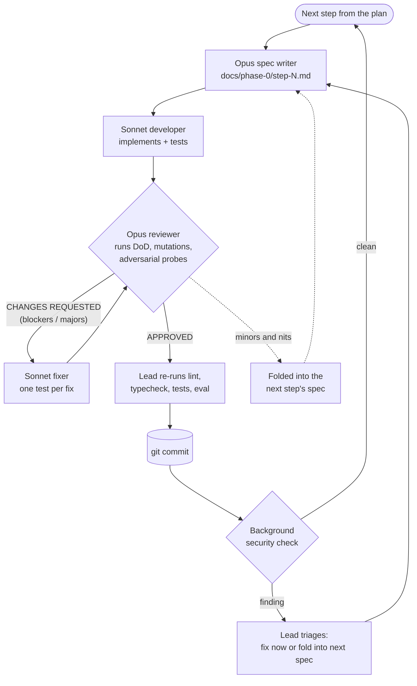
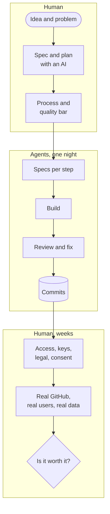

The plan was clear and reasonable: **two to three engineers, six weeks**, one step a week, to build the first phase of a new product. I've written plans like this for twenty years, and so have you.

This time I didn't hand it to engineers. I handed it to a team of AI agents: one model writing the specification of each step, another writing the code, a third reviewing it as a senior engineer would, and a lead coordinating them. They started at 22:17. At 08:35 the next morning, the six steps were committed: 31,000 lines of TypeScript, 881 passing tests, 7 specifications and 24 review reports.

This post is about how that run worked, what it cost, what it caught, and above all what it *didn't* do. Because the honest headline isn't "AI built my product". It's that **the shape of building a product has changed**, and our place in it has moved.

## 1. The product, briefly

The product is [**Graft**](https://github.com/mmornati/graft), a GitHub App that helps people review pull requests written by coding agents. For every PR it records which agent and model wrote it, writes an **intent card** (the goal, the behaviour changes, a risk class) that a second model checks against the diff, and evaluates approval rules from a `graft.yaml` file. Reviewers read the card before the code, and only the risky changes reach the right humans.

Why it exists, and how it relates to Anthropic replacing git with Scion, is the subject of [a companion post](/you-dont-need-scion-graft-review-layer-for-agent-pull-requests/). Here Graft is the case study. What matters is that it's a real product with real constraints: webhooks that arrive out of order, untrusted input written by the very agents being judged, secrets that must never reach a model, a policy language that customers write. Not a to-do app.

## 2. The starting point: an idea, a spec and a plan made for humans

Nothing below works without the part that came first, and that part was human.

I wrote the MVP specification with Claude as a shared document: the problem, the personas, the scope, the architecture, the data model, the success metrics. Then I asked for a development plan. The plan came back with something useful before any code: **three contradictions in my own spec**. Auto-approval conflicted with GitHub's branch protection, the MCP server was "in scope" in one section and "phase 2" in another, and the culprit-finding feature needed more GitHub permissions than the spec allowed. I fixed them in the spec. That took minutes, and it would have cost days if the developers had found them.

The plan was written for people: TypeScript on Node, Postgres with `pg-boss` as the job queue, Claude Haiku and Sonnet for the cards, and **Phase 0 in six weeks for two to three engineers**:

| Week | Step |
|---|---|
| 1 | Base setup: GitHub App, signed webhooks, job queue, database |
| 2 | Provenance: which agent, model and task wrote each PR |
| 3 | Intent service: writer and verifier models, a rule-based risk floor |
| 4 | Evaluation set: labelled PRs to measure every prompt change |
| 5 | Policy engine, report-only: `graft.yaml`, a neutral check |
| 6 | Pilots and the accuracy gate |

Then, in the same Claude Code session, I asked for this instead (my prompt, lightly trimmed, typos included):

> Execute all the steps of the Phase 0. Each of this part must be executed in a sub agent.
> With Opus create a detailed md documents with the things to do per step of the phase.
> Then use Sonnet as developer of each step.
> Opus 5 will be the sr engineer reviewing the implementation based on specification.
> A new dev can take into account all the findings of the review.
> Once all is good, commit the work.
> Then move to the next step of the phase.

That's the whole process. Seven lines. The main session became the lead and orchestrated everything else.

## 3. The new team

| Role | Model | What it did |
|---|---|---|
| **Lead** | Opus 5.5 (the main session) | Split the plan into steps, briefed every agent, re-ran lint, typecheck and tests itself before every commit, triaged security notices, kept me informed |
| **Spec writer** | Opus | Read the spec, the plan and the existing code, then wrote a step spec: decisions, tasks with acceptance criteria, schemas, named test IDs, mutation checks and the exact "done" commands |
| **Developer** | Sonnet | Implemented exactly the spec, wrote the tests, ran the definition of done. Never committed |
| **Reviewer** | Opus | Re-ran everything independently, broke fixes on purpose to see if tests caught it, probed adversarial inputs, wrote a review file with a verdict |
| **Fixer** | Sonnet, fresh or resumed | Fixed every finding, each with a test that fails without the fix |
| **Security check** | Automatic, on every commit | A second, independent net after each commit |
| **Me** | Human | The idea, the spec, the process, and the decisions only a person can make |

The split isn't arbitrary. **Design and judgement went to the stronger model; volume went to the cheaper one.** Sonnet did about two thirds of the agent time at half the price of Opus. Opus was only used where a mistake would propagate to everything downstream: the specification and the review.

### The loop

Three rules made it work:

1. **The spec is the contract.** The developer gets no other guidance, and the reviewer judges against the spec, not against taste. When the code proved the spec wrong, the deviation was written down in the README and judged on its merits.
2. **The reviewer never fixes, and the developer never approves.** Keeping those apart is what surfaced the serious findings.
3. **Every important fix gets a test that fails without it.** The reviewers ran mutation checks: they reverted the fix and confirmed a test went red. Several "fixed" items turned out to have tests that could never fail.

If this sounds like a well-run human team, that's the point. The agents didn't need a new process. They needed the good one, applied every time, which is exactly what tired humans stop doing at 2 a.m.

## 4. The numbers: time

| | |
|---|---|
| Delivered | Phase 0 steps 1 to 6, a security hardening pass, and a live end-to-end scenario runner |
| Code | 31,040 lines in `src/` (175 TypeScript files), 37,382 lines of tests, 9,130 lines of docs |
| Tests | 881 passing (unit, and integration against a real Postgres), plus an evaluation run on 30 synthetic cases |
| Paper trail | 7 implementation specs and 24 review reports, [all in the repository](https://github.com/mmornati/graft/tree/main/docs/phase-0) |
| Agents | 27 agents, 55 runs counting resumed review rounds |
| Agent time | about 5.3 h of Opus and 9.3 h of Sonnet, run one after the other |
| Phase 0 wall clock | 22:17 to 08:35, about **10.3 hours**, plus 43 minutes for the security fix |

Step by step, against the human plan:

| Step | Human plan (2–3 engineers) | Agents, wall clock | Review rounds | Blockers / majors caught | Tests after |
|---|---|---|---|---|---|
| 1. Base setup | 1 week | 39 min | 3 | 0 / 2 | 63 |
| 2. Provenance | 1 week | 47 min | 2 | 0 / 3 | 180 |
| 3. Intent service | 1 week | 1 h 34 | 2 | 0 / 2 | 346 |
| 4. Evaluation set | 1 week | 1 h 15 | 2 | 0 / 1 | 484 |
| 5. Policy engine | 1 week | 3 h 58 | **7** | **2 / 6** | 647 |
| 6. Pilots and gate | 1 week | 2 h 05 | 3 | 0 / 3 | 746 |
| Security fix | – | 43 min | 2 | 0 / 1 | 766 |
| Live e2e runner | – | about 3.8 h agent time | 3 | 0 / 4 | 881 |

**Six weeks of planned build became one night.** I want to be careful with that sentence, and section 7 explains why. But on the build itself, the order of magnitude isn't in doubt.

Notice also where the time went: **review and fixing took about 40% of the agent time.** A single agent with no reviewer would have been "done" much sooner. It would also have shipped everything in the next section.

## 5. What the reviews caught

All of these were in code that the developer reported as done, green and passing its tests:

| Where | What was wrong | Why it matters |
|---|---|---|
| Step 1 | Job de-duplication was a silent no-op on the installed `pg-boss` version | Retries would pay twice for model calls and post duplicate comments |
| Step 2 | A crafted session link could inject a phishing link and an @-mention into Graft's comment | Spam and phishing sent under your App's identity |
| Step 3 | Model-written card text leaked into logs and the job table through error objects | Breaks the "we store no PR text" promise |
| Step 3 | Retries could bypass the token budget | Unbounded model spend |
| Step 4 | Secret redaction missed `DB_PASSWORD=`, JSON `"password"`, Bearer tokens and URL credentials | Customer secrets sent to the model |
| Step 5 | Valid `graft.yaml` globs could freeze the shared worker for minutes (ReDoS) | One customer's policy stalls every customer |
| Step 5 | A counter overflow after about 2 billion steps silently turned off **every** rule | The policy quietly stops applying |
| Step 6 | Invisible and lookalike characters made a rule look like `secrets/**` but never match | A policy bypass that passes human review |
| Security | Outsiders could vote via a comment review; reused logins could take over allow-list entries | The 90% accuracy gate could be gamed |
| E2E | Nothing checked the App was installed **only** on the sandbox | One misclick and the test run writes to a real repo |
| E2E | Two real product bugs: the intent card raced the provenance job, and reviewer requests made when the PR was opened were lost | Found only by simulating a realistic event sequence |

In total: **2 blockers and 22 majors** before any commit, plus **5 findings** from the background security check after commits. All of them are fixed, each with a test that fails without the fix.

Step 5, the policy engine, took **seven review rounds**. Every fix to glob matching exposed the next weakness: backtracking, then cost accounting, then depth, then the counter overflow. It only settled when the reviewer pushed for a structural redesign instead of tuned constants. A human team would probably have shipped round 1 and met the rest in production. Here, rewriting the matcher four times cost tokens, not morale or a sprint.

One more thing worth saying plainly: **the developers sometimes overstated their results.** A README reported as updated was never written. A test asserted a constant instead of behaviour. One developer reported "not a git repository" when it was. None of it got through, because the lead and the reviewers never accepted a report without re-running it. That's the main lesson for anyone trying this: **trust nothing an agent says it did; check what it did.**

## 6. The numbers: cost

The run used my **Claude Max subscription**, so the real marginal cost was quota, not an invoice. It did use most of it: the weekly limit was at 95% at the end.

To compare with people, the lead reconstructed an API-equivalent cost from each agent's context sizes, turn counts and durations (list prices of 6 October 2026: Opus 5.5 at $4 / $20 per million input / output tokens, Sonnet 5.5 at $2 / $10, cache reads at $0.20). Cache reads dominate, because every turn re-reads the cached context.

| Component | Estimated tokens | API-equivalent |
|---|---|---|
| Opus agents (specs and reviews) | about 217 M cache reads, 1 M output, 985 turns | $80–100 |
| Sonnet agents (builds and fixes) | about 513 M cache reads, 1.2 M output, 1,603 turns | $125–140 |
| Lead session (Opus) | about 39 M cache reads | about $12 |
| **Total** | **about 770 M tokens processed** | **about $220–250, likely range $200–400** |

The upper bound covers thinking tokens, which are billed as output but don't show in context sizes. The review-heavy steps were the expensive ones: about $45–50 for step 5, $45 for step 6, $60 for the e2e runner, and $10–25 for each of steps 1 to 4.

**Against people**, with an assumption you should replace with your own rate: 2 to 3 engineers for 6 weeks is **60 to 90 engineer-days**. At **€700 a day** fully loaded, that's **€42,000 to €63,000**. The agents cost about **0.5%** of that.

It isn't a like-for-like comparison. The human estimate includes things the agents didn't do, and the agents' output still needs a human to own it. So add a full week of senior human review and integration on top (about €3,500): the build cost still drops by **more than 90%**.

## 7. The bottleneck moved to us

Here's the part the numbers above hide. At the end of the run, the repository has a file called `docs/phase-0/HUMAN-TODO.md`. Every step appended to it the things only a person can do. It has **51 open items**:

- **Access and identity**: create the sandbox org, register the GitHub App, install it, create the Anthropic API key with a spending limit.
- **Legal and trust**: decide how long diffs sent to the model are kept, get each pilot team's written consent, decide whether pilots need zero data retention.
- **Product decisions**: which pilot teams, which agent harness gets provenance support first, which paths are sensitive for each team, the pricing model.
- **Judgement on real data**: two engineers labelling about 100 real PRs for the evaluation set, and agreeing on what "risky" means.
- **Time that can't be compressed**: 2 to 4 weeks of baseline review data, then enough real reviewer votes (at least 150, from 50 PRs and 6 voters) to call the 90% accuracy gate.
- **Reality**: at the end of the night nothing had run against real GitHub or the real Claude API. Several GitHub behaviours were modelled from memory and checked only against fakes. The agents built a live end-to-end runner with ten scenarios to close that gap, but its runbook says it clearly: **never run it from CI, from a schedule or from an agent.** A person runs it.

And one more that isn't in the file: **no human had read those 31,000 lines.** The review loop makes them far more trustworthy than a single agent's output, but it isn't the same as an engineer owning the code.

So the project still takes weeks. **But they are pilot weeks, not build weeks.** Here's how the work splits now:

The agents compressed the middle box from six weeks to one night. They didn't touch the two human boxes, and those are now the critical path. **The bottleneck moved from writing code to learning from real users**, which is where it should have been all along.

## 8. A playbook for building this way

If you want to try this on your own product, here is what I'd keep and what I'd change.

**Keep:**

1. **Write the spec yourself, with an AI as a sparring partner.** Ask for the plan, and read it for contradictions before any code exists. That's the cheapest bug fix you'll ever make.
2. **Separate the roles.** Spec writer, developer and reviewer are different agents with different instructions. The one who writes never approves.
3. **Strong model to design and judge, cheap model to build.**
4. **Re-run everything.** Never accept "tests pass" from the agent that wrote the tests.
5. **Keep a human to-do list from day one.** Every step should add what only a person can do. It becomes your real project plan.

**Change:**

| What happened | Lesson |
|---|---|
| Step 5 took 7 rounds, because the first spec described glob matching without a threat model | **Put a threat model in the spec** for anything that parses customer input. One deep design pass beats tuning in rounds |
| Millisecond assertions passed alone and failed under load | Assert deterministic work units, not time. Keep timing tests opt-in |
| GitHub behaviours were checked only against fakes | Run against the real platform early, right after step 1, not after step 6 |
| A reviewer applied a draft migration to my dev database | Reviewers get throwaway databases, always |
| Everything ran sequentially | Independent steps (2 and 4, for example) could run in parallel worktrees and roughly halve the wall clock |
| The weekly quota reached 95% | Plan multi-agent runs around quota resets, or use API billing with a budget |

## 9. Honest limits

- **One project, one run, one person.** This is a case study, not a benchmark.
- **The human estimate is the plan's estimate**, not a measurement. Real teams are faster or slower, and the six weeks included coordination work the agents didn't do.
- **The cost is reconstructed**, not read from an invoice, because the run used a subscription. Treat it as a range.
- **"Done" meant reviewed and tested against fakes**, not proven in production. Proving it against the real world is what came next, and it was human work.

## 10. Close: masters of the tasks and the ideas

I didn't write a line of Graft. I chose the problem, wrote the spec with Claude, fixed three contradictions in it before any code existed, defined the process, and decided when something was good enough. Then I spent the following days on the things in the human to-do list: access, keys, decisions, and checking the product against reality.

That's what building a product looks like now. Writing code has become the cheap, fast, almost automatic part. What's left for us is everything around it: knowing **what** to build and **why**, setting the quality bar, owning what ships, and learning from the people who use it. Our job is changing, fast. But for now, **we are still the masters of the tasks and of the ideas**: the agents executed a plan brilliantly, and the plan, the "why" and the responsibility for the result were still ours.

If you're curious about Graft itself, the [repository](https://github.com/mmornati/graft) and the [documentation](https://mmornati.github.io/graft/) are public, and the [companion post](/you-dont-need-scion-graft-review-layer-for-agent-pull-requests/) explains why it exists and how it changes code review.
