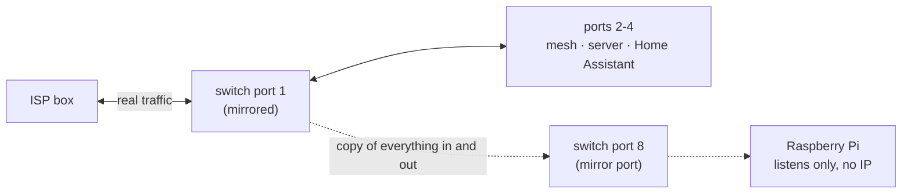
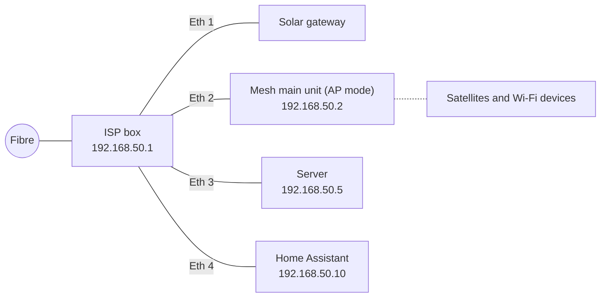
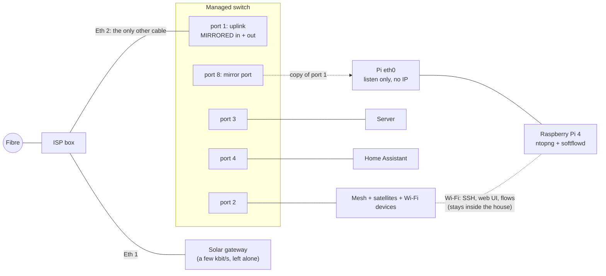
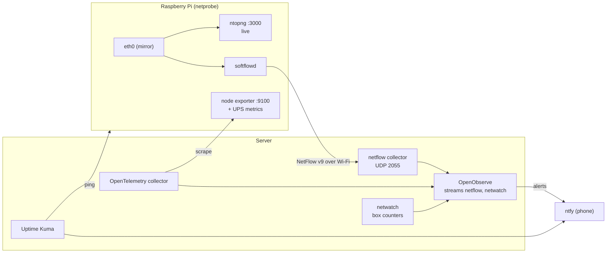
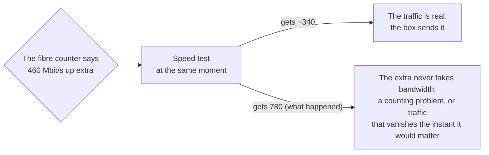

In the [previous post](/have-you-tried-turning-it-off-and-on-again-monitoring-a-home-network/) I told the story of the reset that "fixed" the Wi-Fi and, along the way, made **2 to 3 TB a day of mystery traffic** disappear from the ISP box's counters. I ended it with a new Uptime Kuma monitor, "internet traffic normal", and the slightly smug feeling that I would now notice if it came back.

It came back the next morning.

Not with a jump, but with a slow climb: about 1 Mbit/s just after the reset, 10 in the afternoon, 30 to 90 in the evening, 60 down and 120 up the following morning. Upload higher than download again, all night long. And this time I had a lot more data than the first time. With Claude reading OpenObserve through MCP, I could rule out the server (its whole network card was moving 0.14 Mbit/s down and 0.34 up), Plex (asked directly through its API: no streams, no transcodes) and every container. What I couldn't answer was the only question that mattered: **if it's not the server, who is it?**

Every number I had was **per port**, never **per device**. To know who talks to whom, you have to look at the packets. This post is about how I did that without touching the network's configuration, with a 30-euro switch and a Raspberry Pi I already had in a drawer, and how it plugs into the Uptime Kuma and OpenObserve setup from last time.


**Everything in this post is pseudonymized,** like last time and with the same fake names: the LAN is `192.168.50.0/24`, the ISP box is `.1`, the mesh main unit `.2`, the server `.5`, Home Assistant `.10`. The IPv6 prefix is from the documentation range, and device names are made up. The **hardware models** (switch, Pi, UPS board) are the real ones, because they are the part you might want to copy. Traffic volumes, rates and times are the real measurements.


## What I could already see, and what I couldn't

After the first investigation I had added one more source: `netwatch` (the DHCP watcher from the last post) now also logs in to the ISP box's local API every 20 seconds and reads the byte counters of each of its ports: the fibre, the four Ethernet ports, and its own Wi-Fi. That gave me this picture:

| Source | Answers | Doesn't answer |
|---|---|---|
| ISP box, fibre counter | How much crosses the fibre | Who |
| ISP box, per-port counters | Which **port** of the box carries it | Which device behind the mesh on that port, and where it goes |
| Server's network card, container metrics | Whether the server is the source | Anything about the other 70 devices |
| Home Assistant (mesh integration) | Which device is on which access point, its signal | How much it transfers |

And that picture was very strange: the fibre carried tens of Mbit/s, sometimes more than 300, while **all the box's LAN ports together stayed under 7 Mbit/s** and its Wi-Fi at zero. Either the traffic came from inside the box itself, or the box's port counters were lying (some ISP boxes forward traffic in hardware without counting it on the LAN ports). There is only one way to separate those two explanations: **put something on the cable that counts on its own.**

### The options I considered

*   **Unplug things one at a time and watch the graph.** Free, and it works for an obvious culprit. But the traffic was bursty, it would cut the house off for each test, and it can't tell you *where* traffic goes.
*   **The ISP box's own UI.** Mine shows a device list, not traffic per device.
*   **ARP spoofing** from a Pi or the server, to make every device send its traffic through it. It needs no hardware, but no: it's IPv4 only (my ISP gives IPv6 too, and that would bypass it), it puts a Pi in the path of the whole house, and it can't see traffic the box makes itself, which was one of the two suspects.
*   **An inline bridge**: a Pi with two Ethernet ports on the cable. Same visibility as a mirror, but if the Pi hangs, the house goes offline.
*   **Port mirroring.** A switch copies all the traffic of one port to another port, where a capture device listens. The capture device is not in the path: if it crashes, nobody notices. Nothing on the network changes address or configuration. This is what I picked.

## Port mirroring in one picture

A managed switch can be told: "every frame that enters or leaves port 1, also send a copy out of port 8". The device on port 8 receives traffic that isn't addressed to it; it only listens, never answers, and doesn't even need an IP address on that port.



The trick is choosing **which** port to mirror. If port 1 is the **only** cable between the house and the ISP box, then every byte between any home device and the internet crosses it, and the Pi gets a copy of all of it, IPv4 and IPv6, wired and Wi-Fi. Traffic that stays inside the house (a phone watching Plex on the server, Home Assistant talking to the server) is switched locally and never crosses port 1, which is exactly what you want: less to process, and it has nothing to do with the internet bill.

## The hardware

### A switch that can mirror (this is the important part)

**Not every device can mirror a port, and the one you already have probably can't.** My ISP box can't. My mesh system can't either, and in access point mode it wouldn't help anyway. Unmanaged switches can't, by definition: they have no configuration at all. You need a **managed** or **"smart"** switch, and the feature is usually called *Port Mirroring*, sometimes *SPAN* or *Monitor port*. Check the datasheet before buying.

I used a **TP-Link TL-SG608E**: 8 Gigabit ports, fanless, about 3 W, around 30 euros, from TP-Link's "Easy Smart" range, which supports port mirroring from its web UI. The **E** at the end matters: the TL-SG108 and TL-SG105 without the E look identical and are unmanaged, so they can't mirror. The 5-port TL-SG605E can do the same job if you count your ports carefully: uplink, mesh, server, Home Assistant and the mirror port take exactly five, and you have nothing left for anything else. I took the 8-port one.

### A Raspberry Pi 4 or newer

The Pi does three things: receive the copy, show it live (ntopng), and summarize it into flow records for OpenObserve (softflowd). Which model matters more than it looks:

| Model | Usable? | Why |
|---|---|---|
| **Pi 5** | yes | The most headroom |
| **Pi 4** | **yes** | Its built-in Ethernet is **real Gigabit** on its own controller, it has USB 3, four 64-bit cores, and the ntopng image runs on it. 4 GB is comfortable, 2 GB is fine for a home |
| Pi 3 B+ | no | Its "Gigabit" port goes through USB 2, so in practice about 300 Mbit/s: it would lose most of the copy during any big download |
| Pi 1, 2, 3 B | no | 100 Mbit/s Ethernet, and the oldest can't run 64-bit software |

**Gigabit is not a luxury here.** My fibre is 1 Gbit/s down *and* 1 Gbit/s up. The mirror port receives the copy of both directions on one cable, and the Pi's card must keep up with it. A 100 Mbit/s capture port would silently drop most of the copy as soon as someone downloads a game, and you'd conclude that nothing happened. (Even with Gigabit, there's a physical limit, more on that in the limits section.)

The second important thing is that **the Pi needs two network interfaces**. The Ethernet port connected to the mirror port only listens: it has no address and must never send anything. So something else has to carry SSH, the ntopng web page and the flow records sent to the server. On a Pi 4 that's free: **its Wi-Fi**. The management traffic goes Pi → mesh → switch → server and stays inside the house, so it never crosses the mirrored port and never pollutes the measurement. It's light (an SSH session, a web page, a few kbit/s of flow records), and if the Wi-Fi drops for a moment, the capture keeps running; only the UI and the export pause. If you prefer a cable, a USB 3 Gigabit adapter on a spare switch port does the same job.

Mine is the Pi 4 (4 GB) that used to run Home Assistant before it moved to its own box, with what it already had: a **Geekworm X857** board with a 128 GB mSATA SSD (the Pi boots from it, which is much kinder to constant writes than an SD card) and a **Geekworm X708** UPS hat with 18650 cells. The UPS is optional. Its one real benefit: on a power cut, the Pi shuts down cleanly instead of corrupting its disk.

### Shopping list

| Item | Notes |
|---|---|
| Managed switch with port mirroring | TL-SG608E here; any switch whose datasheet says "port mirroring" |
| Raspberry Pi 4 (2 GB+) or Pi 5 | 64-bit OS required |
| Official power supply | 15 W for a Pi 4, 27 W for a Pi 5; both are picky |
| SSD over USB 3 or a good A2 microSD | An SSD lasts longer with ntopng's constant writes |
| Case with a fan, or heatsinks | ntopng keeps the CPU busy |
| **Cat 5e or Cat 6** patch cables | Check them. More on that below |
| *Optional:* USB 3 Gigabit adapter | Only if you don't want to manage the Pi over Wi-Fi |

## Cabling

Before, the server and Home Assistant were plugged straight into the ISP box, next to the mesh. That's the most common home layout, and the trap is that **mirroring the box-to-mesh cable would only show the Wi-Fi devices**: the server and Home Assistant would never cross it.



After, **the switch is the only cable to the ISP box**, and everything plugs into the switch:



| Switch port | Goes to | Role |
|---|---|---|
| 1 | ISP box, Ethernet 2 | Uplink, **mirrored** |
| 2 | Mesh main unit (its WAN port, as before) | |
| 3 | Server | |
| 4 | Home Assistant | |
| 5, 6, 7 | free | Anything wired later (or the Pi's USB adapter) |
| 8 | Pi, **built-in** Ethernet port | Mirror port: receives the copy |

Nothing changes address: the ISP box still hands out the same IPs, and the DHCP reservations still apply. Rewiring takes five minutes of internet cut. To never create a loop, do it in this order: unplug the mesh, the server and Home Assistant from the box; plug them into ports 2, 3 and 4; then plug port 1 into the box. Check that a phone gets internet and the server answers.


**Check the link speed, not just the link light.** The first cable I used between the switch and the Pi linked at **100 Mbit/s**. Both ends only advertised 10/100: the cable had two working pairs out of four, which is enough for Fast Ethernet and not for Gigabit. Everything "worked", and the Pi would have quietly lost the copy above 100 Mbit/s. `sudo ethtool eth0 | grep Speed` on the Pi must say `1000Mb/s`. A Cat 6 cable fixed it.


## Configuring the switch

Easy Smart switches have a small web UI. The steps, before rewiring anything:

1.  **First login.** Plug only a laptop into the switch. With no DHCP server around, the switch falls back to `192.168.0.1`: give the laptop a fixed address such as `192.168.0.10/24` and open `http://192.168.0.1`. The default login is `admin`/`admin`, and it forces a new password at once. Put it in your password manager.
2.  **IP setting.** Leave DHCP on (the default). Once it's on the LAN, it gets an address from the ISP box; reserve one for it there (mine is `192.168.50.3`), so you can find it later.
3.  **Monitoring → Port Mirror.** Enable mirroring, **mirroring port = 8**, and for **port 1** set both **Ingress** and **Egress** to *Enable*. Leave every other port disabled. Apply.
4.  Leave the rest at its defaults: no VLANs, no QoS. Loop prevention on is fine.

Three things that surprised me:

*   **Mirroring was off out of the box**, even though I thought I had set it. After rewiring, the Pi only saw broadcasts. Always read the setting back after applying it.
*   **There's no "Save" button.** Easy Smart switches apply and keep changes immediately.
*   **The Firmware Upgrade page has a "Ready" button that looks like an update is waiting.** It isn't. It reboots the switch into an upload mode that waits for a firmware file you downloaded yourself, and **while it waits, the switch doesn't pass traffic**: the whole house goes offline. Mine already runs the only firmware TP-Link publishes for its hardware version. Check the vendor's download page, and only press it with a file in hand.

## Setting up the Pi

### The system

With **Raspberry Pi Imager**, write **Raspberry Pi OS Lite (64-bit)**. In the Imager's settings: a hostname (mine is `netprobe`), your user, **SSH with your public key only**, your time zone, and your **Wi-Fi** network. Boot it **without the Ethernet cable**, close to a mesh unit, reserve its Wi-Fi address in the ISP box (mine is `192.168.50.30`), then:

```bash
sudo apt update && sudo apt full-upgrade -y
sudo apt install -y unattended-upgrades tcpdump ethtool
ip -br link   # eth0 = built-in (the mirror), wlan0 = Wi-Fi (management)

# Wi-Fi power saving drops SSH and the flow export now and then: turn it off
sudo nmcli con mod "$(nmcli -g NAME,TYPE con show --active | grep wireless | cut -d: -f1)" \
  802-11-wireless.powersave 2
```

If you have an SSD, this is when you move the system to it and set the boot order (`rpi-eeprom-config`, `BOOT_ORDER=0xf14`: USB first, then the SD card).

### The listen-only interface

This is the key part of the Pi's setup. `eth0` must come up, accept every frame (promiscuous mode, because the copied frames aren't addressed to the Pi), and have **no address of its own**, IPv4 or IPv6, so it never sends a single packet on the mirror port:

```bash
# A NetworkManager profile with no IPv4 and no IPv6 at all
sudo nmcli con add type ethernet ifname eth0 con-name mirror \
  ipv4.method disabled ipv6.method disabled
sudo nmcli con up mirror

# Belt and braces: no IPv6 link-local address either
echo "net.ipv6.conf.eth0.disable_ipv6 = 1" | sudo tee /etc/sysctl.d/90-mirror-eth0.conf

# Promiscuous mode at every boot
echo 'ACTION=="add", SUBSYSTEM=="net", KERNEL=="eth0", RUN+="/usr/sbin/ip link set eth0 promisc on"' \
  | sudo tee /etc/udev/rules.d/90-mirror-promisc.rules
sudo ip link set eth0 promisc on
```

Now cable `eth0` to switch port 8 and check that the copy arrives:

```bash
sudo ethtool eth0 | grep -E 'Speed|Duplex'   # 1000Mb/s, Full
sudo tcpdump -ni eth0 -c 20                  # traffic of OTHER devices, not only the Pi's
```

If `tcpdump` only shows broadcasts (ARP, DHCP, mDNS), the mirroring isn't active on the switch.

### ntopng, the live view

Current Raspberry Pi OS is based on Debian 13, which no longer ships ntopng. ntop publishes an official **ARM64 Docker image** with weekly builds and Redis bundled. I run it with a small compose file:

```yaml
services:
  ntopng:
    image: ntop/ntopng_arm64.dev:latest
    container_name: ntopng
    restart: unless-stopped
    network_mode: host          # it must see eth0 directly
    cap_add: [NET_ADMIN, NET_RAW]
    volumes:
      - ntopng-data:/var/lib/ntopng   # time series
      - ntopng-redis:/var/lib/redis   # users and preferences (!)
    command:
      - -i
      - eth0                    # the mirror port
      - -w
      - "3000"
      - --community             # the free edition
      - --local-networks
      - 192.168.50.0/24,2001:db8:50::/64   # what "home" means, IPv4 and IPv6
      - -n
      - "1"                     # name local hosts from DHCP and mDNS

volumes:
  ntopng-data: { external: true }
  ntopng-redis: { external: true }
```

```bash
sudo apt install -y docker.io docker-compose && sudo usermod -aG docker "$USER"   # log out and in
docker volume create ntopng-data && docker volume create ntopng-redis
docker-compose up -d
```

**The second volume is the one people forget.** ntopng keeps its users and preferences in its Redis. My first version only persisted the time series, which meant that the next image update would have reset everything, including the admin password, back to `admin`/`admin`.

Open `http://192.168.50.30:3000`, log in with `admin`/`admin`, set a real password. Then four preferences that matter for a mirror:

| Setting | Value | Why |
|---|---|---|
| Interface → **Mirrored Traffic** | on | The mirror port only receives. Without this, ntopng complains about "RX only traffic" and misreads connections |
| **DHCP range** | `192.168.50.2-192.168.50.199` | Tells ntopng which addresses are handed out dynamically |
| **Local broadcast domain hosts identifier** | MAC address | Devices keep their history when their DHCP address changes. This works because, with the mesh in AP mode and the box as the only router, the mirrored cable carries the devices' real MAC addresses |
| Interface **speed** | 1000 | For the utilization charts |

They're in the UI, or straight in Redis: `docker exec ntopng redis-cli set ntopng.prefs.ifid_0.is_traffic_mirrored 1`, then `redis-cli save` and a restart. ntopng will also suggest setting up "Emergency notifications": I dismissed it, because alerts already go through OpenObserve and ntfy, and a second alerting system on top mostly adds noise.


**The Pi sees everything that crosses the uplink unencrypted:** DNS names, plain HTTP, which device talks to which service and when. Treat it like the most sensitive box in the house. SSH keys only, unattended upgrades, ntopng never published through the tunnel, and a firewall. An automated security review caught that ntopng's port answered on **every** address of the Pi, **including its public IPv6 address**, with only the ISP box's IPv6 firewall in front of it. Now an nftables table only lets the home IPv4 network reach port 3000 and only the server read the metrics port, and drops both over IPv6. Also: the people you live with are on that cable too. Tell them.


```nft
table inet netprobe {
  chain input {
    type filter hook input priority filter; policy accept;
    tcp dport 9100 ip saddr 192.168.50.5 accept      # node exporter: the server only
    tcp dport 9100 iifname "lo" accept
    tcp dport 9100 drop
    tcp dport 3000 ip saddr 192.168.50.0/24 accept   # ntopng: home IPv4 only
    tcp dport 3000 iifname "lo" accept
    tcp dport 3000 drop                              # including over IPv6
  }
}
```

It's its own table, with no `flush ruleset`, so the rules Docker adds are left alone.

### softflowd, for history in OpenObserve

ntopng's free edition is great live, and keeps little history. For "what happened last Tuesday at 3 a.m.", next to everything else in OpenObserve, the Pi also summarizes the copy into **NetFlow** records with [softflowd](https://github.com/irino/softflowd): one record per connection, with addresses, ports, protocol, bytes and packets, every minute for long connections.

```bash
sudo apt install -y softflowd
sudo tee /etc/softflowd/default.conf >/dev/null <<'EOF'
interface=eth0
options=-n 192.168.50.5:2055 -v 9 -t maxlife=60 -T full
EOF
sudo systemctl enable --now softflowd@default
```

On the server, I didn't need a new tool: the **OpenTelemetry Collector** has a `netflow` receiver. A dedicated collector container listens on UDP 2055 and writes each flow as a log record into an OpenObserve stream `netflow`, kept 30 days:

```yaml
receivers:
  netflow:
    scheme: netflow
    hostname: 0.0.0.0
    port: 2055

processors:
  # Only the Pi may feed this stream. The port is open to the LAN, so drop anything else.
  # (A spoofed source still passes: this stops a stray exporter, not a determined attacker.)
  filter/netprobe:
    logs:
      log_record:
        - attributes["flow.sampler_address"] != "192.168.50.30"
  # Drop routing fields a home network never uses (AS numbers, BGP next hop, VLANs...)
  attributes/slim:
    actions:
      - action: delete
        pattern: ^flow\.(src_as|dst_as|bgp_next_hop|next_hop|src_vlan|dst_vlan|in_if|out_if|ip_tos)$

exporters:
  otlp_http:
    endpoint: http://openobserve:5080/api/default
    headers:
      Authorization: "Basic ${env:OO_BASIC_AUTH}"   # an ingest-only user
      stream-name: netflow
```

That filter also came from the security review: without it, any device on the LAN could send fake flows and pollute the history.

## Plugging it into Uptime Kuma and OpenObserve

A capture box that silently stops capturing is worse than none: you'd read "the house is quiet" from a graph that is just empty. So the Pi gets the same treatment as everything else from the last post.



**Uptime Kuma**: one more ping monitor, "netprobe (traffic-mirror Pi)", in the 🌐 Internet & network group, so that "the Pi is down" shows up in the same place as "the mesh is down".

**OpenObserve alerts**, to the same ntfy topic as the others:

| Alert | Fires when |
|---|---|
| `network_mirror_silent` | No flow received for 15 minutes: the Pi, softflowd, the cable or the switch's mirror setting is gone |
| `netprobe_silent` | No metrics from the Pi for 10 minutes |
| `netprobe_on_battery` / `netprobe_battery_low` | Mains lost / under 30 % on battery (the UPS hat publishes its state as metrics) |
| `netprobe_ssd_full` | The Pi's disk over 85 % |

**SLOs**: "netflow freshness" and "netprobe reachability" joined the network SLOs (DHCP, internet, mesh, DNS), on the dashboard only. Kuma already pages for the urgent ones.

**Two new tabs on the Network dashboard**: one for the Pi itself (CPU, temperature, SSD, the UPS's battery and mains) and **"Flows (mirror)"**: download and upload over time, top home devices, top internet hosts, top services, and the panel this was all built for, **mirror vs fibre**. Device names come from a join with netwatch's device inventory, so the tables say `laptop-01` rather than an address. The top-devices query looks like this:

```sql
SELECT
  CASE WHEN source_address LIKE '192.168.50.%' THEN source_address
       ELSE destination_address END                         AS device,
  SUM(CASE WHEN destination_address LIKE '192.168.50.%'
           THEN flow_io_bytes ELSE 0 END) / 1e6             AS mb_down,
  SUM(CASE WHEN source_address LIKE '192.168.50.%'
           THEN flow_io_bytes ELSE 0 END) / 1e6             AS mb_up
FROM netflow
WHERE (source_address LIKE '192.168.50.%') <> (destination_address LIKE '192.168.50.%')
GROUP BY device
ORDER BY mb_down + mb_up DESC
LIMIT 15
```

(The real one also counts the IPv6 prefix as "home", and excludes broadcast and multicast, which cross the uplink but never leave the house.)

## What ntopng shows

Once the copy arrives, ntopng is the fun part. A few things I use it for.

**"Who's using the internet right now?"** *Hosts*, sorted by throughput. Click a device: its peers, its **applications** (ntopng's nDPI engine recognises Netflix, YouTube, iCloud, WhatsApp, Zoom, speed tests and a few hundred others from the traffic itself, not from DNS), the countries it talks to, and its live flows.

**The first evening, per device.** Here is the tally for 27 minutes, from the flows in OpenObserve, with what ntopng and the destination addresses' owners said about each:

| Device | Down | Up | What it was doing |
|---|---|---|---|
| `laptop-01` | 462 MB | 207 MB | Mostly **a speed test**: port 8080 to servers at several ISPs and a hosting provider, the classic pattern of a well-known speed test, including 185 MB of upload to one server. Plus Claude, writing this. |
| `phone-03` | 333 MB | 7 MB | A large CDN, the kind many apps download from. Some traffic through another CDN that matches Apple's iCloud Private Relay |
| `laptop-02` | 254 MB | 14 MB | One 83 MB download from a public cloud, Apple, two CDNs |
| `work-laptop` | 51 MB | 18 MB | Everything through a **corporate security proxy**: from the house's point of view, a work laptop talks to exactly one company |
| Server | 18 MB | 22 MB | The VPN provider, the Cloudflare tunnel for the public sites, Plex |
| Home Assistant | 11 MB | 2 MB | Ordinary cloud integrations |
| Everything else | under 5 MB each | | |

**About 1.1 GB down and 0.3 GB up, for the whole house.** Hold on to that number.

**Chatty devices.** Volume isn't the only thing worth looking at. A camera bridge was asking its vendor's cloud for the same DNS name **about 20 times a minute**. Negligible bandwidth, but that's the kind of thing that fills DNS logs, drains a battery on a battery-powered device, or hints at a retry loop.

**The VPN kill switch, verified.** In the last post I explained that the containers behind the VPN have no network if the VPN is down. From the mirror, the traffic of those containers shows only as the server talking to the VPN provider's address, never to anything else directly. That's the proof the design works, from outside the server.

**Unknown devices.** netwatch sends a push notification when a MAC address it has never seen joins the network. The next step is now one click: open that address in ntopng and see what it talks to, and how much, before deciding whether to approve it or block it.

**Limits of what it can name.** Phones and Macs increasingly use encrypted DNS or iCloud Private Relay, so the DNS names on the mirror don't say much about them. ntopng's nDPI helps (it recognizes many applications from TLS and traffic patterns), but encrypted traffic shows **who talks to whom and how much**, never the content. Which is how it should be.

## So, who was using the fibre?

Nobody at home.

The mirror and the ISP box's own port counters agree, and they disagree completely with the fibre counter:

| Same 30 seconds | Mbit/s |
|---|---|
| Everything all home devices exchanged with the internet (the mirror, 649 packets/s) | **4** |
| The ISP box's LAN ports, by its own counters | 5.6 |
| The ISP box's **fibre** | **106 down, 78 up** |

Earlier the same evening: about 2 Mbit/s on the mirror while the fibre carried 30–95 down and 20–66 up, with bursts of 383 and 385. And over those 27 minutes of the per-device table, the house moved about 1.1 GB down and 0.3 GB up, while the fibre counter showed about **16 GB down and 24 GB up**. More than 90 % of what the fibre carried never reached a single cable in the house.

Two leads that turned out to be wrong, because they deserve to be in the post too:

*   **A stale DMZ.** The box had a DMZ (and four port forwards) pointing to an address that hasn't existed since the mesh stopped being a router. A very plausible explanation for unsolicited traffic bouncing around. Claude switched it off through the box's API, measured, and the traffic didn't change at all. It stays off anyway, since it pointed at nothing.
*   **Carrier-grade NAT.** The box's settings page mentions CGN, where an ISP shares one public IPv4 between many customers. Could other customers' traffic go through my box? No: the box has its own public IPv4 (not one from the shared `100.64.0.0/10` range), the tunnel CGN would use is inactive, and even with CGN the address sharing happens in the ISP's network, not in your box.

At that point I was ready to write "the box itself sends and receives it" and call my ISP. Then I asked a question I should have asked at the start.

### Who measures the fibre?

**The box does. Only the box.** Every "fibre" number in this story, the graph from the last post included, comes from the ISP box reporting on itself: netwatch reads the counters of its fibre interface through its local API, and Home Assistant reads the same box's counters over UPnP. Two tools, one witness. The mirror and the port counters say that the house uses a few Mbit/s, and only the fibre counter says the line carries hundreds. So there are two very different explanations:

1.  **The traffic is real**, and the box itself produces it: a firmware fault, a loop, a service running on the box.
2.  **The counter is wrong**, and nothing unusual crosses the fibre at all.

From the inside you can't tell those two apart by reading more counters from the same box. You need a measurement that the box doesn't produce.

A first hint was already in OpenObserve: netwatch pings a public resolver every minute, and the latency stayed at **1–2 ms** while the box claimed 100–190 Mbit/s of upload. A saturated link shows up as latency. But that's only a hint: on a fibre with around 800 Mbit/s of upload, 190 wouldn't necessarily show.

### The speed test as an independent witness

The clean test is to **use the bandwidth the box claims is being used.** The upload is the side that matters: on my offer it tops out around 800 Mbit/s. If the box were really pushing 300 Mbit/s up, a speed test running at the same moment couldn't get more than about 500. If the speed test gets full speed while the counter claims hundreds of Mbit/s of "extra" upload, that extra isn't on the fibre.

I ran one from the server, against a test server inside my ISP's network: **919 Mbit/s down, 776 up, 0.9 ms**. 919 is about all a Gigabit Ethernet port can carry, and 776 is about 97 % of the upload cap. The mirror caught the test (782 MB up, 469 MB down, matching the speed test's own figures plus protocol overhead), so Claude could line it up with the box's counters over the same 40 seconds:

| Same 40 s | Download | Upload |
|---|---|---|
| Speed test, seen on the mirror | 3.75 Gbit | 6.25 Gbit |
| The box's port to the switch (its own counter) | 3.9 Gbit | 6.3 Gbit |
| **The box's fibre counter** | **12.6 Gbit** | **8.1 Gbit** |

The port counter matched the test within a few percent: the box counts its LAN side correctly. The fibre counter claimed more, as usual. But one test wasn't enough: the "extra" upload came in bursts, and it happened to be low (about 45 Mbit/s) during those 40 seconds.

So Claude ran **six speed tests back to back** from the server, over about five minutes, each one paired with the fibre counter for its own seconds:

| Test | Download (Mbit/s) | Upload (Mbit/s) |
|---|---|---|
| 1 | 921 | 768 |
| 2 | 920 | 764 |
| 3 | 922 | 779 |
| 4 | 914 | 766 |
| 5 | 914 | 780 |
| 6 | 922 | 775 |

Full speed, six times out of six. Meanwhile the fibre counter claimed about **150 Mbit/s of extra upload on average**, with peaks of 200 to 460. In one 15-second gap between two tests, with no test running and nothing in the house sending, it reported **464 Mbit/s of upload**: about 870 MB in 15 seconds that nothing sent. **Test 5 started right then, and got 780.** If 460 Mbit/s of upload had really been on the line, it would have got about 340.



### What this traffic can be

What's proven: **whatever the fibre counter shows never costs a single Mbit/s of bandwidth.** What isn't: whether it exists at all. Only the ISP can see its side of the line. But some explanations fit the data much better than others:

*   **A statistics bug in the box (the most likely).** Counters are surprisingly easy to get wrong in home routers. Traffic forwarded by a hardware acceleration engine can skip a router's interface counters entirely ([a TP-Link example](https://community.tp-link.com/en/home/forum/topic/796192)), and some acceleration engines count the same connection again each time it's offloaded ([an F5 bug](https://cdn.f5.com/product/bugtracker/ID562406.html)). Counters can be wrong in both directions. On a box like mine, the "fibre" interface is a virtual link between the router and the optical part, which is exactly where that kind of accounting lives. It isn't a simple unit mix-up either: the ratio between fibre and ports keeps changing (3.2× on download and 1.3× on upload during the first test), where a bits-versus-bytes error would give a constant ×8.
*   **The neighbours' downstream traffic.** On a GPON fibre, the **downstream** is a broadcast: every box on the same optical tree receives the same signal, and each one keeps only the frames tagged for it (and the unicast payloads are encrypted, so it can't read the others'; [Cisco's GPON primer](https://www.cisco.com/c/en/us/support/docs/switches/catalyst-pon-series/216230-understand-gpon-technology.html) explains it well). A counter placed before that filter would count the neighbours' downloads. A forum contributor suggested exactly that for this box. It's plausible for the download side, but it **can't explain the upload**: upstream, each box only transmits in its own time slots, so there's nothing of the neighbours' to count. And here, the upload was the bigger anomaly.
*   **Real background traffic from the box that yields instantly** to anything else. It isn't impossible, but hundreds of Mbit/s that disappear at the exact moment a speed test starts, six times in a row, is a lot of politeness for a firmware.

My bet is the first one. And it changes the story of the [last post](/have-you-tried-turning-it-off-and-on-again-monitoring-a-home-network/) too: the "2 to 3 TB a day" came from the same counter, so it's very possible that they never existed either, and that the factory reset only reset a counter.

### What changes

*   **The fibre counter is no longer trusted.** Uptime Kuma's "internet traffic normal" check read the same counter, so it could go red with nothing wrong. I'm switching it to the sum of the box's LAN ports, which matched the mirror and the speed test within a few percent.
*   **The figure that matters is what the devices use:** the mirror, or the sum of the ports. The "mirror vs fibre" panel stays on the dashboard, as a record of how far off the box's own statistics are.
*   **The question for the ISP is now precise:** "my box reports 100 to 460 Mbit/s of upload that no device sends, yet speed tests get full speed; what do *your* counters show for my line?" Either answer is useful: a box that really sends traffic gets replaced, and a box whose statistics are wrong gets a firmware bug report.
*   **One measurement detail:** netwatch reads the fibre and the ports a few seconds apart, so a single 20-second sample can disagree during a short burst (once, a port even showed more than the fibre). Compare over a minute or more. The dashboard panels already average over 5 minutes.

Without the mirror, I would have kept hunting for a misbehaving device that doesn't exist. Without the speed tests, I would have called my ISP to report traffic that, most likely, doesn't exist either. The lesson is the same as in the last post, one level deeper: **a counter is a witness, not the truth. Before you believe it, find a second witness that doesn't share its interests.**

## Limits and good practice

*   **Copy capacity.** Port 1 carries up to 1 Gbit/s **each way**, and the mirror port can send 1 Gbit/s **in total**. During a full-speed download *and* upload at the same time, the switch drops some *copies*: ntopng under-counts that moment. The real traffic is never affected. For a home that's a corner case; if it isn't for you, mirror ingress and egress to two ports, or look at a network TAP.
*   **The switch is now in the path** of all wired traffic. It's fanless and simple, but if it ever dies, put the three cables back on the box as in the "before" picture.
*   **The Pi is not in the path.** If it crashes, nobody but the alerts notices.
*   **It can't see inside the box.** Traffic the box makes itself, and devices on the **box's own Wi-Fi**, never cross the mirrored cable. That's precisely what made the comparison conclusive, but keep the box's Wi-Fi off if you have a mesh, or you'll have a blind spot. (During the investigation I found mine switched back on. netwatch's counters showed nothing on it, so it wasn't the culprit, but it's one more radio for nothing.)
*   **Only one router.** This works so neatly because the box is the only router and the mesh runs in AP mode: the mirrored cable shows real device addresses and MACs. Behind a second router doing NAT, you'd see one address for everything behind it.
*   **Privacy.** See the box above. It's a microscope on your household.

**A cheaper variant without a Pi:** plug a USB 3 Gigabit adapter into the server, cable it to the mirror port, and run ntopng and softflowd in containers there. It saves the Pi, but it puts the capture load on the box that already runs everything, and a server outage then also takes the traffic view down.

## If you want to start

1.  **Get the per-port counters first.** Your router's API, UPnP, or Home Assistant: graph how much the internet link carries. Most of the time you won't need anything else.
2.  **Buy a switch that can mirror.** Check the datasheet for "port mirroring", and check the letter at the end of the model name.
3.  **Make the switch the only cable to the box.** Mirror that port, both directions.
4.  **A Pi 4 or newer, with a listen-only `eth0` and Wi-Fi for management.** Check `ethtool` says 1000.
5.  **ntopng for the live view, softflowd for history.** Persist ntopng's Redis, firewall its port.
6.  **Monitor the monitor.** A ping in Uptime Kuma, a "no flows for 15 minutes" alert.
7.  **Compare the mirror with the fibre.** When they disagree, you know where to look.
8.  **Find a second witness for the numbers that scare you.** A speed test is a free one: if the line still delivers full speed while a counter claims it's busy, the counter is wrong.

## How it was built

One long Claude Code session with Opus 5.5, in the same git repository that holds the server's Coolify configuration, over about a day. It started as "why is the network consuming more than yesterday?" asked through the OpenObserve MCP, and Claude did the elimination work: the containers, the server's card, Plex through its API, then the ISP box's API once I'd logged into its UI in the browser pane. It was Claude who proposed the mirror port over ARP spoofing and an inline bridge, wrote the hardware guide (and corrected my first choice of switch, which had one port too few for the first plan), and then did the rest over SSH: the Pi's system on the SSD, a replacement for the UPS vendor's scripts that don't run on Debian 13, the listen-only interface, ntopng, softflowd, the collector, the dashboard tabs, the alerts and the SLOs. It configured the switch's mirroring through its web forms once I'd logged in, and set ntopng's preferences through its Redis without needing my password. When I asked where the fibre numbers actually came from, it proposed using speed tests as an independent witness, ran six of them from the server and lined each one up with the box's counters, second by second, and it searched forums and GPON documentation for explanations. Automated security reviews on each commit found the two problems described above (the flows port open to the LAN, ntopng on the public IPv6), and both were fixed the same day. For this post, a separate session read that session and the repository and drafted the text with every identifier pseudonymized. My part: buying the switch, moving the cables (twice, because of the cable with two broken pairs), typing passwords, and soon, calling my ISP with a much better question than the one I had.
