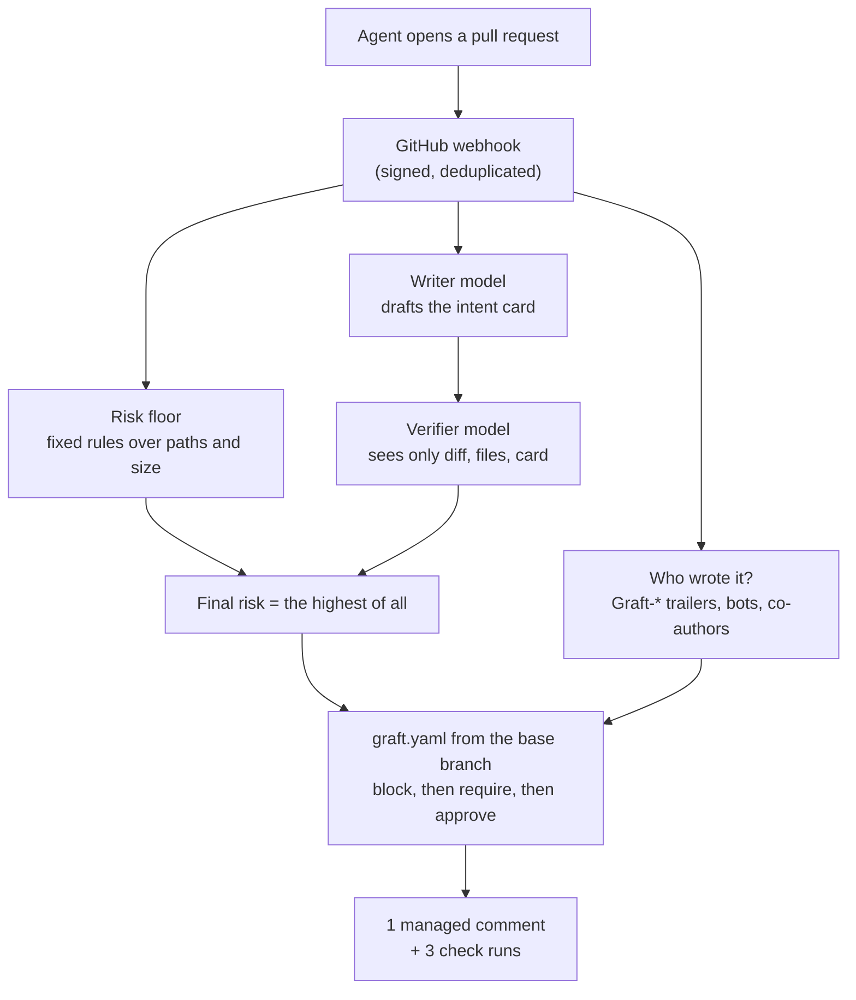

On 13 October Anthropic explained [why it replaced git](https://www.anthropic.com/engineering/redesigning-source-control) for its monorepo. The headline numbers are huge, and most of the discussion I saw was about them: petabytes, mirrors, caches. But the part of the article that stayed with me was a small sentence about people. Their engineers still review every change to the new system, but they look at **the intent of the change**, not at every line.

That sentence is the reason I built **[Graft](https://github.com/mmornati/graft)**. Last week it became public: release [v0.0.1](https://github.com/mmornati/graft/releases/tag/v0.0.1), a [documentation site](https://mmornati.github.io/graft/), a narrated video and a live end-to-end test runner. This post is about what it does, and above all about the change it tries to bring to code review: **read a card the agents prepared and a second model checked, before you read the code.**

How Graft itself was built overnight by a team of agents is a different story, with its own numbers, told in [Six weeks in one night](/six-weeks-in-one-night-building-a-product-in-the-agentic-era/). Here I talk about the product.

## 1. What Anthropic built, and why

The short version of the article:

- Merged changes went from about **2,500 a day in May 2026 to more than 30,000 a day in September**.
- The main branch history is almost **100 GB**, and a compressed working copy is more than **25 GB**. CI alone does about **25 million checkouts a day**. Fetched the normal way, that would be more than **600 PB of git traffic a day**.
- They tried everything git offers for big repositories (shallow clones, sparse checkouts, promisor remotes) and the classic workarounds. At the peak they ran **several hundred internal git mirrors**.
- So in **five months** they moved to **Scion**, an in-house system: the server is the one authoritative copy, objects are content-addressed and served by tiered caches, and checkouts are sparse or even virtual, with files fetched only when read.

Two other points matter more for the rest of us.

First, **the human-scale workflow broke too, not only the storage.** They couldn't keep a merge queue with a global lock at that rate, so they test after merge and before deploy, and let Claude fix the conflicts that this allows. They also run Claude agents that each watch the health of one component. And the engineers' job moved: setting the constraints, reviewing intent, and very often telling the AI "no" when it breaks a rule of the system to follow a pattern.

Second, **Scion is not for sale.** Anthropic says it is not a suitable replacement for git in general, that it would be hard to offer in a form useful to others, and that it only makes sense for truly enormous monorepos. But they also expect this class of problems to reach many more companies in the next **six to 12 months**.

## 2. Why almost nobody needs a Scion

When I read the article a second time, I split its lessons into two layers. That split became the thesis of Graft's [MVP spec](https://mmornati.github.io/graft/docs/spec/mvp-spec/).

| Layer | What it is | Who should solve it | Who has the problem |
|---|---|---|---|
| **Storage and transport** | server-side history API, sparse and virtual checkouts, content-addressed caches | GitHub, GitLab, git itself | a handful of companies with Anthropic-sized monorepos |
| **Workflow** | reviewing the intent of a change, approval rules that know about risk, post-merge testing, agents that watch one component | nobody offers it today | every team where agents open most pull requests |

If you're a team of 20 to 500 engineers on GitHub, your repository fits in git. Your clones are fine. What doesn't fit any more is **review capacity**: dozens of agent pull requests a day, each one read line by line by a person, starting from a description written by the agent being judged.

So the thesis is simple: **leave storage to the forges and own the workflow layer.** Graft sits on top of the GitHub repositories you already have. There is nothing to migrate, and it stores nothing git already stores.

## 3. Graft v0.0.1: what it is

Graft is a GitHub App and a small service (Node 24, TypeScript, Postgres 17). For every pull request it publishes **one managed comment and three check runs** (`graft/provenance`, `graft/intent`, `graft/policy`) that answer four questions:

1. **Who wrote it.** An agent (which one, which model, which task, which session) or a human. Agents add `Graft-Agent`, `Graft-Model`, `Graft-Task` and `Graft-Session` git trailers, or a commit hook adds them; bot accounts, configured logins and agent co-authors count too.
2. **What it claims to do.** A writer model drafts an **intent card**: one-sentence goal, observable behaviour changes, and the edits the goal does not explain. The PR text comes from the agent being judged, so it is fenced as data, never followed as instructions.
3. **Whether the diff matches.** A **verifier** model sees only the diff, the file list and the card (not the title, the description or the issue) and checks every claim. Fixed rules over paths and size set a **risk floor** (`trivial`, `logic`, `sensitive`). **A model can raise the class, never lower it.**
4. **What the policy says.** The repository's `graft.yaml`, read **from the base branch only** (a PR can't relax its own rules), says whether the change would be auto-approved, need humans or a specific team, or be blocked. Block wins, then require, then approve.



Now the important part, **what v0.0.1 actually is**. It's the end of the building of **Phase 0, shadow mode**: Graft reports and never enforces. Every Graft check concludes `neutral`, a "would approve" is not an approval, and team membership is not checked. You keep your branch protection exactly as it is.

| In v0.0.1 (built) | Not yet (Phase 1, planned) |
|---|---|
| Provenance from trailers, bots, logins and co-authors | `graft/policy` as a required check, with approvals from real reviews and team membership |
| Intent cards with writer, verifier and the risk floor; 👍/👎 and "Card is accurate / Card is wrong" buttons | Re-evaluation on push and review, stale approvals, a break-glass label with an audit log |
| `graft.yaml` policy engine, **report-only**, with a CLI and a CI lint | A **post-merge guard** that finds the culprit from CI results and opens a revert PR |
| Evaluation set (`pnpm eval`) with a synthetic set checked in CI | A minimal **MCP server** for agents (`open_change`, `report_provenance`, `get_status`, `get_policy`) |
| Pilot kit: onboarding, starter policies, review-time baseline, the 90% gate report | Security review, five pilots and a second gate |
| Live end-to-end runner against a real sandbox, or fully offline | |

Privacy is a design rule, not an option: no file contents, diffs, PR titles or bodies are stored or logged. Graft keeps paths, SHAs, numbers and the model's own prose. To write and check a card, the diff and the PR text are sent to the Anthropic API, and pilot teams agree to that in writing first. Without an API key, Graft still runs with the rule-based floor only.

## 4. The real change: read the card before the code

This is the part I care about. Today, reviewing an agent pull request goes like this: open the PR, read a description that the agent wrote about its own work, then read the diff line by line to find out whether the description was true. The description is the least trustworthy thing on the page, and it's the first thing we read.

Graft flips the order. The reviewer opens the PR and the first thing they see is a card that was **checked against the diff by a model that never saw the description**, a risk class that **no model could lower**, and a policy verdict that **the PR could not edit**.

Here is an example. It's made up, a fictional repository, but the layout follows the comment Graft renders. The pull request is titled "Fix typo in pace docstring" and its description says "Fixes a typo. No behaviour change." (This is close to one of the scenarios of the live test, which plants exactly this kind of misleading description.)

> **Graft**
>
> **Intent**
>
> > ⚠️ **The verifier disagrees with this card.** Read the diff instead of relying on the card.
> >
> > - The goal is unsupported: the diff also changes how pace is rounded and raises a limit.
> > - Missing from the card: `MAX_PACE_MIN` goes from 15 to 20.
>
> **Goal:** Fix a typo in the docstring of the pace calculation.
>
> **Risk:** `logic` · rules `trivial` · writer `trivial` · verifier `logic`
>
> **Behavior changes**
>
> - Paces are now truncated to two decimals instead of rounded (`math.floor(x * 100) / 100`).
>
> **Out-of-scope edits:** `docs/guide.md` (a second typo fix the goal does not mention)
>
> **Policy:** Would require 1 human · report only
>
> *Illustrative example, fictional repository.*

Without reading a line of code, the reviewer already knows three things: the description lies by omission, there are two real behaviour changes hidden in a "typo" PR, and the policy wants a human. They now open the diff **to check two specific lines**, not to discover what the PR does.

How the day changes, step by step:

| Before | With Graft |
|---|---|
| Read the agent's description | Read the intent card: goal, behaviour changes, out-of-scope edits, risk and where it came from |
| Read the whole diff to find out what it does | Read the diff to **confirm** the card, starting from what the verifier flagged |
| Every PR waits for the same people | The policy routes it: `trivial` docs could flow on their own, `auth/**` needs the security team, an agent touching `secrets/**` is blocked |
| "Who wrote this?" means scrolling commits | Provenance says agent, model, task and session at the top |
| Nobody measures if the summaries are any good | Reviewers rate each card with 👍/👎 or a button, and the accuracy is computed |

The policy side is a small YAML file. A few rules from the [example policy](https://github.com/mmornati/graft/blob/main/docs/examples/graft.yaml):

```yaml
version: 1
default:
  require: { humans: 1 }
rules:
  - name: docs-only
    match: { risk: trivial, only_paths: ["docs/**", "*.md"] }
    approve: auto
  - name: infra-and-auth
    match: { paths: ["infra/**", "**/auth/**"] }
    require: { humans: 1, team: security }
  - name: agent-sensitive
    match: { author: agent, risk: sensitive }
    require: { humans: 2 }
  - name: no-agent-secrets
    match: { paths: ["secrets/**"], author: agent }
    block: true
```

The [onboarding runbook](https://mmornati.github.io/graft/docs/pilots/onboarding/) has three starter files (product service, platform, library), and `pnpm graft policy check graft.yaml` lints them in CI.

**And the auto-approval?** This is where I want to be careful. "Trivial PRs approve themselves" is the kind of feature that sounds great until a wrong summary lets a bad change through. That's why Phase 0 enforces **nothing**. Graft only says what it *would* do, and reviewers vote on the cards. Enforcement starts only if the cards prove accurate on real pilot teams: at least **90% of eligible reviewer votes** must say "accurate", decided with a Wilson interval, with minimums on votes, voters, installations and days, and a PASS that must still hold without the single busiest voter. Only reviewers with real permissions on the repository count, never the PR author. The MVP targets are a **30% share** of PRs that could merge with no human and **50% less** human review time per agent PR, against a baseline measured before the pilot. Those are targets, not results: there is no pilot data yet.

## 5. The video

The repository comes with a two-and-a-half-minute narrated tour: the review problem, the three roles (the agent, the reviewer, the platform owner), the flow from webhook to check runs, the four answers, and a chapter called "A new way of working" about the reviewer's day. Like my [other canvas videos](/canvas-videos-with-voice-over-in-javascript/), it isn't a video file: every frame is drawn in JavaScript, over a synthetic Kokoro voice.

<div style="container-type:inline-size;margin:1.5rem 0">
<iframe src="https://mmornati.github.io/graft/videos/graft-explained/?embed=1&lang=en" title="Graft, explained" loading="lazy" allow="fullscreen; autoplay" allowfullscreen style="display:block;width:100%;height:calc(56.25cqw + 40px);border:0;border-radius:8px;background:#f3f5f1"></iframe>
</div>

*Press Play (sound on). [Open it on its own page](https://mmornati.github.io/graft/videos/graft-explained/) for the chapters and subtitles. Every organisation, person and pull request in it is fictional.*

## 6. The integration test

Unit and integration tests use fakes for GitHub and for the model. Fakes encode assumptions: that comments created by the App carry its id, that reactions are readable with its permissions, that a redelivered webhook reuses the same delivery id. If an assumption is wrong, every test stays green and production breaks. So Graft has a **live end-to-end runner**, `pnpm graft e2e`, that checks those assumptions against real GitHub ([docs](https://mmornati.github.io/graft/docs/e2e/), [runbook](https://mmornati.github.io/graft/docs/e2e/runbook/)).

What one run does:

- **10 scenarios** in a dedicated sandbox repository: an agent typo fix, a CI config change, the misleading description above, a prompt-injection attempt with a mention and HTML in the body, a PR that edits `graft.yaml`, a second commit on an open PR, a human draft PR with reviews and force-pushes, votes and reviewer eligibility (with an optional second "outsider" account), a push to `main` that changes the policy, and a webhook redelivery. Plus **2 optional baseline scenarios** that measure review time in dry-run mode.
- **Five invariants after every scenario**: every Graft check is `neutral`, there is exactly one Graft comment per PR, no planted sentinel string ends up in Graft's database, `pilot doctor` is OK, and token spend is recorded.
- **21 assumption checks** that until now only the fakes had "confirmed". Each one that passes ticks its item in the human to-do list.
- A Markdown and JSON **report** per scenario, observed against expected, with links, timing and cost.

It takes **about 40 minutes**, mostly waiting for webhooks and cards. With a live model, spend is capped by `--max-cost-usd`, **5 USD by default**: the runner computes an upper bound for the whole plan and refuses to start if it's above the cap.

Because this runner writes to GitHub with real tokens, most of its code is about not doing damage:

- the sandbox must be listed in `e2e/sandboxes.json` **and** contain a marker file naming itself;
- every non-GET request of every client goes through a hook that refuses it before sending unless it targets the sandbox; the source repository it was copied from can never be a target;
- the runner's database session is read-only, and tokens, keys and the webhook secret are redacted from every output;
- **agents never run it against GitHub.** The agents that built and reviewed it only ran the offline mode. Starting a live run is a human's job, after reading the runbook.

What has been verified so far is the offline side. `pnpm graft e2e run --only-offline` runs the same suite against a fake GitHub "world", the fake model and a real test database, and writes a real report: every scenario passes, with two assumptions (the 15-minute reaction poll and the one-hour webhook retention) reported as unverified, as designed, because they need real time to pass. The full suite, unit tests and integration tests against a real Postgres, is **882 tests in 85 files**, all passing in CI on the release commit.


**Live results: not yet.** The numbers of the first live run against the real GitHub sandbox (scenarios passed, assumptions confirmed or refuted, duration, model cost) will go here. That run needs a person to register the App, create the sandbox and the tokens, and start it, and it hasn't happened yet. I'll update this post with the real report.


## 7. Honest limits

- **Shadow mode only.** Nothing is enforced. A "would approve" approves nothing. The post-merge guard and the MCP server are planned, not built.
- **No pilot data.** The 90% gate, the 30% and the 50% are targets. Until two pilot teams have voted on cards for a few weeks, I don't know if the cards are good enough.
- **The live e2e hasn't run.** Twenty-one assumptions about GitHub are still tested only against fakes. The offline run proves the runner works, not that GitHub behaves like the fakes.
- **Your code goes to a model.** Diffs and PR text are sent to the Anthropic API to write and check the card. They're not stored by Graft, but it's a real decision for a team, and the pilot agreement names the retention terms.
- **No license yet.** The repository is public, but no license has been chosen; for now all rights are reserved.
- **GitHub only.** GitLab and Bitbucket are out of scope for the MVP.

## 8. Try it

- **Run it offline in under five minutes**: Node 24, pnpm 11 and Docker, no App and no API key needed. The [getting started](https://mmornati.github.io/graft/docs/getting-started/) page has every step.
- **Read the [docs](https://mmornati.github.io/graft/)**, starting with [intent cards](https://mmornati.github.io/graft/docs/features/intent-cards/) and [policy](https://mmornati.github.io/graft/docs/features/policy/).
- **Be a pilot.** Phase 0 needs two pilot teams: 20 to 500 engineers, on GitHub, where agents open most pull requests, and willing to rate cards for at least four weeks. If that's you, open an issue on the [repository](https://github.com/mmornati/graft).

Anthropic had to rebuild source control because of how fast its agents write code. Most of us won't. But the other half of their story, engineers who review intent and say "no" instead of reading every line, is coming for everyone. I'd rather build that half on top of git than wait for it.
