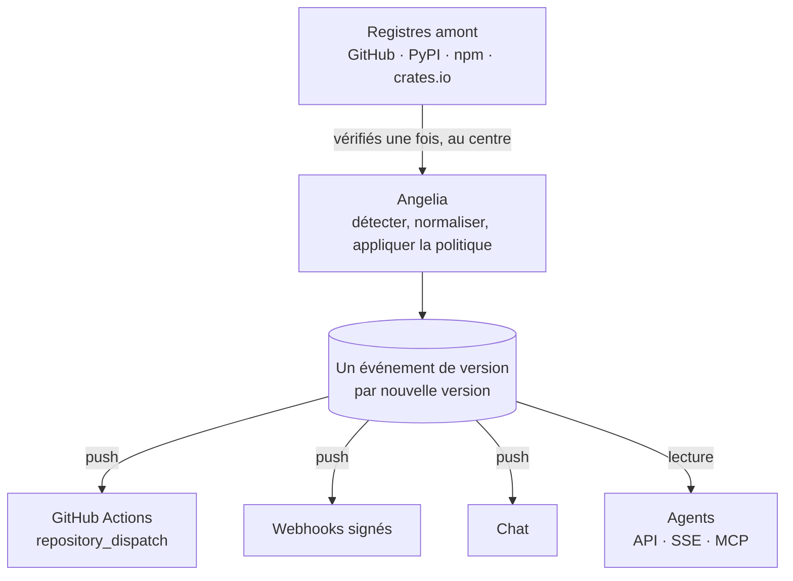
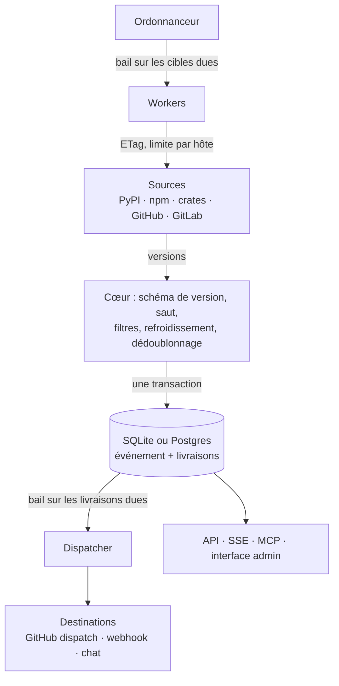

Tous les logiciels que je maintiens reposent sur quelque chose que je ne contrôle pas : une bibliothèque, un framework, une plateforme. Quand l'un d'eux publie une nouvelle version, c'est exactement le moment où mon code peut casser. La plupart du temps, il ne se passe rien. Parfois une fonction a été renommée, une classe de base a changé, une API dépréciée a enfin été supprimée, et je l'apprends par le rapport de bug d'un utilisateur une semaine plus tard.

C'est encore plus vrai quand ce qu'on maintient est **un plugin d'un gros projet**. Une intégration Home Assistant vit à l'intérieur de Home Assistant : elle importe ses classes, suit ses conventions et tourne dans sa boucle d'événements. Home Assistant publie une nouvelle version chaque mois, avec des bêtas la semaine précédente. Donc chaque mois, mes intégrations peuvent casser sans que je change une seule ligne.

La solution semble simple : *quand une nouvelle version sort, lancer mes tests dessus*. Mais il manque une pièce. GitHub peut démarrer un workflow quand quelque chose se passe **dans votre dépôt** (un push, une pull request, une release que vous publiez). Il ne peut pas en démarrer un quand quelque chose se passe **dans celui de quelqu'un d'autre** : il n'existe aucun événement « home-assistant/core a publié 2026.11.2 » auquel s'abonner. Alors tout le monde scrute.

**[Angelia](https://github.com/angelia-dev/angelia)** inverse le modèle. Vous lui dites de quoi vous dépendez (les *surveillances*, ou *watches*), il les vérifie efficacement, et quand une nouvelle version apparaît il **pousse** un événement propre et signé vers qui en a besoin : un workflow GitHub, un webhook, un canal de chat, un agent IA. Cet article explique pourquoi je l'ai construit, montre le vrai exemple Home Assistant qui tourne sur mon intégration, puis détaille son fonctionnement interne et le peu qu'il coûte à faire tourner.


**En bref.** Angelia est un bus d'événements de versions auto-hébergé écrit en Go : **détecter → normaliser → livrer**. Il surveille PyPI, npm, crates.io et les releases GitHub et GitLab, et envoie un [CloudEvent](https://cloudevents.io/) par nouvelle version vers GitHub (`repository_dispatch`), des webhooks signés, le chat, ou les agents via une API de lecture, SSE et MCP. Un seul binaire, SQLite ou Postgres, Apache-2.0. [Documentation](https://angelia-dev.github.io/docs/).


## 1. Pourquoi j'en avais besoin : dépendre de versions qu'on ne contrôle pas

Je maintiens deux intégrations personnalisées pour Home Assistant :

- [**Hitachi CSNet Home**](https://github.com/mmornati/home-assistant-csnet-home), qui pilote ma pompe à chaleur Hitachi via son API cloud ([l'histoire de la rétro-ingénierie est ici](/reverse-engineering-hitachis-cloud-api-with-ai-from-browser-devtools-to-a-full-home-assistant-integration/), en anglais) ;
- [**MEL Garbage Collection**](https://github.com/mmornati/home-assistant-mel-garbage-collection), qui affiche les jours de collecte des déchets de la Métropole Européenne de Lille sous forme de calendrier et de capteurs.

Les deux ont le même problème. Elles sont petites, changent rarement, et dépendent d'une plateforme qui change **tous les mois**. Il y a un mois, j'ai reconstruit la CI de CSNet pour que [Claude lise chaque version de Home Assistant](/fr/home-assistant-sort-chaque-mois-claude-lit-les-notes-de-version/) et ouvre une issue avec ce qui risque de casser. Ce workflow avait besoin d'un déclencheur : *« une nouvelle version de Home Assistant est sortie »*.

Le même besoin apparaît partout dès qu'on le cherche :

- une bibliothèque épinglée dans `requirements.txt` publie une version mineure : on veut que la suite de tests tourne dessus **avant** que Renovate ou Dependabot n'ouvre la PR, ou avant que les utilisateurs ne mettent à jour ;
- une image de base ou un outil en ligne de commande utilisé dans la CI reçoit un correctif de sécurité : on veut le savoir aujourd'hui, pas au prochain rebuild planifié ;
- un agent IA qui maintient un projet devrait être prévenu qu'une chose a changé, au lieu de tout réexaminer à chaque exécution.

Le schéma commun : **un événement se produit en amont, et la réaction appartient à l'aval**, dans un endroit que l'amont ne connaît pas.

## 2. Pourquoi scruter depuis GitHub Actions n'est pas la solution

Faute d'événement auquel s'abonner, le contournement habituel est un workflow planifié. Mon dépôt CSNet avait exactement ça jusqu'à la semaine dernière, dans `ha-release-review.yaml` :

```yaml
# GitHub has no webhook for releases of another repository, so this polls PyPI.
on:
  schedule:
    - cron: '17 */6 * * *'
```

Toutes les six heures, un runner démarre, installe Python, demande à PyPI la dernière version de Home Assistant, la compare avec ce qu'il a déjà analysé, et dans presque toutes les exécutions ne fait rien. Ça marche, mais il y a trois problèmes.

**Ce n'est pas fiable, et GitHub le dit.** La [documentation de l'événement `schedule`](https://docs.github.com/fr/actions/reference/workflows-and-actions/events-that-trigger-workflows#schedule) est explicite : l'événement peut être retardé pendant les périodes de forte charge, le début de chaque heure est une période de forte charge, et si la charge est suffisamment élevée, certains jobs en file d'attente peuvent être abandonnés. En plus, dans un dépôt public, les workflows planifiés sont automatiquement désactivés après 60 jours sans activité. Un petit plugin stable est exactement le genre de dépôt qui reste deux mois sans activité, et la surveillance s'arrête alors en silence.

**C'est lent par construction.** Avec un cron toutes les six heures, une version attend en moyenne trois heures avant d'être remarquée, plus quand l'exécution est retardée. Scruter toutes les cinq minutes à la place consomme des minutes de runner et du quota d'API pour rien 99 % du temps.

**Ça ne passe pas à l'échelle de ce dont on dépend.** Chaque dépôt scrute chaque dépendance de son côté. Deux intégrations qui surveillent Home Assistant, ce sont deux crons qui posent la même question. Dix projets avec dix dépendances chacun, ce sont cent petits jobs de scrutation, chacun avec son état, son token et ses bugs (« ai-je déjà analysé cette version ? »).

Scruter n'est pas mauvais en soi : il faut bien que quelqu'un interroge le registre. Le problème, c'est **qui** scrute et **à quelle fréquence**. C'est la partie qu'Angelia prend en charge.

## 3. L'idée : inverser le modèle

Angelia scrute une seule fois, de façon centralisée et soigneuse, et transforme ça en **push** :

1. **Vous déclarez des surveillances** : « home-assistant/core sur les releases GitHub », « requests sur PyPI », « serde sur crates.io ». Chaque surveillance a un intervalle, un schéma de version (SemVer, PEP 440, CalVer…) et une politique (inclure les pré-versions ou non, ignorer les patchs, attendre un délai de refroidissement).
2. **Angelia détecte** une nouvelle version, la compare avec la précédente et calcule le type de changement : majeur, mineur, patch, pré-version, retrait.
3. **Il écrit un événement de version immuable** au format [CloudEvents](https://cloudevents.io/), avec le paquet, la version, la version précédente, le type de saut, les URL et les labels de la surveillance.
4. **Il livre cet événement** à chaque abonnement qui correspond : un `repository_dispatch` sur un dépôt GitHub, un webhook signé, un message de chat, ou un flux que les agents peuvent lire.



Le dépôt ne demande plus « y a-t-il du nouveau ? » toutes les six heures. Il a simplement un workflow qui dit *« quand Angelia me dit que Home Assistant a publié une version, teste-la »*. Pas de cron, pas d'état, pas de logique « déjà vu » dans le dépôt.

## 4. Un vrai exemple : Home Assistant 2026.11.2 et mon intégration CSNet

C'est la [recette de la documentation](https://angelia-dev.github.io/docs/recipes/home-assistant-agentic/), qui tourne pour de vrai sur mon instance. Toute la chaîne est aussi dans cette vidéo narrée de 90 secondes (comme [mes autres vidéos](/fr/videos-narrees-sans-fichier-video-canvas-javascript/), elle est dessinée en JavaScript sur un canvas, ce n'est pas un fichier vidéo ; la narration est en anglais, les sous-titres aussi) :

<div style="container-type:inline-size;margin:1.5rem 0">
<iframe src="/videos/angelia-home-assistant/?embed=1&lang=en" title="Home Assistant to an agentic PR" loading="lazy" allow="fullscreen; autoplay" allowfullscreen style="display:block;width:100%;height:calc(56.25cqw + 40px);border:0;border-radius:8px;background:#0d0b2a"></iframe>
</div>

*Appuyez sur Play (avec le son). [Ouvrez-la en pleine page](/videos/angelia-home-assistant/?lang=en) pour avoir la liste des chapitres.*

### Côté Angelia

Une destination (*sink*, où envoyer), une surveillance (quoi vérifier), un abonnement (quels événements vont vers quelle destination) :

```yaml
# watches.yaml
version: 1

sinks:
  - name: csnet-home-ci
    kind: github-dispatch
    config:
      repo: mmornati/home-assistant-csnet-home
      token_ref: gh-dispatch-csnet      # PAT fin : Contents en lecture/écriture sur ce dépôt uniquement
      event_type: ha-release

watches:
  - name: home-assistant
    source: github-release
    coordinates: { repo: home-assistant/core }
    scheme: calver                      # 2026.11.2, 2026.12.0b0
    interval: 30m
    labels: { consumer: csnet-home }
    policy:
      prerelease: include               # les bêtas aussi : trouver la casse avant les utilisateurs

subscriptions:
  - name: ha-to-csnet-home
    sink: csnet-home-ci
    filter:
      labels: { consumer: csnet-home }
      type: [release.published, release.prerelease]
    policy:
      cooldown: 1h                      # laisser le wheel arriver sur PyPI ; l'ignorer s'il est retiré
```

Quelques lignes méritent une explication :

- **`scheme: calver`** : les versions de Home Assistant sont des dates. Angelia sait que `2026.12.0b0` est une pré-version de `2026.12.0`, et que `2026.11.1 → 2026.11.2` est un patch.
- **`prerelease: include`** : les bêtas sont le moment où la casse coûte le moins cher à corriger, une semaine avant que les utilisateurs ne reçoivent la version.
- **`cooldown: 1h`** : Home Assistant publie la release GitHub un peu avant que le wheel n'arrive sur PyPI. Attendre une heure garantit que la CI peut vraiment faire `pip install` de la version, et une version retirée dans l'heure n'atteint jamais la CI.

Le token est stocké comme secret Angelia (`angelia secret set gh-dispatch-csnet --from-file pat.txt --host api.github.com`), lié à l'hôte de l'API GitHub, et jamais écrit dans le fichier. Ma deuxième intégration, MEL Garbage Collection, a les trois mêmes blocs avec sa propre destination : **la même surveillance sert les deux**, et Home Assistant n'est vérifié qu'une fois.

### Côté dépôt

Le dépôt reçoit un workflow qui écoute ce seul type d'événement, [`angelia-ha-release.yaml`](https://github.com/mmornati/home-assistant-csnet-home/blob/main/.github/workflows/angelia-ha-release.yaml). En simplifié :

```yaml
name: HA Release from Angelia
on:
  repository_dispatch:
    types: [ha-release]

permissions:
  contents: read

concurrency:                          # une livraison renvoyée porte le même identifiant d'événement
  group: angelia-${{ github.event.client_payload.event_id }}

jobs:
  validate:                           # la charge utile est une entrée non fiable : la vérifier d'abord
    runs-on: ubuntu-latest
    steps:
      - env:
          PACKAGE: ${{ github.event.client_payload.package }}
          VERSION: ${{ github.event.client_payload.version }}
        run: |
          [ "$PACKAGE" = "home-assistant/core" ] || exit 1
          [[ "$VERSION" =~ ^20[0-9]{2}\.[0-9]+\.[0-9]+(b[0-9]+)?$ ]] || exit 1

  test:                               # installer cette version exacte de HA et lancer les tests
    needs: validate
    # … installer HA $VERSION, test d'import, pytest

  review:                             # lancer la revue Claude une fois par version mensuelle
    needs: [validate, test]
    # … gh workflow run ha-release-review.yaml -f version="$VERSION"
```

L'ancien cron de six heures a été supprimé dans le même commit : [*« start HA release checks from Angelia instead of polling PyPI »*](https://github.com/mmornati/home-assistant-csnet-home/commit/dc19cf96ecf4116a51db6b6bbc82fcf6cd448866).

### Ce qui s'est passé le 16 novembre

Home Assistant a publié **2026.11.2** le lundi soir. Voici la vraie chronologie, d'après l'API de GitHub, l'événement d'Angelia et l'exécution Actions :

| Heure (UTC) | Quoi |
|---|---|
| 20:03:59 | GitHub publie la [release 2026.11.2](https://github.com/home-assistant/core/releases/tag/2026.11.2) de `home-assistant/core` |
| 20:04:02 | Angelia la détecte : `patch` depuis `2026.11.1`, schéma `calver` (**3 secondes plus tard**, une vérification chanceuse ; le pire cas est l'intervalle de 30 minutes) |
| 20:04 → 21:04 | le délai de refroidissement d'une heure de l'abonnement s'écoule |
| 21:04:05 | Angelia envoie le `repository_dispatch` ; GitHub démarre l'[exécution du workflow](https://github.com/mmornati/home-assistant-csnet-home/actions/runs/43956230731) |
| 21:04:15 | charge utile validée |
| 21:05:14 | Home Assistant 2026.11.2 installé, test d'import et tests unitaires passés |
| 21:05:23 | étape de revue : 2026.11 a déjà son issue de revue Claude, donc rien de nouveau à ouvrir |

De la publication aux tests : **une heure et 84 secondes**, et l'heure est un choix de ma part. Avec l'ancien cron, la même version aurait été remarquée entre 17 minutes et six heures plus tard, si l'exécution planifiée n'avait pas été retardée ou abandonnée.

Voici l'événement tel qu'Angelia l'a enregistré et livré, dans l'interface d'administration :


La charge utile que reçoit le workflow contient les mêmes informations : `package`, `version`, `previous_version`, `bump`, `event_id`. L'`event_id` compte : la livraison est *au moins une fois*, donc une livraison renvoyée porte le même identifiant et le groupe `concurrency` du workflow transforme un doublon en non-événement.

## 5. L'interface d'administration

Angelia a commencé en « fichier YAML et ligne de commande uniquement », et c'est toujours la façon GitOps de le configurer. Depuis cette semaine, il a aussi une **interface web d'administration**, intégrée au binaire et servie sous `/ui/`, avec connexion GitHub (ou n'importe quel fournisseur OpenID Connect) et trois rôles : lecteur, éditeur, administrateur.


Le design suit la métaphore d'un « fil d'agence de presse » : chaque surveillance est un compartiment d'un casier de tri avec sa dernière version, le type de saut et une jauge jusqu'à la prochaine vérification, et chaque version est une fiche tamponnée ROUTINE (patch), BULLETIN (mineure) ou FLASH (majeure, ou un échec qui demande de l'attention). La page Events montre les derniers jours sous forme de ruban perforé, un trou par version, avec le CloudEvent à côté. La page Deliveries montre ce qui a été envoyé où, avec les nouvelles tentatives, les lettres mortes et un bouton pour rejouer.

L'interface appelle la même API REST que la ligne de commande, avec les mêmes contrôles de permissions et les mêmes traces d'audit. Les surveillances qui viennent du fichier sont marquées d'un badge et ne se modifient pas dans le navigateur : le fichier reste la source de vérité.

## 6. Comment ça marche à l'intérieur

Angelia est un seul binaire Go avec quatre rôles qui peuvent tourner ensemble (par défaut) ou séparément pour monter en charge : **API**, **ordonnanceur**, **worker** et **dispatcher**. Le plus intéressant n'est pas la liste des fonctionnalités, c'est la façon d'éviter le travail inutile. Un bus de versions passe presque toute sa vie à demander « du nouveau ? » et à recevoir « non », donc tout le design vise à rendre ce « non » aussi bon marché que possible.



**Un ordonnanceur continu, pas un traitement par lots.** Un cron qui boucle sur toutes les surveillances crée des pics, atteint les limites de débit, et laisse un registre lent retarder tous les autres. Dans Angelia, chaque cible a son propre `next_check_at`, avec une part d'aléatoire, et les workers prennent un *bail* sur celles qui sont dues, directement dans la base. Sur Postgres, le bail utilise `FOR UPDATE SKIP LOCKED`, donc plusieurs processus peuvent se partager le travail sans courtier de messages. Sur SQLite, un seul processus s'en charge.

**La mutualisation.** Les surveillances pointent vers une *cible* partagée. Si cinquante surveillances suivent `pypi:requests` (cinquante équipes, cinquante labels, cinquante destinations), Angelia fait **une** requête, pas cinquante. Mes deux intégrations Home Assistant partagent une seule vérification.

**Des requêtes conditionnelles partout.** Chaque cible garde son ETag et son Last-Modified. La vérification suivante envoie `If-None-Match`, et un registre inchangé répond `304 Not Modified` avec un corps vide. Sur GitHub, une requête authentifiée qui reçoit un 304 [ne compte même pas dans la limite de débit](https://docs.github.com/fr/rest/using-the-rest-api/best-practices-for-using-the-rest-api#use-conditional-requests-if-appropriate). Dans le benchmark ci-dessous, **83 % des vérifications** ont reçu un 304.

**Un limiteur de débit par hôte amont.** `api.github.com` a un seau à jetons dimensionné sur sa vraie limite (4 990 requêtes par heure plus une rafale de 10 pour un token), PyPI et npm ont le leur. Angelia ralentit avant que le registre n'ait à dire non, donc les benchmarks ne voient aucune réponse 429 ni 403.

**Des sources simples, un cœur intelligent.** Un plugin de source ne fait que lister des versions : `List(cible, état) → versions + nouvel ETag`. L'analyse des versions, le calcul du saut, le filtrage des pré-versions, le refroidissement et le dédoublonnage se font une seule fois, dans le cœur, de la même façon pour tous les écosystèmes. L'ordre des versions a son propre benchmark, comparé à l'ordre de chaque registre, parce que « 2.0.0rc1 est-elle plus récente que 2.0.0b3 ? » est exactement là où les bugs se cachent.

**Événement et livraison sont séparés, et écrits ensemble.** Une nouvelle version crée un événement immuable et une ligne de livraison par abonnement correspondant, **dans la même transaction** que le changement d'état (un *outbox* transactionnel). Le dispatcher prend ensuite un bail sur les livraisons dues, réessaie avec un délai croissant, et déplace une livraison qui échoue toujours vers une liste de lettres mortes qu'on peut rejouer. Un crash entre « détecté » et « envoyé » ne perd rien : le benchmark tue le processus avec `SIGKILL` 100 fois pendant les livraisons et vérifie que chaque livraison arrive quand même.

**Push et pull.** La CI veut du push (`repository_dispatch`, webhooks signés en HMAC). Les agents n'ont souvent pas d'URL publique, alors ils *lisent* : une API d'événements avec curseur, un flux Server-Sent Events, et un serveur MCP avec des outils comme `events_since` et `latest_version`.

**Peu de dépendances, une petite empreinte.** Go avec `CGO_ENABLED=0`, SQLite via un pilote en Go pur, Postgres via `pgx` quand on a besoin de haute disponibilité, une image distroless, des métriques Prometheus, des traces OpenTelemetry, des logs JSON. L'interface est en React et TypeScript, construite avec Vite et intégrée avec `go:embed`, polices comprises, donc la Content Security Policy n'autorise que `'self'`.

## 7. Performances : ce que coûte la surveillance de 10 000 choses

L'architecture a fixé des objectifs réussite/échec avant de choisir Go, et le dépôt contient un [outillage de benchmark](https://github.com/angelia-dev/angelia/tree/main/bench) pour les vérifier. Les benchmarks qui mesurent le temps et la mémoire tournent sur une machine connue : mon portable (Apple M4, 16 Go, OrbStack), avec Angelia dans un conteneur Linux limité à **1 vCPU et 256 Mo de mémoire, sans swap**, face à un faux registre qui publie de nouvelles versions pendant l'exécution.

Pour cet article, je les ai relancés aujourd'hui sur le `main` actuel (avec la nouvelle interface et le travail sur Postgres), à côté de la première exécution du 9 novembre :

| Benchmark 1 : 10 000 surveillances, vérifiées toutes les 5 minutes | Objectif | 9 nov. (`a7fe3ea`) | Aujourd'hui (`5890cc2`) |
|---|---|---|---|
| Surveillances (PyPI, npm, crates.io, GitHub ; 2 500 chacun) | | 10 000 | 10 000 |
| Retard entre échéance et vérification, P95 | < 2 min | **1,0 s** | **1,1 s** |
| Mémoire du conteneur, max | < 100 Mo | **45,1 Mio** | **46,0 Mio** |
| CPU, moyenne (sur 1 vCPU) | < 20 % | **8,1 %** | **13,5 %** |
| Vérifications en 30 minutes | | 60 765 requêtes | 60 672 requêtes |
| Réponses `304 Not Modified` | | 83 % | 83 % |
| Erreurs de limite de débit (429 / 403) | 0 | 0 | 0 |

| Benchmark 2 : empreinte au repos, 100 surveillances | Objectif | 9 nov. | Aujourd'hui |
|---|---|---|---|
| Mémoire après la phase de chauffe, max | < 40 Mo | **26,6 Mio** | **33,8 Mio** |
| Binaire (build de release) | < 40 Mo | **23,3 Mo** | **30,7 Mo** |
| Image du conteneur, non compressée | < 50 Mo | **39,4 Mo** (9,8 Mo compressée) | **49,1 Mo** (12,0 Mo compressée) |

Ce que ces chiffres veulent dire en pratique : **10 000 surveillances vérifiées toutes les cinq minutes**, environ 33 vérifications par seconde, utilisent **moins de mémoire qu'un seul onglet de navigateur** et, en moyenne, entre 8 % et 14 % d'un cœur de processeur. Chaque vérification démarre en moyenne moins d'une seconde après son échéance, donc rien ne s'accumule. Un serveur domestique, un Raspberry Pi ou le plus petit VPS peut surveiller toutes les dépendances de tous vos projets.

La comparaison est aussi un avertissement utile. Entre les deux exécutions, Angelia a gagné l'interface d'administration (React, intégrée avec ses polices), le stockage Postgres et la connexion OpenID Connect. Le retard et la mémoire sous charge n'ont pas bougé, mais le CPU moyen est passé de 8 % à 13,5 %, le binaire de 23 à 31 Mo et l'image de 39 à 49 Mo, **juste sous son objectif de 50 Mo**. Tous les objectifs passent encore, et la prochaine fonctionnalité qui ajoute du poids devra le compenser. C'est le fait d'avoir le benchmark dans le dépôt qui rend ça visible.

Deux autres résultats de l'outillage :

- **GitHub avec un seul token** (2 000 vrais dépôts publics, toutes les heures, pendant 6,5 heures) : **aucune** réponse 403 ni 429 de `api.github.com`, au plus 3 779 requêtes décomptées du token pendant l'heure la plus chargée pour une limite de 5 000, avec un conteneur à 0,8 % d'un CPU en moyenne. Le taux de réponses ETag y était de 60 %, moins que les 90 % attendus, parce que la liste des releases de GitHub change quand les compteurs de téléchargement changent. C'est une story de suivi.
- **Résistance aux crashs** (`kill -9` 100 fois pendant les livraisons) : aucune livraison perdue, sur SQLite comme sur Postgres.

Le dispatcher n'est pas non plus le goulot d'étranglement : avec 8 workers et un faux destinataire lent (125 ms par appel), un dispatcher livre environ **60 événements par seconde**, deux sur le même Postgres environ 120, soit 94 % du plafond théorique.

## 8. Construit avec des agents, aussi

Comme [Horae](/fr/un-humain-un-tableau-et-une-equipe-dagents/), Angelia a été construit surtout par des agents IA qui suivent un tableau GitHub Project partagé, avec moi comme mainteneur qui valide les tickets, répond aux questions et approuve les versions. Le tableau a été créé le 30 octobre et la v0.1.0 a été taguée le 10 novembre. L'article précédent raconte ce côté de l'histoire ; celui-ci parle de ce que fait le produit.

## 9. L'essayer

- **[Documentation](https://angelia-dev.github.io/docs/)** : installation, premier événement en quelques minutes, sources, destinations, recettes.
- **[angelia-dev/angelia](https://github.com/angelia-dev/angelia)** : le code, les [releases](https://github.com/angelia-dev/angelia/releases) (binaires signés et image de conteneur), l'architecture et les ADR.
- **[La recette Home Assistant](https://angelia-dev.github.io/docs/recipes/home-assistant-agentic/)** : tout ce qui est montré ci-dessus, prêt à adapter à votre propre intégration.
- **[angelia-dev/actions](https://github.com/angelia-dev/actions)** et **[helm-charts](https://github.com/angelia-dev/helm-charts)** : consommer les événements dans les workflows, déployer sur Kubernetes.

L'état du projet, honnêtement : c'est une jeune pré-version (v0.2.0, avec la v0.3.0 en release candidates). Le mode push avec les fichiers de surveillance est le chemin le plus testé ; l'API de lecture, MCP et Postgres sont sur `main`. Si vous maintenez un plugin, une intégration ou une bibliothèque qui dépend des versions de quelqu'un d'autre, j'aimerais savoir de quelles sources et destinations vous auriez besoin ensuite.

Le schéma est ce que je garderais même sans jamais utiliser Angelia : **détecter de façon centralisée, livrer un événement, laisser chaque dépôt réagir**. Votre CI ne devrait pas avoir à demander toutes les six heures si le monde a changé. On devrait le lui dire.
