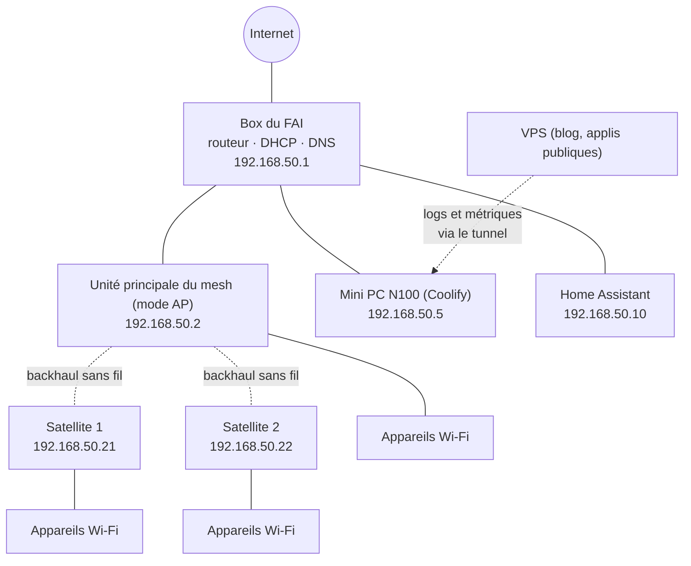
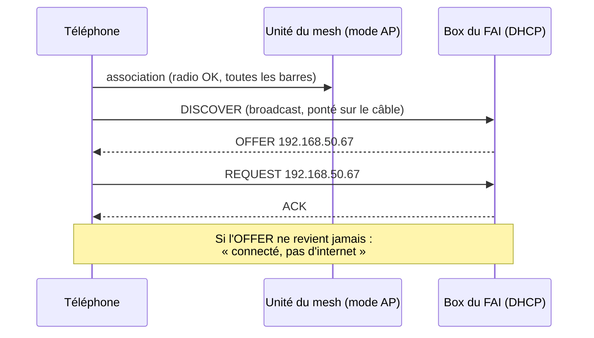
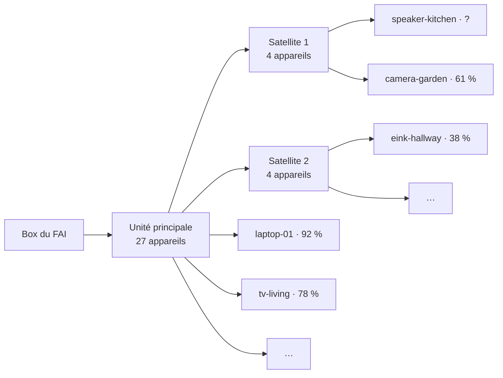

Chaque foyer a un service informatique. Chez moi, c'est moi, et les tickets arrivent en personne : *« Le Wi-Fi ne marche pas. »* *« Plex est encore bloqué. »* *« La télé dit pas d'internet, mais mon téléphone marche. »*

Pendant des années, ma réponse standard a été celle de Roy dans *The IT Crowd* : **« Vous avez essayé de l'éteindre et de le rallumer ? »** Redémarrer la box, redémarrer le mesh, redémarrer le serveur si ça ne suffit pas. Ça marche étonnamment souvent. Mais il y a un gros problème : quand ça marche, **on n'apprend jamais ce qui était cassé**. Et parfois, c'est le redémarrage *lui-même* qui casse tout.

Ces dernières semaines, avec Claude Code qui tapait la plus grande partie du code, j'ai transformé mon serveur maison en quelque chose capable de répondre à trois questions avant que je touche à un bouton d'alimentation :

1.  **Est-ce que ça tourne ?** — Uptime Kuma, organisé selon « ce qu'il faut regarder quand ça passe au rouge ».
2.  **Pourquoi ça ne tourne pas ?** — OpenObserve, avec les logs et les métriques du serveur, des conteneurs et de Home Assistant.
3.  **Pourquoi cet appareil n'arrive pas à se connecter ?** — un petit observateur DHCP sur le câble, et la vue de Home Assistant sur le maillage Wi-Fi.

Et puis une quatrième chose que je n'avais pas prévue : une fois toutes ces données au même endroit, Claude pouvait les lire via MCP. La dernière section de cet article est une vraie alerte qui s'est déclenchée *pendant que je l'écrivais*, déboguée depuis le chat.


**Tout dans cet article est pseudonymisé.** Les adresses réseau, les adresses MAC, les noms d'hôtes, les noms de domaine et les noms d'appareils ci-dessous ne sont pas les vrais. Je les ai remplacés de manière cohérente (un même appareil garde le même faux nom du début à la fin), donc les histoires et les chiffres tiennent toujours. Les latences, les niveaux de signal, les compteurs et les volumes de trafic sont les vraies mesures. J'ai aussi laissé de côté quelques services qui tournent sur la même machine mais n'ont rien à voir avec le réseau.


## L'installation en un coup d'œil

Rien d'exotique, et sans doute proche de ce que beaucoup de gens ont à la maison :

*   **La box du FAI** est le routeur, le serveur DHCP et le relais DNS de toute la maison.
*   **Un mesh Wi-Fi** (une unité principale et deux satellites) tourne en **mode point d'accès** : il fait le pont entre les clients Wi-Fi et le LAN filaire, sans routage ni DHCP propre. Un seul réseau, un seul serveur DHCP, pas de double NAT.
*   **Un mini PC avec un Intel N100** (16 Go de RAM) fait tourner tout l'auto-hébergé, géré avec [Coolify](/fr/migrer-de-hashnode-vers-hugo-avec-coolify/) : Plex et ses compagnons, un conteneur VPN, quelques applis perso, le reverse proxy, Authentik pour le single sign-on, et un tunnel Cloudflare pour les parties accessibles de l'extérieur.
*   **Home Assistant** tourne sur sa propre machine et sait beaucoup de choses sur le réseau sans que personne ne le lui demande (j'y reviens plus loin).
*   **Un petit VPS** héberge ce blog et quelques applis publiques. Il envoie lui aussi ses logs à la maison.



## Couche 1 : Uptime Kuma, organisé selon ce qu'il faut regarder

[Uptime Kuma](https://github.com/louislam/uptime-kuma) est l'outil de monitoring le plus simple que je connaisse : un conteneur, une interface web, et un moniteur, c'est trois champs. Le piège, c'est que c'est *tellement* simple qu'on finit avec quatre-vingts moniteurs dans une liste à plat, et quand six d'entre eux passent au rouge en même temps, on ne sait toujours pas par où commencer.

J'ai donc réorganisé les miens autour d'une seule question : **quand c'est rouge, qu'est-ce que je vais regarder ?**

| Groupe | Ce qu'il contient |
|---|---|
| 🌐 Internet & réseau | Ping de la box, ping internet, DNS via la box, résolution de noms publics, l'unité du mesh et les deux satellites, santé du DHCP, « les clients Wi-Fi obtiennent une IP », « trafic internet normal » |
| 🚪 Accès public | Vérifications de bout en bout via Cloudflare → tunnel → proxy → SSO : la page de login doit contenir son mot-clé, une appli protégée doit répondre par une redirection vers le login |
| 🔐 Edge | Le reverse proxy, le conteneur du tunnel, le serveur SSO, son worker et sa base de données |
| 🎬 Médias | Plex (HTTP **et** conteneur), Tautulli, le gestionnaire de requêtes, les serveurs d'e-books |
| 🔒 VPN | Le conteneur VPN, et la santé de ce qui en dépend |
| 🤖 Applis | Mes propres applis et leurs workers en arrière-plan |
| 🧰 Plateforme | Coolify, le serveur de notifications, le proxy du socket Docker, le partage de fichiers, la sauvegarde hebdomadaire |
| 💾 Santé du serveur | Occupation disque de chaque point de montage, mémoire |
| 🏡 Maison connectée | Home Assistant (local et distant), MQTT |

Deux tags traversent les groupes : `public` pour tout ce qui est exposé sur internet et `critical` pour la poignée d'éléments qui entraînent tout le reste dans leur chute (routeur, internet, proxy, tunnel, SSO, VPN, disques, mémoire, sauvegarde). Les alertes partent vers un [ntfy](https://ntfy.sh) auto-hébergé, donc elles arrivent en notifications push sur mon téléphone.

L'ordre des groupes compte plus qu'il n'y paraît. Si « ping de la box » est rouge, rien en dessous ne veut rien dire. Si le réseau est vert mais « Accès public » est rouge, c'est le tunnel ou le proxy. Si une seule appli est rouge, c'est cette appli. **Le tableau de bord se lit de haut en bas comme un arbre de diagnostic.**

Quelques leçons apprises en chemin :

*   **Vérifier de bout en bout, pas seulement « le conteneur tourne ».** Un conteneur peut être en route alors que la route du proxy vers lui est cassée. Mes vérifications publiques passent par le vrai chemin, depuis l'extérieur, et attendent la *bonne* réponse : une appli protégée doit rediriger vers le login SSO. Un `200` à cet endroit serait en fait un problème de sécurité.
*   **Plex a droit à deux moniteurs.** Une vérification HTTP sur l'endpoint web *et* une vérification Docker sur le conteneur. Plex tourne sur le réseau de l'hôte avec le transcodage matériel, et il a plus d'une façon d'être « à moitié vivant ».
*   **Le VPN est une dépendance, pas un service.** Les conteneurs qui ne doivent parler qu'à travers le VPN partagent son namespace réseau : **pas de VPN, pas de réseau**, par conception. Le moniteur qui compte n'est donc pas « le conteneur VPN tourne-t-il ? » mais « ce qui est derrière arrive-t-il vraiment à joindre l'extérieur ? ». Si le tunnel tombe, ils se retrouvent coupés au lieu de fuiter sur ma vraie connexion, et Kuma me le dit.
*   **Les moniteurs push servent de signal de vie (« dead-man switch »).** L'occupation disque, la mémoire, la sauvegarde hebdomadaire et la tâche de mise à jour ne sont pas interrogées : elles *poussent* vers Kuma, et Kuma passe au rouge quand le push n'arrive pas à temps. Ça attrape à la fois « la sauvegarde a échoué » et « la tâche de sauvegarde est morte et personne ne l'a remarqué ».
*   **Une vérification verte peut mentir.** Ma tâche de mise à jour hebdomadaire signalait un succès alors que deux pulls d'images avaient en réalité échoué (une limite de débit du registry), parce qu'elle lisait l'état du service 30 secondes après avoir demandé un redémarrage, quand les anciens conteneurs tournaient encore. La solution n'était pas un nouveau moniteur mais une meilleure question : vérifier la date de création des conteneurs, pas seulement « est-ce qu'il tourne ».

## Couche 2 : OpenObserve, pour le « pourquoi »

Uptime Kuma me dit *que* quelque chose est rouge. Il ne me dit pas *pourquoi*, et il n'a aucune mémoire de ce qui s'est passé à 3 h du matin. Pour ça, j'ai installé [OpenObserve](https://openobserve.ai), un binaire unique qui stocke logs, métriques et traces, avec une interface correcte et du SQL par-dessus.

Trois agents l'alimentent, tous à côté de lui sur le mini PC :

| Agent | Ce qu'il envoie |
|---|---|
| **Vector** | Les logs de chaque conteneur (étiquetés avec le conteneur et la ressource Coolify), et le log d'accès du reverse proxy |
| **OpenTelemetry Collector** | Les métriques de l'hôte (CPU, mémoire, disques, réseau), les métriques par conteneur, les métriques Prometheus du proxy et du serveur SSO, l'endpoint Prometheus de Home Assistant, et un endpoint OTLP pour mes propres applis |
| **Un petit expéditeur d'événements Home Assistant** | Chaque changement d'état et chaque événement de Home Assistant, sous forme d'un enregistrement JSON chacun |

Le VPS fait tourner la même configuration Vector et Collector et pousse en HTTPS via le tunnel, vers une route d'ingestion qui n'accepte que des `POST` sur quelques chemins, avec un token en écriture seule.

Quelques choix qui se sont révélés importants :

*   **Expurger avant d'envoyer.** Vector retire les query strings, les tokens dans les URL et les motifs de secrets courants de *chaque* champ avant que quoi que ce soit ne soit écrit. Les logs, c'est là que les secrets vont pour être oubliés.
*   **Une rétention par stream.** Les logs des conteneurs et les logs d'accès sont gardés 30 jours, les événements Home Assistant 30 jours, tout le reste 90. Les données vivent sur le NVMe du serveur et sont explicitement *jetables* : les tableaux de bord et les définitions de SLO sont des scripts Python dans un dépôt git, donc je peux les reconstruire en une minute.
*   **Mesurer le volume d'abord.** Avant d'installer quoi que ce soit, j'ai mesuré le volume brut de logs : environ 25 Mo par jour pour tous les conteneurs de la maison, plus 6 pour le proxy. Un serveur maison n'est pas un problème de big data, et c'est ce qui rendait raisonnable un outil en binaire unique.
*   **Les alertes restent dans Uptime Kuma.** OpenObserve a aussi des alertes, et je m'en sers pour quelques notifications de burn rate de SLO, mais le chemin principal d'alerte reste Kuma → ntfy. Un seul endroit où regarder quand le téléphone vibre.

## Couche 3 : « Mon téléphone dit connecté, mais rien ne marche »

C'est le ticket le plus frustrant, et celui que le redémarrage « répare » le plus souvent.

Quand un appareil rejoint un réseau Wi-Fi, il parle d'abord au point d'accès (la partie radio), puis il demande une adresse au réseau avec **DHCP** : il diffuse un `DISCOVER`, un serveur DHCP répond avec un `OFFER`, l'appareil envoie un `REQUEST`, et le serveur confirme avec un `ACK`. Si cette deuxième étape échoue, le téléphone affiche toutes ses barres Wi-Fi et un avertissement « pas d'internet ». Du point de vue du téléphone, le Wi-Fi va bien. **C'est le réseau qui ne répond pas.**



Ce qui peut mal tourner à cet endroit est classique, et invisible depuis l'appareil :

*   le serveur DHCP est lent, surchargé ou bloqué (j'y reviens plus bas) ;
*   **un deuxième serveur DHCP** apparaît — par exemple une unité du mesh repassée en mode routeur après une mise à jour du firmware ou une réinitialisation d'usine — et distribue des adresses sur un autre sous-réseau ;
*   le pool d'adresses est plein ;
*   l'appareil est en limite de couverture radio et ses broadcasts n'arrivent pas.

Aucun de ces problèmes ne se voit avec un ping. J'ai donc construit un petit agent, `netwatch`, qui se place **sur le câble** (réseau de l'hôte sur le mini PC, parce qu'il doit envoyer et entendre des broadcasts) et fait trois choses :

| Vérification | Comment | Ce qu'elle détecte |
|---|---|---|
| **Sonde DHCP active**, toutes les 60 s | Envoie un `DISCOVER` depuis une fausse MAC administrée localement, collecte chaque `OFFER`, et n'envoie jamais de `REQUEST` (aucun bail n'est pris) | La box qui ne répond pas ou répond lentement ; **tout autre serveur DHCP qui répond** |
| **Écoute DHCP passive** | Écoute chaque broadcast DHCP sur le LAN. Le mesh fait passer les broadcasts des clients Wi-Fi sur le câble, donc on les voit de là | Un client qui envoie 3 `DISCOVER` en 2 minutes (« connecté mais pas d'IP »), des `NAK`, un serveur pirate qui répond à un vrai client |
| **Ping et DNS** | La box, l'unité du mesh, les deux satellites, Home Assistant, internet ; le DNS via la box et via le résolveur système | Une unité qui disparaît du LAN, des pertes de paquets, un satellite lent |

Chaque résultat va dans un stream OpenObserve (un enregistrement par événement, avec un `kind`), et deux d'entre eux alimentent des moniteurs push Uptime Kuma : **« DHCP en bonne santé »** et **« les clients Wi-Fi obtiennent une IP »**. Les deux ont un heartbeat de 2 minutes, donc ils passent aussi au rouge si l'agent lui-même meurt.

Un jour normal, c'est ennuyeux, et c'est tout l'intérêt. Sur la dernière semaine : 313 sondes, chacune avec une réponse d'exactement un serveur, en environ 5 ms (la toute première après un redémarrage prend environ une seconde, le temps que la box vérifie que l'adresse est libre) ; chaque unité pinguée a répondu, à chaque fois.

| Cible | RTT moyen | Pire | Indisponible |
|---|---|---|---|
| Box du FAI | 1,1 ms | 16,6 ms | 0 |
| Unité principale du mesh | 0,7 ms | 13,6 ms | 0 |
| Satellite 1 | **17,5 ms** | 52,0 ms | 0 |
| Satellite 2 | 4,0 ms | 9,2 ms | 0 |
| Home Assistant | 0,2 ms | 0,4 ms | 0 |

Que le satellite 1 soit quatre fois plus lent que le satellite 2, c'est le genre de chose qu'on ne remarque jamais tant qu'on ne l'a pas mis en graphique. Les deux utilisent un backhaul sans fil ; le satellite 1 est simplement plus loin, derrière plus de murs. Rien n'est cassé, mais maintenant je sais lequel déplacer si quelqu'un se plaint de ce bout de la maison.


**Les noms d'appareils sont une entrée contrôlée par l'attaquant.** Un observateur DHCP lit les noms d'hôtes que les appareils annoncent eux-mêmes, et ceux-ci finissent dans les logs, les alertes et les tableaux de bord. Une revue de sécurité automatisée de la première version a trouvé trois vrais problèmes : un faux serveur DHCP pouvait se faire passer pour la box en revendiquant son IP (maintenant la MAC est épinglée aussi), une avalanche de MAC aléatoires pouvait faire grossir la table des clients indéfiniment (maintenant bornée), et les noms d'hôtes arrivaient tels quels dans les alertes (maintenant réduits aux lettres, chiffres, `.`, `_` et `-`, 32 caractères au maximum). Une semaine plus tard, la même revue a remarqué que l'infobulle de la carte du tableau de bord affichait les noms d'appareils en HTML. N'importe qui sur votre Wi-Fi peut choisir le nom de son appareil.


Un script Mac le complète côté radio, qu'un câble ne peut pas voir : il enregistre sur quelle unité du mesh se trouve le portable, son signal et sa latence toutes les 10 secondes, et peut capturer chaque serveur DHCP qui répond côté Wi-Fi.

## La réinitialisation qui a « tout réparé »

Voici l'histoire qui m'a convaincu que tout ça en valait la peine.

Un matin, plusieurs appareils n'arrivaient pas à se connecter au Wi-Fi. Toutes les barres, pas d'adresse. J'ai fait ce que tout le monde fait : réinitialisation d'usine de la box, reconfiguration, et tout a remarché. Ticket fermé, Roy serait fier.

Sauf que cette fois, le réseau était surveillé, et le graphique du trafic internet de la box (via l'intégration UPnP de Home Assistant, qui lit les propres compteurs de la box toutes les 30 secondes) racontait une histoire bien plus étrange :

| Période | Téléchargement | Envoi |
|---|---|---|
| Dimanche en journée | 230–350 Mbit/s | 270–375 Mbit/s |
| Dimanche soir | ~120 Mbit/s | ~150 Mbit/s |
| Lundi matin, avant la réinitialisation | ~50 Mbit/s | ~70 Mbit/s |
| **Après la réinitialisation** | **~3 Mbit/s** | **~1,5 Mbit/s** |

Ça fait **2 à 3 To par jour**, avec **plus d'envoi que de téléchargement, même à 3 h du matin**. Aucun foyer ne fait ça. J'ai demandé à Claude de croiser ça avec tout ce qui avait été collecté, et il a écarté les suspects évidents un par un : les conteneurs du serveur avaient déplacé quelques Mbit/s, le trafic VPN était minuscule, et le mesh en mode AP ne compte que son propre trafic d'administration. Il a recalculé le débit à partir du compteur d'octets brut pour écarter une erreur d'unités : les chiffres étaient réels.

L'explication la plus probable, c'est du trafic qui passe *à travers* la box dans les deux sens — une boucle entre la box et le mesh, ou du trafic local routé par elle — et compté deux fois. La réinitialisation a effacé la configuration qui la provoquait, et très probablement le problème DHCP aussi. Je ne peux pas le prouver : il n'y avait qu'un jour d'historique avant la réinitialisation, et rien ne montre le trafic par appareil.

Mais le plus important, c'est ceci : **sans le graphique, le redémarrage aurait « réparé » le Wi-Fi, et je n'aurais jamais su que la box poussait des téraoctets par jour depuis on ne sait combien de temps.** Il y a donc maintenant un moniteur pour ça. Toutes les 5 minutes, un script fait la moyenne du débit de la box sur les 30 dernières minutes, et le moniteur Kuma « trafic internet normal » passe au rouge au-delà de 50 Mbit/s d'envoi soutenu ou de 200 en téléchargement. Je l'ai rejoué sur les anciennes données avant de lui faire confiance : vert maintenant, rouge le dimanche après-midi, rouge le lundi à 4 h du matin.


**Pourquoi mon test de débit n'apparaissait pas.** Juste après la réinitialisation, j'ai lancé un test de débit à environ 400 Mbit/s, et le graphique a affiché… 205. Le capteur UPnP est la différence entre deux lectures d'un compteur, à 30 secondes d'intervalle : un pic de 15 secondes moyenné sur 30 secondes fait la moitié de sa hauteur. Connaissez la résolution de votre capteur avant de croire à un pic, ou à son absence.


### …et le redémarrage qui a tout cassé

Éteindre et rallumer peut aussi être la cause. Quelques jours plus tôt, après un redémarrage, **tous les services publics sont tombés d'un coup.** Le tunnel était en route, les conteneurs étaient en route, mais le reverse proxy avait tout simplement disparu.

Les logs le disaient en une ligne : `all predefined address pools have been fully subnetted`. La configuration par défaut de Docker n'a de place que pour 31 réseaux bridge, et Coolify en crée un par ressource, plus quelques autres pour certains réseaux compose. Tant que le proxy tournait, personne n'avait remarqué que les 31 étaient utilisés. Au redémarrage, il n'a pas pu récupérer de réseau, et il n'est pas revenu. La solution a été un pool d'adresses plus grand dans le `daemon.json` de Docker (256 petits réseaux dans une plage qui ne chevauche pas le LAN) et un nettoyage des réseaux laissés par d'anciennes installations. La leçon est passée dans le monitoring : le proxy est dans le groupe `critical`, et après chaque redémarrage il y a une courte checklist des éléments dont on sait qu'ils ne reviennent pas tout seuls.

## Home Assistant est un capteur réseau

Je ne m'attendais pas à ce que cette partie soit la plus utile. Home Assistant parle déjà à la box et au mesh pour ses propres raisons, donc il **sait** déjà beaucoup de choses sur le réseau :

*   l'**intégration UPnP** sur la box donne le débit internet et les compteurs (le graphique ci-dessus) ;
*   l'**intégration du fabricant du mesh**, même avec le mesh en mode AP, donne pour chaque appareil : s'il est connecté, son signal, son débit de lien et **sur quel point d'accès il se trouve**, plus le CPU et la mémoire des unités ;
*   et chaque appareil avec une IP et une intégration (caméras, prises, écrans, enceintes) remonte son propre signal Wi-Fi.

Tout ça arrive dans OpenObserve par deux chemins : l'endpoint Prometheus de Home Assistant (scrapé par le collector, sans les métriques de comptabilité par entité, environ 2 400 séries), et l'expéditeur d'événements, qui écrit **chaque changement d'état**. Le second demande de la prudence : il contient la présence, les localisations et les routines. Il utilise un token admin (seuls les admins peuvent s'abonner à tous les événements), masque les tokens, les mots de passe et les codes PIN de l'alarme, garde les attributs sous forme d'une seule chaîne JSON pour que 4 000 entités ne deviennent pas 4 000 colonnes, et le stream ne vit que 30 jours, derrière le SSO.

Par-dessus, j'ai construit un tableau de bord « Réseau ». Mon onglet préféré répond à la question à laquelle l'appli du fabricant du mesh répond sur mon téléphone, mais avec l'historique : **qui est sur quelle unité ?**



Dans OpenObserve, c'est un arbre radial (un panneau personnalisé ECharts) où chaque appareil est coloré selon son signal, à côté d'un tableau et de la liste des **derniers déplacements entre unités**. Deux choses en sont sorties dès la première heure :

*   **Une enceinte connectée faisait du ping-pong** entre le satellite 1 et le satellite 2 toutes les quelques minutes. Elle est presque exactement à mi-chemin entre les deux. C'est un bon candidat pour ses coupures occasionnelles, et la rapprocher un peu de l'un des deux est une meilleure solution que n'importe quel redémarrage.
*   **Le mesh remonte un signal de 0 % quand il ne sait pas**, ce qui arrive souvent pour les appareils sur les satellites. Mon premier tableau « signal Wi-Fi le plus faible » avait un minimum de 0 en permanence. Zéro veut maintenant dire « non remonté » et s'affiche en gris.

## Déboguer avec Claude, via MCP

C'est la partie qui a changé ma façon de travailler. OpenObserve et Home Assistant exposent tous les deux un **serveur MCP**, donc Claude peut les interroger directement : du SQL sur n'importe quel stream OpenObserve, et l'état en direct des entités Home Assistant. Pas de copier-coller de captures d'écran, pas d'export CSV. Je pose la question, Claude écrit la requête, lit la réponse, et écrit la requête suivante.

L'enquête sur le trafic ci-dessus a été faite comme ça. Mais le meilleur exemple est arrivé pendant que j'écrivais cet article : **« les clients Wi-Fi obtiennent une IP » est passé au rouge.**

Voici, légèrement condensé, comment ça s'est passé.

**1. Que dit netwatch ?** Le dernier enregistrement `clients_status` listait un client bloqué, un appareil qui s'annonçait comme `eink-hallway`. Ses événements juste avant :

```sql
SELECT _timestamp, msg, requested_ip, server_id
FROM netwatch
WHERE client_mac = 'aa:bb:cc:00:00:2a'
ORDER BY _timestamp
```

| Heure | Événement |
|---|---|
| 16:07:38.7 | `discover` |
| 16:07:39.2 | `discover` |
| 16:07:40.2 | `discover` → **client_stuck** (3 en 120 s) |
| 16:07:40.6 | `request` 192.168.50.41 au serveur 192.168.50.1 |
| 16:07:40.7 | `request` 192.168.50.41 au serveur 192.168.50.1 |

Il n'était donc pas vraiment bloqué : deux secondes et trois essais plus tard, il demandait une adresse *à la box*, ce qui veut dire qu'il avait reçu une offre. Lent, mais pas en échec. La sonde DHCP une minute plus tard a eu sa réponse en 5 ms : le serveur allait bien.

**2. Est-ce un cas isolé ?** Depuis la fin de matinée, le même appareil avait fait exactement la même chose, `discover` puis `request` pour la même adresse, **toutes les 20 minutes, réglé comme une horloge**. Ce n'est pas un problème réseau, c'est un planning.

**3. Que sait Home Assistant de cet appareil ?** Claude est passé aux événements Home Assistant dans OpenObserve :

```sql
SELECT _timestamp, entity_id, state
FROM home_assistant
WHERE str_match(entity_id, 'eink_hallway')
ORDER BY _timestamp DESC
```

| Heure | Capteur | Valeur |
|---|---|---|
| 16:07:51 | `boot_count` | 1341 |
| 16:07:51 | `wifi_signal` | **−82 dBm** |
| 15:47:32 | `boot_count` | 1340 |
| 15:47:32 | `wifi_signal` | −81 dBm |
| 15:06:56 | `wifi_signal` | −61 dBm |
| 13:25:32 | `wifi_signal` | −57 dBm |
| plus tôt | `boot_reason` | `timer` |
| plus tôt | `battery` | 38 % |

Le voilà. `eink-hallway` est un **écran e-paper sur batterie**, un ESP32 qui se réveille de son deep sleep toutes les 20 minutes (`boot_reason: timer`, compteur de démarrages qui augmente de un à chaque fois), rejoint le Wi-Fi depuis zéro, demande une adresse, rafraîchit l'écran et se rendort. Un échange DHCP complet 72 fois par jour. La plupart du temps, son signal est entre −57 et −67 dBm et l'échange prend quelques millisecondes. À −82 dBm, ce qui est la limite de l'utilisable, il lui a fallu trois `DISCOVER`, et c'est exactement la règle « 3 en 2 minutes » que netwatch utilise pour signaler un client bloqué.

**4. Alors, quelle solution ?** Pas un redémarrage. Les options que Claude a proposées :

*   donner à l'écran une **IP statique et le BSSID/canal du point d'accès** dans son firmware, pour qu'il saute l'essentiel du DHCP et du scan après son réveil — plus rapide, et meilleur pour la batterie aussi ;
*   le déplacer, ou déplacer le satellite, un peu : −82 dBm sur un appareil fixé au mur, c'est un problème de placement ;
*   apprendre à netwatch à reconnaître les **dormeurs connus**, des appareils qui font légitimement un échange DHCP complet à chaque réveil, pour qu'un dormeur lent ne m'envoie pas d'alerte.

Le tout a pris quelques minutes, passées surtout à lire. Sans les données, la réponse honnête à « pourquoi l'alerte s'est déclenchée ? » aurait été « aucune idée, c'est redevenu vert ». Sans MCP, ça aurait été moi qui jongle entre deux interfaces, qui écrit du SQL à la main et qui plisse les yeux sur des horodatages dans deux fuseaux horaires différents.


**Donner à une IA l'accès à votre monitoring, c'est lui donner l'accès à votre maison.** Le stream d'événements de Home Assistant contient les allées et venues des gens. Je garde les connexions MCP sur ma propre machine, celle d'OpenObserve utilise un compte de service dédié, et les tableaux de bord et les données sont derrière le SSO. Avant de connecter quoi que ce soit, décidez ce que vous acceptez qu'un modèle lise, et pseudonymisez avant de publier, comme le fait cet article.


## Si vous voulez commencer

Vous n'avez pas besoin de tout ça. Si je devais recommencer, dans l'ordre :

1.  **Uptime Kuma et ntfy.** Un après-midi. Regroupez vos moniteurs selon « ce qu'il faut regarder quand c'est rouge », mettez le routeur et internet en haut, et ajoutez des **moniteurs push** pour tout ce qui tourne selon un planning (sauvegardes, mises à jour). Ça suffit à répondre à la plupart des questions « c'est moi ou c'est cassé ? ».
2.  **Vérifiez le chemin complet.** Au moins un moniteur qui passe exactement par où passe un utilisateur extérieur, et qui attend la *bonne* réponse, pas juste un `200`.
3.  **Activez ce que Home Assistant sait déjà.** Si vous l'avez, ses intégrations routeur et mesh sont du monitoring réseau gratuit. Mettez en graphique le débit et le signal par appareil, même avec l'historique intégré.
4.  **Logs et métriques au même endroit**, une fois que vous avez un « pourquoi » auquel vous ne savez pas répondre. OpenObserve avait la bonne taille pour un serveur maison ; Grafana avec Loki et Prometheus est l'autre choix évident.
5.  **Surveillez le DHCP depuis le câble** si vous avez un mesh et que les gens se plaignent de « connecté mais pas d'internet ». C'est la seule panne que rien d'autre ne voit.
6.  **Puis branchez un assistant sur les données.** Il est bien meilleur que moi à 23 h pour croiser deux streams et remarquer un rythme de 20 minutes.

Et gardez le redémarrage. Ça reste une très bonne solution. Assurez-vous simplement que, la prochaine fois, vous saurez ce qu'il a réparé.

## Comment il a été construit

Plusieurs sessions Claude Code avec Opus 5.5, sur environ trois semaines, sur un dépôt git qui contient la configuration Coolify du serveur. Claude a travaillé en SSH sur le serveur (sans sudo) et dans un navigateur où je me connectais moi-même chaque fois qu'une interface était nécessaire ; il a écrit les fichiers compose, les configurations Vector et Collector, l'agent netwatch (à partir d'une première version esquissée dans un chat), les tableaux de bord sous forme de scripts Python, et les moniteurs Uptime Kuma. Une revue de sécurité automatisée tournait sur chaque changement, et ses découvertes sont l'encadré d'avertissement ci-dessus. Claude a aussi enquêté sur l'anomalie de trafic et sur la panne du pool d'adresses à partir des données. Pour cet article, une session séparée a lu ces sessions et le dépôt, interrogé OpenObserve et Home Assistant via MCP (c'est de là que vient l'enquête sur l'écran e-paper, en direct), et rédigé le texte avec chaque identifiant pseudonymisé. Ma part : choisir quoi surveiller et quoi laisser de côté, me connecter quand il le fallait, décider des seuils, et faire la réinitialisation d'usine. Il y a des habitudes qui ont la vie dure.
