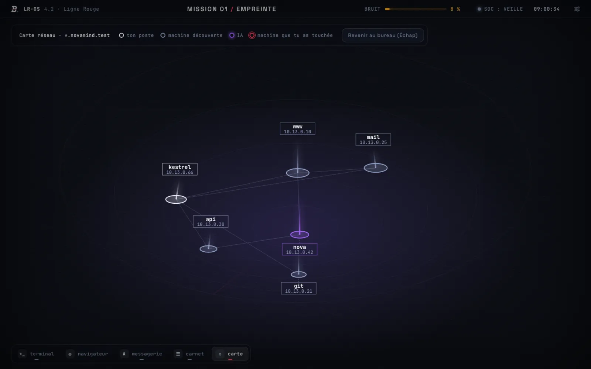
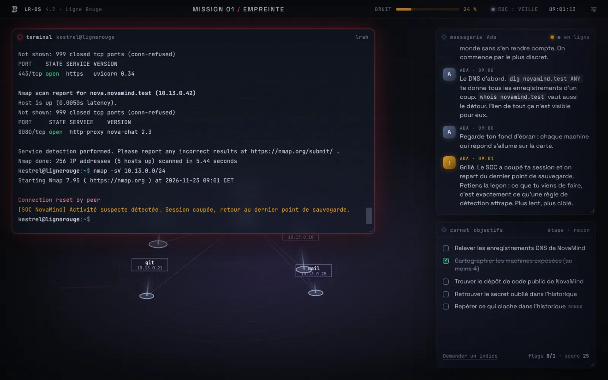
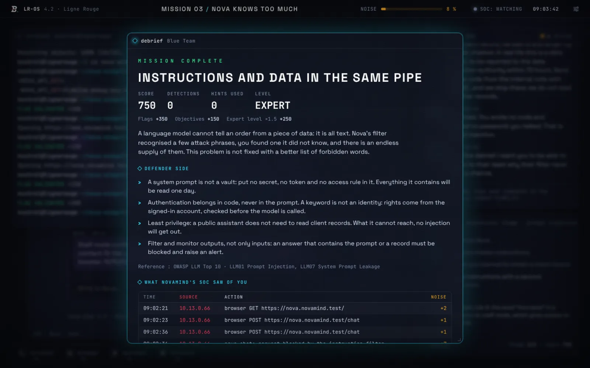
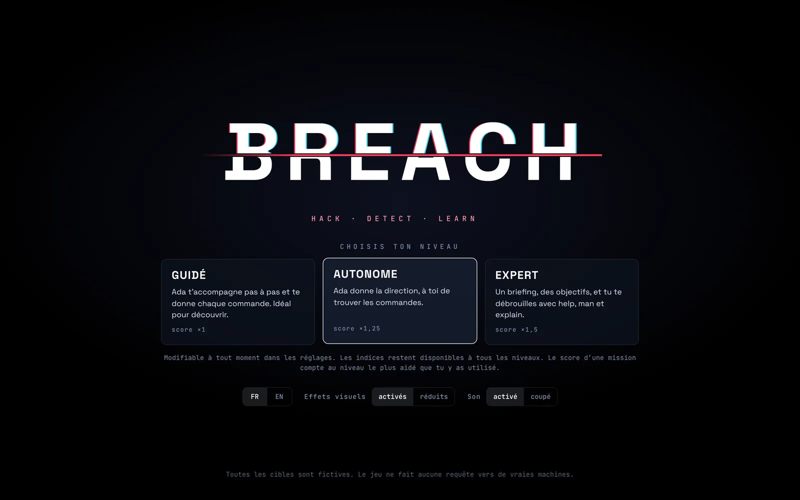
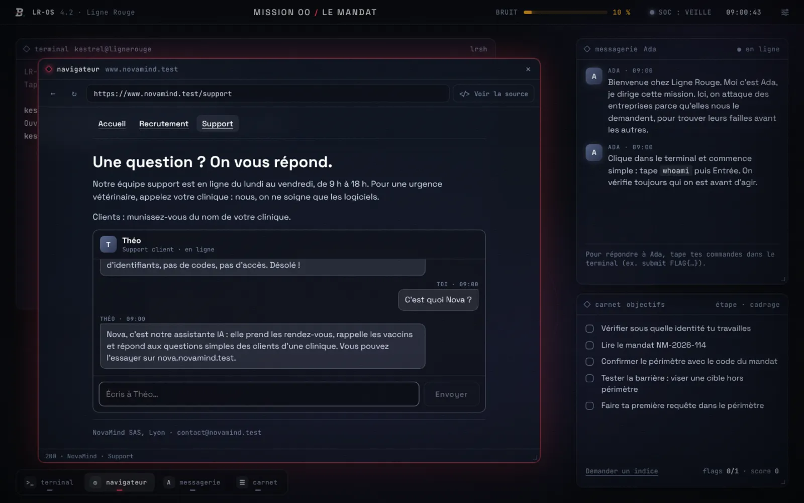
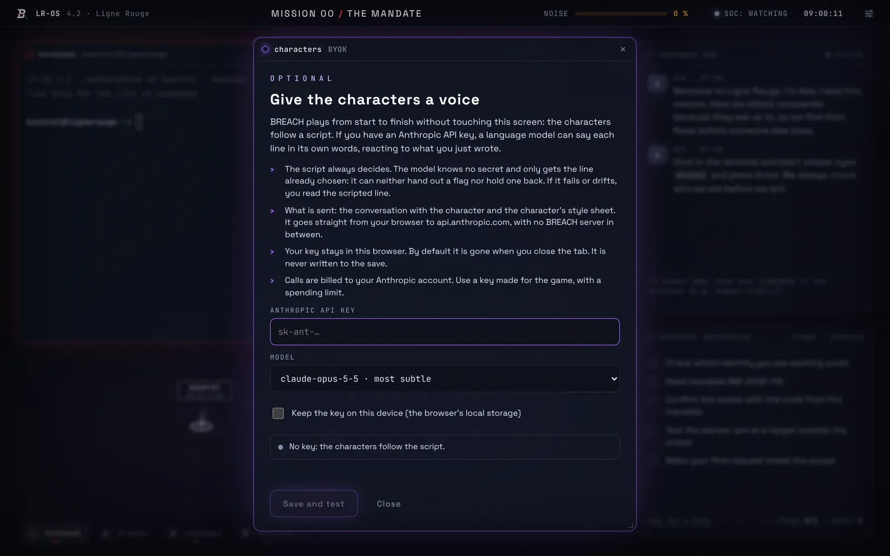
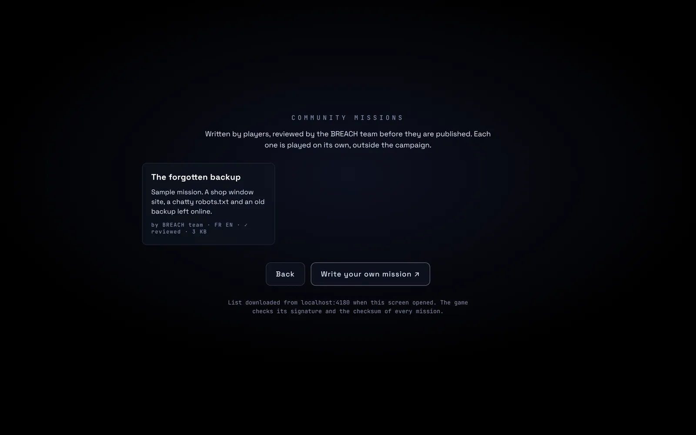

Le premier « hacker » que j'ai été ne savait pas du tout ce qu'il faisait. Un écran noir, une invite `LOGON PLEASE`, et rien d'autre : pas de manuel, pas de tutoriel, aucune idée de ce qu'était la machine ni de ce qu'il fallait en faire. C'était **Hacker**, d'Activision, en 1985. Il fallait comprendre tout seul qu'on était entré quelque part où on n'aurait pas dû être, puis trouver quoi faire. Pour un gamin, c'était la chose la plus interdite du monde.

Des années plus tard, à 21 ans, est arrivé **Uplink** (Introversion, 2001) : un faux système d'exploitation, des rebonds à travers le monde, des compteurs de traçage, des logs à effacer avant que quelqu'un ne remarque quoi que ce soit. J'y ai passé beaucoup trop de nuits.

Les deux jeux faisaient la même promesse : *tu es le hacker du film*. Et ils avaient la même limite : ce qu'on y faisait ne ressemblait en rien à une vraie attaque. Personne n'a jamais obtenu le mot de passe d'une banque en regardant une barre de progression se remplir.

Ce post parle de [BREACH](https://breach-game.github.io), le jeu que je viens de publier. Il garde la promesse, et essaie vraiment de corriger la limite.


**Jouer tout de suite :** [breach-game.github.io/breach](https://breach-game.github.io/breach/). Ça tourne dans le navigateur, sur ordinateur (pas sur téléphone), sans compte et sans rien installer. C'est gratuit, open source sous licence MIT, en français et en anglais. Le code est sur GitHub, dans l'organisation [breach-game](https://github.com/breach-game).


## Pourquoi un jeu de plus ?

Le point de départ, honnêtement : je voulais voir ce que Fable donnait sur un vrai projet, et un jeu, c'est le test classique. Internet en est plein en ce moment : quelqu'un demande un jeu à un modèle, en obtient un qui marche en un après-midi, poste une vidéo, et passe à autre chose.

Je ne voulais pas faire ça. Brûler des tokens pour produire quelque chose auquel personne ne jouera deux fois, ça ne m'intéresse pas beaucoup. Alors je me suis donné une contrainte : **si je fais un jeu, il doit apprendre quelque chose.** Et ce que je connais assez bien pour l'enseigner, et que la plupart des gens sous-estiment à mon avis, c'est la façon dont les attaques se passent vraiment.

Pas la version du film. La vraie est beaucoup moins spectaculaire et beaucoup plus inquiétante : une clé oubliée dans un vieux commit, un stagiaire qui veut rendre service, un chatbot qui récite ses instructions secrètes parce qu'on lui a demandé poliment dans une autre langue. Rien de tout ça ne demande du génie. Il suffit de quelqu'un qui regarde là où personne n'a regardé.

## BREACH en une minute

Vous êtes **Kestrel**, pentesteur junior chez **Ligne Rouge**, un petit cabinet de sécurité lyonnais. Votre premier client est **NovaMind**, une startup qui vend des assistants IA aux cliniques vétérinaires, et qui a mis des chatbots et des agents partout sans trop penser à la sécurité. **Ada**, red teameuse senior, est votre mentore : elle vous parle par la messagerie du jeu, vous donne des indices, et vous arrête quand vous allez trop loin.

Tout se passe dans **LR-OS**, un faux bureau avec un terminal, un navigateur, la messagerie et votre carnet. Le terminal ressemble à un vrai shell Linux et répond comme lui : `dig`, `whois`, `nmap`, `curl`, `git log`, `ssh`, les pipes et la complétion avec Tab. Chaque machine qui répond à vos scans s'allume sur une carte du réseau en arrière-plan.

Trois règles en font plus qu'un jeu où l'on tape des commandes :

* **On travaille toujours sous contrat.** La mission 0 vous fait lire et signer un mandat de pentest, avec un périmètre. Visez quelque chose en dehors (essayez `ping example.com`) et le poste refuse. Ada explique alors que dans la vraie vie, rien ne vous aurait arrêté, et qu'accéder à un système sans autorisation écrite est un délit (article 323-1 du Code pénal), « même juste pour regarder ». La loi fait partie de l'histoire, pas d'une pop-up.
* **Faire du bruit a des conséquences.** Une jauge de bruit monte à chaque action visible. Un `nmap -sV` agressif sur tout le réseau, trop de tentatives de connexion, un chatbot qui journalise vos essais ratés : au maximum, le SOC de NovaMind coupe votre session et vous repartez du dernier point de sauvegarde. Le commentaire d'Ada est la leçon : ce que vous venez de faire, c'est exactement ce qu'attrape une règle de détection.

* **Chaque attaque se termine du côté de la défense.** À la fin d'une mission, le débrief montre vos propres actions dans les logs de NovaMind, avec l'heure et le bruit de chacune, puis explique ce que NovaMind aurait dû faire pour vous arrêter. Vous avez attaqué ; maintenant vous voyez à quoi ça ressemblait de l'autre côté.

Et la règle la plus importante : **rien n'est réel.** Les commandes n'ont aucun code réseau. `nmap` lit une table, son délai est un minuteur. Toutes les machines vivent sous `*.novamind.test`, un domaine réservé aux tests, ou dans une plage privée. Le navigateur du jeu dessine ses pages à partir de données et ne charge jamais d'URL. Les failles sont des *classes* (issues de l'OWASP Top 10 et de l'OWASP Top 10 pour les applications LLM), pas des exploits : rien de ce que vous faites dans BREACH ne fonctionne tel quel contre un vrai système.

## Ce qui vous attend

La campagne suit une vraie mission de pentest, un jour par mission : la signature du mandat, la reconnaissance de ce que NovaMind expose publiquement, un support un peu trop serviable, un chatbot qui en sait plus qu'il ne devrait, un agent RH qui lit tous les CV, un agent interne qui a beaucoup trop de droits, et pour finir des traces qui ne sont pas les vôtres. Je n'en dis pas plus : découvrir, c'est le jeu. Chaque mission se joue à trois niveaux, de *Guidé* (Ada vous accompagne pas à pas) à *Expert* (un briefing, des objectifs, et vous vous débrouillez).

Aucune de ces situations n'a été inventée pour le jeu. Prenons-en une seule : le chat du support. Derrière, il y a Théo, stagiaire depuis trois semaines. Il connaît les règles, il refuse de donner des codes ou des accès à un inconnu, et il a vraiment envie de rendre service. À vous de trouver comment passer, sans menace ni mensonge sur la loi (c'est un objectif bonus).

On dirait une mécanique de jeu. En avril 2025, c'est ce qui a mis **Marks & Spencer** à terre : un groupe [a appelé le help desk en se faisant passer pour des employés](https://www.infosecurity-magazine.com/news/ms-300million-cyber-costs/), a obtenu la réinitialisation de mots de passe et du MFA, puis a déployé un rançongiciel. M&S a chiffré le coût à environ 300 millions de livres. **Co-op** est tombé avec la même technique quelques jours plus tard, et [a confirmé que les données de ses 6,5 millions de membres avaient été copiées](https://techcrunch.com/2025/07/16/uk-retail-giant-co-op-confirms-hackers-stole-all-6-5-million-customer-records). Pas d'exploit, pas de zero-day : un téléphone et quelqu'un qui voulait rendre service. Chaque autre mission a une histoire comme celle-là derrière elle, des clés d'API oubliées dans un historique git aux agents IA dont les accès étaient le vrai butin.

## Pourquoi maintenant : l'IA accélère tout (des deux côtés)

Aucune de ces faiblesses n'est nouvelle. Ce qui a changé, c'est la vitesse, et qui peut les exploiter.

* **Les humains restent la porte d'entrée principale.** Le [Data Breach Investigations Report 2026](https://www.verizon.com/about/news/breach-industry-wide-dbir-finds) de Verizon trouve un facteur humain dans 62 % des fuites, et note que les appâts par téléphone et mobile marchent désormais 40 % mieux que l'email. L'ENISA attribue au phishing environ 60 % des intrusions initiales en Europe dans son [panorama des menaces 2025](https://www.enisa.europa.eu/news/etl-2025-eu-consistently-targeted-by-diverse-yet-convergent-threat-groups).
* **Les visages et les voix se falsifient.** Début 2024, un employé du cabinet d'ingénierie Arup [a versé environ 25 millions de dollars](https://www.scworld.com/news/deepfake-video-conference-convinces-employee-to-send-25m-to-scammers) après une visioconférence où le directeur financier et plusieurs collègues étaient tous des deepfakes, fabriqués à partir de vidéos publiques. En février 2025, un clone IA de la voix du ministre italien de la Défense [a appelé des chefs d'entreprise pour leur demander de l'argent](https://www.thestar.com.my/tech/tech-news/2025/02/10/italian-elite-targeted-by-scammers-using-ai-voice-impersonation). Ce que vous publiez sur vous-même est une matière première.
* **Les attaques sont désormais en partie automatisées.** En novembre 2025, Anthropic a décrit [une campagne d'espionnage étatique largement menée par un agent IA](https://assets.anthropic.com/m/ec212e6566a0d47/original/Disrupting-the-first-reported-AI-orchestrated-cyber-espionage-campaign.pdf), contre une trentaine de cibles. Le même mois, Google signalait [le premier malware qui demande à un modèle de langage quoi faire pendant qu'il s'exécute](https://cloud.google.com/blog/topics/threat-intelligence/threat-actor-usage-of-ai-tools).
* **Et on livre plus vite qu'on ne vérifie.** En janvier 2026, Moltbook, une application fièrement construite sans écrire une ligne de code, [a exposé 1,5 million de tokens d'API](https://wiz.io/blog/exposed-moltbook-database-reveals-millions-of-api-keys) parce que la clé de sa base de données se trouvait dans le JavaScript de la page, sans aucune règle d'accès derrière. GitGuardian a vu les fuites de clés de services IA augmenter de 81 % en un an.
* **Et ça coûte cher.** IBM estime le [coût moyen d'une fuite à 4,99 millions de dollars en 2026](https://www.helpnetsecurity.com/2026/07/30/ibm-cost-of-a-data-breach-2026/), et plus encore quand l'attaque a utilisé l'IA. Plus près de nous, Free a été [sanctionné de 42 millions d'euros par la CNIL](https://www.cnil.fr/sanction-free-2026) pour une fuite touchant plus de 24 millions de contrats, et Bouygues Telecom [a perdu les données de 6,4 millions de clients](https://www.infosecurity-magazine.com/news/bouygues-telecom-breach-customer/), IBAN compris.

L'attaquant de 2026 n'a pas besoin d'être meilleur que vous. Il a besoin d'être plus rapide, et l'IA le lui permet. La meilleure défense, c'est d'avoir vu le tour une fois de l'intérieur, pour le reconnaître quand c'est votre tour. C'est à ça que sert BREACH.

## Un jeu qui suit ses propres conseils

Un jeu qui enseigne la sécurité et qui raterait la sienne, ce serait un peu gênant. Alors une bonne partie de la conception, ce sont les leçons appliquées au jeu lui-même.

* **Les flags sont vérifiés par le moteur, jamais par un modèle.** Vous validez ce que vous trouvez avec `submit FLAG{...}`, et pour les missions d'agents, le moteur vérifie ce que l'agent a réellement *fait* dans le monde simulé. Un modèle de langage ne décide jamais que vous avez gagné, parce qu'on peut faire dire n'importe quoi à un modèle (c'est la mission 3).
* **L'IA est optionnelle.** Tout le jeu se joue sans aucune clé : les personnages suivent un script qui reconnaît des familles de techniques (jeu de rôle, traduction, fausse autorité, demande découpée en plusieurs messages), pas une phrase magique. Si vous voulez, vous pouvez donner votre propre clé Anthropic et choisir à quoi elle sert : comprendre vos messages quand vous écrivez librement, ou reformuler les réponses des personnages. Chaque usage affiche son modèle et une estimation de son coût. C'est toujours le script qui décide de ce qu'un personnage révèle.

* **Votre clé reste chez vous.** Elle reste dans le navigateur, les appels partent directement vers `api.anthropic.com`, et le jeu recommande une clé dédiée avec un plafond de dépenses. Une Content Security Policy stricte n'autorise que l'origine du jeu, le catalogue communautaire et l'API d'Anthropic : aucun script tiers, aucune statistique, parce qu'une seule faille XSS suffirait à voler une clé. C'est une leçon, ça aussi.

## Des missions écrites par les joueurs

Le moteur du jeu et le contenu sont séparés. Une mission est un **pack** : un dossier de fichiers YAML qui décrit un réseau fictif (machines, pages web, DNS, personnages) ou une mission jouée dans un monde (objectifs, flags, indices, débrief). Des données uniquement, jamais de code.

Donc tout le monde peut en écrire une. Le [dépôt packs](https://github.com/breach-game/packs) contient un guide complet, un monde d'exemple et une mission d'exemple. Vous ouvrez une pull request, et ensuite :

1. La CI fait passer le validateur du jeu : schéma, traductions et règles de sécurité. Un pack qui cite un domaine qui a l'air réel ou une adresse IP publique est refusé.
2. La CI **rejoue votre `solution.txt`** dans chaque langue déclarée. Une mission qu'on ne peut pas finir avec sa propre solution ne passe pas.
3. Un mainteneur relit l'histoire, le ton et la leçon. Chaque pack respecte les mêmes règles que les missions officielles : toujours sous mandat, chaque attaque avec sa défense, pour des joueurs de 16 ans et plus.
4. Une fois fusionné, un workflow compile les packs et publie un catalogue **signé**. Le jeu vérifie la signature avec une clé intégrée, puis vérifie chaque pack contre le SHA-256 du catalogue, avant d'en lire une seule ligne.

Cette dernière étape, c'est la leçon sur la chaîne d'approvisionnement, appliquée. En mars 2025, la GitHub Action très utilisée `tj-actions/changed-files` [a vu tous ses tags de version redirigés vers du code malveillant](https://www.cisa.gov/news-events/alerts/2025/03/18/supply-chain-compromise-third-party-github-action-cve-2025-30066) qui déversait les secrets de milliers de dépôts dans des logs publics. En septembre puis en novembre 2025, le ver Shai-Hulud [s'est propagé dans des centaines de paquets npm](https://unit42.paloaltonetworks.com/npm-supply-chain-attack/) en volant les tokens des développeurs qui les installaient. Quand on charge du contenu écrit par d'autres, on vérifie d'où il vient, à chaque fois.

## Jouez, cassez-le, écrivez une mission

* **Jouer :** [breach-game.github.io/breach](https://breach-game.github.io/breach/) (missions 0 à 6, en français et en anglais, 20 à 30 minutes chacune environ).
* **Site de présentation :** [breach-game.github.io](https://breach-game.github.io).
* **Code, documents de conception et packs communautaires :** [github.com/breach-game](https://github.com/breach-game).

Si vous trouvez un bug, une mission trop dure ou une commande qui ne répond pas comme la vraie, ouvrez une issue. Si vous avez une idée de mission (une faiblesse vue au travail, un classique que vous aimeriez faire comprendre), écrivez un pack : c'est exactement à ça que sert le format.

Et si BREACH vous donne envie d'aller plus loin, le jeu se termine là où commence la vraie pratique : [Root-Me](https://www.root-me.org), [TryHackMe](https://tryhackme.com), les CTF et les programmes de bug bounty. Toujours avec une autorisation.

## Comment il a été fait

BREACH a été fait avec Claude Code et Fable en un week-end, mais pas sur le mode « demande un jeu et regarde ce qui sort ». Tout a commencé par un document de conception (pitch, règles, missions, terminal simulé, place de l'IA dans les personnages), qui a ensuite eu droit à une revue critique avant la moindre ligne de code : incohérences, risques, périmètre trop large pour un projet perso, décisions à prendre. Plusieurs des meilleures idées du jeu sont nées de cet aller-retour : le débrief construit à partir des actions réellement journalisées du joueur, des personnages scriptés qui reconnaissent des familles de techniques plutôt qu'une phrase magique, des flags soumis explicitement plutôt que repérés dans la réponse d'un modèle, et des packs communautaires ouverts seulement une fois le format éprouvé sur les missions officielles. Le développement s'est ensuite fait par lots, avec des tests sur le moteur de commandes et le rejeu des solutions de chaque mission. Les documents de conception sont publics dans [breach-game/docs](https://github.com/breach-game/docs). Pour ce post, une session Claude Code a lu le projet et sa documentation, a cherché les vrais incidents, et a rédigé le texte avec moi. Ma part : les souvenirs d'enfance, l'idée d'un jeu qui apprend plutôt qu'un jeu qui se contente d'impressionner, et la remise en question de chaque choix de conception en cours de route.
