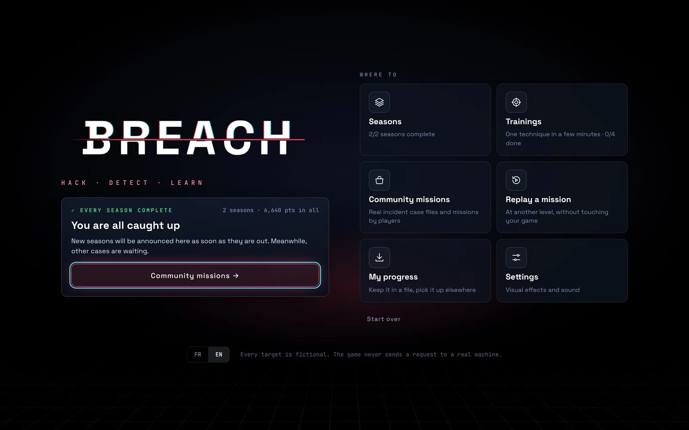
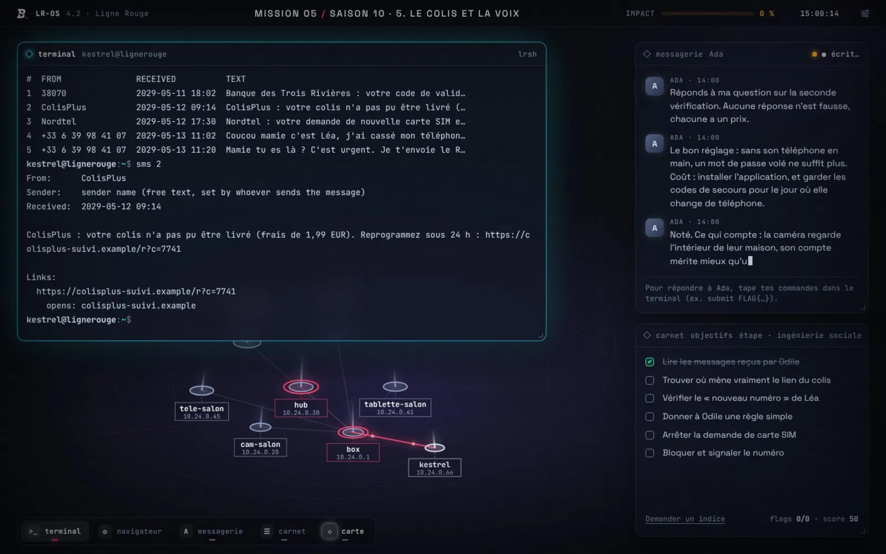
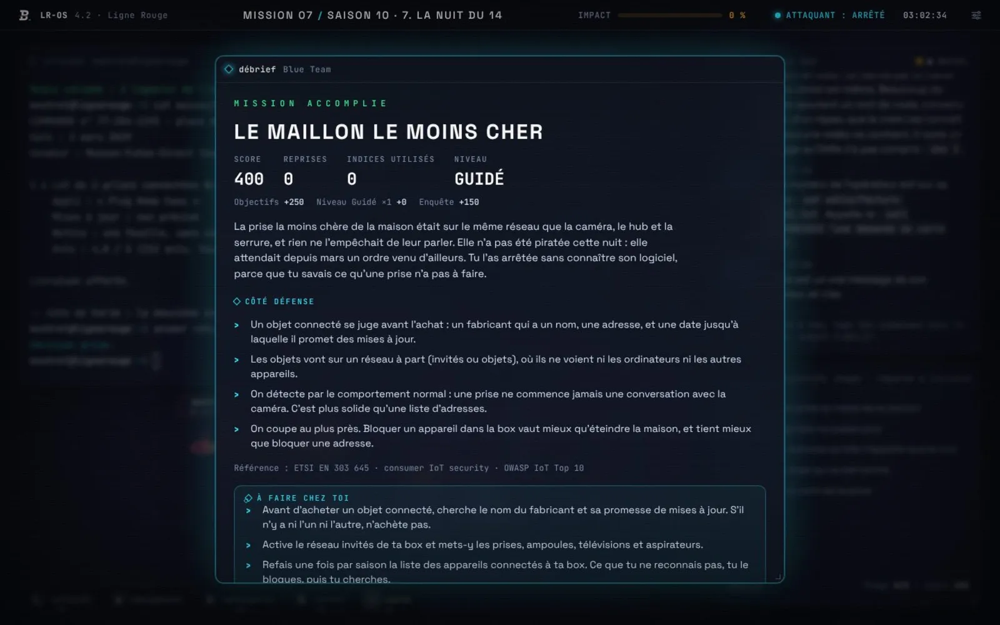
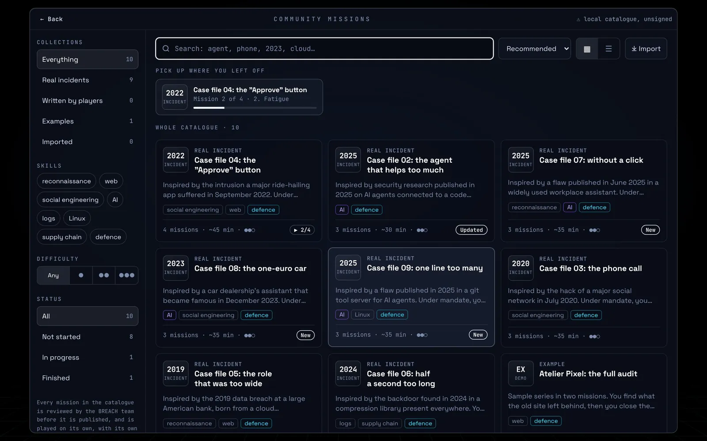
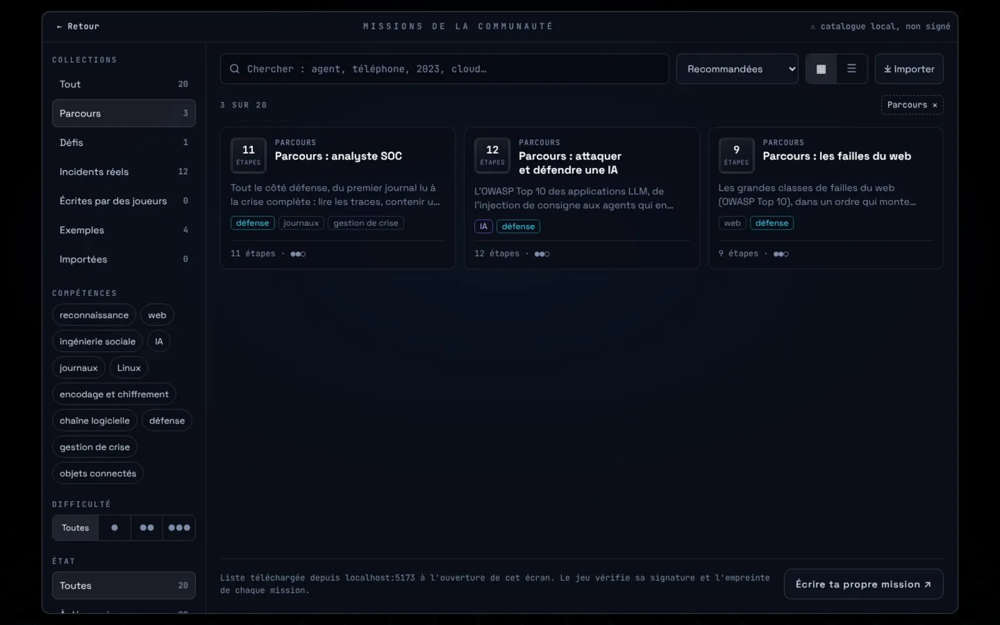

Il y a une semaine, je vous parlais de [BREACH](/fr/breach-un-nouveau-jeu-de-hacking/), le jeu de hacking que j'ai fait pour montrer à quel point les vraies attaques sont devenues faciles : une clé oubliée dans un historique git, un stagiaire qui veut rendre service, un chatbot qui récite ses instructions secrètes si on lui demande gentiment. À l'époque, c'était une campagne de sept missions, toutes chez NovaMind, la startup bourrée d'agents IA.

Ce n'est plus vraiment le même jeu. Juste après la sortie, j'ai demandé à Fable de cartographier la sécurité du quotidien et celle de l'entreprise, et de me proposer tout ce qui manquait encore au jeu. Puis je l'ai laissé tourner en tâche de fond une bonne partie de la semaine, pendant que j'étais à mon vrai travail. C'est une drôle de sensation, un peu comme avoir deux jobs en parallèle : un au bureau, et un qui tourne sur le PC de la maison après quelques prompts le matin. Une semaine plus tard, l'écran titre ressemble à ça.

Je ne vais pas tout détailler (et je ne donne toujours aucune solution). Voici les trois changements qui, à mon avis, valent un deuxième coup d'œil.

## Ce qui a changé, en chiffres

| | Il y a une semaine | Aujourd'hui |
| --- | --- | --- |
| Campagne principale | 7 missions | 10, dont les trois dernières côté défense |
| Saisons | aucune | 11 de plus, environ 50 missions |
| Entraînements | aucun | 15 missions courtes, une technique chacune |
| Missions communautaires | 1 exemple | 46 dossiers, 15 hors-séries, 11 défis, 6 parcours |

Le débrief a changé aussi. Avant, il expliquait comment se défendre. Maintenant, vous **rejouez la défense** : vous retrouvez vos propres lignes dans les logs, vous choisissez la règle de détection qui vous aurait attrapé, vous écrivez la correction, et le jeu rejoue votre attaque contre elle pour vérifier qu'elle échoue vraiment. Et une petite carrière en prime : plus vous jouez en autonomie, plus vous montez en grade chez Ligne Rouge (avec un plus beau bureau, ce qui est évidemment la motivation principale).

Les saisons vont désormais bien au-delà de l'IA : une chaîne de build et la confusion de dépendances, les failles web classiques, la réponse à un rançongiciel dans une mairie, un compte cloud, un programme de bug bounty, une ferme verticale et ses quarante capteurs, l'API d'une néobanque, et une finale où l'intrus que vous poursuivez depuis le premier jour s'attaque à votre propre cabinet.

## Saison 10 : la maison

C'est celle dont je suis le plus fier, parce que c'est celle qui parle à tout le monde, pas seulement aux gens qui travaillent dans l'informatique.

Pas d'entreprise cette fois. Élise vous invite un week-end parce qu'elle aimerait savoir qui regarde chez elle. Vous êtes côté défense, avec l'accord de la famille : la box et sa liste d'appareils, le Wi-Fi, une caméra dans le salon, une box domotique, des ampoules et une serrure connectées, le téléphone de la grand-mère et les comptes de tout le monde.

Si vous avez des parents, vous avez sûrement déjà vu ces messages. Un colis bloqué pour 1,99 €, un « nouveau numéro » d'un petit-enfant qui a besoin d'argent en urgence, un code bancaire que personne n'a demandé. Dans le jeu comme dans la vraie vie, ils ne sont pas sophistiqués. Ils marchent parce qu'ils arrivent au bon moment, et parce que personne n'a dit à la grand-mère qu'elle avait le droit de raccrocher et de rappeler.

Ce que je préfère, c'est la fin de chaque débrief : une fiche **« À faire chez toi »**. Pas un sermon, trois ou quatre choses à faire le soir même sur votre propre box, votre propre caméra, le téléphone de vos parents.

## Saison 12 : le prototype

Dans le premier article, je parlais de Moltbook, l'appli « construite sans écrire une ligne de code » qui a exposé 1,5 million de tokens. C'est devenu une saison.

Trois bénévoles écrivent en un week-end, avec un assistant de code, une appli d'entraide entre voisins, et quatre cents personnes s'y inscrivent. Votre travail : une semaine d'audit sur ce que l'assistant a fait vite et que personne n'a relu. Ensuite vous relisez le code généré, vous écrivez les règles qui manquaient, et vous prévenez les voisins, avec les faits d'une vraie vulnérabilité qui a touché des applis construites exactement comme ça en 2025.

Je la trouve juste, cette saison. Je construis des choses avec des agents de code tous les jours, et elle rappelle que « ça marche » et « c'est sûr » sont deux relectures différentes.

## Quarante-six dossiers, quarante-six vraies histoires

Dans le premier article, chaque mission était reliée à un vrai incident dans le texte. Maintenant, c'est l'inverse : des séries entières sont construites *à partir* de vrais incidents.

Les **dossiers** de la boutique communautaire sont de courtes séries de deux à quatre missions, chacune inspirée d'un incident documenté publiquement, jouée dans une entreprise fictive pour que ça reste un jeu, et conclue par une fiche sourcée qui raconte ce qui s'est vraiment passé. Certains vous diront quelque chose : Log4Shell, Heartbleed, MOVEit, Equifax, Colonial Pipeline, la fausse visioconférence d'Arup, la panne mondiale de juillet 2024, la GitHub Action tj-actions. D'autres sont moins connus et tout aussi instructifs.

À côté, il y a des **hors-séries** sur des situations du quotidien (un badge perdu, le Wi-Fi public en déplacement, un autocollant QR code sur un horodateur, un outil IA utilisé sans que personne ne le sache), des **défis** qui se jouent uniquement en Expert, et des **parcours** qui enchaînent des missions autour d'un thème : sécuriser sa maison, l'OWASP Top 10 des applications LLM, une journée d'analyste SOC, les premiers pas.

## La seule chose qui manque : vous

Voici la partie honnête. Toutes ces missions communautaires, c'est moi qui les ai écrites. La boutique est pleine, le validateur, le rejeu des solutions et le catalogue signé marchent, il y a un kit d'auteur et un monde d'exemple. Ce qui manque encore, c'est une mission écrite par **quelqu'un d'autre**.

Alors si vous avez vu au travail une faiblesse que tout le monde devrait comprendre, ou si une actualité vous a fait penser « les gens comprendraient s'ils y jouaient », le [dépôt packs](https://github.com/breach-game/packs) explique comment en écrire une. C'est du YAML, pas de code, et le jeu peut importer une mission depuis un fichier pour la tester avant d'ouvrir une pull request. La première mission venue de l'extérieur aura droit à une vraie mention ici.

* **Jouer :** [breach-game.github.io/breach](https://breach-game.github.io/breach/) (français et anglais, gratuit, sans compte).
* **Site de présentation :** [breach-game.github.io](https://breach-game.github.io).
* **Code et packs :** [github.com/breach-game](https://github.com/breach-game).

Et si vous n'avez que vingt minutes ce week-end, jouez à la saison 10. Puis allez voir la liste des appareils connectés à votre box. Vous y trouverez sûrement une prise que vous aviez oubliée.
