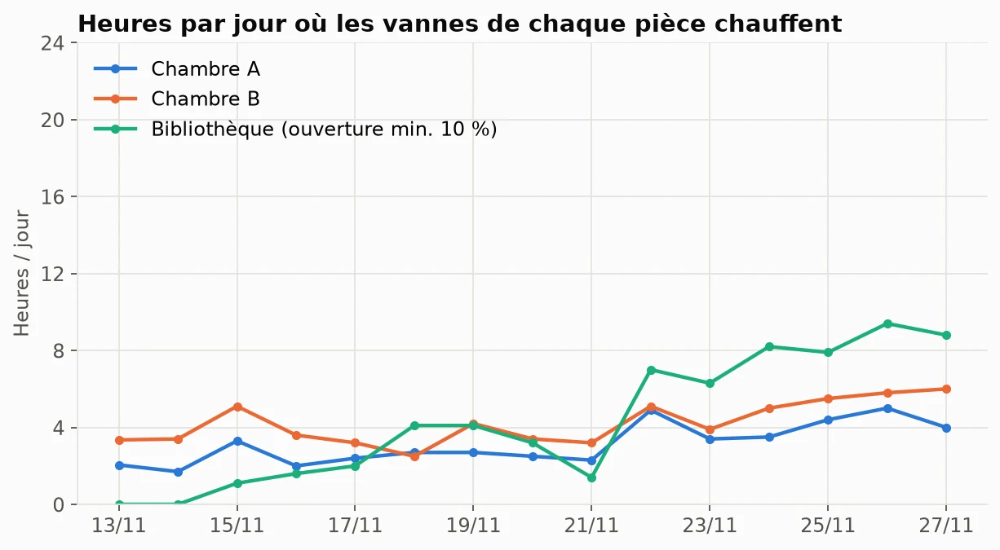

Il y a trois semaines, j'ai raconté comment [on a découvert, avec Claude, que les deux circuits de ma pompe à chaleur étaient inversés depuis cinq ans](/fr/cinq-ans-de-circuits-inverses-ma-pompe-a-chaleur-relue-par-claude/). Le plancher chauffant du rez-de-chaussée était piloté par le thermostat de l'étage, les radiateurs recevaient de l'eau à 25 °C, et la vanne mélangeuse « qui ne marchait pas en auto » obéissait au mauvais circuit. Une fois la configuration remise à l'endroit, la maison a enfin chauffé comme elle devait.

Mais remettre les circuits à l'endroit n'était que la première étape. Avec une pompe à chaleur, chaque degré d'eau en trop se paie sur le rendement, et maintenant que j'avais des données propres, je voulais savoir **quelle était la température d'eau juste suffisante**. C'est l'objet de cette petite série :

1.  **La loi d'eau, réglée avec les données** (cet article) : comment fonctionne une loi d'eau, quels signaux disent que l'eau est trop chaude, ce qu'on a changé.
2.  **Une vanne par pièce, et une PAC qui n'écoute que la demande** : les automatisations Home Assistant qui règlent chaque chambre de l'étage et pilotent la PAC, avec le nombre de mouvements des vannes et ce que ça coûte en piles.
3.  **Le bilan de l'hiver** : confort et consommation sur toute la saison, comparés à l'hiver dernier. Cet article-ci donne déjà une première comparaison avec l'hiver dernier.

## La loi d'eau, en deux minutes

Une pompe à chaleur ne fabrique pas de chaleur : elle la **déplace** de l'air extérieur vers l'eau du chauffage. Plus l'écart entre les deux est grand, plus elle travaille pour chaque kWh de chaleur. C'est pour ça qu'on cherche toujours l'eau la plus froide possible : l'ordre de grandeur souvent cité est de **2 à 3 % de rendement (COP) gagné par degré d'eau en moins**.

Mais une maison perd plus de chaleur quand il fait froid dehors. La **loi d'eau** (ou courbe de chauffe, *OTC* chez Hitachi) fait le lien : elle donne la température d'eau à produire en fonction de la température extérieure. Il fait doux, l'eau peut être tiède ; il gèle, il faut de l'eau plus chaude.

Sur ma Yutaki, chaque circuit a sa loi, et il en existe deux formes :

*   **par points** : deux points (par exemple « 50 °C d'eau quand il fait −10 °C » et « 21 °C d'eau quand il fait +20 °C »), une droite entre les deux, et un plateau au-delà ;
*   **par courbe** : une droite qui part de 20 °C d'eau pour 20 °C dehors et qui monte d'une **pente** (0,2 à 2,2) par degré extérieur en moins. Avec une pente de 0,6, on demande 32 °C d'eau quand il fait 0 °C.

Les deux peuvent être décalées d'un bloc (*offset*), et la PAC ajoute une **compensation d'ambiance** : quand la pièce du thermostat est sous sa consigne, elle pousse l'eau un peu plus haut. On a mesuré l'effet le 17 novembre : **environ 2 °C d'eau en plus par degré de consigne** (consigne 17-18 °C → eau à 32-33 °C, 19 °C → 36 °C, 20 °C → 37 °C).

Un dernier point change tout dans une maison à deux circuits : **il n'y a qu'un compresseur**. La PAC produit l'eau du circuit qui demande le plus chaud, et le plancher (C2) refroidit ensuite la sienne en la mélangeant avec son retour, grâce à sa vanne trois voies. Chez moi, ce sont donc les **radiateurs de l'étage (C1) qui fixent la température d'eau de toute la maison**. Le plancher, lui, n'a besoin que d'environ 31 °C par 0 °C dehors. Chaque degré de trop demandé par les radiateurs est un degré que la PAC produit pour rien.

Les points verts sont les consignes d'eau réelles de la PAC, en moyenne par jour, pendant la vague de froid de fin novembre : elles suivent la loi des radiateurs presque au degré près. C'est bien elle qui commande.

Petit détail pratique : CSNet dit quel *type* de loi chaque circuit utilise, mais pas ses valeurs. Depuis la version 2.14 de l'[intégration CSNet](https://github.com/mmornati/home-assistant-csnet-home), on peut recopier les valeurs de la télécommande dans les options, et Home Assistant affiche alors, pour chaque circuit, la température d'eau que la loi demande en ce moment. C'est ce qui permet de voir sur un graphique si la PAC suit sa loi ou si autre chose la pousse.

## Les signaux qui disent que l'eau est trop chaude

Personne ne vous dit « votre loi d'eau est trop haute ». Mais une maison bien instrumentée le montre de plusieurs façons, et c'est en croisant ces signaux qu'on a avancé.

**1. Le temps d'ouverture des vannes.** Depuis le 11 novembre, chaque radiateur de l'étage a une vanne connectée qui régule sur le capteur de sa pièce (le détail sera dans le prochain article). Si les pièces tiennent leur consigne alors que les vannes sont fermées la plupart du temps, c'est que chaque minute d'ouverture apporte beaucoup de chaleur : l'eau est plus chaude que nécessaire. Du 12 au 14 novembre, les vannes des chambres n'étaient ouvertes que **6 à 13 % du temps**.

**2. Des chauffes courtes qui dépassent la consigne.** Quand une vanne s'ouvre, une chambre gagne un demi-degré en un quart d'heure, puis continue à monter après la fermeture, parce que le radiateur reste chaud. Résultat : des dents de scie de près d'un degré autour de la consigne. Avec de l'eau moins chaude, les ouvertures sont plus longues et la température plus stable.

**3. La vitesse de chauffe de chaque pièce.** Home Assistant enregistre maintenant chaque épisode de chauffe (début, durée, température au début et à la fin, température extérieure) et en tire une vitesse de chauffe médiane par pièce. Aujourd'hui : **2,4 °C/h pour une chambre, 1,3 °C/h pour l'autre, 0,9 °C/h pour la bibliothèque**. La chambre la plus lente est celle qui fixe la limite basse : si l'eau devient trop froide, c'est elle qui n'arrivera plus à sa consigne le matin.

**4. Le temps de préchauffe le matin.** Les chambres passent de 18 °C la nuit à 19 °C au réveil. Avec une préchauffe de 90 minutes, elles y arrivent en une heure environ. Il reste de la marge.

**5. L'écart entre ce que demande le plancher et ce que produit la PAC.** Fin novembre, par 0 °C dehors, la PAC produisait de l'eau à 40 °C pour un plancher qui en demandait 31. Toute la différence était pour les radiateurs.

## Ce qu'on a changé, dans l'ordre

Quatre réglages en deux semaines. Le graphique ci-dessous les place sur la température extérieure, la consigne d'eau de la PAC et son COP de chaque jour (chaleur produite divisée par l'électricité mesurée par le compteur de la PAC).

| Date | Réglage | Pourquoi |
|---|---|---|
| 11 nov. | Circulateur : vitesse fixe 100 % → régulation ΔT | Débit trop fort, écart départ/retour de 1 à 2 °C au lieu de 5. La consommation à l'arrêt est passée d'environ 240 W à 130 W. |
| 11 nov. | Circuits remis à l'endroit | Voir [l'article précédent](/fr/cinq-ans-de-circuits-inverses-ma-pompe-a-chaleur-relue-par-claude/). L'eau monte d'environ 12 °C à température extérieure égale : les radiateurs reçoivent enfin de quoi chauffer. |
| 14 nov. | Loi des radiateurs : **60 → 50 °C à −10 °C** (21 °C à +20 °C inchangé) | Vannes ouvertes 6 à 13 % du temps, bibliothèque à 21 °C pour une consigne de 19. |
| 16 nov. | Home Assistant pilote la consigne CSNet de l'étage | Le thermostat mural demandait de la chaleur toute la nuit alors que toutes les vannes étaient fermées. |
| 25 nov. | Marge de la PAC : **1 → 0,5 °C** | Les vannes chauffaient 3 à 5 h par jour, mais la PAC restait en demande 15 à 17 h. |

Le 11 novembre fait monter la consigne d'eau d'un coup : c'est le prix des radiateurs qui chauffent enfin. Le 14, la nouvelle loi la fait redescendre de 4 à 5 °C. À partir du 21, c'est le froid qui la fait remonter, en suivant la nouvelle loi.

Ce qui saute aux yeux sur la courbe du COP, c'est surtout la **température extérieure** : un peu plus de 3 par 9-10 °C dehors (17-20 novembre), autour de 2,2 par 0 °C. Pour isoler l'effet du réglage, il faut comparer des jours à la même température. Le 14 et le 22 novembre ont tous les deux eu 2,2 °C de moyenne dehors :

| | 14 nov. (loi à 60 °C) | 22 nov. (loi à 50 °C) |
|---|---|---|
| Consigne d'eau moyenne | 38,6 °C | 37,7 °C |
| COP du jour | 2,12 | 2,28 (+7,5 %) |
| Électricité de la PAC | 53,0 kWh | 46,0 kWh (−13 %) |
| Étage (moyenne) | 20,1 °C | 18,5 °C |
| Rez-de-chaussée (moyenne) | 19,3 °C | 19,5 °C |

Il faut lire ce tableau honnêtement. L'écart de consigne d'eau est plus petit que ce que la loi laisse croire (0,9 °C), parce que le 14, Home Assistant ne pilotait pas encore la consigne du thermostat et la compensation d'ambiance jouait. Et une bonne partie des 13 % vient du fait que **l'étage surchauffait le 14** : 20,1 °C de moyenne, avec une bibliothèque à 21 °C. Le 22, l'étage est à sa consigne, avec la nuit à 18 °C. C'est justement le but : ne plus produire de chaleur que personne n'a demandée.

Pour la marge du 25 novembre, je n'ai **pas encore d'effet mesurable** : la consigne d'eau moyenne est passée de 40,3 °C le 24 à 39,7 °C le 25, puis 40,2 et 40,1 °C les jours suivants, avec un peu plus froid dehors chaque jour. À ce niveau, le bruit des journées l'emporte. On verra sur plusieurs semaines.

## Et par rapport à l'hiver dernier ?

L'hiver dernier, la maison tournait encore avec les circuits inversés : la PAC produisait l'eau selon la loi prévue pour le plancher, la vanne trois voies était en manuel, et le circulateur tournait à 100 % jour et nuit. Qu'est-ce que tous ces changements ont réellement changé, par rapport à ça ?

**D'abord, un piège.** Ma première comparaison disait que l'hiver dernier, la PAC consommait **deux fois plus** à température extérieure égale. Le chiffre était faux : le capteur « température extérieure moyenne » que je m'étais fait dans Home Assistant lisait **3 à 5 °C trop haut** l'hiver dernier (8,9 °C de moyenne en janvier, quand ma station Netatmo et la sonde Ecojoko, qui sont d'accord entre elles, disaient 3,4 à 4 °C). Les jours « doux » de l'hiver dernier étaient en réalité des jours froids. Tout ce qui suit utilise la station Netatmo.

**La température de l'eau.** Home Assistant n'a pas enregistré les températures d'eau de la PAC l'hiver dernier (ces capteurs n'existent que depuis juin 2026). Mais octobre et début novembre 2026, avant la correction, avaient exactement la même configuration : l'eau était à **24-28 °C** par 5 à 10 °C dehors. Aujourd'hui, elle est à 30-34 °C par le même temps, et vers 40 °C quand il gèle. L'eau est donc **6 à 10 °C plus chaude** qu'avant : c'est le prix des radiateurs qui chauffent enfin.

**La consommation.** Le compteur de la PAC est le même depuis octobre 2024. À température extérieure égale :

| Dehors | Hiver 2025-26 | Depuis le 15 nov. 2026 |
|---|---|---|
| −2 à 0 °C | 69,2 kWh/j · maison à 18,5 / 20,0 °C | 62,0 kWh/j · 18,6 / 19,3 °C |
| 0 à 2 °C | 58,0 kWh/j · 19,1 / 19,7 °C | 56,9 kWh/j · 18,7 / 19,4 °C |
| 2 à 4 °C | 43,8 kWh/j · 19,9 / 20,8 °C | 39,3 kWh/j · 19,2 / 19,6 °C |
| 6 à 8 °C | 31,4 kWh/j · 20,5 / 21,5 °C | 24,5 kWh/j · 19,2 / 19,7 °C |
| 8 à 10 °C | 21,8 kWh/j · 20,0 / 20,9 °C | 16,4 kWh/j · 19,0 / 19,8 °C |

*(températures : étage / rez-de-chaussée, moyennes du jour)*

On consomme 10 à 25 % de moins par temps doux, et à peu près autant quand il gèle. Mais la maison n'est pas la même : l'hiver dernier, elle était **0,5 à 1,5 °C plus chaude**, et le rez-de-chaussée montait à 21-21,5 °C dès qu'il faisait doux, parce que le plancher recevait son eau sans régulation. Pour comparer honnêtement, il faut rapporter la consommation à l'écart entre l'intérieur et l'extérieur :

À écart égal, les jours d'après le 15 novembre tombent **sur la tendance de l'hiver dernier** : 501 kWh mesurés sur 13 jours, pour 510 kWh prévus (−2 %, bien en dessous de la dispersion d'un jour à l'autre). Un peu moins par temps doux, un peu plus quand il gèle.

Autrement dit : l'eau est 6 à 10 °C plus chaude, ce qui coûte en rendement, et pourtant la PAC ne consomme pas plus par degré d'écart. Ce surcoût est compensé par tout le reste : le circulateur qui module, la PAC qui ne chauffe l'étage que quand une pièce le demande, les nuits à 18 °C, et la fin de la surchauffe du rez-de-chaussée. Et la maison, elle, est maintenant **à sa consigne dans chaque pièce**, au lieu de 21 °C en bas et d'un étage qui dépendait de la loi d'eau du plancher. Et maintenant que tout le reste est en place, chaque degré d'eau en moins serait un gain net. Restait à savoir s'il en vaut la peine.

**Et le COP de l'hiver dernier ?** CSNet garde un compteur de chaleur mensuel depuis octobre 2025. Divisé par l'électricité du compteur de la PAC, il donnerait un COP de **3,2 à 3,6** l'hiver dernier, contre 2,7 en novembre 2026. Je ne m'y fie pas : avec le circulateur à 100 % et un écart départ/retour de 1 à 2 °C, ce compteur surestimait nettement la chaleur. Il a compté 9 à 14 kWh de chaleur par jour en plein été, sans aucun besoin de chauffage, et du 1er au 10 novembre 2026, il annonçait 64 à 113 kWh par jour, là où le calcul débit × écart de température en donnait 30 à 72. Depuis le passage du circulateur en ΔT, les deux mesures sont d'accord à quelques pourcents près sur une semaine. Le mauvais réglage du circulateur ne coûtait donc pas seulement de l'électricité : il **faussait aussi la mesure**. Les COP d'aujourd'hui (autour de 2,2 par 0 °C, 3 par 10 °C) sont les premiers chiffres fiables de cette PAC.

## Faut-il descendre encore ?

Le meilleur indicateur reste le premier : combien de temps les vannes chauffent-elles chaque jour ?

Même pendant la semaine la plus froide (autour de 0 °C de moyenne, −3 °C la nuit), les vannes des chambres ne chauffent que **4 à 6 heures par jour**. La bibliothèque monte à 8-9 heures, mais c'est aussi la pièce qui chauffe le plus lentement, et sa vanne ne se ferme jamais complètement (elle garde 10 % d'ouverture pour que l'eau circule toujours quelque part). Autrement dit, les radiateurs restent fermés les trois quarts du temps alors qu'il gèle. L'eau à 40 °C est encore plus chaude que nécessaire.

Il y a donc de la marge. Pour qui veut la prendre, la méthode est simple, plutôt qu'un grand saut :

1.  **Baisser le point froid de la loi des radiateurs de 2 à 3 °C à la fois** (50 → 47 °C à −10 °C, puis peut-être 45 °C), en laissant le point à +20 °C tel quel.
2.  **Attendre au moins une semaine**, pour avoir des jours froids et des jours doux.
3.  **Surveiller trois chiffres** : les heures de chauffe des vannes (elles vont monter, c'est voulu), la chambre la plus lente au réveil (elle doit atteindre 19 °C dans les 90 minutes de préchauffe), et le COP à température extérieure égale.
4.  **S'arrêter quand la pièce la plus lente commence à décrocher** les matins de gel, et remonter d'un cran.

Avant de le faire, j'ai voulu savoir ce que ça rapporterait. Passer de 50 à 47 °C, c'est 1 °C d'eau en moins par 10 °C dehors, 2 °C par 0 °C et 2,5 °C par −5 °C. Avec la règle des 2 à 3 % de COP par degré, ça fait **4 à 6 % de consommation en moins**, surtout quand il fait froid. Sur une saison de chauffe d'environ 5 500 kWh pour cette PAC, c'est **200 à 300 kWh par an, soit 50 à 80 €**. C'est une estimation, pas une mesure.

En face, ce qu'on perd : des radiateurs qui chauffent 10 à 15 % moins vite, une préchauffe du matin un peu plus longue, et le risque d'une pièce fraîche les matins de grand froid. Les pièces les plus exposées sont justement les plus lentes : une des chambres (1,3 °C/h) et la bibliothèque (0,9 °C/h), où se trouve le thermostat de la PAC. Au rez-de-chaussée, rien ne changerait : la PAC produirait encore de l'eau plus chaude que ce que demande le plancher, et la vanne trois voies s'ouvrirait simplement un peu plus.

**J'ai décidé de rester à 50 °C.** 80 € par an, ce n'est pas rien, mais une maison qui est à la bonne température au bon moment compte plus pour nous, surtout les matins d'hiver. Aujourd'hui, chaque pièce tient sa consigne, y compris par −3 °C, et à écart de température égal la PAC consomme autant que l'hiver dernier, mais pour une maison enfin équilibrée. Le gros du travail était ailleurs : les circuits, le circulateur, les vannes, le pilotage de la PAC. Ce qui reste, c'est de l'optimisation à la marge, et je préfère la garder en réserve.

Il reste aussi un défaut que la loi d'eau ne corrigera pas seule : le compresseur démarre **2 à 3 fois par heure** pour des cycles de 8 à 13 minutes. La PAC (20 kW) est surdimensionnée pour une maison qui demande en moyenne 5 à 6 kW quand il gèle. De l'eau moins chaude allonge un peu les cycles, mais ce sera un sujet à part.

## Ce que je retiens

Une loi d'eau ne se règle pas une fois pour toutes en suivant le tableau de l'installateur. Celle de mes radiateurs (60 °C à −10 °C) était là depuis l'installation et n'avait jamais été remise en question : avec les circuits inversés, elle ne servait de toute façon à rien.

Ce qui a changé, c'est d'avoir **des signaux qui répondent à la question** : des vannes qui disent combien de temps elles chauffent, des capteurs qui mesurent la vitesse de chauffe de chaque pièce, un compteur qui donne le COP du jour. Avec ça, régler la loi d'eau n'est plus une affaire de sensation (« il fait un peu frais ce soir »), c'est une boucle : on baisse, on mesure, on garde ou on revient en arrière.

## Comment ça a été fait

Plusieurs sessions Claude Code avec Opus 5.5, réparties sur deux semaines, dans le dépôt de l'intégration CSNet et dans celui de ma configuration Home Assistant. Claude a lu l'historique de Home Assistant (via OpenObserve, qui reçoit tous les événements et métriques de HA, et via une copie en lecture seule de la base du recorder pour les statistiques longues), calculé les temps d'ouverture des vannes et les COP journaliers, proposé chaque changement avec les chiffres qui le justifiaient, et écrit les automatisations et les capteurs (vitesse de chauffe, consigne de la PAC, loi d'eau dans l'intégration). Les réglages de la PAC elle-même, je les ai faits à la main sur la télécommande, en photographiant chaque écran avant. Cet article a été écrit dans une autre session, à partir de ces données et des notes de ces sessions ; les graphiques ont été générés depuis les mêmes données.
