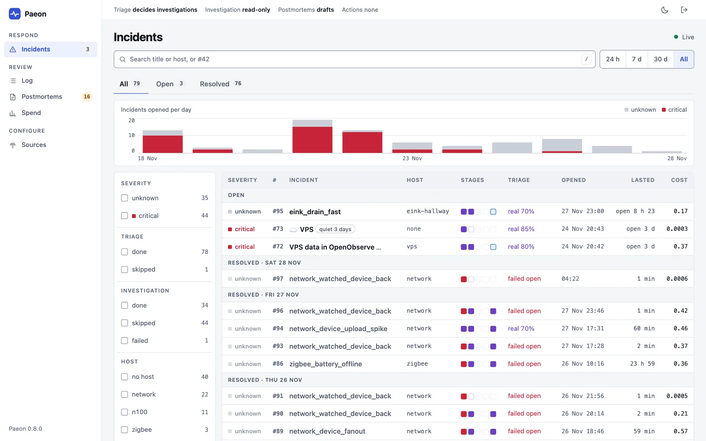
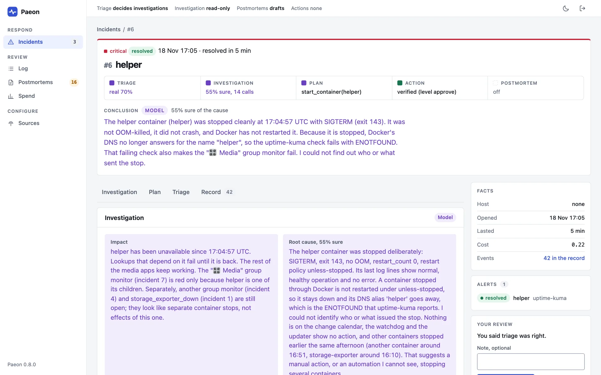
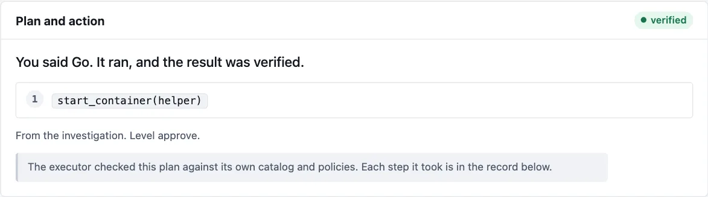
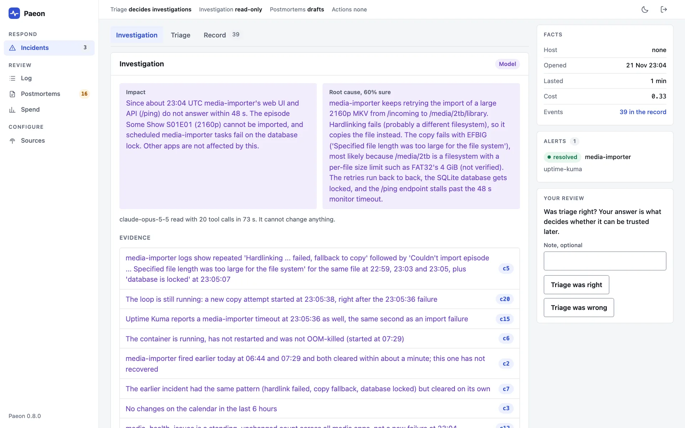
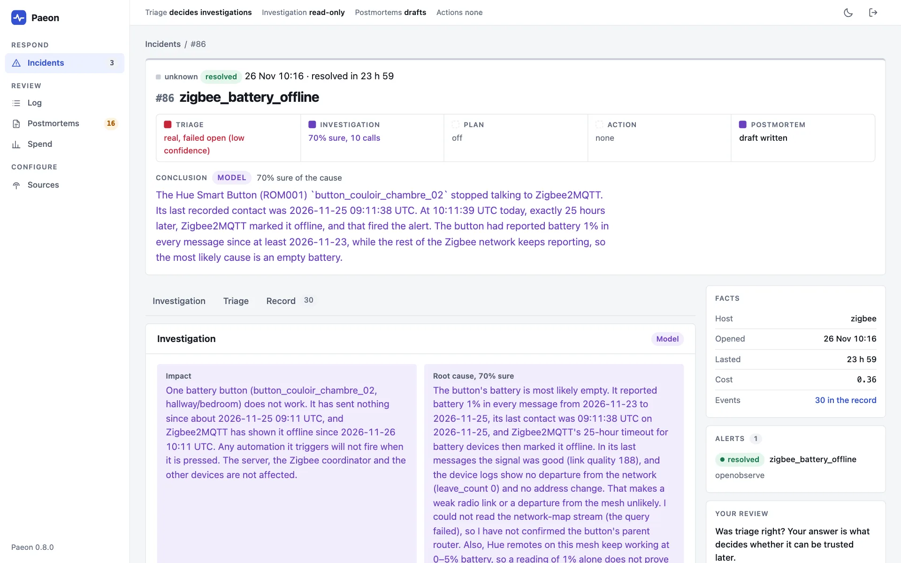
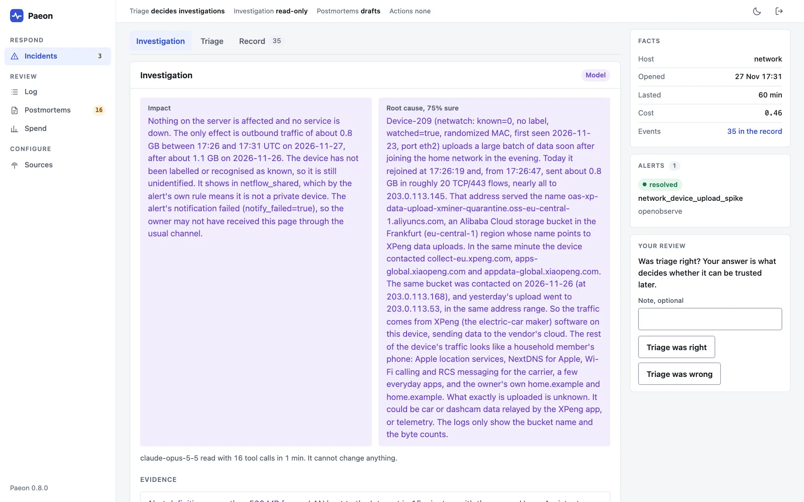

Il y a dix jours, j'ai présenté [Paeon](/fr/paeon-un-collegue-d-astreinte-pour-mon-serveur-maison/), le collègue d'astreinte que j'ai construit pour mon serveur maison. Cet article était prudent : toutes les captures venaient de données de démo, et je disais clairement que la partie qui *agit* n'avait pas tourné assez longtemps pour être considérée comme éprouvée.

Maintenant, c'est fait. Paeon tourne sur mon serveur depuis le 18 novembre, avec de vraies alertes, de vrais modèles et de l'argent réel. Cet article est le compte rendu : ce qu'il a trouvé, ce qu'il a raté, ce qu'il a coûté, et ce que j'ai changé à cause de lui. Je vous le dis tout de suite : l'essentiel de ce que j'ai changé, ce n'était pas Paeon. C'étaient mes alertes.


**Les captures ci-dessous viennent du vrai serveur**, pas de données de démo. J'ai lancé la console en local sur une copie du journal d'événements, dans laquelle j'ai supprimé ou renommé ce qui est privé : adresses, noms de domaine, noms d'appareils, et une partie de ma stack multimédia que je préfère garder pour moi. Donc `media-importer` ou `helper` ne sont pas les vrais noms des conteneurs. Leur histoire, elle, est vraie.


## D'abord, les chiffres

Entre le 18 et le 28 novembre :

| | |
|---|---|
| Incidents | **97** (pour 107 alertes déclenchées) |
| Investigations | **42**, par Claude Opus, avec des outils en lecture seule |
| Verdicts de tri | **89**, par Claude Haiku |
| Plans proposés | 13, dont **2 exécutés après mon Go**, tous deux vérifiés |
| Brouillons de post-mortem | 37 |
| Coût des modèles, toutes étapes | **13,48 USD**, dont **0,04 USD** pour le tri |

Deux choses sautent aux yeux dans ce tableau, et elles résument tout l'article.

**Le tri ne coûte presque rien.** 89 verdicts pour quatre centimes. Tout l'argent part dans les investigations. Le rôle du tri n'est donc pas d'être malin, mais de bien décider *qui mérite une investigation*.

**Les 97 incidents n'étaient pas 97 problèmes.** Loin de là.

## Le week-end qui a mal tourné (presque exprès)

Le samedi 21 novembre, j'ai fait un peu de maintenance à la main : un redémarrage le matin, un déploiement, puis un redéploiement de mes applications multimédia à 07:29 que je n'ai pas annoncé à Paeon. Le dimanche, les mises à jour hebdomadaires ont tourné. Ajoutez une coupure Wi-Fi, un CPU chargé et un capteur Zigbee de mauvaise humeur, et Paeon a ouvert **39 incidents en deux jours**.

Le dimanche matin, j'ai demandé à Claude Code de tous les lire, avec leur tri et leurs investigations, et de les classer par cause. La réponse était plutôt humiliante :

* **3 sur 34** (les incidents du week-end, du #24 au #57) avaient vraiment besoin de moi ;
* 12 venaient de ma propre maintenance, faite à la main et pas annoncée ;
* 11 étaient des moniteurs *groupe* d'uptime-kuma, qui répétaient ce qu'un moniteur enfant disait déjà : Paeon triait (et parfois investiguait) deux fois la même panne ;
* 5 étaient de petites coupures DHCP de la box de mon opérateur ;
* 4 étaient des alertes avec des seuils tout simplement trop bas.

Et l'argent a suivi : 2,23 USD le samedi et 2,25 le dimanche, au-dessus de mon budget de 2 USD par jour. La protection contre les tempêtes d'alertes (2 investigations par heure au maximum) a dû en sauter 13.

Le modèle n'était pas le problème. Les investigations étaient le plus souvent *justes* : quand une alerte se déclenchait parce qu'un conteneur redémarrait pendant ma maintenance, l'investigation disait exactement ça. Le problème, c'est que je payais un modèle puissant pour me dire des choses que je savais déjà, ou qui ne valaient pas la peine d'être sues.

## Ce que j'ai changé dans mes alertes

C'est la partie que je recommanderais à tout le monde, avec ou sans IA d'astreinte. Paeon lit chaque alerte comme si elle comptait, et écrit pourquoi elle s'est déclenchée. Au bout d'une semaine, ça fait une revue brutalement honnête de votre monitoring.

* **Sonde DHCP :** une seule réponse manquée déclenchait une alerte de panne. Dans les données, 55 des 61 « échecs » entre le 9 et le 19 novembre étaient une seule sonde manquée. La sonde réessaie maintenant une fois, comme le fait un vrai client.
* **`netwatch_errors` :** elle se déclenchait sur *une* erreur en 30 minutes. Il en faut maintenant trois.
* **Alerte CPU :** elle avait un silence de 6 heures, donc Paeon gardait l'incident ouvert 6 heures, et chaque tri réseau pendant ce temps voyait un « incident ouvert lié » et devenait nerveux. Le silence est maintenant d'1 heure.
* **Alerte de trafic de la box :** supprimée. Le compteur fibre de la box affiche 600 à 1 400 Mbit/s heure après heure, alors que la maison en utilise quelques-uns. Une alerte sur un compteur faux, c'est seulement du bruit. Je garde les données, pas l'alerte.
* **Moniteurs groupe :** ils ne notifient plus Paeon. Le moniteur enfant suffit.
* **Les travaux prévus sont annoncés, avec une fin.** Mes scripts de mise à jour et de sauvegarde disaient déjà à Paeon « mises à jour hebdomadaires commencées ». Ils ne disaient jamais quand c'était *fini*, donc le tri lisait chaque redémarrage comme « changement encore en cours ». Maintenant chaque annonce porte une heure de fin.

## Ce que Paeon a appris aussi

La même revue a donné trois changements dans Paeon lui-même, sortis en 0.7.0 et 0.8.0 le 22 :

* **Les fenêtres de maintenance retiennent leurs incidents.** Ce dimanche-là, le fournisseur d'identité a redémarré pendant les mises à jour hebdomadaires à 05:07, a ouvert deux incidents, envoyé deux notifications et payé deux investigations, pour un service qui allait bien une minute plus tard. Maintenant, un incident qui s'ouvre pendant une fenêtre de maintenance attend qu'elle se ferme ; puis Paeon revérifie chaque alerte auprès de sa source. Si c'est fini, l'incident se ferme sans bruit. Sinon, l'investigation démarre, et on lui dit ce qui était encore cassé après la maintenance.
* **On dit au tri ce qu'il ne peut pas voir.** 39 des 56 premiers verdicts étaient sous le seuil de confiance, donc ils *basculaient* en « réel », comme prévu. En lisant les raisons, le petit modèle répétait qu'il ne voyait pas « le résultat de la requête de l'alerte », parce que le code lui disait que ce résultat manquait. Maintenant, le tri reçoit la requête de l'alerte, et on lui dit que son résultat ne fait jamais partie de ce qu'il voit : son absence n'est pas une raison de douter.
* **Plus d'investigations répétées.** `investigation.repeat_hours` : une alerte investiguée récemment n'est pas investiguée à nouveau, et le saut indique quel incident l'a été.

## La semaine d'après

Du 23 au 27 novembre, avec les nouvelles alertes et Paeon 0.8 :

| | 21–22 nov. | 23–27 nov. |
|---|---|---|
| Incidents par jour | **19,5** | **6,8** |
| Coût des modèles par jour | **2,24 USD** | **1,26 USD** |
| Verdicts basculés en « réel » (confiance basse) | 65 % | 41 % |
| Investigations sautées par la protection anti-tempête | 13 | 1 |
| Investigations sautées comme répétitions | – | 5 |

Les coupures DHCP, les `netwatch_errors`, les moniteurs groupe et la « tempête » Zigbee ont simplement disparu de la liste. Et la moitié de ce qui reste est une histoire à part entière, plus bas.

## Ce qu'il a vraiment trouvé

Les statistiques, c'est bien, mais ce qui m'a convaincu, ce sont quelques incidents où Paeon a fait exactement ce pour quoi je l'ai construit.

### Un conteneur redémarré depuis mon téléphone

Le soir du 18, un petit conteneur utilitaire dont se servent mes applications multimédia est tombé. Paeon a regroupé les deux alertes (le check du conteneur et celui de son groupe), le tri a dit *réel*, et l'investigation a trouvé quelque chose qui m'aurait demandé quelques minutes et un ordinateur : le conteneur avait été **arrêté proprement** (SIGTERM, code de sortie 143), il n'avait pas planté, il n'avait pas été tué pour manque de mémoire, et Docker n'allait pas le relancer tout seul à cause de sa politique `unless-stopped`. Elle a aussi écarté l'outil de mise à jour et le watchdog, et a dit honnêtement qu'elle ne trouvait pas *qui* avait envoyé l'arrêt.

Le plan avait une étape qui correspondait à mon catalogue, `start_container(helper)`. J'ai appuyé sur **Go** sur mon téléphone, l'executor l'a démarré, a vérifié qu'il était en bonne santé, et l'alerte s'est résolue toute seule. Cinq minutes depuis la première alerte, sans ouvrir d'ordinateur.

C'est la seule fois en dix jours qu'une action proposée par un modèle a vraiment tourné sur mon serveur. Et c'est très bien. C'est ce que promettait le premier article, et ça a marché du premier coup.

### Le disque FAT32 que j'avais oublié

Le soir du 21, une application qui importe de gros fichiers vidéo dans ma bibliothèque a arrêté de répondre à son health check. L'investigation a lu ses logs et a trouvé une boucle : toutes les 90 secondes, l'application essayait d'importer le même fichier 4K, la copie échouait avec *« Specified file length was too large for the file system »*, sa base SQLite se retrouvait verrouillée, et le health check expirait.

La cause proposée, à 60 % : le disque de destination est *très probablement* un système de fichiers avec une taille maximale par fichier, *« comme les 4 Gio de FAT32 (non vérifié) »*. Elle ne pouvait pas le vérifier, car Paeon n'a pas accès à la machine. La première étape de son plan était donc une phrase pour moi : lancer `df -T` et regarder le système de fichiers. Je l'ai fait le lendemain matin. Le disque était bien en `vfat`, un vieux disque USB formaté il y a longtemps, et je l'avais complètement oublié.

Voici la partie gênante. **Paeon l'a trouvé quatre fois.** Les incidents #44 et #56, puis à nouveau via leurs moniteurs groupe #45 et #57 : le même diagnostic à chaque fois, environ 1,20 USD d'investigations, pendant que je faisais autre chose. Le diagnostic était juste dès la première fois, et personne n'a agi. C'est ce qui a donné `repeat_hours` : si la réponse est la même, inutile de la payer à nouveau, il suffit de renvoyer vers l'incident précédent. Le 22 à 10:58, le dossier est passé sur un disque ext4, l'import a réussi, et les erreurs se sont arrêtées.

### Une pile morte

Tout n'est pas spectaculaire. Le 26, un bouton Zigbee du couloir est passé hors ligne. L'investigation a remarqué qu'il annonçait 1 % de batterie dans chaque message depuis trois jours, que son signal radio était bon jusqu'au bout, et que le reste du maillage allait bien : *« la cause la plus probable est une pile vide »*. Une CR2032 neuve, et c'est réglé.

C'est le genre d'alerte que j'aurais peut-être regardée le dimanche. Paeon l'a regardée tout de suite, et la réponse est arrivée avec la raison.

## L'appareil qui revenait sans cesse (c'était moi)

Le 24 novembre, j'ai ajouté de nouvelles alertes sur le [miroir de trafic](/fr/qui-utilise-vraiment-ma-fibre-copier-le-trafic-de-la-maison-vers-un-raspberry-pi/) : un appareil inconnu sur le réseau, un appareil surveillé qui revient, un appareil qui envoie plus de 500 Mo en 15 minutes. Paeon a le droit de les investiguer avec les données de flux, sauf pour quelques appareils de la maison qui sont volontairement exclus de ce qu'il peut lire.

Presque tout de suite, un appareil inconnu avec une adresse MAC aléatoire est apparu. Il rejoignait le réseau le soir, partait, revenait. Et deux fois, juste après s'être connecté, il a **envoyé environ 1 Go** vers une seule adresse, sur le port 443.

L'investigation a fait ce que j'aurais fait, en mieux. Elle a regardé les noms résolus par l'appareil et les noms TLS de son trafic, et a trouvé la destination : un bucket de stockage chez Alibaba Cloud, région de Francfort, dont le nom contient **« xp-data-upload »**, contacté en même temps que les serveurs de **XPeng**, le constructeur de voitures électriques. Le reste du trafic ressemblait à un téléphone : services Apple, appels Wi-Fi de l'opérateur, quelques applications de tous les jours.

L'appareil inconnu, c'était **mon propre iPhone**. iOS donne à chaque réseau Wi-Fi une adresse MAC privée et aléatoire, donc pour mon monitoring réseau, c'était un inconnu. Et tout colle : je conduis une XPeng. À chaque fois que je rentre et que le téléphone rejoint le Wi-Fi, l'application XPeng envoie des centaines de mégaoctets vers le cloud du constructeur.

Qu'est-ce qu'il y a dedans ? Je ne sais pas encore. La politique de confidentialité européenne d'XPeng parle de « données télématiques » (état de la batterie et de la charge, kilométrage, vitesse, position) et d'identifiants de l'appareil, mais rien qui explique un gigaoctet envoyé par le téléphone après chaque trajet. Des métriques de conduite ? Des données de caméra ? Des logs ? Ça mérite une enquête à part, avec une demande au titre du Data Act européen (qui permet au propriétaire d'une voiture de demander les données qu'elle produit) et un regard sur ce qui sort du téléphone. **Ce sera l'objet d'un prochain article.**

Pour Paeon, la leçon est plus simple. Le modèle avait raison, les alertes avaient raison, et ça faisait quand même la plupart des 17 incidents réseau de la semaine, et environ 3 USD d'investigations, pour un appareil qui m'appartient. La correction tient en une ligne dans ma liste d'appareils connus.

## Ce que Paeon m'a montré sur mes propres alertes

Ces incidents réseau ont révélé une dernière chose, et c'est celle qui m'a le plus surpris. Dans une investigation, une phrase à la fin de l'impact : *« La notification de l'alerte a échoué (`notify_failed=true`), donc le propriétaire n'a peut-être pas reçu cette alerte par le canal habituel. »*

J'ai vérifié. **Les 15 déclenchements des nouvelles alertes réseau avaient tous échoué à notifier.** Aucun n'était arrivé sur mon téléphone par OpenObserve. Le plus probable : la nouvelle destination ntfy créée par mon script n'a pas l'en-tête d'autorisation que j'ajoute à la main sur les autres. Paeon était le seul à voir ces alertes.

Dans le premier article, j'écrivais « gardez votre système d'alerte, Paeon ne le remplace pas ». Je le pense toujours. Mais une deuxième paire d'yeux qui lit les métadonnées de l'alerte a trouvé un trou dans la première.

## Ce qui n'a pas marché

Pour être honnête, certaines choses se sont moins bien passées.

* **Investiguer ce qu'on ne peut pas lire, c'est du gaspillage.** Deux alertes sur mon écran e-ink (un redémarrage inattendu, une batterie qui se vide vite) lisent le flux Home Assistant, que Paeon n'a pas le droit de lire. Les deux investigations ont fini en *« Not found »*, confiance 10 %, pour environ 0,47 USD. Elles l'ont dit honnêtement, et l'allow-list a fait son travail. Mais Paeon pourrait savoir *avant* de payer que la requête de l'alerte lit un flux qu'il ne voit pas.
* **Un Go a besoin de quelqu'un pour le dire.** Un runbook m'a demandé deux fois mon Go cette semaine, à des moments où je ne regardais pas mon téléphone. Les deux demandes ont expiré au bout de 30 minutes, et le problème s'est résolu tout seul des heures plus tard. « Approve », c'est sûr, mais ça n'aide que si quelqu'un est là pour approuver.
* **Les post-mortems, il faut les lire.** Le tri ne lit que les post-mortems que j'ai marqués comme relus. J'ai 22 brouillons en attente. Chaque brouillon non lu, c'est un problème connu que le tri ne peut pas reconnaître comme connu. Ça, c'est pour moi.
* **Un pic CPU de 6 heures, tous les un ou deux jours.** Le serveur multimédia fait ses tâches de fond (probablement les vignettes et l'analyse des médias) pendant environ 6 heures, régulièrement, la nuit. L'investigation a trouvé le motif dans l'historique de 7 jours et a dit *ne redémarrez rien*. C'est juste, mais l'alerte se redéclenchera tant que je n'aurai pas programmé ces tâches correctement ou appris à l'alerte à les reconnaître.

## Ce que je vous dirais maintenant

Les conseils du premier article tiennent toujours. Dix jours de vraies alertes ajoutent quelques lignes :

* **Votre première semaine est une revue de vos alertes, pas de l'IA.** Lisez chaque incident avec sa raison. Corrigez les alertes qui se déclenchent pour rien avant de reprocher au modèle d'être nerveux.
* **Annoncez chaque changement, avec une fin.** Un redéploiement à la main à 7 h 29 que personne n'a annoncé m'a coûté huit incidents.
* **Regardez où va l'argent.** Le tri, ce n'est rien ; les investigations, c'est tout. Les meilleures économies sont venues d'investiguer moins (pas de répétitions, pas de maintenance, pas de moniteurs groupe), pas de modèles moins chers.
* **Attendez-vous à apprendre des choses que vous n'avez pas demandées.** Un disque FAT32 oublié, une notification cassée, une voiture qui parle à son cloud via mon téléphone. Rien de tout ça n'était la raison pour laquelle j'ai construit Paeon.

Paeon est sur [GitHub](https://github.com/mmornati/paeon), maintenant en 0.8.0, avec tout ce qui est décrit ici.

## Comment ça a été fait

La revue du week-end était une session Claude Code qui a lu les incidents et les post-mortems sur le serveur et les a classés par cause. Une deuxième session a confronté chaque proposition au code de Paeon et a écrit la 0.7.0 et la 0.8.0, et une troisième a modifié les alertes sur le serveur. Pour cet article, une session Claude Code a copié le journal d'événements depuis le serveur (en lecture seule), comparé les semaines avant et après, vérifié le disque FAT32, construit une copie anonymisée du journal, lancé la console en local dessus pour prendre les captures, et rédigé le texte. Ma part : décider ce qui valait la peine d'être corrigé, déplacer le dossier hors du disque FAT32, changer une pile, et reconnaître mon propre téléphone.
