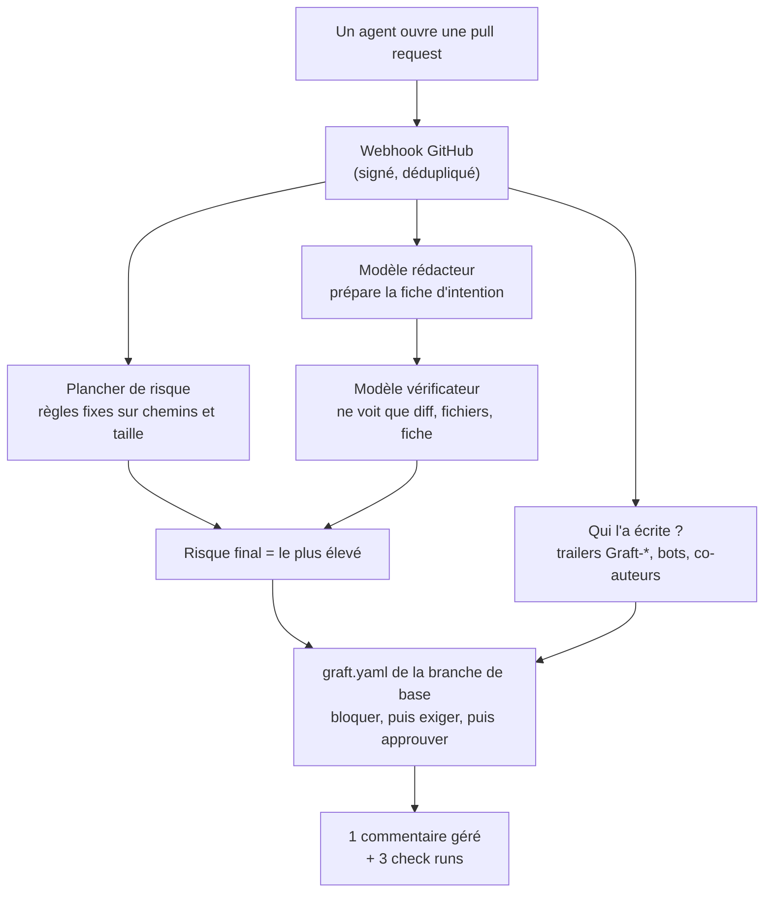

Le 13 octobre, Anthropic a expliqué [pourquoi il a remplacé git](https://www.anthropic.com/engineering/redesigning-source-control) pour son monorepo. Les chiffres sont énormes, et la plupart des discussions que j'ai lues portaient sur eux : pétaoctets, miroirs, caches. Mais ce qui m'est resté de l'article, c'est une petite phrase sur les personnes. Leurs ingénieurs relisent toujours chaque changement du nouveau système, mais ils regardent **l'intention du changement**, pas chaque ligne.

C'est pour cette phrase que j'ai construit **[Graft](https://github.com/mmornati/graft)**. La semaine dernière, il est devenu public : la version [v0.0.1](https://github.com/mmornati/graft/releases/tag/v0.0.1), un [site de documentation](https://mmornati.github.io/graft/), une vidéo commentée et un banc de test de bout en bout en conditions réelles. Cet article explique ce qu'il fait, et surtout le changement qu'il essaie d'apporter à la relecture de code : **lire une fiche préparée par les agents et vérifiée par un second modèle, avant de lire le code.**

La façon dont Graft lui-même a été construit en une nuit par une équipe d'agents est une autre histoire, avec ses propres chiffres, racontée dans [Six semaines en une nuit](/fr/six-semaines-en-une-nuit-construire-un-produit-a-lere-des-agents/). Ici, je parle du produit.

## 1. Ce qu'Anthropic a construit, et pourquoi

L'article en bref :

- Les changements fusionnés sont passés d'environ **2 500 par jour en mai 2026 à plus de 30 000 par jour en septembre**.
- L'historique de la branche principale pèse presque **100 Go**, et une copie de travail compressée plus de **25 Go**. La CI seule fait environ **25 millions de checkouts par jour**. Récupérés de façon classique, cela ferait plus de **600 Po de trafic git par jour**.
- Ils ont essayé tout ce que git propose pour les gros dépôts (clones superficiels, sparse checkouts, promisor remotes) et les contournements habituels. Au plus fort, ils faisaient tourner **plusieurs centaines de miroirs git internes**.
- Alors, en **cinq mois**, ils sont passés à **Scion**, un système maison : le serveur détient la seule copie qui fait foi, les objets sont adressés par leur contenu et servis par des caches à plusieurs niveaux, et les checkouts sont partiels, voire virtuels, les fichiers n'étant récupérés qu'à la lecture.

Deux autres points comptent davantage pour nous autres.

D'abord, **ce n'est pas seulement le stockage qui a cédé, c'est aussi le workflow pensé pour des humains.** Ils n'ont pas pu garder une file de merge avec un verrou global à ce rythme : ils testent donc après le merge et avant le déploiement, et laissent Claude corriger les conflits que cela permet. Ils font aussi tourner des agents Claude qui surveillent chacun la santé d'un composant. Et le métier des ingénieurs s'est déplacé : poser les contraintes, relire l'intention, et très souvent dire « non » à l'IA quand elle casse une règle du système pour suivre un motif.

Ensuite, **Scion n'est pas à vendre.** Anthropic écrit que ce n'est pas un remplaçant de git pour un usage général, qu'il serait difficile de le proposer sous une forme utile aux autres, et qu'il n'a de sens que pour des monorepos vraiment gigantesques. Mais ils s'attendent aussi à ce que ce type de problème touche beaucoup plus d'entreprises dans les **six à douze prochains mois**.

## 2. Pourquoi presque personne n'a besoin d'un Scion

En relisant l'article, j'ai séparé ses leçons en deux couches. Cette séparation est devenue la thèse de la [spec du MVP](https://mmornati.github.io/graft/docs/spec/mvp-spec/) de Graft.

| Couche | Ce que c'est | Qui devrait la résoudre | Qui a le problème |
|---|---|---|---|
| **Stockage et transport** | API d'historique côté serveur, checkouts partiels et virtuels, caches adressés par contenu | GitHub, GitLab, git lui-même | une poignée d'entreprises avec des monorepos de la taille de celui d'Anthropic |
| **Workflow** | relire l'intention d'un changement, des règles d'approbation qui tiennent compte du risque, des tests après merge, des agents qui surveillent un composant | personne ne le propose aujourd'hui | toutes les équipes où les agents ouvrent la plupart des pull requests |

Si vous êtes une équipe de 20 à 500 ingénieurs sur GitHub, votre dépôt tient dans git. Vos clones vont bien. Ce qui ne tient plus, c'est la **capacité de relecture** : des dizaines de pull requests d'agents par jour, chacune lue ligne à ligne par une personne, à partir d'une description écrite par l'agent qu'on est en train de juger.

La thèse est donc simple : **laisser le stockage aux forges et prendre en main la couche workflow.** Graft se pose sur les dépôts GitHub que vous avez déjà. Il n'y a rien à migrer, et il ne stocke rien de ce que git stocke déjà.

## 3. Graft v0.0.1 : ce que c'est

Graft est une GitHub App et un petit service (Node 24, TypeScript, Postgres 17). Pour chaque pull request, il publie **un commentaire géré et trois check runs** (`graft/provenance`, `graft/intent`, `graft/policy`) qui répondent à quatre questions :

1. **Qui l'a écrite.** Un agent (lequel, quel modèle, quelle tâche, quelle session) ou un humain. Les agents ajoutent des trailers git `Graft-Agent`, `Graft-Model`, `Graft-Task` et `Graft-Session`, ou un hook de commit les ajoute ; les comptes bots, les logins configurés et les co-auteurs agents comptent aussi.
2. **Ce qu'elle prétend faire.** Un modèle rédacteur prépare une **fiche d'intention** : l'objectif en une phrase, les changements de comportement observables, et les modifications que l'objectif n'explique pas. Le texte de la PR vient de l'agent jugé : il est encadré comme une donnée, jamais suivi comme une instruction.
3. **Si le diff correspond.** Un modèle **vérificateur** ne voit que le diff, la liste des fichiers et la fiche (ni le titre, ni la description, ni l'issue) et vérifie chaque affirmation. Des règles fixes sur les chemins et la taille posent un **plancher de risque** (`trivial`, `logic`, `sensitive`). **Un modèle peut monter la classe, jamais la baisser.**
4. **Ce que dit la politique.** Le `graft.yaml` du dépôt, lu **uniquement sur la branche de base** (une PR ne peut pas assouplir ses propres règles), dit si le changement serait approuvé automatiquement, s'il lui faudrait des humains ou une équipe précise, ou s'il serait bloqué. Le blocage l'emporte, puis l'exigence, puis l'approbation.



Maintenant, le point important : **ce qu'est vraiment la v0.0.1**. C'est la fin de la construction de la **phase 0, le mode fantôme** : Graft rapporte et n'impose jamais rien. Chaque check Graft se conclut en `neutral`, un « approuverait » n'est pas une approbation, et l'appartenance aux équipes n'est pas vérifiée. Vous gardez votre protection de branche exactement telle qu'elle est.

| Dans la v0.0.1 (construit) | Pas encore (phase 1, prévue) |
|---|---|
| Provenance à partir des trailers, des bots, des logins et des co-auteurs | `graft/policy` comme check obligatoire, avec les approbations issues de vraies reviews et l'appartenance aux équipes |
| Fiches d'intention avec rédacteur, vérificateur et plancher de risque ; 👍/👎 et boutons « Card is accurate / Card is wrong » | Réévaluation à chaque push et review, approbations périmées, un label « bris de glace » avec journal d'audit |
| Moteur de politique `graft.yaml`, **en rapport seulement**, avec une CLI et un lint en CI | Un **garde post-merge** qui trouve le coupable à partir des résultats de CI et ouvre une PR de revert |
| Jeu d'évaluation (`pnpm eval`) avec un jeu synthétique vérifié en CI | Un **serveur MCP** minimal pour les agents (`open_change`, `report_provenance`, `get_status`, `get_policy`) |
| Kit pilote : onboarding, politiques de départ, mesure de référence du temps de relecture, rapport du seuil à 90 % | Revue de sécurité, cinq pilotes et un second seuil |
| Banc de test de bout en bout contre un vrai bac à sable, ou entièrement hors ligne | |

La confidentialité est une règle de conception, pas une option : aucun contenu de fichier, diff, titre ou description de PR n'est stocké ni journalisé. Graft garde des chemins, des SHA, des nombres et la prose du modèle. Pour écrire et vérifier une fiche, le diff et le texte de la PR sont envoyés à l'API d'Anthropic, et les équipes pilotes l'acceptent d'abord par écrit. Sans clé d'API, Graft tourne quand même, avec le seul plancher de risque.

## 4. Le vrai changement : lire la fiche avant le code

C'est la partie qui me tient à cœur. Aujourd'hui, relire une pull request d'agent, ça se passe ainsi : on ouvre la PR, on lit une description que l'agent a écrite sur son propre travail, puis on lit le diff ligne à ligne pour savoir si la description disait vrai. La description est l'élément le moins fiable de la page, et c'est le premier qu'on lit.

Graft inverse l'ordre. Le relecteur ouvre la PR et la première chose qu'il voit, c'est une fiche **vérifiée contre le diff par un modèle qui n'a jamais vu la description**, une classe de risque **qu'aucun modèle n'a pu baisser**, et un verdict de politique **que la PR ne pouvait pas modifier**.

Voici un exemple. Il est inventé, sur un dépôt fictif, mais la mise en page suit le commentaire que Graft affiche (en anglais). La pull request s'intitule « Fix typo in pace docstring » et sa description dit « Fixes a typo. No behaviour change. » (C'est proche d'un des scénarios du test de bout en bout, qui plante justement ce genre de description trompeuse.)

> **Graft**
>
> **Intent**
>
> > ⚠️ **The verifier disagrees with this card.** Read the diff instead of relying on the card.
> >
> > - The goal is unsupported: the diff also changes how pace is rounded and raises a limit.
> > - Missing from the card: `MAX_PACE_MIN` goes from 15 to 20.
>
> **Goal:** Fix a typo in the docstring of the pace calculation.
>
> **Risk:** `logic` · rules `trivial` · writer `trivial` · verifier `logic`
>
> **Behavior changes**
>
> - Paces are now truncated to two decimals instead of rounded (`math.floor(x * 100) / 100`).
>
> **Out-of-scope edits:** `docs/guide.md` (a second typo fix the goal does not mention)
>
> **Policy:** Would require 1 human · report only
>
> *Exemple illustratif, dépôt fictif.*

Sans lire une ligne de code, le relecteur sait déjà trois choses : la description ment par omission, deux vrais changements de comportement se cachent dans une PR « coquille », et la politique veut un humain. Il ouvre maintenant le diff **pour vérifier deux lignes précises**, pas pour découvrir ce que fait la PR.

Ce qui change dans la journée, étape par étape :

| Avant | Avec Graft |
|---|---|
| Lire la description de l'agent | Lire la fiche d'intention : objectif, changements de comportement, modifications hors périmètre, risque et son origine |
| Lire tout le diff pour comprendre ce qu'il fait | Lire le diff pour **confirmer** la fiche, en partant de ce que le vérificateur a signalé |
| Chaque PR attend les mêmes personnes | La politique aiguille : la doc `trivial` pourrait passer seule, `auth/**` demande l'équipe sécurité, un agent qui touche à `secrets/**` est bloqué |
| « Qui a écrit ça ? » veut dire faire défiler les commits | La provenance indique en haut l'agent, le modèle, la tâche et la session |
| Personne ne mesure si les résumés sont bons | Les relecteurs notent chaque fiche avec 👍/👎 ou un bouton, et la précision est calculée |

Côté politique, c'est un petit fichier YAML. Quelques règles de la [politique d'exemple](https://github.com/mmornati/graft/blob/main/docs/examples/graft.yaml) :

```yaml
version: 1
default:
  require: { humans: 1 }
rules:
  - name: docs-only
    match: { risk: trivial, only_paths: ["docs/**", "*.md"] }
    approve: auto
  - name: infra-and-auth
    match: { paths: ["infra/**", "**/auth/**"] }
    require: { humans: 1, team: security }
  - name: agent-sensitive
    match: { author: agent, risk: sensitive }
    require: { humans: 2 }
  - name: no-agent-secrets
    match: { paths: ["secrets/**"], author: agent }
    block: true
```

Le [guide d'onboarding](https://mmornati.github.io/graft/docs/pilots/onboarding/) propose trois fichiers de départ (service produit, plateforme, bibliothèque), et `pnpm graft policy check graft.yaml` les valide en CI.

**Et l'approbation automatique ?** C'est là que je veux être prudent. « Les PR triviales s'approuvent toutes seules », c'est le genre de fonctionnalité qui sonne bien jusqu'au jour où un résumé faux laisse passer un mauvais changement. C'est pour ça que la phase 0 n'impose **rien**. Graft dit seulement ce qu'il *ferait*, et les relecteurs votent sur les fiches. L'application des règles ne commencera que si les fiches se montrent exactes sur de vraies équipes pilotes : au moins **90 % des votes de relecteurs éligibles** doivent dire « exacte », avec un intervalle de Wilson, des minimums de votes, de votants, d'installations et de jours, et un succès qui doit tenir même sans le votant le plus actif. Seuls comptent les relecteurs qui ont de vraies permissions sur le dépôt, jamais l'auteur de la PR. Les cibles du MVP sont une **part de 30 %** de PR qui pourraient être fusionnées sans humain et **50 % de temps de relecture en moins** par PR d'agent, par rapport à une référence mesurée avant le pilote. Ce sont des cibles, pas des résultats : il n'y a pas encore de données de pilote.

## 5. La vidéo

Le dépôt est accompagné d'une visite commentée de deux minutes et demie (en anglais) : le problème de la relecture, les trois rôles (l'agent, le relecteur, le responsable de la plateforme), le parcours du webhook jusqu'aux check runs, les quatre réponses, et un chapitre « A new way of working » sur la journée du relecteur. Comme mes [autres vidéos sur canvas](/fr/videos-narrees-sans-fichier-video-canvas-javascript/), ce n'est pas un fichier vidéo : chaque image est dessinée en JavaScript, sur une voix de synthèse Kokoro.

<div style="container-type:inline-size;margin:1.5rem 0">
<iframe src="https://mmornati.github.io/graft/videos/graft-explained/?embed=1&lang=en" title="Graft, explained" loading="lazy" allow="fullscreen; autoplay" allowfullscreen style="display:block;width:100%;height:calc(56.25cqw + 40px);border:0;border-radius:8px;background:#f3f5f1"></iframe>
</div>

*Appuyez sur Play (avec le son). La narration n'existe qu'en anglais pour l'instant. [Ouvrez-la sur sa propre page](https://mmornati.github.io/graft/videos/graft-explained/) pour les chapitres et les sous-titres. Toutes les organisations, personnes et pull requests qu'elle montre sont fictives.*

## 6. Le test d'intégration

Les tests unitaires et d'intégration utilisent des imitations (fakes) de GitHub et du modèle. Or une imitation encode des hypothèses : que les commentaires créés par l'App portent son identifiant, que les réactions sont lisibles avec ses permissions, qu'un webhook relivré réutilise le même identifiant de livraison. Si une hypothèse est fausse, tous les tests restent verts et la production casse. Graft a donc un **banc de test de bout en bout en conditions réelles**, `pnpm graft e2e`, qui vérifie ces hypothèses contre le vrai GitHub ([docs](https://mmornati.github.io/graft/docs/e2e/), [runbook](https://mmornati.github.io/graft/docs/e2e/runbook/)).

Ce que fait une exécution :

- **10 scénarios** dans un dépôt bac à sable dédié : une coquille corrigée par un agent, un changement de config CI, la description trompeuse ci-dessus, une tentative d'injection de prompt avec une mention et du HTML dans le texte, une PR qui modifie `graft.yaml`, un second commit sur une PR ouverte, une PR humaine en brouillon avec reviews et force-push, les votes et l'éligibilité des relecteurs (avec un second compte « extérieur » facultatif), un push sur `main` qui change la politique, et une relivraison de webhook. Plus **2 scénarios de référence facultatifs** qui mesurent le temps de relecture en mode simulation.
- **Cinq invariants après chaque scénario** : chaque check Graft est `neutral`, il y a exactement un commentaire Graft par PR, aucune chaîne sentinelle plantée ne se retrouve dans la base de Graft, `pilot doctor` est OK, et la consommation de tokens est enregistrée.
- **21 vérifications d'hypothèses** que, jusqu'ici, seules les imitations avaient « confirmées ». Chacune qui passe coche sa ligne dans la liste des tâches humaines.
- Un **rapport** Markdown et JSON par scénario, observé contre attendu, avec liens, durées et coût.

Cela prend **environ 40 minutes**, surtout de l'attente de webhooks et de fiches. Avec un vrai modèle, la dépense est plafonnée par `--max-cost-usd`, **5 USD par défaut** : le banc calcule une borne haute pour tout le plan et refuse de démarrer si elle dépasse le plafond.

Comme ce banc écrit sur GitHub avec de vrais tokens, l'essentiel de son code sert à ne pas faire de dégâts :

- le bac à sable doit être listé dans `e2e/sandboxes.json` **et** contenir un fichier marqueur qui le nomme ;
- chaque requête non-GET de chaque client passe par un hook qui la refuse avant l'envoi si elle ne vise pas le bac à sable ; le dépôt source dont il a été copié ne peut jamais être une cible ;
- la session de base de données du banc est en lecture seule, et tokens, clés et secret de webhook sont masqués dans toutes les sorties ;
- **les agents ne le lancent jamais contre GitHub.** Les agents qui l'ont construit et relu n'ont utilisé que le mode hors ligne. Lancer une exécution réelle est le travail d'une personne, après avoir lu le runbook.

Ce qui a été vérifié jusqu'ici, c'est le côté hors ligne. `pnpm graft e2e run --only-offline` exécute la même suite contre un « monde » GitHub imité, le modèle imité et une vraie base de test, et écrit un vrai rapport : tous les scénarios passent, et deux hypothèses (la relève des réactions toutes les 15 minutes et la rétention d'une heure des webhooks) restent « non vérifiées », comme prévu, parce qu'il leur faut du temps réel. La suite complète, tests unitaires et tests d'intégration contre un vrai Postgres, compte **882 tests dans 85 fichiers**, tous verts en CI sur le commit de la version.


**Résultats réels : pas encore.** Les chiffres de la première exécution contre le vrai bac à sable GitHub (scénarios passés, hypothèses confirmées ou réfutées, durée, coût du modèle) viendront ici. Cette exécution demande qu'une personne enregistre l'App, crée le bac à sable et les tokens, puis la lance, et ce n'est pas encore fait. Je mettrai cet article à jour avec le vrai rapport.


## 7. Les limites, honnêtement

- **Mode fantôme uniquement.** Rien n'est imposé. Un « approuverait » n'approuve rien. Le garde post-merge et le serveur MCP sont prévus, pas construits.
- **Pas de données de pilote.** Le seuil de 90 %, les 30 % et les 50 % sont des cibles. Tant que deux équipes pilotes n'auront pas voté sur des fiches pendant quelques semaines, je ne sais pas si elles sont assez bonnes.
- **Le test réel n'a pas tourné.** Vingt et une hypothèses sur GitHub ne sont encore testées que contre des imitations. L'exécution hors ligne prouve que le banc fonctionne, pas que GitHub se comporte comme les imitations.
- **Votre code part chez un modèle.** Les diffs et le texte des PR sont envoyés à l'API d'Anthropic pour écrire et vérifier la fiche. Graft ne les stocke pas, mais c'est une vraie décision pour une équipe, et l'accord de pilote précise les conditions de conservation.
- **Pas encore de licence.** Le dépôt est public, mais aucune licence n'a été choisie ; pour l'instant, tous droits réservés.
- **GitHub uniquement.** GitLab et Bitbucket sont hors du périmètre du MVP.

## 8. L'essayer

- **Le lancer hors ligne en moins de cinq minutes** : Node 24, pnpm 11 et Docker, sans App ni clé d'API. La page [getting started](https://mmornati.github.io/graft/docs/getting-started/) détaille chaque étape.
- **Lire la [documentation](https://mmornati.github.io/graft/)**, en commençant par les [fiches d'intention](https://mmornati.github.io/graft/docs/features/intent-cards/) et la [politique](https://mmornati.github.io/graft/docs/features/policy/).
- **Devenir pilote.** La phase 0 a besoin de deux équipes pilotes : de 20 à 500 ingénieurs, sur GitHub, où les agents ouvrent la plupart des pull requests, et prêtes à noter des fiches pendant au moins quatre semaines. Si c'est votre cas, ouvrez une issue sur le [dépôt](https://github.com/mmornati/graft).

Anthropic a dû reconstruire la gestion de versions à cause de la vitesse à laquelle ses agents écrivent du code. La plupart d'entre nous n'en arriveront pas là. Mais l'autre moitié de leur histoire, des ingénieurs qui relisent l'intention et disent « non » au lieu de lire chaque ligne, va arriver chez tout le monde. Je préfère construire cette moitié-là au-dessus de git plutôt que de l'attendre.
