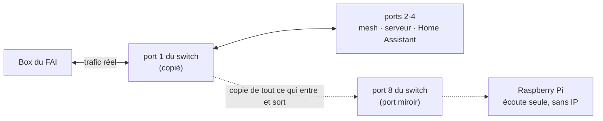
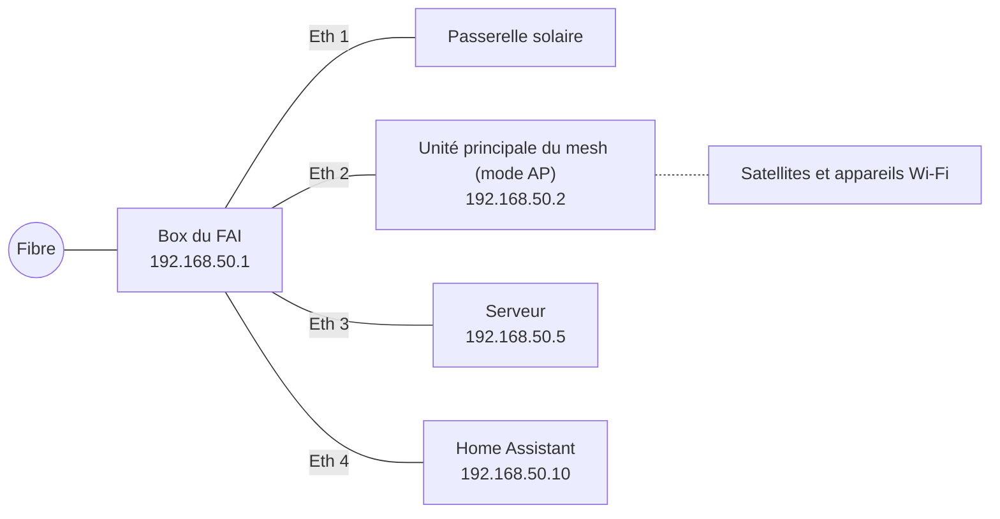
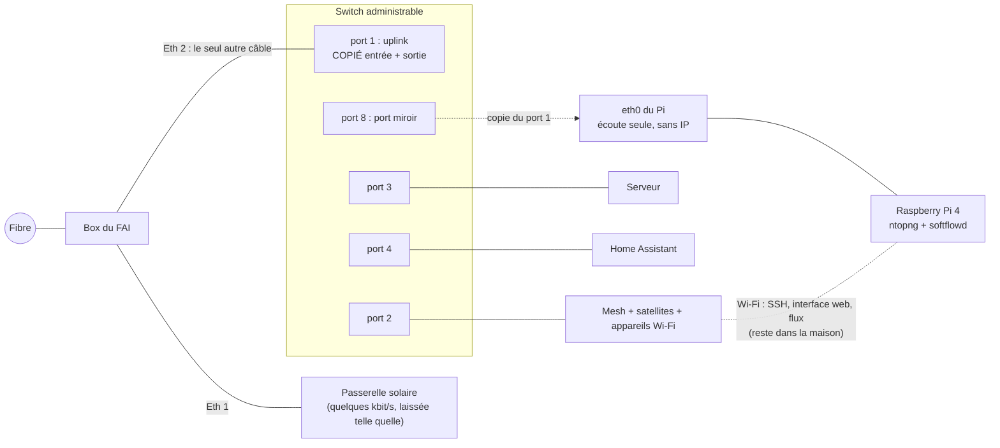
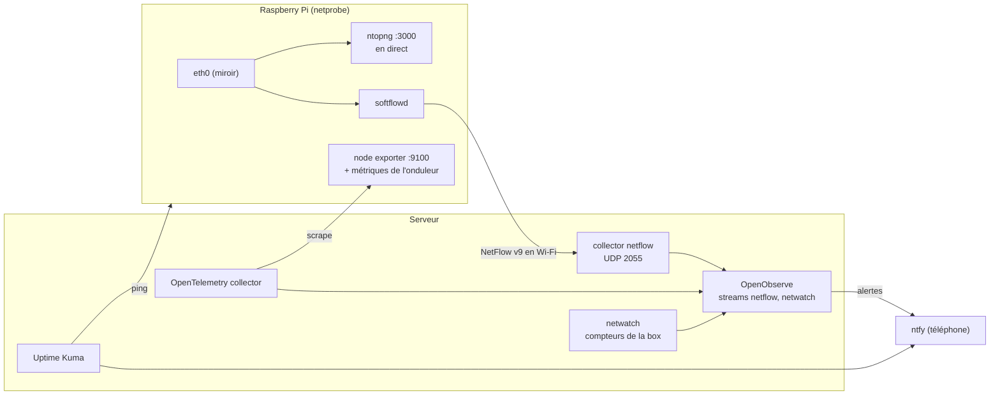
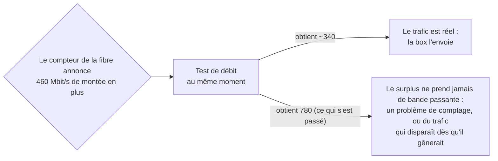

Dans l'[article précédent](/fr/avez-vous-essaye-de-l-eteindre-et-de-le-rallumer-surveiller-un-reseau-domestique/), j'ai raconté l'histoire de la réinitialisation qui avait « réparé » le Wi-Fi et, au passage, fait disparaître **2 à 3 To par jour de trafic mystère** des compteurs de la box. Je l'avais terminé avec un nouveau moniteur Uptime Kuma, « trafic internet normal », et le sentiment un peu suffisant que, cette fois, je verrais si ça revenait.

C'est revenu le lendemain matin.

Pas d'un coup, mais par une lente montée : environ 1 Mbit/s juste après la réinitialisation, 10 l'après-midi, 30 à 90 le soir, 60 en descente et 120 en montée le lendemain matin. De nouveau plus d'upload que de download, toute la nuit. Et cette fois, j'avais beaucoup plus de données que la première fois. Avec Claude qui lisait OpenObserve via MCP, j'ai pu mettre hors de cause le serveur (toute sa carte réseau faisait 0,14 Mbit/s en descente et 0,34 en montée), Plex (interrogé directement via son API : aucun stream, aucun transcodage) et chacun des conteneurs. Ce à quoi je ne savais pas répondre, c'était la seule question qui comptait : **si ce n'est pas le serveur, alors qui ?**

Tous mes chiffres étaient **par port**, jamais **par appareil**. Pour savoir qui parle à qui, il faut regarder les paquets. Cet article raconte comment je l'ai fait sans toucher à la configuration du réseau, avec un switch à 30 euros et un Raspberry Pi qui traînait déjà dans un tiroir, et comment tout ça se branche sur l'installation Uptime Kuma et OpenObserve de la dernière fois.


**Tout dans cet article est pseudonymisé,** comme la dernière fois et avec les mêmes faux noms : le LAN est `192.168.50.0/24`, la box du FAI est en `.1`, l'unité principale du mesh en `.2`, le serveur en `.5`, Home Assistant en `.10`. Le préfixe IPv6 vient de la plage réservée à la documentation, et les noms d'appareils sont inventés. Les **modèles de matériel** (switch, Pi, carte onduleur) sont les vrais, parce que c'est la partie que vous voudrez peut-être reproduire. Les volumes de trafic, les débits et les horaires sont les vraies mesures.


## Ce que je voyais déjà, et ce que je ne voyais pas

Après la première enquête, j'avais ajouté une source de plus : `netwatch` (l'observateur DHCP de l'article précédent) se connecte maintenant aussi à l'API locale de la box toutes les 20 secondes et lit les compteurs d'octets de chacun de ses ports : la fibre, les quatre ports Ethernet, et son propre Wi-Fi. Ça me donnait ce tableau :

| Source | Répond à | Ne répond pas à |
|---|---|---|
| Box du FAI, compteur de la fibre | Combien passe par la fibre | Qui |
| Box du FAI, compteurs par port | Quel **port** de la box le transporte | Quel appareil derrière le mesh sur ce port, et où ça va |
| Carte réseau du serveur, métriques des conteneurs | Si le serveur est la source | Quoi que ce soit sur les 70 autres appareils |
| Home Assistant (intégration du mesh) | Quel appareil est sur quel point d'accès, son signal | Combien il transfère |

Et ce tableau était très bizarre : la fibre transportait des dizaines de Mbit/s, parfois plus de 300, alors que **tous les ports LAN de la box réunis restaient sous les 7 Mbit/s** et son Wi-Fi à zéro. Soit le trafic venait de l'intérieur de la box elle-même, soit les compteurs de ports de la box mentaient (certaines box transfèrent le trafic au niveau matériel sans le compter sur les ports LAN). Il n'y a qu'une seule façon de départager ces deux explications : **mettre sur le câble quelque chose qui compte de son côté.**

### Les options envisagées

*   **Débrancher les appareils un par un en regardant le graphique.** Gratuit, et ça marche pour un coupable évident. Mais le trafic arrivait par rafales, ça aurait coupé la maison à chaque test, et ça ne dit pas *où* va le trafic.
*   **L'interface de la box elle-même.** La mienne affiche une liste d'appareils, pas le trafic par appareil.
*   **De l'ARP spoofing** depuis un Pi ou le serveur, pour que chaque appareil envoie son trafic à travers lui. Pas besoin de matériel, mais non : c'est IPv4 uniquement (mon FAI fournit aussi de l'IPv6, qui passerait à côté), ça met un Pi sur le chemin de toute la maison, et ça ne voit pas le trafic généré par la box elle-même, qui était l'un des deux suspects.
*   **Un pont en coupure** : un Pi avec deux ports Ethernet sur le câble. Même visibilité qu'un miroir, mais si le Pi plante, la maison se retrouve hors ligne.
*   **Le port mirroring.** Un switch copie tout le trafic d'un port vers un autre port, où un appareil de capture écoute. L'appareil de capture n'est pas sur le chemin : s'il plante, personne ne s'en aperçoit. Rien sur le réseau ne change d'adresse ni de configuration. C'est ce que j'ai choisi.

## Le port mirroring en une image

On peut dire à un switch administrable : « chaque trame qui entre ou sort par le port 1, envoie-la aussi en copie sur le port 8 ». L'appareil branché sur le port 8 reçoit du trafic qui ne lui est pas adressé ; il ne fait qu'écouter, ne répond jamais, et n'a même pas besoin d'une adresse IP sur ce port.



Toute l'astuce est de choisir **quel** port copier. Si le port 1 est le **seul** câble entre la maison et la box, alors chaque octet échangé entre un appareil de la maison et internet passe par lui, et le Pi en reçoit une copie intégrale, IPv4 et IPv6, filaire et Wi-Fi. Le trafic qui reste à l'intérieur de la maison (un téléphone qui regarde Plex sur le serveur, Home Assistant qui parle au serveur) est commuté localement et ne passe jamais par le port 1, et c'est exactement ce qu'on veut : moins de choses à traiter, et ça n'a rien à voir avec la facture internet.

## Le matériel

### Un switch qui sait faire du mirroring (c'est la partie importante)

**Tous les appareils ne savent pas copier un port, et celui que vous avez déjà ne le sait probablement pas.** Ma box ne sait pas le faire. Mon mesh non plus, et en mode point d'accès ça ne servirait de toute façon à rien. Les switchs non administrables ne le peuvent pas, par définition : ils n'ont aucune configuration. Il faut un switch **administrable** ou **« smart »**, et la fonction s'appelle en général *Port Mirroring*, parfois *SPAN* ou *Monitor port*. Vérifiez la fiche technique avant d'acheter.

J'ai pris un **TP-Link TL-SG608E** : 8 ports Gigabit, sans ventilateur, environ 3 W, autour de 30 euros, de la gamme « Easy Smart » de TP-Link, qui gère le port mirroring depuis son interface web. Le **E** à la fin compte : les TL-SG108 et TL-SG105 sans le E ont exactement la même tête mais ne sont pas administrables, donc ils ne savent pas copier. Le TL-SG605E à 5 ports peut faire le même travail si vous comptez bien vos ports : uplink, mesh, serveur, Home Assistant et port miroir en prennent exactement cinq, et il ne reste plus rien pour autre chose. J'ai pris celui à 8 ports.

### Un Raspberry Pi 4 ou plus récent

Le Pi fait trois choses : recevoir la copie, l'afficher en direct (ntopng), et la résumer en enregistrements de flux pour OpenObserve (softflowd). Le modèle compte plus qu'on ne le croit :

| Modèle | Utilisable ? | Pourquoi |
|---|---|---|
| **Pi 5** | oui | La plus grande marge |
| **Pi 4** | **oui** | Son Ethernet intégré est du **vrai Gigabit** sur son propre contrôleur, il a de l'USB 3, quatre cœurs 64 bits, et l'image ntopng tourne dessus. 4 Go, c'est confortable, 2 Go suffisent pour une maison |
| Pi 3 B+ | non | Son port « Gigabit » passe par l'USB 2, donc en pratique environ 300 Mbit/s : il perdrait l'essentiel de la copie pendant le moindre gros téléchargement |
| Pi 1, 2, 3 B | non | Ethernet à 100 Mbit/s, et les plus anciens ne font pas tourner de logiciels 64 bits |

**Le Gigabit n'est pas un luxe ici.** Ma fibre fait 1 Gbit/s en descente *et* 1 Gbit/s en montée. Le port miroir reçoit la copie des deux sens sur un seul câble, et la carte du Pi doit suivre. Un port de capture à 100 Mbit/s perdrait silencieusement l'essentiel de la copie dès que quelqu'un télécharge un jeu, et vous en concluriez qu'il ne s'est rien passé. (Même en Gigabit, il y a une limite physique, j'y reviens dans la section sur les limites.)

La deuxième chose importante, c'est que **le Pi a besoin de deux interfaces réseau**. Le port Ethernet branché sur le port miroir ne fait qu'écouter : il n'a pas d'adresse et ne doit jamais rien envoyer. Il faut donc autre chose pour transporter le SSH, la page web de ntopng et les enregistrements de flux envoyés au serveur. Sur un Pi 4, c'est gratuit : **son Wi-Fi**. Le trafic d'administration fait Pi → mesh → switch → serveur et reste à l'intérieur de la maison, donc il ne passe jamais par le port copié et ne pollue jamais la mesure. Il est léger (une session SSH, une page web, quelques kbit/s d'enregistrements de flux), et si le Wi-Fi décroche un instant, la capture continue ; seuls l'interface et l'export se mettent en pause. Si vous préférez un câble, un adaptateur USB 3 Gigabit sur un port libre du switch fait le même travail.

Le mien est le Pi 4 (4 Go) qui faisait tourner Home Assistant avant qu'il ne passe sur sa propre machine, avec ce qu'il avait déjà : une carte **Geekworm X857** avec un SSD mSATA de 128 Go (le Pi démarre dessus, ce qui est beaucoup plus tendre avec les écritures permanentes qu'une carte SD) et un hat onduleur **Geekworm X708** avec des accus 18650. L'onduleur est facultatif. Son seul vrai avantage : en cas de coupure de courant, le Pi s'éteint proprement au lieu de corrompre son disque.

### Liste de courses

| Article | Remarques |
|---|---|
| Switch administrable avec port mirroring | Ici un TL-SG608E ; n'importe quel switch dont la fiche technique mentionne « port mirroring » |
| Raspberry Pi 4 (2 Go+) ou Pi 5 | OS 64 bits obligatoire |
| Alimentation officielle | 15 W pour un Pi 4, 27 W pour un Pi 5 ; les deux sont exigeantes |
| SSD en USB 3 ou une bonne microSD A2 | Un SSD tient plus longtemps face aux écritures permanentes de ntopng |
| Boîtier avec ventilateur, ou dissipateurs | ntopng occupe bien le CPU |
| Câbles **Cat 5e ou Cat 6** | Vérifiez-les. J'y reviens plus bas |
| *Facultatif :* adaptateur USB 3 Gigabit | Seulement si vous ne voulez pas administrer le Pi en Wi-Fi |

## Le câblage

Avant, le serveur et Home Assistant étaient branchés directement sur la box, à côté du mesh. C'est la configuration la plus courante à la maison, et le piège, c'est que **copier le câble entre la box et le mesh ne montrerait que les appareils Wi-Fi** : le serveur et Home Assistant n'y passeraient jamais.



Après, **le switch est le seul câble vers la box**, et tout se branche sur le switch :



| Port du switch | Relié à | Rôle |
|---|---|---|
| 1 | Box du FAI, Ethernet 2 | Uplink, **copié** |
| 2 | Unité principale du mesh (son port WAN, comme avant) | |
| 3 | Serveur | |
| 4 | Home Assistant | |
| 5, 6, 7 | libres | Tout ce qui sera câblé plus tard (ou l'adaptateur USB du Pi) |
| 8 | Pi, port Ethernet **intégré** | Port miroir : reçoit la copie |

Rien ne change d'adresse : la box distribue toujours les mêmes IP, et les réservations DHCP s'appliquent toujours. Le recâblage coûte cinq minutes de coupure internet. Pour ne jamais créer de boucle, faites-le dans cet ordre : débranchez le mesh, le serveur et Home Assistant de la box ; branchez-les sur les ports 2, 3 et 4 ; puis branchez le port 1 sur la box. Vérifiez qu'un téléphone a bien internet et que le serveur répond.


**Vérifiez la vitesse du lien, pas seulement le voyant.** Le premier câble que j'ai utilisé entre le switch et le Pi négociait à **100 Mbit/s**. Les deux côtés n'annonçaient que du 10/100 : le câble avait deux paires fonctionnelles sur quatre, ce qui suffit pour du Fast Ethernet, mais pas pour du Gigabit. Tout « marchait », et le Pi aurait discrètement perdu la copie au-delà de 100 Mbit/s. `sudo ethtool eth0 | grep Speed` sur le Pi doit afficher `1000Mb/s`. Un câble Cat 6 a réglé le problème.


## Configurer le switch

Les switchs Easy Smart ont une petite interface web. Les étapes, avant de recâbler quoi que ce soit :

1.  **Première connexion.** Branchez seulement un portable sur le switch. Sans serveur DHCP à proximité, le switch se rabat sur `192.168.0.1` : donnez au portable une adresse fixe comme `192.168.0.10/24` et ouvrez `http://192.168.0.1`. L'identifiant par défaut est `admin`/`admin`, et il impose tout de suite un nouveau mot de passe. Mettez-le dans votre gestionnaire de mots de passe.
2.  **Réglage IP.** Laissez le DHCP activé (c'est le défaut). Une fois sur le LAN, il obtient une adresse de la box ; réservez-lui-en une (la mienne est `192.168.50.3`), pour pouvoir le retrouver plus tard.
3.  **Monitoring → Port Mirror.** Activez le mirroring, **port miroir = 8**, et pour le **port 1**, mettez **Ingress** et **Egress** sur *Enable*. Laissez tous les autres ports désactivés. Appliquez.
4.  Laissez le reste par défaut : pas de VLAN, pas de QoS. La prévention des boucles activée, ça ne pose pas de problème.

Trois choses qui m'ont surpris :

*   **Le mirroring était désactivé à la sortie du carton**, alors que je pensais l'avoir configuré. Après le recâblage, le Pi ne voyait que des broadcasts. Relisez toujours le réglage après l'avoir appliqué.
*   **Il n'y a pas de bouton « Enregistrer ».** Les switchs Easy Smart appliquent et conservent les changements immédiatement.
*   **La page Firmware Upgrade a un bouton « Ready » qui donne l'impression qu'une mise à jour attend.** Ce n'est pas le cas. Il redémarre le switch dans un mode de téléversement qui attend un fichier de firmware que vous avez téléchargé vous-même, et **pendant cette attente, le switch ne fait plus passer le trafic** : toute la maison se retrouve hors ligne. Le mien a déjà le seul firmware que TP-Link publie pour sa version matérielle. Consultez la page de téléchargement du fabricant, et n'appuyez dessus qu'avec un fichier en main.

## Installer le Pi

### Le système

Avec **Raspberry Pi Imager**, écrivez **Raspberry Pi OS Lite (64-bit)**. Dans les réglages de l'Imager : un nom d'hôte (le mien est `netprobe`), votre utilisateur, **SSH avec votre clé publique uniquement**, votre fuseau horaire et votre réseau **Wi-Fi**. Démarrez-le **sans le câble Ethernet**, près d'une unité du mesh, réservez son adresse Wi-Fi dans la box (la mienne est `192.168.50.30`), puis :

```bash
sudo apt update && sudo apt full-upgrade -y
sudo apt install -y unattended-upgrades tcpdump ethtool
ip -br link   # eth0 = intégré (le miroir), wlan0 = Wi-Fi (administration)

# L'économie d'énergie du Wi-Fi coupe de temps en temps le SSH et l'export des flux : on la désactive
sudo nmcli con mod "$(nmcli -g NAME,TYPE con show --active | grep wireless | cut -d: -f1)" \
  802-11-wireless.powersave 2
```

Si vous avez un SSD, c'est le moment de migrer le système dessus et de régler l'ordre de démarrage (`rpi-eeprom-config`, `BOOT_ORDER=0xf14` : l'USB d'abord, puis la carte SD).

### L'interface en écoute seule

C'est la partie clé de l'installation du Pi. `eth0` doit monter, accepter toutes les trames (mode promiscuous, parce que les trames copiées ne sont pas adressées au Pi), et n'avoir **aucune adresse à lui**, ni IPv4 ni IPv6, pour ne jamais envoyer le moindre paquet sur le port miroir :

```bash
# Un profil NetworkManager sans IPv4 ni IPv6 du tout
sudo nmcli con add type ethernet ifname eth0 con-name mirror \
  ipv4.method disabled ipv6.method disabled
sudo nmcli con up mirror

# Ceinture et bretelles : pas d'adresse IPv6 link-local non plus
echo "net.ipv6.conf.eth0.disable_ipv6 = 1" | sudo tee /etc/sysctl.d/90-mirror-eth0.conf

# Mode promiscuous à chaque démarrage
echo 'ACTION=="add", SUBSYSTEM=="net", KERNEL=="eth0", RUN+="/usr/sbin/ip link set eth0 promisc on"' \
  | sudo tee /etc/udev/rules.d/90-mirror-promisc.rules
sudo ip link set eth0 promisc on
```

Branchez maintenant `eth0` sur le port 8 du switch et vérifiez que la copie arrive :

```bash
sudo ethtool eth0 | grep -E 'Speed|Duplex'   # 1000Mb/s, Full
sudo tcpdump -ni eth0 -c 20                  # du trafic d'AUTRES appareils, pas seulement celui du Pi
```

Si `tcpdump` ne montre que des broadcasts (ARP, DHCP, mDNS), le mirroring n'est pas actif sur le switch.

### ntopng, la vue en direct

La version actuelle de Raspberry Pi OS est basée sur Debian 13, qui ne fournit plus ntopng. ntop publie une **image Docker ARM64** officielle, avec des builds hebdomadaires et Redis inclus. Je la fais tourner avec un petit fichier compose :

```yaml
services:
  ntopng:
    image: ntop/ntopng_arm64.dev:latest
    container_name: ntopng
    restart: unless-stopped
    network_mode: host          # il doit voir eth0 directement
    cap_add: [NET_ADMIN, NET_RAW]
    volumes:
      - ntopng-data:/var/lib/ntopng   # séries temporelles
      - ntopng-redis:/var/lib/redis   # utilisateurs et préférences (!)
    command:
      - -i
      - eth0                    # le port miroir
      - -w
      - "3000"
      - --community             # l'édition gratuite
      - --local-networks
      - 192.168.50.0/24,2001:db8:50::/64   # ce que « maison » veut dire, IPv4 et IPv6
      - -n
      - "1"                     # nommer les hôtes locaux via DHCP et mDNS

volumes:
  ntopng-data: { external: true }
  ntopng-redis: { external: true }
```

```bash
sudo apt install -y docker.io docker-compose && sudo usermod -aG docker "$USER"   # se déconnecter et se reconnecter
docker volume create ntopng-data && docker volume create ntopng-redis
docker-compose up -d
```

**Le deuxième volume, c'est celui qu'on oublie.** ntopng garde ses utilisateurs et ses préférences dans son Redis. Ma première version ne persistait que les séries temporelles, ce qui voulait dire que la prochaine mise à jour de l'image aurait tout remis à zéro, y compris le mot de passe admin, revenu à `admin`/`admin`.

Ouvrez `http://192.168.50.30:3000`, connectez-vous avec `admin`/`admin`, définissez un vrai mot de passe. Ensuite, quatre préférences qui comptent pour un miroir :

| Réglage | Valeur | Pourquoi |
|---|---|---|
| Interface → **Mirrored Traffic** | activé | Le port miroir ne fait que recevoir. Sans ça, ntopng se plaint de « RX only traffic » et interprète mal les connexions |
| **DHCP range** | `192.168.50.2-192.168.50.199` | Indique à ntopng quelles adresses sont distribuées dynamiquement |
| **Local broadcast domain hosts identifier** | MAC address | Les appareils gardent leur historique quand leur adresse DHCP change. Ça marche parce que, avec le mesh en mode AP et la box comme seul routeur, le câble copié transporte les vraies adresses MAC des appareils |
| **Speed** de l'interface | 1000 | Pour les graphiques d'utilisation |

Elles sont dans l'interface, ou directement dans Redis : `docker exec ntopng redis-cli set ntopng.prefs.ifid_0.is_traffic_mirrored 1`, puis `redis-cli save` et un redémarrage. ntopng proposera aussi de configurer des « Emergency notifications » : j'ai refusé, parce que les alertes passent déjà par OpenObserve et ntfy, et un deuxième système d'alerte par-dessus ajoute surtout du bruit.


**Le Pi voit tout ce qui passe en clair sur l'uplink :** les noms DNS, le HTTP non chiffré, quel appareil parle à quel service et quand. Traitez-le comme la machine la plus sensible de la maison. Clés SSH uniquement, mises à jour automatiques, ntopng jamais publié via le tunnel, et un pare-feu. Une revue de sécurité automatisée a repéré que le port de ntopng répondait sur **toutes** les adresses du Pi, **y compris son adresse IPv6 publique**, avec seulement le pare-feu IPv6 de la box devant. Désormais, une table nftables ne laisse que le réseau IPv4 de la maison joindre le port 3000 et que le serveur lire le port des métriques, et bloque les deux en IPv6. Et puis : les gens avec qui vous vivez passent aussi par ce câble. Prévenez-les.


```nft
table inet netprobe {
  chain input {
    type filter hook input priority filter; policy accept;
    tcp dport 9100 ip saddr 192.168.50.5 accept      # node exporter : le serveur uniquement
    tcp dport 9100 iifname "lo" accept
    tcp dport 9100 drop
    tcp dport 3000 ip saddr 192.168.50.0/24 accept   # ntopng : IPv4 de la maison uniquement
    tcp dport 3000 iifname "lo" accept
    tcp dport 3000 drop                              # y compris en IPv6
  }
}
```

C'est une table à part, sans `flush ruleset`, donc les règles qu'ajoute Docker ne sont pas touchées.

### softflowd, pour l'historique dans OpenObserve

L'édition gratuite de ntopng est excellente en direct, mais garde peu d'historique. Pour « qu'est-ce qui s'est passé mardi dernier à 3 h du matin ? », à côté de tout le reste dans OpenObserve, le Pi résume aussi la copie en enregistrements **NetFlow** avec [softflowd](https://github.com/irino/softflowd) : un enregistrement par connexion, avec les adresses, les ports, le protocole, les octets et les paquets, chaque minute pour les connexions longues.

```bash
sudo apt install -y softflowd
sudo tee /etc/softflowd/default.conf >/dev/null <<'EOF'
interface=eth0
options=-n 192.168.50.5:2055 -v 9 -t maxlife=60 -T full
EOF
sudo systemctl enable --now softflowd@default
```

Côté serveur, pas besoin d'un nouvel outil : l'**OpenTelemetry Collector** a un récepteur `netflow`. Un conteneur collector dédié écoute sur l'UDP 2055 et écrit chaque flux comme un enregistrement de log dans un stream OpenObserve `netflow`, conservé 30 jours :

```yaml
receivers:
  netflow:
    scheme: netflow
    hostname: 0.0.0.0
    port: 2055

processors:
  # Seul le Pi peut alimenter ce stream. Le port est ouvert au LAN, donc on jette tout le reste.
  # (Une source usurpée passe quand même : ça arrête un exporteur égaré, pas un attaquant déterminé.)
  filter/netprobe:
    logs:
      log_record:
        - attributes["flow.sampler_address"] != "192.168.50.30"
  # On supprime les champs de routage qu'un réseau domestique n'utilise jamais (numéros d'AS, next hop BGP, VLAN...)
  attributes/slim:
    actions:
      - action: delete
        pattern: ^flow\.(src_as|dst_as|bgp_next_hop|next_hop|src_vlan|dst_vlan|in_if|out_if|ip_tos)$

exporters:
  otlp_http:
    endpoint: http://openobserve:5080/api/default
    headers:
      Authorization: "Basic ${env:OO_BASIC_AUTH}"   # un utilisateur en ingestion seule
      stream-name: netflow
```

Ce filtre vient lui aussi de la revue de sécurité : sans lui, n'importe quel appareil du LAN pourrait envoyer de faux flux et polluer l'historique.

## Le brancher sur Uptime Kuma et OpenObserve

Une machine de capture qui arrête silencieusement de capturer, c'est pire que rien : vous liriez « la maison est calme » sur un graphique qui est simplement vide. Le Pi a donc droit au même traitement que tout le reste dans l'article précédent.



**Uptime Kuma** : un moniteur ping de plus, « netprobe (traffic-mirror Pi) », dans le groupe 🌐 Internet & réseau, pour que « le Pi est tombé » s'affiche au même endroit que « le mesh est tombé ».

**Alertes OpenObserve**, vers le même topic ntfy que les autres :

| Alerte | Se déclenche quand |
|---|---|
| `network_mirror_silent` | Aucun flux reçu depuis 15 minutes : le Pi, softflowd, le câble ou le réglage de mirroring du switch a disparu |
| `netprobe_silent` | Aucune métrique du Pi depuis 10 minutes |
| `netprobe_on_battery` / `netprobe_battery_low` | Secteur perdu / moins de 30 % sur batterie (le hat onduleur publie son état sous forme de métriques) |
| `netprobe_ssd_full` | Le disque du Pi au-delà de 85 % |

**SLO** : « fraîcheur de netflow » et « joignabilité de netprobe » ont rejoint les SLO réseau (DHCP, internet, mesh, DNS), uniquement sur le tableau de bord. Kuma prévient déjà pour les urgences.

**Deux nouveaux onglets sur le tableau de bord Réseau** : un pour le Pi lui-même (CPU, température, SSD, batterie et secteur de l'onduleur) et **« Flux (miroir) »** : download et upload dans le temps, top des appareils de la maison, top des hôtes internet, top des services, et le panneau pour lequel tout ça a été construit, **miroir vs fibre**. Les noms des appareils viennent d'une jointure avec l'inventaire des appareils de netwatch, donc les tableaux affichent `laptop-01` plutôt qu'une adresse. La requête du top des appareils ressemble à ça :

```sql
SELECT
  CASE WHEN source_address LIKE '192.168.50.%' THEN source_address
       ELSE destination_address END                         AS device,
  SUM(CASE WHEN destination_address LIKE '192.168.50.%'
           THEN flow_io_bytes ELSE 0 END) / 1e6             AS mb_down,
  SUM(CASE WHEN source_address LIKE '192.168.50.%'
           THEN flow_io_bytes ELSE 0 END) / 1e6             AS mb_up
FROM netflow
WHERE (source_address LIKE '192.168.50.%') <> (destination_address LIKE '192.168.50.%')
GROUP BY device
ORDER BY mb_down + mb_up DESC
LIMIT 15
```

(La vraie compte aussi le préfixe IPv6 comme « maison », et exclut le broadcast et le multicast, qui passent par l'uplink mais ne sortent jamais de la maison.)

## Ce que montre ntopng

Une fois que la copie arrive, ntopng, c'est la partie amusante. Quelques usages que j'en fais.

**« Qui utilise internet en ce moment ? »** *Hosts*, trié par débit. Cliquez sur un appareil : ses correspondants, ses **applications** (le moteur nDPI de ntopng reconnaît Netflix, YouTube, iCloud, WhatsApp, Zoom, les tests de débit et quelques centaines d'autres à partir du trafic lui-même, pas du DNS), les pays avec lesquels il parle, et ses flux en direct.

**Le premier soir, appareil par appareil.** Voici le décompte sur 27 minutes, à partir des flux dans OpenObserve, avec ce que ntopng et les propriétaires des adresses de destination disaient de chacun :

| Appareil | Descente | Montée | Ce qu'il faisait |
|---|---|---|---|
| `laptop-01` | 462 Mo | 207 Mo | Surtout **un test de débit** : le port 8080 vers des serveurs de plusieurs FAI et d'un hébergeur, le schéma classique d'un test de débit bien connu, dont 185 Mo d'upload vers un seul serveur. Plus Claude, en train d'écrire cet article. |
| `phone-03` | 333 Mo | 7 Mo | Un grand CDN, du genre de ceux depuis lesquels beaucoup d'applis téléchargent. Un peu de trafic via un autre CDN qui correspond à iCloud Private Relay d'Apple |
| `laptop-02` | 254 Mo | 14 Mo | Un téléchargement de 83 Mo depuis un cloud public, Apple, deux CDN |
| `work-laptop` | 51 Mo | 18 Mo | Tout passe par un **proxy de sécurité d'entreprise** : du point de vue de la maison, un portable pro ne parle qu'à une seule entreprise |
| Serveur | 18 Mo | 22 Mo | Le fournisseur VPN, le tunnel Cloudflare pour les sites publics, Plex |
| Home Assistant | 11 Mo | 2 Mo | Des intégrations cloud ordinaires |
| Tout le reste | moins de 5 Mo chacun | | |

**Environ 1,1 Go en descente et 0,3 Go en montée, pour toute la maison.** Gardez ce chiffre en tête.

**Les appareils bavards.** Le volume n'est pas la seule chose qui mérite qu'on la regarde. Un pont de caméras demandait au cloud de son fabricant le même nom DNS **environ 20 fois par minute**. Une bande passante négligeable, mais c'est le genre de chose qui remplit les logs DNS, vide la batterie d'un appareil sur batterie, ou trahit une boucle de tentatives.

**Le kill switch du VPN, vérifié.** Dans l'article précédent, j'expliquais que les conteneurs derrière le VPN n'ont pas de réseau si le VPN tombe. Depuis le miroir, le trafic de ces conteneurs n'apparaît que comme le serveur parlant à l'adresse du fournisseur VPN, jamais directement à quoi que ce soit d'autre. C'est la preuve que la conception fonctionne, vue de l'extérieur du serveur.

**Les appareils inconnus.** netwatch envoie une notification push quand une adresse MAC qu'il n'a jamais vue rejoint le réseau. L'étape suivante est désormais à un clic : ouvrir cette adresse dans ntopng et voir à qui elle parle, et combien, avant de décider de l'approuver ou de la bloquer.

**Les limites de ce qu'il sait nommer.** Les téléphones et les Mac utilisent de plus en plus le DNS chiffré ou iCloud Private Relay, donc les noms DNS vus sur le miroir n'en disent pas beaucoup sur eux. Le nDPI de ntopng aide (il reconnaît beaucoup d'applications à partir du TLS et des profils de trafic), mais le trafic chiffré montre **qui parle à qui et combien**, jamais le contenu. Et c'est très bien comme ça.

## Alors, qui utilisait la fibre ?

Personne à la maison.

Le miroir et les compteurs de ports de la box elle-même sont d'accord, et ils sont en désaccord total avec le compteur de la fibre :

| Les mêmes 30 secondes | Mbit/s |
|---|---|
| Tout ce que tous les appareils de la maison ont échangé avec internet (le miroir, 649 paquets/s) | **4** |
| Les ports LAN de la box, d'après ses propres compteurs | 5,6 |
| La **fibre** de la box | **106 en descente, 78 en montée** |

Plus tôt le même soir : environ 2 Mbit/s sur le miroir pendant que la fibre transportait 30 à 95 en descente et 20 à 66 en montée, avec des pics à 383 et 385. Et sur les 27 minutes du tableau par appareil, la maison a fait passer environ 1,1 Go en descente et 0,3 Go en montée, pendant que le compteur de la fibre affichait environ **16 Go en descente et 24 Go en montée**. Plus de 90 % de ce que la fibre a transporté n'a jamais atteint le moindre câble de la maison.

Deux pistes qui se sont révélées fausses, parce qu'elles méritent aussi leur place dans l'article :

*   **Une DMZ oubliée.** La box avait une DMZ (et quatre redirections de ports) pointant vers une adresse qui n'existe plus depuis que le mesh a cessé d'être un routeur. Une explication très plausible pour du trafic non sollicité qui rebondit dans tous les sens. Claude l'a désactivée via l'API de la box, a mesuré, et le trafic n'a pas bougé d'un iota. Elle reste désactivée quand même, puisqu'elle ne pointait vers rien.
*   **Le CGNAT (Carrier-grade NAT).** La page de réglages de la box mentionne le CGN, où un FAI partage une seule IPv4 publique entre plusieurs clients. Le trafic d'autres clients pourrait-il passer par ma box ? Non : la box a sa propre IPv4 publique (pas une de la plage partagée `100.64.0.0/10`), le tunnel qu'utiliserait le CGN est inactif, et même avec du CGN, le partage d'adresse se fait dans le réseau du FAI, pas dans votre box.

À ce stade, j'étais prêt à écrire « c'est la box elle-même qui l'envoie et le reçoit » et à appeler mon FAI. Puis je me suis posé une question que j'aurais dû me poser dès le début.

### Qui mesure la fibre ?

**La box. Seulement la box.** Chaque chiffre « fibre » de cette histoire, y compris le graphique de l'article précédent, vient de la box du FAI qui rend compte d'elle-même : netwatch lit les compteurs de son interface fibre via son API locale, et Home Assistant lit les compteurs de la même box en UPnP. Deux outils, un seul témoin. Le miroir et les compteurs de ports disent que la maison utilise quelques Mbit/s, et seul le compteur de la fibre dit que la ligne en transporte des centaines. Il y a donc deux explications très différentes :

1.  **Le trafic est réel**, et c'est la box elle-même qui le produit : un défaut de firmware, une boucle, un service qui tourne sur la box.
2.  **Le compteur se trompe**, et rien d'inhabituel ne passe sur la fibre.

De l'intérieur, impossible de distinguer les deux en lisant plus de compteurs de la même box. Il faut une mesure que la box ne produit pas.

Un premier indice était déjà dans OpenObserve : netwatch envoie un ping vers un résolveur public chaque minute, et la latence est restée à **1 à 2 ms** pendant que la box annonçait 100 à 190 Mbit/s en montée. Un lien saturé, ça se voit dans la latence. Mais ce n'est qu'un indice : sur une fibre avec environ 800 Mbit/s en montée, 190 ne se verraient pas forcément.

### Le test de débit comme témoin indépendant

Le test propre consiste à **utiliser la bande passante que la box prétend occupée.** C'est la montée qui compte : sur mon offre, elle plafonne autour de 800 Mbit/s. Si la box envoyait vraiment 300 Mbit/s en montée, un test de débit lancé au même moment ne pourrait pas dépasser environ 500. Si le test de débit obtient le plein débit pendant que le compteur annonce des centaines de Mbit/s de montée « en plus », ce surplus n'est pas sur la fibre.

J'en ai lancé un depuis le serveur, vers un serveur de test à l'intérieur du réseau de mon FAI : **919 Mbit/s en descente, 776 en montée, 0,9 ms**. 919, c'est à peu près tout ce qu'un port Ethernet Gigabit peut transporter, et 776, c'est environ 97 % du plafond en montée. Le miroir a capté le test (782 Mo en montée, 469 Mo en descente, conformes aux chiffres du test lui-même plus le surcoût des protocoles), donc Claude a pu le comparer aux compteurs de la box sur les mêmes 40 secondes :

| Les mêmes 40 s | Descente | Montée |
|---|---|---|
| Test de débit, vu sur le miroir | 3,75 Gbit | 6,25 Gbit |
| Le port de la box vers le switch (son propre compteur) | 3,9 Gbit | 6,3 Gbit |
| **Le compteur de la fibre de la box** | **12,6 Gbit** | **8,1 Gbit** |

Le compteur du port correspondait au test à quelques pourcents près : la box compte correctement son côté LAN. Le compteur de la fibre en annonçait plus, comme d'habitude. Mais un seul test ne suffisait pas : la montée « en plus » arrivait par rafales, et elle était justement basse (environ 45 Mbit/s) pendant ces 40 secondes.

Claude a donc lancé **six tests de débit à la suite** depuis le serveur, sur environ cinq minutes, chacun mis en regard du compteur de la fibre pour ses propres secondes :

| Test | Descente (Mbit/s) | Montée (Mbit/s) |
|---|---|---|
| 1 | 921 | 768 |
| 2 | 920 | 764 |
| 3 | 922 | 779 |
| 4 | 914 | 766 |
| 5 | 914 | 780 |
| 6 | 922 | 775 |

Plein débit, six fois sur six. Pendant ce temps, le compteur de la fibre annonçait environ **150 Mbit/s de montée en plus en moyenne**, avec des pics de 200 à 460. Dans un intervalle de 15 secondes entre deux tests, sans aucun test en cours et sans rien qui émettait dans la maison, il a affiché **464 Mbit/s en montée** : environ 870 Mo en 15 secondes que rien n'a envoyés. **Le test 5 a démarré à ce moment précis, et a obtenu 780.** Si 460 Mbit/s de montée avaient vraiment été sur la ligne, il aurait obtenu environ 340.



### Ce que peut être ce trafic

Ce qui est prouvé : **ce que montre le compteur de la fibre ne coûte jamais un seul Mbit/s de bande passante.** Ce qui ne l'est pas : s'il existe tout court. Seul le FAI peut voir son côté de la ligne. Mais certaines explications collent bien mieux aux données que d'autres :

*   **Un bug de statistiques dans la box (le plus probable).** Les compteurs sont étonnamment faciles à rater dans les routeurs domestiques. Le trafic transféré par un moteur d'accélération matérielle peut complètement échapper aux compteurs d'interface d'un routeur ([un exemple chez TP-Link](https://community.tp-link.com/en/home/forum/topic/796192)), et certains moteurs d'accélération comptent la même connexion à nouveau chaque fois qu'elle est déchargée ([un bug F5](https://cdn.f5.com/product/bugtracker/ID562406.html)). Les compteurs peuvent se tromper dans les deux sens. Sur une box comme la mienne, l'interface « fibre » est un lien virtuel entre le routeur et la partie optique, exactement là où vit ce genre de comptabilité. Ce n'est pas non plus une simple confusion d'unités : le rapport entre fibre et ports change sans arrêt (3,2× en descente et 1,3× en montée pendant le premier test), là où une erreur bits contre octets donnerait un ×8 constant.
*   **Le trafic descendant des voisins.** Sur une fibre GPON, le **sens descendant** est diffusé : chaque box du même arbre optique reçoit le même signal, et chacune ne garde que les trames qui lui sont destinées (et les données unicast sont chiffrées, donc elle ne peut pas lire celles des autres ; [l'introduction au GPON de Cisco](https://www.cisco.com/c/en/us/support/docs/switches/catalyst-pon-series/216230-understand-gpon-technology.html) l'explique bien). Un compteur placé avant ce filtre compterait les téléchargements des voisins. Un contributeur d'un forum a suggéré exactement ça pour cette box. C'est plausible pour la descente, mais ça **ne peut pas expliquer la montée** : dans le sens montant, chaque box n'émet que dans ses propres créneaux, il n'y a donc rien des voisins à compter. Et ici, c'est la montée qui était la plus grosse anomalie.
*   **Du vrai trafic de fond de la box qui s'efface instantanément** devant tout le reste. Ce n'est pas impossible, mais des centaines de Mbit/s qui disparaissent au moment exact où un test de débit démarre, six fois de suite, ça fait beaucoup de politesse pour un firmware.

Je parie sur la première. Et ça change aussi l'histoire de l'[article précédent](/fr/avez-vous-essaye-de-l-eteindre-et-de-le-rallumer-surveiller-un-reseau-domestique/) : les « 2 à 3 To par jour » venaient du même compteur, il est donc très possible qu'ils n'aient jamais existé non plus, et que la réinitialisation n'ait remis à zéro qu'un compteur.

### Ce qui change

*   **Le compteur de la fibre n'est plus digne de confiance.** Le check « trafic internet normal » d'Uptime Kuma lisait le même compteur, il pouvait donc passer au rouge sans que rien n'aille mal. Je le bascule sur la somme des ports LAN de la box, qui correspondait au miroir et au test de débit à quelques pourcents près.
*   **Le chiffre qui compte est ce qu'utilisent les appareils :** le miroir, ou la somme des ports. Le panneau « miroir vs fibre » reste sur le tableau de bord, comme témoin de l'écart des statistiques de la box elle-même.
*   **La question pour le FAI est désormais précise :** « ma box annonce 100 à 460 Mbit/s de montée qu'aucun appareil n'envoie, et pourtant les tests de débit obtiennent le plein débit ; que montrent *vos* compteurs pour ma ligne ? » Les deux réponses sont utiles : une box qui envoie vraiment du trafic se remplace, et une box dont les statistiques sont fausses mérite un rapport de bug firmware.
*   **Un détail de mesure :** netwatch lit la fibre et les ports à quelques secondes d'écart, donc un seul échantillon de 20 secondes peut ne pas concorder pendant une rafale courte (une fois, un port a même affiché plus que la fibre). Comparez sur une minute ou plus. Les panneaux du tableau de bord font déjà la moyenne sur 5 minutes.

Sans le miroir, j'aurais continué à chercher un appareil défaillant qui n'existe pas. Sans les tests de débit, j'aurais appelé mon FAI pour signaler un trafic qui, très probablement, n'existe pas non plus. La leçon est la même que dans l'article précédent, un niveau plus bas : **un compteur est un témoin, pas la vérité. Avant de le croire, trouvez un deuxième témoin qui ne partage pas ses intérêts.**

## Limites et bonnes pratiques

*   **La capacité de copie.** Le port 1 transporte jusqu'à 1 Gbit/s **dans chaque sens**, et le port miroir peut envoyer 1 Gbit/s **au total**. Pendant un téléchargement *et* un upload à pleine vitesse en même temps, le switch laisse tomber une partie des *copies* : ntopng sous-estime ce moment-là. Le trafic réel n'est jamais affecté. Pour une maison, c'est un cas limite ; si ce n'est pas le cas chez vous, copiez l'entrée et la sortie vers deux ports, ou regardez du côté d'un TAP réseau.
*   **Le switch est désormais sur le chemin** de tout le trafic filaire. Il est sans ventilateur et simple, mais s'il venait à lâcher, remettez les trois câbles sur la box comme sur le schéma « avant ».
*   **Le Pi n'est pas sur le chemin.** S'il plante, personne ne s'en aperçoit à part les alertes.
*   **Il ne voit pas l'intérieur de la box.** Le trafic que la box génère elle-même, et les appareils sur le **Wi-Fi de la box**, ne passent jamais par le câble copié. C'est précisément ce qui a rendu la comparaison concluante, mais gardez le Wi-Fi de la box éteint si vous avez un mesh, sinon vous aurez un angle mort. (Pendant l'enquête, j'ai découvert que le mien s'était rallumé. Les compteurs de netwatch n'y montraient rien, donc ce n'était pas le coupable, mais c'est une radio de plus pour rien.)
*   **Un seul routeur.** Tout ça fonctionne aussi proprement parce que la box est le seul routeur et que le mesh tourne en mode AP : le câble copié montre les vraies adresses et MAC des appareils. Derrière un deuxième routeur qui fait du NAT, vous verriez une seule adresse pour tout ce qui est derrière.
*   **La vie privée.** Voir l'encadré plus haut. C'est un microscope braqué sur votre foyer.

**Une variante moins chère, sans Pi :** branchez un adaptateur USB 3 Gigabit sur le serveur, reliez-le au port miroir, et faites tourner ntopng et softflowd dans des conteneurs sur le serveur. Ça économise le Pi, mais ça met la charge de la capture sur la machine qui fait déjà tout tourner, et une panne du serveur emporte alors aussi la vue sur le trafic.

## Si vous voulez vous lancer

1.  **Récupérez d'abord les compteurs par port.** L'API de votre routeur, UPnP, ou Home Assistant : tracez ce que transporte le lien internet. La plupart du temps, vous n'aurez besoin de rien d'autre.
2.  **Achetez un switch qui sait copier.** Cherchez « port mirroring » dans la fiche technique, et vérifiez la lettre à la fin du nom du modèle.
3.  **Faites du switch le seul câble vers la box.** Copiez ce port, dans les deux sens.
4.  **Un Pi 4 ou plus récent, avec un `eth0` en écoute seule et le Wi-Fi pour l'administration.** Vérifiez que `ethtool` affiche 1000.
5.  **ntopng pour la vue en direct, softflowd pour l'historique.** Persistez le Redis de ntopng, protégez son port par un pare-feu.
6.  **Surveillez le système de surveillance.** Un ping dans Uptime Kuma, une alerte « aucun flux depuis 15 minutes ».
7.  **Comparez le miroir avec la fibre.** Quand ils ne sont pas d'accord, vous savez où chercher.
8.  **Trouvez un deuxième témoin pour les chiffres qui vous font peur.** Un test de débit en est un gratuit : si la ligne délivre toujours le plein débit pendant qu'un compteur prétend qu'elle est occupée, c'est le compteur qui se trompe.

## Comment ça a été construit

Une longue session Claude Code avec Opus 5.5, dans le même dépôt git que celui qui contient la configuration Coolify du serveur, sur environ une journée. Ça a commencé par « pourquoi le réseau consomme plus qu'hier ? », posé via le MCP d'OpenObserve, et Claude a fait le travail d'élimination : les conteneurs, la carte du serveur, Plex via son API, puis l'API de la box une fois que je m'étais connecté à son interface dans le panneau du navigateur. C'est Claude qui a proposé le port miroir plutôt que l'ARP spoofing ou un pont en coupure, qui a rédigé le guide matériel (et corrigé mon premier choix de switch, qui avait un port de moins que nécessaire pour le premier plan), puis qui a fait le reste en SSH : le système du Pi sur le SSD, un remplacement des scripts du fabricant de l'onduleur qui ne tournent pas sur Debian 13, l'interface en écoute seule, ntopng, softflowd, le collector, les onglets du tableau de bord, les alertes et les SLO. Il a configuré le mirroring du switch via ses formulaires web une fois que je m'étais connecté, et réglé les préférences de ntopng via son Redis sans avoir besoin de mon mot de passe. Quand j'ai demandé d'où venaient réellement les chiffres de la fibre, il a proposé d'utiliser des tests de débit comme témoin indépendant, en a lancé six depuis le serveur et a aligné chacun d'eux avec les compteurs de la box, seconde par seconde, et il a cherché des explications dans les forums et la documentation GPON. Des revues de sécurité automatisées sur chaque commit ont trouvé les deux problèmes décrits plus haut (le port des flux ouvert au LAN, ntopng sur l'IPv6 publique), et les deux ont été corrigés le jour même. Pour cet article, une session séparée a lu cette session et le dépôt, et a rédigé le texte en pseudonymisant chaque identifiant. Ma part : acheter le switch, déplacer les câbles (deux fois, à cause du câble aux deux paires cassées), taper des mots de passe, et bientôt, appeler mon FAI avec une bien meilleure question que celle que j'avais.
