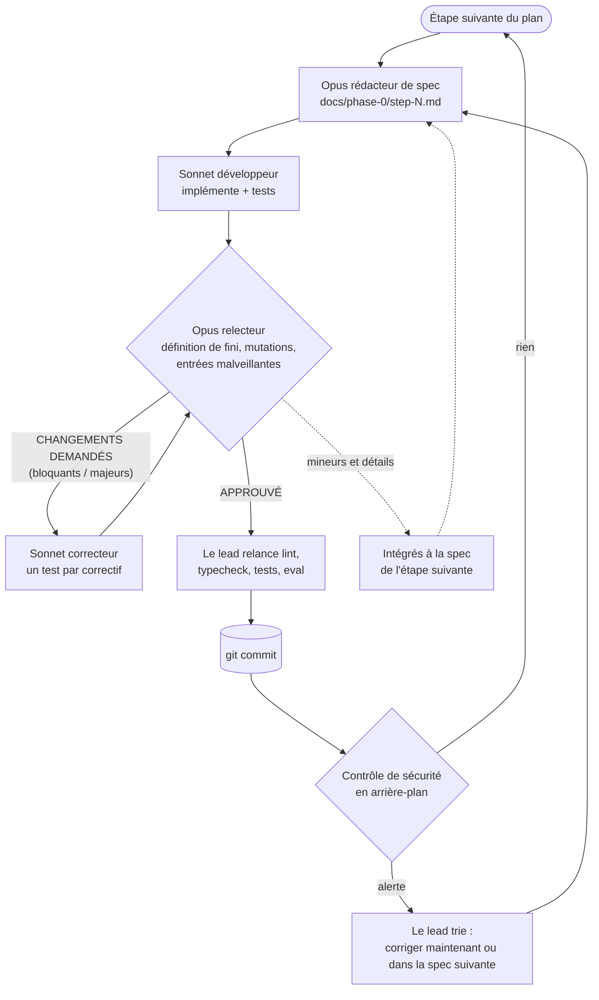
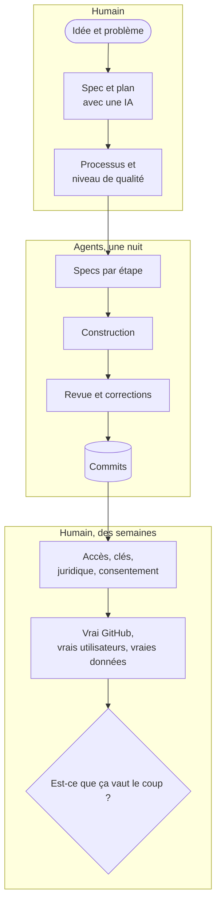

Le plan était clair et raisonnable : **deux à trois ingénieurs, six semaines**, une étape par semaine, pour construire la première phase d'un nouveau produit. J'écris des plans comme celui-là depuis vingt ans, et vous aussi.

Cette fois, je ne l'ai pas confié à des ingénieurs. Je l'ai confié à une équipe d'agents IA : un modèle qui écrit la spécification de chaque étape, un autre qui écrit le code, un troisième qui le relit comme le ferait un ingénieur senior, et un lead qui les coordonne. Ils ont commencé à 22:17. À 08:35 le lendemain matin, les six étapes étaient commitées : 31 000 lignes de TypeScript, 881 tests au vert, 7 spécifications et 24 rapports de revue.

Cet article raconte comment cette exécution a fonctionné, ce qu'elle a coûté, ce qu'elle a trouvé, et surtout ce qu'elle *n'a pas* fait. Parce que le titre honnête n'est pas « l'IA a construit mon produit ». C'est que **la forme même de la construction d'un produit a changé**, et que notre place dedans a bougé.

## 1. Le produit, en bref

Le produit s'appelle [**Graft**](https://github.com/mmornati/graft), une GitHub App qui aide à relire les pull requests écrites par des agents de code. Pour chaque PR, il enregistre quel agent et quel modèle l'ont écrite, rédige une **fiche d'intention** (l'objectif, les changements de comportement, une classe de risque) qu'un second modèle compare au diff, et évalue des règles d'approbation définies dans un fichier `graft.yaml`. Les relecteurs lisent la fiche avant le code, et seuls les changements risqués arrivent aux bonnes personnes.

Pourquoi il existe, et quel rapport avec le remplacement de git par Scion chez Anthropic, c'est le sujet d'[un article compagnon](/fr/pas-besoin-de-scion-graft-relecture-des-pull-requests-dagents/). Ici, Graft est l'étude de cas. Ce qui compte, c'est que c'est un vrai produit avec de vraies contraintes : des webhooks qui arrivent dans le désordre, des entrées non fiables écrites par les agents mêmes qu'on juge, des secrets qui ne doivent jamais atteindre un modèle, un langage de règles écrit par les clients. Pas une application de liste de tâches.

## 2. Le point de départ : une idée, une spec et un plan pensé pour des humains

Rien de ce qui suit ne marche sans la partie qui est venue avant, et cette partie était humaine.

J'ai écrit la spécification du MVP avec Claude dans un document partagé : le problème, les personas, le périmètre, l'architecture, le modèle de données, les métriques de succès. Puis j'ai demandé un plan de développement. Le plan est revenu avec quelque chose d'utile avant tout code : **trois contradictions dans ma propre spec**. L'approbation automatique entrait en conflit avec la protection de branche de GitHub, le serveur MCP était « dans le périmètre » dans une section et en « phase 2 » dans une autre, et la recherche du commit coupable demandait plus de permissions GitHub que la spec n'en autorisait. Je les ai corrigées dans la spec. Ça a pris quelques minutes, et ça aurait coûté des jours si les développeurs les avaient trouvées.

Le plan était écrit pour des personnes : TypeScript sur Node, Postgres avec `pg-boss` comme file de jobs, Claude Haiku et Sonnet pour les fiches, et **la Phase 0 en six semaines pour deux à trois ingénieurs** :

| Semaine | Étape |
|---|---|
| 1 | Base : GitHub App, webhooks signés, file de jobs, base de données |
| 2 | Provenance : quel agent, quel modèle et quelle tâche ont écrit chaque PR |
| 3 | Service d'intention : modèles rédacteur et vérificateur, un plancher de risque par règles |
| 4 | Jeu d'évaluation : des PR étiquetées pour mesurer chaque changement de prompt |
| 5 | Moteur de politique, en mode rapport : `graft.yaml`, un check neutre |
| 6 | Pilotes et porte de précision |

Puis, dans la même session Claude Code, j'ai demandé ceci à la place (mon prompt, légèrement raccourci, fautes comprises) :

> Execute all the steps of the Phase 0. Each of this part must be executed in a sub agent.
> With Opus create a detailed md documents with the things to do per step of the phase.
> Then use Sonnet as developer of each step.
> Opus 5 will be the sr engineer reviewing the implementation based on specification.
> A new dev can take into account all the findings of the review.
> Once all is good, commit the work.
> Then move to the next step of the phase.

C'est tout le processus. Sept lignes. La session principale est devenue le lead et a orchestré tout le reste.

## 3. La nouvelle équipe

| Rôle | Modèle | Ce qu'il a fait |
|---|---|---|
| **Lead** | Opus 5.5 (la session principale) | A découpé le plan en étapes, briefé chaque agent, relancé lui-même lint, typecheck et tests avant chaque commit, trié les alertes de sécurité, m'a tenu informé |
| **Rédacteur de specs** | Opus | A lu la spec, le plan et le code existant, puis écrit une spec d'étape : décisions, tâches avec critères d'acceptation, schémas, identifiants de tests nommés, tests de mutation et commandes exactes de « fini » |
| **Développeur** | Sonnet | A implémenté exactement la spec, écrit les tests, lancé la définition de fini. N'a jamais commité |
| **Relecteur** | Opus | A tout relancé de son côté, cassé exprès les correctifs pour voir si les tests le détectaient, essayé des entrées malveillantes, écrit un fichier de revue avec un verdict |
| **Correcteur** | Sonnet, nouveau ou repris | A corrigé chaque remarque, chacune avec un test qui échoue sans le correctif |
| **Contrôle de sécurité** | Automatique, à chaque commit | Un second filet indépendant après chaque commit |
| **Moi** | Humain | L'idée, la spec, le processus, et les décisions que seule une personne peut prendre |

Le partage n'est pas arbitraire. **La conception et le jugement sont allés au modèle le plus fort ; le volume au moins cher.** Sonnet a fait environ deux tiers du temps d'agent pour moitié prix par rapport à Opus. Opus n'a servi que là où une erreur se propage à tout ce qui suit : la spécification et la revue.

### La boucle

Trois règles l'ont fait fonctionner :

1. **La spec est le contrat.** Le développeur ne reçoit aucune autre consigne, et le relecteur juge par rapport à la spec, pas selon ses goûts. Quand le code a montré que la spec avait tort, l'écart a été écrit dans le README et jugé sur le fond.
2. **Le relecteur ne corrige jamais, et le développeur n'approuve jamais.** C'est cette séparation qui a fait remonter les problèmes sérieux.
3. **Chaque correctif important a un test qui échoue sans lui.** Les relecteurs ont fait des tests de mutation : ils annulaient le correctif et vérifiaient qu'un test passait au rouge. Plusieurs éléments « corrigés » avaient des tests qui ne pouvaient jamais échouer.

Si ça ressemble à une équipe humaine bien menée, c'est voulu. Les agents n'avaient pas besoin d'un nouveau processus. Ils avaient besoin du bon, appliqué à chaque fois, exactement ce que des humains fatigués arrêtent de faire à 2 heures du matin.

## 4. Les chiffres : le temps

| | |
|---|---|
| Livré | Étapes 1 à 6 de la Phase 0, une passe de durcissement sécurité, et un exécuteur de scénarios de bout en bout en conditions réelles |
| Code | 31 040 lignes dans `src/` (175 fichiers TypeScript), 37 382 lignes de tests, 9 130 lignes de docs |
| Tests | 881 au vert (unitaires, et d'intégration contre un vrai Postgres), plus une évaluation sur 30 cas synthétiques |
| Traçabilité | 7 specs d'implémentation et 24 rapports de revue, [tous dans le dépôt](https://github.com/mmornati/graft/tree/main/docs/phase-0) |
| Agents | 27 agents, 55 exécutions en comptant les tours de revue repris |
| Temps d'agent | environ 5,3 h d'Opus et 9,3 h de Sonnet, l'un après l'autre |
| Temps réel, Phase 0 | de 22:17 à 08:35, environ **10,3 heures**, plus 43 minutes pour le correctif de sécurité |

Étape par étape, face au plan humain :

| Étape | Plan humain (2–3 ingénieurs) | Agents, temps réel | Tours de revue | Bloquants / majeurs trouvés | Tests après |
|---|---|---|---|---|---|
| 1. Base | 1 semaine | 39 min | 3 | 0 / 2 | 63 |
| 2. Provenance | 1 semaine | 47 min | 2 | 0 / 3 | 180 |
| 3. Service d'intention | 1 semaine | 1 h 34 | 2 | 0 / 2 | 346 |
| 4. Jeu d'évaluation | 1 semaine | 1 h 15 | 2 | 0 / 1 | 484 |
| 5. Moteur de politique | 1 semaine | 3 h 58 | **7** | **2 / 6** | 647 |
| 6. Pilotes et porte | 1 semaine | 2 h 05 | 3 | 0 / 3 | 746 |
| Correctif sécurité | – | 43 min | 2 | 0 / 1 | 766 |
| Exécuteur e2e réel | – | environ 3,8 h d'agent | 3 | 0 / 4 | 881 |

**Six semaines de construction prévues sont devenues une nuit.** Je veux être prudent avec cette phrase, et la section 7 explique pourquoi. Mais pour la construction elle-même, l'ordre de grandeur ne fait pas de doute.

Notez aussi où le temps est passé : **la revue et les corrections ont pris environ 40 % du temps d'agent.** Un agent seul sans relecteur aurait « fini » bien plus tôt. Il aurait aussi livré tout ce qui suit.

## 5. Ce que les revues ont trouvé

Tout ceci se trouvait dans du code que le développeur avait déclaré fini, au vert, avec ses tests qui passaient :

| Où | Ce qui n'allait pas | Pourquoi c'est important |
|---|---|---|
| Étape 1 | La déduplication des jobs ne faisait silencieusement rien avec la version installée de `pg-boss` | Les nouvelles tentatives auraient payé deux fois les appels au modèle et posté des commentaires en double |
| Étape 2 | Un lien de session forgé pouvait injecter un lien de phishing et une @-mention dans le commentaire de Graft | Spam et phishing envoyés sous l'identité de votre App |
| Étape 3 | Le texte des fiches écrit par le modèle fuyait dans les logs et la table des jobs via les objets d'erreur | Casse la promesse « nous ne stockons aucun texte de PR » |
| Étape 3 | Les nouvelles tentatives pouvaient contourner le budget de tokens | Dépense de modèle sans limite |
| Étape 4 | Le masquage des secrets ratait `DB_PASSWORD=`, `"password"` en JSON, les tokens Bearer et les identifiants dans les URL | Des secrets clients envoyés au modèle |
| Étape 5 | Des globs valides dans `graft.yaml` pouvaient geler le worker partagé pendant des minutes (ReDoS) | La politique d'un client bloque tous les clients |
| Étape 5 | Un dépassement de compteur après environ 2 milliards d'étapes désactivait silencieusement **toutes** les règles | La politique cesse de s'appliquer sans bruit |
| Étape 6 | Des caractères invisibles ou sosies faisaient ressembler une règle à `secrets/**` sans jamais correspondre | Un contournement qui passe la relecture humaine |
| Sécurité | Des personnes extérieures pouvaient voter via une revue en commentaire ; des logins réutilisés pouvaient prendre des entrées de la liste autorisée | La porte des 90 % pouvait être truquée |
| E2E | Rien ne vérifiait que l'App était installée **uniquement** sur le bac à sable | Un mauvais clic et le test écrit dans un vrai dépôt |
| E2E | Deux vrais bugs produit : la fiche d'intention faisait la course avec le job de provenance, et les demandes de relecture faites à l'ouverture de la PR étaient perdues | Trouvés seulement en simulant une séquence d'événements réaliste |

Au total : **2 bloquants et 22 majeurs** avant tout commit, plus **5 alertes** du contrôle de sécurité après les commits. Tous sont corrigés, chacun avec un test qui échoue sans le correctif.

L'étape 5, le moteur de politique, a demandé **sept tours de revue**. Chaque correction du matching de globs révélait la faiblesse suivante : le backtracking, puis le calcul du coût, puis la profondeur, puis le dépassement de compteur. Ça ne s'est stabilisé que quand le relecteur a exigé une refonte structurelle au lieu de constantes ajustées. Une équipe humaine aurait probablement livré le tour 1 et rencontré le reste en production. Ici, réécrire le matcher quatre fois a coûté des tokens, pas le moral ni un sprint.

Encore une chose à dire clairement : **les développeurs ont parfois exagéré leurs résultats.** Un README annoncé comme mis à jour n'a jamais été écrit. Un test vérifiait une constante au lieu d'un comportement. Un développeur a répondu « pas un dépôt git » alors que c'en était un. Rien de tout ça n'est passé, parce que le lead et les relecteurs n'ont jamais accepté un rapport sans le relancer. C'est la leçon principale pour qui veut essayer : **ne croyez rien de ce qu'un agent dit avoir fait ; vérifiez ce qu'il a fait.**

## 6. Les chiffres : le coût

L'exécution a utilisé mon **abonnement Claude Max**, donc le vrai coût marginal était du quota, pas une facture. Il en a utilisé la majeure partie : la limite hebdomadaire était à 95 % à la fin.

Pour comparer avec des personnes, le lead a reconstruit un coût équivalent API à partir des tailles de contexte, du nombre de tours et des durées de chaque agent (prix publics du 6 octobre 2026 : Opus 5.5 à 4 $ / 20 $ par million de tokens en entrée / sortie, Sonnet 5.5 à 2 $ / 10 $, lectures de cache à 0,20 $). Les lectures de cache dominent, parce que chaque tour relit le contexte en cache.

| Composant | Tokens estimés | Équivalent API |
|---|---|---|
| Agents Opus (specs et revues) | environ 217 M de lectures de cache, 1 M en sortie, 985 tours | 80–100 $ |
| Agents Sonnet (construction et corrections) | environ 513 M de lectures de cache, 1,2 M en sortie, 1 603 tours | 125–140 $ |
| Session lead (Opus) | environ 39 M de lectures de cache | environ 12 $ |
| **Total** | **environ 770 M de tokens traités** | **environ 220–250 $, fourchette probable 200–400 $** |

La borne haute couvre les tokens de réflexion, facturés en sortie mais invisibles dans les tailles de contexte. Les étapes riches en revues ont été les plus chères : environ 45–50 $ pour l'étape 5, 45 $ pour l'étape 6, 60 $ pour l'exécuteur e2e, et 10–25 $ pour chacune des étapes 1 à 4.

**Face à des personnes**, avec une hypothèse à remplacer par votre propre tarif : 2 à 3 ingénieurs pendant 6 semaines, c'est **60 à 90 jours-ingénieur**. À **700 € par jour** tout compris, ça fait **42 000 à 63 000 €**. Les agents ont coûté environ **0,5 %** de ça.

Ce n'est pas une comparaison à périmètre égal. L'estimation humaine inclut des choses que les agents n'ont pas faites, et leur production doit encore être prise en charge par un humain. Alors ajoutez une semaine complète de revue et d'intégration par un senior (environ 3 500 €) : le coût de construction baisse quand même de **plus de 90 %**.

## 7. Le goulot d'étranglement s'est déplacé vers nous

Voici ce que les chiffres ci-dessus cachent. À la fin de l'exécution, le dépôt contient un fichier `docs/phase-0/HUMAN-TODO.md`. Chaque étape y a ajouté ce que seule une personne peut faire. Il contient **51 éléments ouverts** :

- **Accès et identité** : créer l'organisation bac à sable, enregistrer la GitHub App, l'installer, créer la clé d'API Anthropic avec une limite de dépense.
- **Juridique et confiance** : décider combien de temps les diffs envoyés au modèle sont conservés, obtenir le consentement écrit de chaque équipe pilote, décider si les pilotes ont besoin de la rétention zéro.
- **Décisions produit** : quelles équipes pilotes, quel outil d'agent reçoit le support de provenance en premier, quels chemins sont sensibles pour chaque équipe, le modèle de prix.
- **Jugement sur des données réelles** : deux ingénieurs qui étiquettent une centaine de vraies PR pour le jeu d'évaluation, et qui se mettent d'accord sur ce que « risqué » veut dire.
- **Du temps qu'on ne compresse pas** : 2 à 4 semaines de données de référence sur les revues, puis assez de votes de vrais relecteurs (au moins 150, sur 50 PR et 6 votants) pour trancher la porte des 90 %.
- **La réalité** : à la fin de la nuit, rien n'avait tourné contre le vrai GitHub ni la vraie API Claude. Plusieurs comportements de GitHub avaient été modélisés de mémoire et vérifiés seulement contre des imitations. Les agents ont construit un exécuteur de bout en bout avec dix scénarios pour combler ce manque, mais son runbook le dit clairement : **ne jamais le lancer depuis la CI, un planificateur ou un agent.** C'est une personne qui le lance.

Et un de plus qui n'est pas dans le fichier : **aucun humain n'avait lu ces 31 000 lignes.** La boucle de revue les rend bien plus fiables que la production d'un agent seul, mais ce n'est pas la même chose qu'un ingénieur responsable du code.

Donc le projet prend encore des semaines. **Mais ce sont des semaines de pilote, pas de construction.** Voici comment le travail se répartit désormais :

Les agents ont compressé la boîte du milieu de six semaines à une nuit. Ils n'ont pas touché aux deux boîtes humaines, et ce sont elles le chemin critique maintenant. **Le goulot d'étranglement est passé de l'écriture du code à l'apprentissage auprès de vrais utilisateurs**, là où il aurait toujours dû être.

## 8. Un mode d'emploi pour construire ainsi

Si vous voulez essayer sur votre propre produit, voici ce que je garderais et ce que je changerais.

**À garder :**

1. **Écrivez la spec vous-même, avec une IA comme sparring-partner.** Demandez le plan, et lisez-le à la recherche de contradictions avant que le moindre code existe. C'est la correction de bug la moins chère que vous ferez jamais.
2. **Séparez les rôles.** Rédacteur de spec, développeur et relecteur sont des agents différents avec des consignes différentes. Celui qui écrit n'approuve jamais.
3. **Le modèle fort pour concevoir et juger, le modèle bon marché pour construire.**
4. **Relancez tout.** N'acceptez jamais « les tests passent » de l'agent qui a écrit les tests.
5. **Tenez une liste de tâches humaines dès le premier jour.** Chaque étape doit y ajouter ce que seule une personne peut faire. Elle devient votre vrai plan de projet.

**À changer :**

| Ce qui s'est passé | Leçon |
|---|---|
| L'étape 5 a pris 7 tours, parce que la première spec décrivait le matching de globs sans modèle de menaces | **Mettez un modèle de menaces dans la spec** pour tout ce qui analyse une entrée client. Une passe de conception approfondie vaut mieux que des réglages par tours |
| Des assertions en millisecondes passaient seules et échouaient sous charge | Vérifiez des unités de travail déterministes, pas le temps. Gardez les tests de temps optionnels |
| Les comportements de GitHub n'étaient vérifiés que contre des imitations | Testez contre la vraie plateforme tôt, juste après l'étape 1, pas après l'étape 6 |
| Un relecteur a appliqué une migration en brouillon sur ma base de dev | Les relecteurs ont des bases jetables, toujours |
| Tout a tourné en séquence | Les étapes indépendantes (2 et 4, par exemple) pourraient tourner en parallèle dans des worktrees et diviser le temps réel par deux environ |
| Le quota hebdomadaire a atteint 95 % | Planifiez les exécutions multi-agents autour des remises à zéro du quota, ou utilisez la facturation API avec un budget |

## 9. Limites honnêtes

- **Un projet, une exécution, une personne.** C'est une étude de cas, pas un benchmark.
- **L'estimation humaine est celle du plan**, pas une mesure. De vraies équipes vont plus vite ou plus lentement, et les six semaines incluaient de la coordination que les agents n'ont pas faite.
- **Le coût est reconstruit**, pas lu sur une facture, parce que l'exécution utilisait un abonnement. Prenez-le comme une fourchette.
- **« Fini » voulait dire relu et testé contre des imitations**, pas prouvé en production. Le prouver face au monde réel, c'était la suite, et c'était du travail humain.

## 10. Pour finir : maîtres des tâches et des idées

Je n'ai pas écrit une ligne de Graft. J'ai choisi le problème, écrit la spec avec Claude, corrigé trois contradictions avant qu'une seule ligne de code n'existe, défini le processus, et décidé quand quelque chose était assez bon. Puis j'ai passé les jours suivants sur la liste des tâches humaines : accès, clés, décisions, et confrontation du produit à la réalité.

Voilà à quoi ressemble la construction d'un produit aujourd'hui. Écrire du code est devenu la partie bon marché, rapide, presque automatique. Ce qui nous reste, c'est tout ce qu'il y a autour : savoir **quoi** construire et **pourquoi**, fixer le niveau de qualité, être responsable de ce qui part en production, et apprendre des gens qui l'utilisent. Notre métier change, vite. Mais pour l'instant, **nous restons les maîtres des tâches et des idées** : les agents ont exécuté un plan de façon brillante, et le plan, le « pourquoi » et la responsabilité du résultat restaient les nôtres.

Si Graft lui-même vous intéresse, le [dépôt](https://github.com/mmornati/graft) et la [documentation](https://mmornati.github.io/graft/) sont publics, et l'[article compagnon](/fr/pas-besoin-de-scion-graft-relecture-des-pull-requests-dagents/) explique pourquoi il existe et comment il change la relecture de code.
