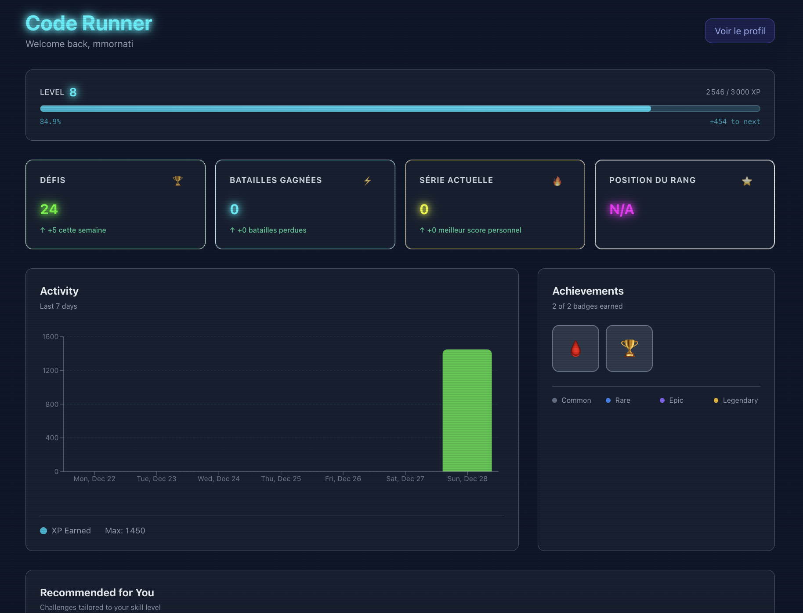
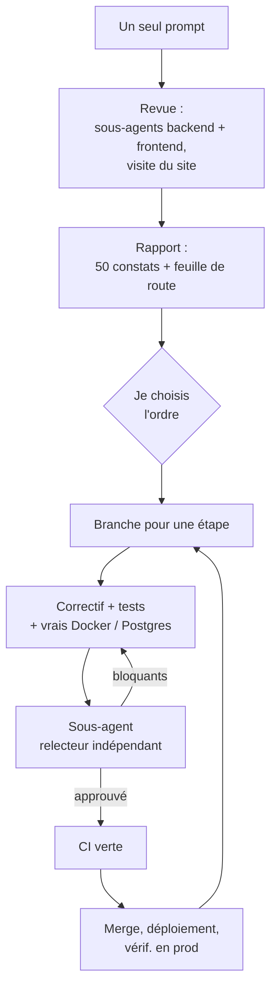

En décembre 2025, j'ai construit [Cyber Code Academy](https://play.pygame.ovh/), un petit jeu pour apprendre Python, pour mon fils et ses camarades. Je l'ai fait en cinq jours avec **Cursor** et **GitHub Copilot**, dans ce que j'appelais du [« pure vibe coding »](/fr/building-cyber-code-academy-a-pure-vibe-coding-experiment/). Puis, en janvier, j'ai utilisé **Antigravity** pour [écrire des tests d'intrusion sur mesure](/fr/vibe-coding-custom-penetration-tests-when-ai-becomes-your-security-partner/), et j'ai écrit tout un article sur [la sécurisation de la sandbox Python](/fr/securing-python-code-execution-how-we-protected-our-server-from-untrusted-code/).

Mon objectif était la sécurité d'abord, même si les enjeux sont faibles. Il n'y a aucune donnée personnelle dans l'app (seulement un pseudo), et rien de précieux sur le serveur. Je voulais voir ce que vaut l'IA pour les contrôles de sécurité, et je vérifiais moi-même ce qu'elle produisait. Dans le premier article, j'avais même écrit que la sécurité *« semblait gérée toute seule »*.

L'app va bientôt avoir un an. Avant de décider de la laisser tourner, j'ai regardé les chiffres. Ils sont petits (49 comptes, 756 soumissions), mais quelques personnes l'utilisent encore. Alors j'ai tenté une expérience : **que pense de ce code un modèle plus jeune d'un an, et bien plus fort ?** J'ai ouvert Claude Code avec **Opus 5.5** et j'ai écrit un seul prompt.

La réponse, en gros : *WTF*.

## 1. Ce que veut dire « les modèles d'il y a un an »

Je ne me souviens pas exactement quel modèle tournait derrière chaque session Cursor ou Copilot. J'en changeais souvent, et parfois l'outil choisissait pour moi. Voici ce qui était au menu en décembre 2025 :

| Éditeur | Modèles disponibles en décembre 2025 |
|---|---|
| Anthropic | Claude Sonnet 4.5 (septembre), Haiku 4.5 (octobre), **Opus 4.5** (24 novembre) |
| OpenAI | GPT-5 (août), GPT-5.1 et GPT-5.1-Codex-Max (novembre), **GPT-5.2** (11 décembre) |
| Google | **Gemini 3 Pro** (18 novembre), le modèle par défaut d'Antigravity, sorti le même jour |
| Cursor | Composer 1, le modèle de code maison de Cursor (octobre) |
| Chine | DeepSeek V3.2, Kimi K2 Thinking (Moonshot), MiniMax M2, GLM-4.6 (Z.ai, puis GLM-4.7 le 22 décembre), Qwen3-Coder (Alibaba) |

C'étaient les meilleurs modèles de leur époque. Opus 4.5 a été le premier modèle au-dessus de 80 % sur SWE-bench Verified (80,9 %). Ce n'est donc pas une histoire d'outils faibles. C'est une histoire de tout ce qui a changé en un an.


**Ce que « un seul prompt » veut dire ici.** Un seul message a lancé chaque session. J'ai quand même répondu aux questions du modèle : quelle refonte choisir, dans quel ordre corriger, et me connecter moi-même à Coolify quand il a eu besoin des logs du serveur (il ne peut pas taper de mots de passe). Tous les bugs ci-dessous sont corrigés et mergés (le plan de gameplay à la fin reste à faire), et rien n'a jamais été testé comme une attaque contre la production.


## 2. Le prompt

Voici le prompt complet, fautes comprises (je l'ai écrit en anglais) :

> Make a full review of the project to identify all the improvements, security fix, ...
> Then using the /impeccable:impeccable skill propose a complete graphical refactor in a WOW effect mode in line with the style of the project.
> You can see the pages on https://play.pygame.ovh/ (I can log you in to make a check everywhere)

En clair : une revue complète du projet (améliorations, correctifs de sécurité…), puis une refonte graphique « effet WOW » avec le skill de design Impeccable. Je reviendrai sur la refonte. La première moitié a produit ceci.

Une dizaine de minutes plus tard, la session avait :

- lancé deux revues de code en parallèle, une sur le backend et une sur le frontend, chacune par son propre sous-agent ;
- visité le site en ligne, pages publiques et pages connectées ;
- publié un rapport avec **50 constats : 2 critiques, 12 élevés, 22 moyens, 14 faibles**, plus une feuille de route.

Les premières lignes de son résumé :

> **N'importe qui peut gérer les défis sans se connecter.** [...] Je l'ai confirmé dans le code mais je ne l'ai pas essayé contre la production.
>
> **Le code de l'utilisateur peut falsifier ses propres résultats.** Il peut sortir des builtins restreints, afficher une fausse ligne `{"passed": true}`, et réussir n'importe quel défi ou combat.

## 3. Les deux bugs critiques

### N'importe qui pouvait modifier le catalogue

`POST`, `PUT` et `DELETE /api/v1/challenges` n'avaient **aucune authentification**. Avec `curl`, n'importe qui pouvait supprimer tous les défis, ou publier un défi à 1000 XP sans aucun test. Et un défi sans tests était toujours réussi.

Pas d'exploit astucieux ici : juste trois endpoints sans `Depends(require_admin)`. La section admin avait son propre [article](/fr/behind-the-scenes-the-admin-section-of-cyber-code-academy/), et les *pages* admin vérifiaient bien le rôle. L'API derrière, non. Les tests d'intrusion de janvier couvraient la manipulation des JWT, l'injection SQL et les évasions de sandbox. Aucun n'a essayé d'appeler l'endpoint sans jeton.

### N'importe quel élève pouvait falsifier ses résultats

Celui-ci fait plus mal, parce que j'avais écrit tout un article dessus. La sandbox exécute le code de l'élève avec un dictionnaire `__builtins__` restreint. L'article expliquait pourquoi `getattr(__builtins__, 'exec')` échoue : `__builtins__` est un dict qui ne contient que des fonctions sûres, pas le vrai module. C'est vrai. Mais une fonction built-in se souvient du module d'où elle vient :

```python
print.__self__   # le vrai module builtins, avec exec, __import__, open...
```

En plus, le code de l'élève tournait **dans le même interpréteur que les tests**, et le backend lisait **la dernière ligne JSON affichée** comme résultat. Le code n'avait donc même pas besoin de sortir de la sandbox. Il pouvait afficher une ligne de résultat disant que tous les tests étaient passés. La même astuce permettait de lire les tests cachés.

Les tests d'intrusion de janvier vérifiaient exactement l'attaque décrite dans l'article de janvier, et cette attaque échouait. Personne, ni humain ni IA, n'a posé la question suivante.

La correction a reconstruit le harnais :

- le programme de l'élève et chaque test tournent dans des **processus enfants séparés** ;
- pour les comparaisons comme `assert add(2, 3) == 5`, la valeur est comparée **dans le parent**, donc la réponse attendue n'atteint jamais le code de l'utilisateur ;
- le résultat final porte un **nonce par exécution**, et le backend ignore toutes les autres lignes ;
- le harnais se marque non-dumpable, donc un enfant ne peut pas lire sa mémoire via `/proc` ;
- les conteneurs ont une limite de PID, `no-new-privileges`, un tmpfs `noexec`, et sont tués au timeout.

La session a ensuite attaqué sa propre correction dans un vrai conteneur. Un résultat falsifié a été rejeté. `/proc/1/mem` a renvoyé `PermissionError`. Les fork bombs ont été tuées, sans conteneur oublié derrière. Tout cela est maintenant un smoke test dans la CI.

## 4. Les bugs « bêtes »

Les bugs critiques ont une histoire. La plupart des autres sont des bugs que n'importe quel relecteur attentif aurait vus. Les anciens modèles, et moi, non.

| Bug | Ce qu'il faisait |
|---|---|
| Le rate limiter utilisait la **première** entrée de `X-Forwarded-For` | Cette entrée vient du client : changer l'en-tête donnait des tentatives de connexion illimitées |
| …et il se **désactivait** quand Redis était injoignable | Redis était injoignable en production : il avait un mot de passe, et le backend se connectait sans |
| 15 défis importés avec `padawan`, `knight`, `master` | L'API n'accepte que `initiate`/`hacker`/`elite`/`legend`, donc ces pages renvoyaient une erreur HTTP 500 |
| `get_current_user` chargeait l'utilisateur dans une session DB déjà fermée | Toute modification de l'utilisateur courant était **perdue sans un bruit** |
| Les séries de jours (streaks) n'étaient **jamais calculées** | Les badges de série étaient impossibles à obtenir (ma capture de décembre ci-dessous affiche « série actuelle : 0 ») |
| Un combat pouvait être gagné en 0 ms | Le temps venait du client, et sans appel à `/start`, il n'y avait pas de temps du tout |
| Deux soumissions réussies au même moment | Les deux comptaient comme premier succès : XP double |
| Une route d'indices gratuite à côté de la payante | Elle marquait les indices comme révélés sans les facturer, puis la route payante les servait gratuitement |
| Jetons de connexion dans `localStorage` | N'importe quelle XSS pouvait voler un refresh token à longue durée de vie |
| `create_admin.py` sans `--password` | Il retombait sur un hash `admin123` codé en dur |
| Le conteneur de l'API tournait en root avec le socket Docker monté | Root sur l'API voulait dire root sur l'hôte |
| Pas de CI, 158 tests en échec sur `main` | Un fichier de test contenait même des marqueurs de conflit git commités, donc pytest ne pouvait pas le charger |
| L'historique des combats | Chaque combat apparaissait deux fois |
| Le tableau de bord | Il affichait des clés brutes comme `dashboard.dashboardActivity.title` |
| Ctrl+Entrée dans l'éditeur | Mauvais keycode, et une closure périmée derrière |



Deux des problèmes de production (les 500 et le classement vide) ne s'expliquaient qu'avec les logs du serveur. La session m'a demandé de me connecter à Coolify dans le navigateur intégré, puis elle a lu les tracebacks elle-même : `input_value='padawan'` pour l'un, `redis.exceptions.AuthenticationError` pour l'autre. Elle a aussi compté, via l'API publique, combien de défis étaient touchés (15 sur 180).

## 5. Comment il a tout corrigé

J'ai demandé une pull request par étape de la feuille de route, chacune relue par **un sous-agent séparé** qui reçoit le diff et les objectifs mais pas les conclusions de l'auteur, puis un merge une fois la CI verte. La session a suivi cette boucle pendant une journée :



Les étapes, dans l'ordre :

1. **Correctif de sécurité :** l'authentification sur le CRUD des défis, le nouveau harnais de sandbox, le rate limiter, et la première CI.
2. **Suites de sécurité :** ce que le relecteur indépendant a trouvé dans l'étape 1.
3. **Correctifs de production :** une migration pour les 15 défis cassés plus une contrainte `CHECK`, les traductions, les en-têtes de sécurité (HSTS, CSP), et des erreurs d'API lisibles.
4. **Intégrité du jeu :** verrous de ligne et incréments SQL pour l'XP, temps de combat mesurés par le serveur, refresh tokens à usage unique, pseudos uniques sans tenir compte de la casse, séries de jours, et le même travail bcrypt à la connexion que le pseudo existe ou non.
5. **Durcissement du backend :** refus de démarrer avec des secrets JWT par défaut, un script de migration qui arrête le démarrage au lieu de « continuer quand même », plus de `str(e)` dans 29 réponses d'erreur, et `bcrypt` à la place de passlib, qui n'est plus maintenu.
6. **Une passerelle d'exécution :** le seul conteneur avec le socket Docker. Ses options sont fixes (pas de réseau, lecture seule, `cap-drop ALL`), donc même avec un jeton volé, on ne peut qu'exécuter du code en sandbox. Avec la passerelle, l'API tourne sous un utilisateur sans privilèges et sans socket. La session a aussi *rejeté* la solution évidente, un proxy générique du socket Docker, parce que tout ce qui peut l'atteindre peut lancer un conteneur privilégié.
7. **Authentification :** le refresh token est passé dans un cookie `HttpOnly; Secure; SameSite=Strict` et l'access token reste en mémoire, avec une migration qui ne déconnecte personne.
8. **Tests :** les 158 tests backend en quarantaine corrigés et de retour dans la CI (431 qui passent), et toutes les suites frontend qui tournent aussi.
9. **La refonte :** les fondations du design, puis quatre tranches (plus bas).

Ça fait **13 pull requests mergées en environ 24 heures**, chacune avec des tests, une relecture, et la liste de ce qui a été vérifié à la main, comme la migration exécutée sur un vrai Postgres 15 ou les conditions de course rejouées sur Postgres 16.

### Là où le modèle plus fort s'est trompé

Il n'était pas parfait, et je veux être précis là-dessus.

- **Corriger un bug en a rendu un autre actif.** Une fois que `get_current_user` a utilisé la session DB de la requête, les modifications de l'utilisateur ont enfin été enregistrées. Y compris une pénalité d'indice facturée à *chaque* affichage. L'étape 1 avait été mergée avec son premier commit seulement, donc ce bug a tourné en production environ deux heures. La session l'a vu sur la version déployée et a rendu la PR de suite urgente.
- **Son premier verrou ne verrouillait pas.** Dans l'étape d'intégrité, le relecteur indépendant a prouvé sur un vrai Postgres qu'un combat pouvait encore être terminé deux fois : `SELECT ... FOR UPDATE` renvoyait l'objet déjà chargé dans l'identity map de SQLAlchemy, sans le recharger. Corrigé et revérifié avec des exécutions concurrentes.
- **Une condition de course dans le nettoyage des processus** de la nouvelle sandbox a été signalée par la revue de sécurité automatique qui tourne à chaque commit. Corrigée avec une boucle atomique `kill(-1)`.
- **Le premier dry-run en production d'un script de données a planté**, avant d'écrire quoi que ce soit, parce qu'un modèle de base de données n'était pas importé.

Aucun de ces problèmes n'a touché les utilisateurs longtemps, grâce à la façon dont le travail était organisé : un relecteur qui n'a pas écrit le code, de vraies bases de données au lieu de mocks, et rien de mergé tant que c'est rouge. Un modèle plus fort fait encore des erreurs. Il faut ce cadre pour les attraper.

## 6. La refonte graphique

La seconde moitié du prompt demandait une refonte « WOW ». Le skill de design m'a posé quelques questions sur le public de l'app (des ados et des adultes débutants), puis a proposé trois directions sur une page de choix. J'ai choisi **Holo Deck** :

- chaque défi est une carte à collectionner ;
- la difficulté est la rareté de la carte ;
- réussir un défi rend la carte holographique, avec un reflet qui suit le curseur ;
- les tests s'allument un par un avant que la carte se retourne.

D'abord les fondations du design (tokens, une boîte de dialogue accessible, des contrastes WCAG AA). Puis quatre tranches : la page d'accueil, le catalogue des défis en classeur, le lecteur de défi en table de jeu, et les combats contre des fantômes. Chaque tranche a eu une revue de design et une revue de code. La page d'accueil ressemble maintenant à l'image en tête de cet article. Comparez avec la capture de décembre plus haut.

Une précision : la génération d'images du skill a échoué (sa clé d'API n'avait plus de crédit), donc toute la refonte a été construite en code, pas à partir de maquettes générées.

## 7. Le second prompt : les exercices eux-mêmes

La première session a corrigé la plateforme. Aujourd'hui, j'ai ouvert une seconde session sur le contenu :

> can you make a review on the list of challenges, tests, ... review and fix several if needed and then propose a full rework, additions, ... to have a good an complete website making a cool way to learn python.

En clair : relire la liste des défis et des tests, en corriger si besoin, puis proposer une refonte complète pour que le site devienne une façon cool d'apprendre Python.

Elle s'est connectée à la base de données de production, a exporté les **198 défis**, et a écrit un harnais qui note chaque solution de référence et chaque code de départ avec le vrai exécuteur. Puis elle a rejoué les **756 soumissions** de l'historique.

Les solutions de référence étaient toutes correctes. **Les tests et les consignes, non.** Tous ces exercices avaient été générés par l'IA et relus (trop vite) par moi.

- **Les consignes ne disaient pas ce que vérifiaient les tests.** *String with Spaces* teste une variable `message` que personne n'a demandé de créer : 6 tentatives réussies sur 41. *AND Operator* attend le texte `In range`, qui n'apparaît nulle part dans la consigne : 2 sur 10. *Grade Calculator* ne dit jamais quels sont les seuils des notes. La consigne française d'un exercice demande `'Hello, World !'`, avec l'espace français avant le `!`, et le test attend la version anglaise.
- **Beaucoup d'exercices se réussissaient sans les résoudre.** 87 des 180 défis publiés passaient en affichant simplement la réponse attendue. Aucun n'avait de test caché. *Print Empty Line* passait avec un fichier vide.
- **Le correcteur était trop strict.** Un espace en fin de ligne faisait échouer une bonne réponse, par exemple la grille `print('*', end=' ')` de *Nested Loops*.
- **D'anciens bugs de correction.** En décembre et en janvier, du code correct a été marqué en échec (23 soumissions correctes identiques sur *Fix Indentation Error*). C'était déjà corrigé dans le code actuel, mais 8 élèves n'ont jamais eu leurs points.
- **Exécuter et Soumettre n'étaient pas d'accord.** Le bouton Exécuter du navigateur autorise `import math`, mais le correcteur à la soumission non : du code pouvait marcher, puis échouer.
- **Le défi du jour n'a jamais tourné.** Six badges en dépendent, mais son feature flag est désactivé et aucun worker de tâches de fond n'est déployé.

Les corrections sont aussi soigneuses que celles de la première session : une seule fonction `normalize_output()` partagée par Exécuter et Soumettre, et **83 corrections de contenu** avec **115 nouveaux tests cachés**. Les valeurs attendues sont calculées à partir des solutions de référence, avec les builtins de la sandbox. Avant d'écrire en base, le script note chaque défi corrigé : la solution doit passer et le code de départ doit échouer. Elle a fait une sauvegarde de la table, un dry-run contre la production, puis appliqué les corrections et lancé un second dry-run, qui n'a plus rien trouvé à changer.

Rejouer les anciennes soumissions avec les nouveaux tests a trouvé une chose de plus que j'aime beaucoup : un `find_max` d'élève qui part de `0` et échoue sur une liste de nombres tous négatifs. Il avait été accepté, parce que les anciens tests n'utilisaient que des nombres positifs. C'est une erreur classique de débutant, et l'exercice est justement là pour l'apprendre.

La session s'est terminée par un plan en quatre phases pour donner envie de revenir : activer le défi du jour, des imports sûrs, une première leçon guidée, des exercices « devine la sortie », des étoiles de maîtrise, une campagne scénarisée, des ligues hebdomadaires. C'est la suite.

## 8. Un pilote moins fort, et des modèles qu'il fallait piloter

Pour être juste avec les anciens modèles, celui qui les pilotait apprenait aussi. En décembre 2025, je découvrais cette façon de travailler, et je n'étais sûrement pas un bon « pilote d'IA ». Ces modèles avaient besoin de beaucoup de guidage pour faire du bon travail :

- des fichiers de règles et de longues instructions dans `AGENTS.md` ;
- des prompts courts et précis, une tâche à la fois ;
- une liste explicite de ce qu'il fallait vérifier (« teste l'évasion par `getattr` », « essaie l'injection SQL sur le login »).

Je leur en ai donné une partie, pas tout. Ils ont fait ce que je demandais, et ce que je demandais était trop étroit. Les tests d'intrusion de janvier en sont un bon exemple : ils ont trouvé et corrigé toutes les attaques que *j'avais* listées.

Les prompts de cet article sont l'inverse : un message vague, avec des fautes, et des « ... » là où les détails devraient être. Le modèle a construit la méthode tout seul. Il a réparti la revue entre des sous-agents, lu les logs, vérifié les données en production, écrit une feuille de route, posé les questions qui comptaient, et attaqué ses propres correctifs. Il y a un an, j'aurais dû écrire tout ça dans le prompt, ou dans un skill.

Les benchmarks racontent la même histoire :

| | Fin 2025 | Aujourd'hui (novembre 2026) |
|---|---|---|
| SWE-bench Verified | Opus 4.5 : 80,9 %, le premier modèle au-dessus de 80 % | Saturé : Opus 5 est annoncé à environ 96 % |
| SWE-bench Pro, plus difficile et moins contaminé | Gemini 3 Pro : environ 43 % | Opus 5.5 : 89,9 % |
| Horizon temporel METR (durée des tâches qu'un modèle réussit une fois sur deux) | Opus 4.5 : environ 5 heures | Environ 12 heures dès début 2026, doublant tous les 3 à 4 mois environ |

Anthropic présente Opus 5.5, sorti le 22 septembre 2026, comme particulièrement bon sur les longs travaux comme les audits de toute une base de code. Les testeurs disent qu'il continue à creuser au-delà de la première réponse plausible. C'est ce que j'ai vu ici. Le tableau mélange des sources, et les benchmarks ne sont pas mon app : lisez-le comme une tendance, pas comme une mesure. Sources : [Anthropic, Opus 4.5](https://www.anthropic.com/claude/opus), [Anthropic, Opus 5.5](https://www.anthropic.com/claude-opus-5-5), [BenchLM, Opus 5.5](https://benchlm.ai/models/claude-opus-5-5), [Developers Digest, classements SWE-bench](https://www.developersdigest.tech/benchmarks/swe-bench), [Vals.ai SWE-bench Verified](https://www.vals.ai/benchmarks/swebench), [METR, Time Horizon 1.1](https://metr.org/blog/2026-01-29-time-horizon-1-1/) et [METR, Frontier Risk Report](https://metr.org/blog/2026-05-19-frontier-risk-report/).

## 9. Ce que j'en retiens

- **« La sécurité semblait gérée toute seule »** était faux, et la façon dont c'était faux est intéressante. Les anciens modèles ont sécurisé exactement ce que je demandais (l'évasion du namespace, les JWT, l'injection SQL) et testé exactement ça. Les trous critiques étaient un pas à côté : un endpoint sans contrôle, et un résultat qui venait de la sortie de l'attaquant lui-même.
- **Le modèle plus fort ne s'est pas limité à mon modèle de menace.** Il a lu tout le code, le déploiement, les logs et les données, et s'est demandé pour chaque élément : « qui peut atteindre ça, et à quoi le backend fait-il confiance ? »
- **La méthode a compté autant que le modèle.** Une PR par étape, un relecteur indépendant, de vrais Postgres et Docker au lieu de mocks, et un dry-run avant de toucher à la production. C'est ce qui a attrapé les erreurs du nouveau modèle lui-même.
- **Le contenu aussi était généré par l'IA, et personne ne l'avait confronté aux vrais élèves.** La session qui a regardé les vraies soumissions a trouvé plus de problèmes que n'importe quelle revue du code.
- **Moins de guidage, pas zéro guidage.** J'ai donné un seul prompt, mais j'ai quand même choisi l'ordre, fixé les règles de relecture, fait les changements sur le serveur et suivi les PR. La différence, c'est que maintenant je pilote le travail au lieu d'écrire la méthode.
- **Le verdict :** l'app reste en ligne. Avec 13 PR, une sandbox en laquelle j'ai maintenant confiance, des exercices plus justes et un nouveau design, c'est une bien meilleure app qu'il y a un an.

## Comment cet article a été construit

Deux sessions Claude Code avec Opus 5.5, chacune lancée par le prompt cité plus haut. La première (*Project review and graphical refactor*) a tourné du soir du 2 novembre au soir du 3 novembre et a produit le rapport et 13 pull requests (correctifs et refonte), avec des sous-agents relecteurs indépendants et une session séparée pour les dernières tranches de la refonte. La seconde (*Python learning platform review and rework*) a pris environ une demi-heure et a produit la revue du contenu, le correctif du correcteur et les 83 corrections de défis appliquées en production. Mon rôle : répondre à ses questions, me connecter là où il avait besoin de moi, faire les changements de configuration sur le serveur, et suivre les pull requests au fil de l'eau.
