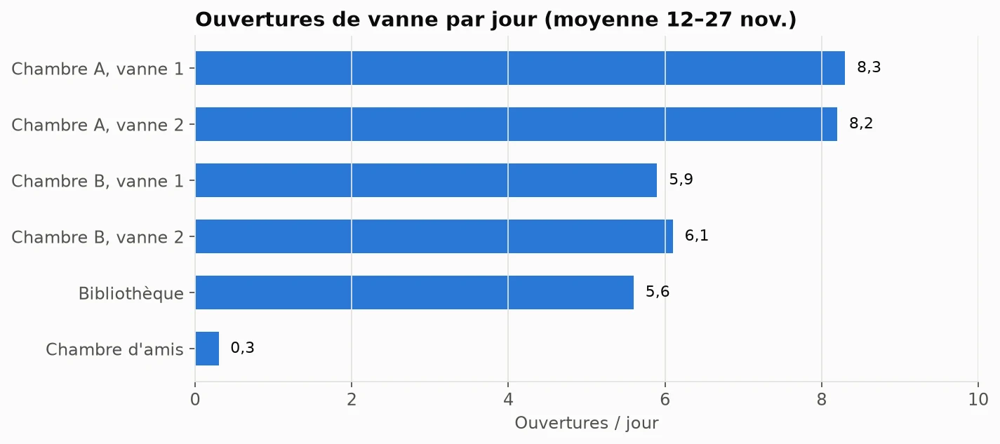
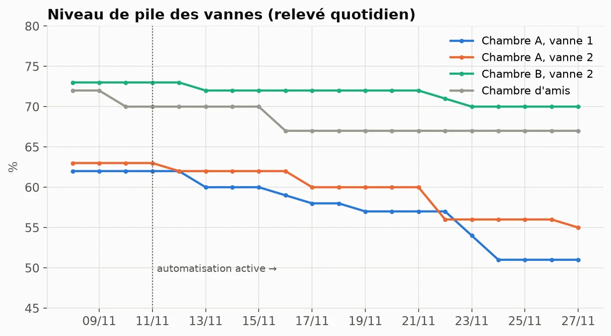

Dans [le premier article de cette série](/fr/la-loi-deau-de-ma-pompe-a-chaleur-reglee-avec-les-donnees/), j'ai expliqué comment on a réglé la loi d'eau de ma pompe à chaleur à partir des données. Plusieurs de ces données venaient des **vannes des radiateurs de l'étage** : combien de temps elles chauffent, à quelle vitesse chaque pièce monte en température. Ces vannes ne donnaient rien de tout ça il y a trois semaines. Cet article raconte comment elles sont devenues le cœur du chauffage de l'étage.

Pour rappel, la maison a deux circuits sur une seule PAC Hitachi : un plancher chauffant au rez-de-chaussée (C2), et des radiateurs à l'étage (C1), [remis à l'endroit le 11 novembre](/fr/cinq-ans-de-circuits-inverses-ma-pompe-a-chaleur-relue-par-claude/). L'étage compte quatre pièces chauffées : deux chambres d'enfants (deux radiateurs chacune), une chambre d'amis et une bibliothèque, où se trouve le thermostat mural de la PAC pour ce circuit.

## Le point de départ : des vannes qui ne régulaient rien

Les six radiateurs de l'étage ont chacun une vanne thermostatique Zigbee **Sonoff TRVZB**, reliée à Home Assistant par Zigbee2MQTT. Sur le papier, chaque pièce pouvait donc avoir sa température. Dans les faits, le 11 novembre, les données racontaient autre chose :

*   les vannes mesuraient la température avec **leur propre capteur, collé au radiateur**. Il lisait 22 à 25 °C dans des chambres à 19 °C. Pour que les pièces chauffent quand même, leurs consignes avaient été poussées à 22-27 °C : elles étaient simplement **grandes ouvertes, en permanence** ;
*   le thermostat mural de la bibliothèque, réglé à 19,5 °C, lisait 18-18,5 °C la nuit et **demandait de la chaleur presque tout le temps**. La température de l'étage ne dépendait que de la loi d'eau ;
*   toutes les chambres étaient à 18,5-19,5 °C jour et nuit, occupées ou pas.

L'idée a été de faire travailler les deux niveaux ensemble : **chaque pièce règle sa propre température**, et **la PAC ne chauffe l'étage que si une pièce en a besoin**.

```
capteurs des pièces ──► consigne par pièce ──► vannes TRVZB (capteur de la pièce)
                                 │
                                 └──► demande de l'étage ──► consigne CSNet ──► PAC
```

## Premier niveau : chaque vanne régule sur sa pièce

### Le capteur de la pièce, pas celui du radiateur

La TRVZB sait utiliser une température externe : on passe son sélecteur de capteur en `remote_temperature` et on écrit la température de la pièce dans son entrée `external_temperature_input`. Une automatisation le fait pour chaque vanne, à partir du capteur Zigbee de sa pièce (les deux vannes d'une chambre reçoivent la même valeur) :

*   à chaque variation de 0,1 °C ou plus du capteur ;
*   **toutes les 30 minutes**, même sans variation : sans ce battement de cœur, la vanne considère la valeur comme périmée et repasse toute seule sur son capteur interne (`remote_source_offline`) ;
*   au démarrage de Home Assistant, et dès qu'une vanne revient sur son capteur interne (ça arrive quelques minutes après un redémarrage de Zigbee2MQTT).

Si le capteur de la pièce tombe en panne (indisponible, muet, ou valeur absurde), la vanne repasse sur son capteur interne avec une consigne de secours à 24 °C, puisque ce capteur lit 3 à 6 °C trop haut, et Home Assistant m'envoie une alerte.

### L'écart de réouverture

La TRVZB est tout ou rien : ouverte ou fermée. Par défaut, elle se rouvre quand la température passe **1 °C sous la consigne**. Une chambre réglée à 18 °C la nuit descendait donc à 17 °C avant de chauffer. L'automatisation maintient ce paramètre (`temperature_accuracy`) à **−0,4 °C** sur les vannes des chambres. La température oscille ainsi entre la consigne moins 0,4 °C et un peu au-dessus de la consigne, puisque le radiateur continue à chauffer après la fermeture.

### Une consigne par pièce, selon l'heure et la présence

Pour chaque pièce, un capteur template calcule la consigne, avec un mode et la raison du choix, en prenant la première règle qui s'applique :

| Ordre | Situation | Mode | Consigne par défaut |
|---|---|---|---|
| 1 | Mode vacances de la maison | eco | 16 °C |
| 2 | Chambre d'amis non occupée | eco | 16 °C |
| 3 | Fenêtre ouverte (chute brutale de température) | hors-gel | 12 °C |
| 4 | De 22:00 au réveil moins la préchauffe | nuit | 18 °C |
| 5 | Une heure avant la nuit (chambres) | coucher | 19,5 °C |
| 6 | Sinon | confort | 19 °C |

Le réveil est à 06:30 les jours d'école (un capteur suit le calendrier scolaire de la zone B) et à 08:30 sinon. La **préchauffe** démarre 90 minutes avant : au début, elle était de 45 minutes, et les chambres n'atteignaient 19 °C qu'une heure à une heure et demie après le réveil. La chambre d'amis reste à 16 °C tant qu'un interrupteur « chambre d'amis occupée » n'est pas allumé ; elle suit alors le profil d'une chambre d'enfant un jour sans école.

Une précision qui a compté : l'interrupteur « vacances » d'un enfant veut dire « il est à la maison et ne part pas tôt à l'école », pas « sa chambre est vide ». Sa chambre suit alors le réveil de 08:30 au lieu de passer à 16 °C. Seul le mode vacances de toute la maison la vide.

Tous les réglages (températures, heures, préchauffe, écart) sont des helpers modifiables depuis le tableau de bord, et les automatisations n'ont aucun chiffre en dur. Pour ménager les piles, la consigne n'est envoyée à une vanne que si elle change d'au moins 0,25 °C.

### La bibliothèque, la pièce à part

Il n'y a **pas de bypass hydraulique** à l'étage. Si toutes les vannes se ferment alors que la PAC fait circuler de l'eau dans le circuit, l'eau n'a nulle part où aller. Et le thermostat mural de la PAC est dans la bibliothèque : il doit sentir la chaleur. La vanne de la bibliothèque régule donc sur son capteur comme les autres, mais **ne se ferme jamais complètement**. L'ouverture minimale est passée de 30 % à 20 %, puis à **10 %** : à 30 %, la pièce restait à 20,5-21,4 °C pour une consigne de 19 °C, vanne « fermée ».

Voici à quoi ressemble une journée dans une chambre, le 27 novembre, par −1 °C de moyenne dehors :


On voit tout le système : la préchauffe à 05:00 qui amène la chambre de 17,4 à 19,4 °C en une demi-heure, les dents de scie de la journée (la vanne s'ouvre un quart d'heure, la pièce prend presque un degré, puis redescend lentement), la consigne « coucher » à 21:00 et la nuit à 18 °C. On voit aussi que l'eau est encore un peu chaude : des ouvertures si courtes et un tel dépassement, c'est ce que le [premier article](/fr/la-loi-deau-de-ma-pompe-a-chaleur-reglee-avec-les-donnees/) propose de corriger en baissant encore la loi d'eau.

## Deuxième niveau : la PAC ne chauffe l'étage que si une pièce le demande

Avec des vannes qui régulent vraiment, il restait un problème : le thermostat mural de la bibliothèque continuait à décider seul quand la PAC chauffait l'étage. Entre le 13 et le 16 novembre, il a **demandé de la chaleur toute la nuit**, alors que toutes les vannes des chambres étaient fermées. L'eau de la PAC restait alors 6 °C plus chaude que ce dont le plancher avait besoin, pour rien.

Depuis le 16 novembre, Home Assistant pilote la consigne de ce thermostat :

*   un capteur binaire `chauffage_etage_demande` est allumé quand **une vanne d'une pièce active chauffe** (avec, en secours, une pièce à plus de 0,7 °C sous sa consigne). Il ne s'éteint qu'après **15 minutes sans demande**, pour que les radiateurs finissent leur chauffe et que le circuit ne fasse pas de cycles courts ;
*   quand il y a une demande, la consigne CSNet devient **la température lue par le thermostat + 0,5 °C** (1 °C jusqu'au 25 novembre) ;
*   sans demande, elle devient **la lecture − 1 °C** ;
*   elle n'est réécrite que si elle bouge d'au moins 0,5 °C.

Pourquoi « lecture ± quelque chose » plutôt qu'une consigne fixe ? Parce que le thermostat mural ne sert plus à mesurer le confort : la bibliothèque a sa propre vanne et sa propre consigne. Il sert **d'interrupteur**, et la façon la plus fiable de l'allumer ou de l'éteindre est de placer sa consigne juste au-dessus ou juste au-dessous de ce qu'il lit.

Le lendemain, les données ont apporté une surprise : baisser la consigne **n'arrête pas le circuit C1**. La demande du circuit et son circulateur sont restés allumés toute la nuit. En revanche, la consigne déplace la température d'eau, d'environ 2 °C par degré : 37 °C d'eau pour une consigne de 20 °C, 32-33 °C pour 17-18 °C. Le pilotage fait donc moins « marche/arrêt » que prévu, mais il fait baisser l'eau quand personne n'a froid, et c'est ce qui compte pour le rendement. La première version comptait aussi une pièce « en demande » dès qu'elle passait 0,4 °C sous sa consigne, ce qui la gardait allumée trop souvent : depuis le 17 novembre, c'est la vanne qui décide.

L'automatisation a trois modes : `actif` (elle écrit dans CSNet), `observation` (elle calcule sans écrire) et `manuel` (elle ne touche à rien). En quittant le mode actif, elle remet une consigne de secours de 19 °C. Elle ne change jamais le mode de la PAC, et n'écrit rien si le thermostat n'est pas en chauffe. En pratique, elle envoie **22 à 31 consignes par jour** au cloud CSNet, un peu plus d'une par heure, et chaque écriture est notée dans le journal de Home Assistant avec la raison.

## Ce que la maison apprend en passant

Deux capteurs enregistrent ce qui se passe, sans rien piloter pour l'instant :

*   **les réveils** : pour chaque chambre, la première lumière allumée le matin (hors salle de bain : le chien déclenche les détecteurs de mouvement toutes les nuits, ils sont exclus), rangée par jour de la semaine et par type de jour (école ou pas). Le capteur donne la médiane des six derniers matins de chaque type. Les données de novembre ont montré qu'un enfant se lève vers 06:00-06:15 les jours d'école, pas à 06:30 comme prévu, et vers 07:35 le week-end, pas à 08:30 ;
*   **la vitesse de chauffe** de chaque pièce : chaque épisode de chauffe est enregistré (début, durée, température au début et à la fin, température extérieure, minutes pour gagner 0,5 °C), et le capteur garde la médiane des douze derniers. Aujourd'hui : **2,4 °C/h** pour une chambre, **1,3 °C/h** pour l'autre, **0,9 °C/h** pour la bibliothèque. Le plancher du rez-de-chaussée, lui, est trop lent pour gagner 0,5 °C pendant un épisode : son inertie se compte en heures.

La prochaine étape est de s'en servir : une préchauffe calculée pour chaque chambre à partir de son réveil appris et de sa vitesse de chauffe, au lieu de 90 minutes pour tout le monde. Une chambre qui monte à 2,4 °C/h n'a pas besoin d'une heure et demie pour gagner un degré.

## Combien de fois les vannes bougent, et ce que ça coûte en piles

C'était la question qui m'inquiétait le plus : une vanne qui régule vraiment bouge beaucoup plus qu'une vanne bloquée grande ouverte, et chaque mouvement de moteur se paie en piles.



En moyenne sur les 16 premiers jours, chaque vanne de chambre s'ouvre **6 à 8 fois par jour** (et se ferme autant). La chambre A, qui chauffe le plus vite, fait les cycles les plus nombreux et les plus courts. La chambre d'amis, à 16 °C et inoccupée, ne s'ouvre presque jamais. Les consignes, elles, ne changent que **2 à 3 fois par jour** (nuit, préchauffe, coucher). Le reste du trafic radio, c'est la température de la pièce, envoyée à chaque variation de 0,1 °C et toutes les 30 minutes.



Le résultat est assez clair, même si le pourcentage de pile de ces vannes est grossier et avance par paliers :

*   les deux vannes de la chambre A, les plus actives, perdent **environ 0,5 % par jour** depuis que l'automatisation tourne (de 62-63 % à 51 % et 55 % en deux semaines). Au même rythme, la plus basse sera vide dans trois mois environ, donc vers la fin de l'hiver ;
*   les vannes qui bougent moins perdent 0,1 à 0,2 % par jour ;
*   avant le 11 novembre, quand les vannes restaient ouvertes, les niveaux bougeaient à peine.

C'est le prix d'une régulation fine, et je le trouve raisonnable : un jeu de piles par hiver pour les vannes les plus sollicitées. Deux leviers existent si ça devient gênant : élargir l'écart de réouverture (−0,4 °C → −0,6 °C : moins de cycles, un peu plus d'oscillation), et espacer le battement de cœur de la température externe. Et une loi d'eau plus basse aidera aussi : des chauffes plus longues, c'est moins d'ouvertures.

## Et le confort ?

C'est la partie la plus simple à résumer. Depuis la mi-novembre, les chambres restent entre **18,5 et 19,5 °C** la journée et autour de **18 °C la nuit**, à la consigne près, y compris pendant la semaine de gel de fin novembre (−3 °C au petit matin). Au rez-de-chaussée, le salon est entre 19 et 20 °C **87 % du temps**, contre 69 % les 9 et 10 novembre. La bibliothèque, qui était à 21 °C toute la journée, est revenue à sa consigne.

## Ce que je retiens

Des vannes thermostatiques connectées ne régulent rien toutes seules si elles mesurent la température au mauvais endroit. Je pensais avoir un chauffage « pièce par pièce » : en réalité, j'avais six vannes ouvertes et un thermostat mural qui décidait de tout. Il a fallu trois choses pour que ça marche : **le capteur de la pièce** dans chaque vanne, **une consigne qui dépend de la vie de la maison**, et **une PAC qui écoute les pièces** plutôt qu'un seul thermostat.

Et, comme souvent, le plus utile n'était pas prévu au départ : ces vannes sont devenues le meilleur capteur de la maison pour savoir si l'eau est trop chaude.

Le troisième et dernier article fera le bilan de l'hiver : confort et consommation sur toute la saison, comparés à l'hiver dernier (le [premier article](/fr/la-loi-deau-de-ma-pompe-a-chaleur-reglee-avec-les-donnees/) en donne déjà une première comparaison), avec le résultat des prochaines baisses de la loi d'eau.

## Comment ça a été fait

Plusieurs sessions Claude Code avec Opus 5.5, entre le 11 et le 25 novembre, dans le dépôt de ma configuration Home Assistant. Claude a analysé l'historique (vannes, capteurs de pièces, thermostat CSNet, lumières pour les réveils), proposé le plan en deux niveaux, écrit le package `chauffage_etage` et les macros Jinja, avec des tests qui rejouent les données réelles dans l'image Home Assistant de production avant chaque pull request. Chaque correction (écart de réouverture, ouverture minimale de la bibliothèque, préchauffe, demande basée sur les vannes, marge de la PAC) est partie d'une relecture des données des jours précédents. Les réponses aux questions de vie de la maison (l'heure à laquelle les enfants se lèvent, le chien, les vacances) venaient de moi. Les chiffres et les graphiques de cet article ont été tirés de l'historique de Home Assistant dans une autre session.
