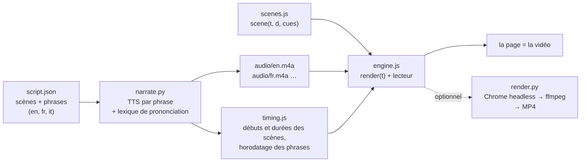

Il y a moins de deux semaines, [ai-running-coach](/fr/ai-running-coach-cinq-jours-apres-chat-materiel-carte-videos/) a eu droit à sa série de vidéos : **« Le Sentier »**, une bande-annonce et 20 épisodes, un par fonctionnalité, narrés en français et en anglais. Cela fait environ 35 minutes de vidéo par langue. Je n'ai jamais ouvert de logiciel de montage, jamais enregistré mon écran et jamais parlé dans un micro.

Aucune de ces vidéos n'est un fichier vidéo. Chaque « vidéo » est une page web : **chaque image est dessinée en JavaScript sur un canvas** à partir du seul temps écoulé, par-dessus une piste de narration produite par un moteur de synthèse vocale. Claude Code a écrit l'essentiel du code, à partir de prompts du genre « fais-moi une vidéo qui explique cette fonctionnalité ».

On m'a demandé comment ça marche, alors voici la méthode. On y trouve l'idée, les options de voix off gratuites (et les pièges de licence, qui comptent plus que la qualité de la voix), ce que 21 épisodes m'ont appris, des prompts réutilisables, et un exemple pas à pas sur un autre projet, pour voir le tout tourner de zéro.

## 0. D'abord le résultat

Voici l'exemple construit pour cet article : une présentation de 80 secondes de [leanproxy-mcp](https://github.com/mmornati/leanproxy-mcp), mon pare-feu à tokens pour MCP. Elle est narrée en anglais, en français et en italien, et elle tourne à l'intérieur de cette page :

<div style="container-type:inline-size;margin:1.5rem 0">
<iframe src="/videos/leanproxy-mcp/?embed=1&lang=fr" title="leanproxy-mcp en 80 secondes" loading="lazy" allow="fullscreen; autoplay" allowfullscreen style="display:block;width:100%;height:calc(56.25cqw + 40px);border:0;border-radius:8px;background:#f3f5f1"></iframe>
</div>

*Appuyez sur Lecture (avec le son). Changez de langue dans la barre de contrôle, ou activez les sous-titres. [Ouvrez-la en pleine page](/videos/leanproxy-mcp/?lang=fr) pour avoir la liste des chapitres.*

Quelques chiffres :

- **2 Mo** pour les trois langues : environ 40 Ko de JavaScript et de JSON, plus environ 600 Ko d'audio AAC par langue. Un export MP4 de la seule version anglaise pèse 3,6 Mo.
- **1 300 lignes de code**, tout compris : le moteur réutilisable (495 lignes), les huit scènes (389) et les deux outils Python pour la narration et l'export.
- **0 euro** : la voix est [Kokoro](https://huggingface.co/hexgrad/Kokoro-82M), un modèle à poids ouverts (Apache-2.0) qui tourne sur le CPU d'un portable.
- **Hébergement :** c'est un dossier dans le `static/` de ce blog. Pas de YouTube, pas de lecteur tiers, rien à téléverser.

## 1. L'idée : une vidéo est une fonction du temps

Toute la technique repose sur une seule règle : **chaque image est une fonction pure du temps**. Une scène est une fonction `scene(t, d, cues)` qui dessine, en partant de zéro, ce que montre l'écran `t` secondes après le début de la scène. Elle ne garde aucun état caché et n'utilise aucun aléatoire non initialisé. Le même `t` donne toujours les mêmes pixels.

Cette seule règle fournit tout ce dont un lecteur vidéo a besoin :

- **Lire**, c'est appeler `render(t)` à chaque frame d'animation.
- **Se déplacer** dans la vidéo, c'est appeler `render(t)` avec un autre `t`.
- **Exporter** en MP4, c'est appeler `render(t)` 30 fois par seconde de vidéo dans un navigateur headless et envoyer les PNG à ffmpeg. Ce n'est jamais du temps réel, donc aucune image n'est jamais perdue.

Ensuite, la voix. La narration est écrite dans un `script.json`, phrase par phrase, scène par scène. Un script synthétise chaque phrase, mesure sa durée et calcule la timeline : **c'est la voix qui donne le rythme, l'animation s'y adapte**. Une scène dure le temps de ce qui y est dit, plus un peu d'air.



Deux détails donnent l'impression d'une vraie vidéo.

**Les animations s'accrochent aux phrases, pas aux secondes.** `timing.js` donne à chaque scène le début et la fin de chacune de ses phrases. Une scène ne dit jamais « affiche le compteur à 3,2 s ». Elle dit « affiche le compteur quand la deuxième phrase commence ». La même scène fonctionne donc en anglais, en français et en italien, alors que la narration italienne dure 13 secondes de plus :

```js
function sTax(t, d, cues) {
  const a2 = at(cues, 1, 7.7);              // début de la 2e phrase (repli : 7,7 s)
  const k = seg(t, a2, a2 + 0.8);            // 0 → 1 en 0,8 s à partir de ce moment
  panel(700, 470, 500, 46, { alpha: k });    // la « fenêtre de contexte » apparaît en fondu
  // …
}
```

**L'audio est l'horloge maître.** Pendant que la narration joue, le lecteur lit le temps sur l'élément `<audio>` plutôt que sur l'horloge système, si bien que la voix et l'image ne se désynchronisent jamais, même sur une machine lente ou dans un onglet masqué :

```js
if (soundOn && !a.paused && a.readyState >= 3) { t = a.currentTime; t0 = now - t * 1000; }
```

Pourquoi ne pas simplement faire un MP4 ? On peut, c'est une commande (section 7). Mais la version page a de vrais avantages pour la documentation :

- **Les langues ne coûtent presque rien.** On traduit les phrases dans `script.json` et on régénère : les scènes se recalent toutes seules. Sur la vidéo leanproxy, l'essentiel de l'effort par langue est passé dans la vérification de la prononciation.
- **On peut la relire en revue.** Une modification de vidéo est un diff dans une pull request. Quand une fonctionnalité change, l'agent modifie une phrase et une scène, et la CI vérifie que la narration a bien été régénérée.
- **Elle est minuscule et auto-hébergée**, comme on l'a vu plus haut.
- **Le texte reste du texte.** Sous-titres, chapitres et transcription viennent du même script.

## 2. Anatomie d'une vidéo

Le moteur que j'ai extrait pour ce blog se trouve dans [`static/videos/engine/`](https://github.com/mmornati/mornati-blog/tree/main/static/videos/engine). C'est une version allégée de celui d'ai-running-coach, sans les parties propres à la série (l'intro avec le dossard, l'arche d'arrivée, le gestionnaire de captures d'écran). Une vidéo est un dossier à côté :

| Fichier | Écrit par | Rôle |
|---|---|---|
| `index.html` | à la main (10 lignes) | charge le moteur, le timing et les scènes |
| `script.json` | vous ou l'agent | scènes, chapitres et ce qui est dit, par langue |
| `lexicon.json` | vous ou l'agent | corrections de prononciation (texte parlé uniquement, sous-titres intacts) |
| `scenes.js` | l'agent, surtout | une fonction de dessin par scène, puis `VIDEO.create({...})` |
| `timing.js` | **généré** | durées des scènes et horodatage des phrases, par langue |
| `audio/<lang>.m4a` | **généré** | la piste de narration |

Le script est le contrat entre la voix et l'image :

```json
{"id": "router", "min": 6,
 "en": ["Clients without their own tool search get a router: four tools, three hundred and eighteen tokens.",
        "The model searches every server, and loads only the tool it needs."],
 "fr": ["Les clients sans recherche d'outils intégrée reçoivent un routeur : quatre outils, trois cent dix-huit tokens.", "…"],
 "it": ["I client senza una ricerca degli strumenti integrata ricevono un router: quattro strumenti, trecentodiciotto token.", "…"]}
```

Les nombres sont écrits en toutes lettres exprès. Les moteurs TTS lisent « 318 » correctement la plupart du temps, mais « 10,049 » peut sortir en « dix, zéro quarante-neuf » en français, où la virgule est un séparateur décimal. Les mots, eux, ne sont jamais ambigus.

Le moteur offre aux scènes un petit vocabulaire : `text`, `para`, `panel`, `pill`, `terminal` (avec des lignes tapées et un curseur), `arrow`, `packets` (des points qui circulent le long d'un fil), `highlight`, `callout`, `check`, plus des fonctions d'easing et un générateur aléatoire initialisé par une graine. C'est suffisant pour des vidéos explicatives. Pour aller plus loin, la scène dispose du `ctx` brut du canvas.

L'outillage se résume à deux scripts Python lancés avec `uv`, donc rien n'est installé dans le projet :

- [`scripts/video/narrate.py`](https://github.com/mmornati/mornati-blog/blob/main/scripts/video/narrate.py) s'occupe de la voix, du timing et du `--check` utilisé par la CI.
- [`scripts/video/render.py`](https://github.com/mmornati/mornati-blog/blob/main/scripts/video/render.py) produit les images fixes PNG et l'export MP4.

La vidéo elle-même est 100 % HTML, CSS et JavaScript.

## 3. La voix : les options gratuites, et celles qu'on a le droit de publier

C'est là que la plus grande partie du temps est passée sur ai-running-coach, et c'est là que le paysage a encore changé **hier**.

### Ce qui est arrivé à la série

- La première narration utilisait **Kokoro**. Il tourne hors ligne, mais son unique voix française sonne robotique.
- La PR #161 est passée à **edge-tts**, qui donne accès gratuitement, sans compte, aux voix neuronales Microsoft de la « Lecture à voix haute » d'Edge. Remy et Andrew Multilingual sonnent très bien, et la bande-annonce ainsi que les épisodes 1 à 15 les utilisent.
- Hier, pendant la narration des épisodes 16 à 20, edge-tts s'est mis à répondre **HTTP 403**. Je ne suis pas le seul : l'[issue #490 d'edge-tts](https://github.com/rany2/edge-tts/issues/490) a été ouverte le 10 octobre. Les signalements viennent de France, d'Europe centrale et du Royaume-Uni ; ça fonctionne encore depuis l'Amérique du Nord. La nouvelle version d'Edge parle à un nouvel hôte avec un nouveau format de token, et il n'y a pas encore de correctif.
- Les épisodes 16 à 20 ont été narrés avec Kokoro, si bien que la série mélange désormais deux voix.

Cette panne m'a rappelé quelque chose que j'avais survolé. **edge-tts n'a jamais été sous licence.** Il utilise un endpoint privé du navigateur. L'audio sonnait professionnel, mais rien ne m'autorisait à le publier. J'ai donc refait les recherches correctement, avec une contrainte : **gratuit, et publiable**.

### Les options en octobre 2026

**Modèles locaux à poids ouverts** (ils tournent sur votre machine, sans compte, sans quota) :

| Moteur | Licence de l'audio que vous publiez | EN / FR / IT | Remarques |
|---|---|---|---|
| [Kokoro-82M](https://huggingface.co/hexgrad/Kokoro-82M) | Apache-2.0 : OK, usage commercial compris | EN excellent, FR 1 voix (B-), IT 2 voix (C) | Minuscule, rapide sur CPU. La meilleure qualité pour sa taille en anglais. Python (`kokoro`, `kokoro-onnx`) et JavaScript ([`kokoro-js`](https://www.npmjs.com/package/kokoro-js), Node et navigateur, voix anglaises uniquement). |
| [Chatterbox Multilingual](https://github.com/resemble-ai/chatterbox) | MIT : OK. Chaque fichier porte un filigrane inaudible « Perth » | EN, FR, IT et 20 autres | Clonage de voix à partir d'un échantillon. Tourne sur Apple Silicon (MPS). |
| [Kyutai Pocket TTS](https://huggingface.co/kyutai/pocket-tts) | CC-BY-4.0 : OK **en créditant Kyutai** ; cloner quelqu'un sans son consentement est interdit | EN, FR, IT, DE, ES, PT | Nouveau en 2026 : 100M de paramètres, temps réel sur le CPU d'un portable. Téléchargement soumis à acceptation. |
| [Kyutai TTS 1.6B](https://huggingface.co/kyutai/tts-1.6b-en_fr) | CC-BY-4.0 (crédit) | EN, FR | Très bon français. Sur Mac via MLX. |
| [Qwen3-TTS](https://huggingface.co/Qwen/Qwen3-TTS-12Hz-1.7B-CustomVoice) | Apache-2.0 | EN, FR, IT et 7 autres | Solide, clonage à partir de 3 s d'audio, mais il réclame un GPU. |
| [Piper](https://github.com/OHF-Voice/piper1-gpl) | Moteur en GPL-3.0 (qui ne couvre pas votre audio), mais **chaque voix a sa propre licence de dataset** : vérifiez sa fiche de modèle | De nombreuses voix | Fiable, un peu robotique, tourne sur un Raspberry Pi. |

Attention aux **pièges du non commercial** : certains des modèles ouverts qui sonnent le mieux interdisent précisément l'usage qui nous intéresse (une vidéo produit ou marketing). Parmi eux : Fish Audio S2, Voxtral TTS, F5-TTS (les poids), Spark-TTS, XTTS-v2 (et Coqui n'existe plus pour vous vendre une licence), OuteTTS 1B et Breeze TTS 2 (actuellement n° 1 du classement des modèles à poids ouverts). Lisez la licence des *poids*, pas seulement celle du code.

**Offres gratuites officielles dans le cloud** (un compte est nécessaire, et l'audio est sous licence) :

| Service | Quota gratuit | Remarques |
|---|---|---|
| [Azure AI Speech F0](https://azure.microsoft.com/en-us/pricing/details/cognitive-services/speech-services/) | 500 000 caractères par mois | **Les mêmes voix qu'utilisait edge-tts**, en toute légalité. Toute la série ai-running-coach fait environ 31 000 caractères. |
| [Google Cloud TTS](https://cloud.google.com/text-to-speech/pricing) | 1M de caractères/mois en Chirp 3 HD (ses meilleures voix), 4M en Standard, 4M en WaveNet | Nécessite un compte de facturation (une carte enregistrée). |
| [Gemini API TTS](https://ai.google.dev/gemini-api/docs/pricing) | Offre gratuite sur les modèles Flash TTS | Voix pilotées par un prompt texte ; limites de débit serrées. |
| [Amazon Polly](https://aws.amazon.com/polly/pricing/) | Crédits pour les nouveaux comptes (jusqu'à 200 $) | Les anciens quotas « 12 mois gratuits » ne s'appliquent qu'aux comptes créés avant juillet 2025. |
| [Cloudflare Workers AI](https://developers.cloudflare.com/workers-ai/models/melotts/) | 10 000 neurons/jour, environ 9 heures d'audio MeloTTS | Français et anglais, pas d'italien ; qualité datée. |

Les offres gratuites des services commerciaux ne sont pas une option pour cet usage : **ElevenLabs Free** interdit l'usage commercial et exige « elevenlabs.io » dans le titre de ce que vous publiez, l'offre gratuite de Cartesia n'inclut pas de licence commerciale, et OpenAI n'a aucune offre TTS gratuite.

**Intégré à votre ordinateur**, la solution de repli quand rien d'autre ne marche :

- **`say` sous macOS** est parfait pour les brouillons et les passes de timing : zéro installation, des voix correctes dans toutes les langues. Mais la licence de macOS (section 2F du contrat de licence de Tahoe) n'autorise les voix système que "for your personal, non-commercial use" (pour un usage personnel et non commercial) et interdit explicitement d'en publier des enregistrements. **Utilisez-le, ne le publiez pas.**
- Les voix naturelles de **Windows** n'ont aucune autorisation de publication que j'aie pu trouver.
- **espeak-ng** (Linux, macOS, Windows) sonne comme en 1995, mais c'est un logiciel GPL qui ne revendique rien sur votre audio : c'est la solution de repli gratuite que vous avez réellement le droit de publier.

Mon `narrate.py` gère trois moteurs : `kokoro` (par défaut), `espeak` (repli publiable) et `say` (brouillons). Celui d'ai-running-coach ajoute `azure`, `edge`, `chatterbox` et `kyutai`. Ajouter un moteur, c'est une classe de 15 lignes : on prend une phrase, on écrit un WAV.

### Ce que je choisirais

- **Anglais seul :** Kokoro. Difficile de faire mieux avec 82M de paramètres, et c'est le seul qui tourne aussi en JavaScript.
- **Français et italien, en local :** Chatterbox Multilingual, ou Pocket TTS si vous pouvez créditer Kyutai.
- **Les meilleures voix gratuitement :** Azure F0, 500 000 caractères par mois, officiellement. C'est la voie naturelle pour renarrer la série ai-running-coach avec une seule voix.
- **Brouillons :** `say`, puis on change de moteur pour la version finale. Comme le timing est calculé à partir de l'audio réel, changer de moteur ne fait que recaler les scènes.

Pour cet article, j'ai volontairement utilisé Kokoro dans les trois langues, pour que vous entendiez où il excelle (l'anglais) et où il montre ses limites (les voix française et italienne sont notées B- et C par son propre auteur).

## 4. Ce que 21 épisodes m'ont appris

**La prononciation est le vrai travail, et on ne peut pas la vérifier à l'oreille.** Au bout de trois écoutes, on entend ce qu'on s'attend à entendre. Transcrivez la piste avec Whisper (`faster-whisper` tourne en local) et faites un diff avec le script. Sur la vidéo leanproxy, Whisper a repéré :

- « your AI client » entendu « your iClient » ;
- « binaire Go » entendu « binergo » ;
- « LeanProxy » en italien entendu « L'improxia ».

Chaque cas a été corrigé par une entrée d'une ligne dans `lexicon.json` : une graphie phonétique, ou des phonèmes IPA bruts pour Kokoro (`"AI": "[[ˌeɪˈaɪ]]"`). Les sous-titres gardent le texte d'origine.

**Kokoro lit à voix haute ses propres marqueurs de langue.** Quand une phrase française contient un mot anglais, espeak (que Kokoro utilise pour les phonèmes) l'entoure de marqueurs de changement de langue : `(en)kˈoʊtʃ(fr)`. kokoro-onnx retire les parenthèses mais pas les lettres, et la voix disait littéralement « en coach fr ». La correction tient en un paramètre (`language_switch="remove-flags"`), et elle est dans `narrate.py`.

**Laissez la voix fixer le timing, jamais l'inverse.** La première bande-annonce était muette, avec des durées de scènes réglées à la main. Quand la narration est arrivée, les durées ont été calculées à partir de l'audio : aucune phrase n'est jamais coupée, et une traduction ou un changement de moteur ne fait que recaler les scènes.

**Faites du déterminisme un test.** ai-running-coach a un test de lint qui échoue si une scène utilise `Math.random()` ou `Date.now()`. Une seule image non déterministe, et l'export MP4 ne correspond plus à ce que les gens voient dans le navigateur.

**Faites d'une narration périmée un échec de CI.** `narrate.py --check` n'utilise que la bibliothèque standard. Il compare une empreinte du script, de la voix et du lexique à celle stockée dans `timing.js`. Vous changez une phrase et oubliez de régénérer : la CI vous le dit.

**Écrivez l'audio de façon atomique.** Avec plusieurs agents qui régénèrent en parallèle, une piste pouvait être lue à moitié écrite. Le script l'écrit dans un fichier temporaire puis le déplace à sa place.

**Agents parallèles et fichiers partagés ne font pas bon ménage.** Les épisodes ont été construits par plusieurs sessions Claude Code en parallèle. Chacune ajoutait sa ligne à la liste partagée des épisodes dans `engine.js`, si bien que chaque branche entrait en conflit avec toutes les autres. Gardez les registres partagés minuscules, ou générez-les.

**Utilisez des données fictives, et dites-le à l'écran.** Les vidéos d'ai-running-coach mettent en scène « Camille », une athlète de démo générée par les fixtures de test, pour que je ne publie jamais mes propres données de santé. La vidéo leanproxy n'utilise que des chiffres issus du benchmark du projet, avec les conditions de test affichées à côté.

## 5. Des prompts réutilisables

Les sessions qui ont construit « Le Sentier » n'existent plus : la première tournait dans un bac à sable cloud, et les sessions locales ont été nettoyées depuis. Ce qui suit est réécrit à partir des descriptions des pull requests et généralisé, pour fonctionner sur n'importe quel projet. Les deux derniers sont les prompts derrière l'exemple de cet article.

Je les laisse en anglais, tels que je les ai écrits : ils fonctionnent de la même façon quelle que soit la langue.

**Démarrer le moteur** (la toute première vidéo) :

```text
I want a ~80 s presentation video of this project that is NOT a video file:
a single HTML page where every frame is drawn on a 16:9 canvas by a pure
function render(t) of the elapsed time. No framework, no build step, no
third-party requests (bundle the fonts with their licences). Expose
window.renderFrame(t) and window.videoReady so a script can export an MP4
frame by frame with headless Chrome + ffmpeg. Read the README and the docs
first, use the project's real colours, and never invent a feature.
```

**En faire une série narrée :**

```text
Turn the trailer into a series: one short episode per feature, half demo,
half documentation, sharing one engine (player, chapters, subtitles,
drawing helpers). Each episode has a script.json with the scenes and the
narration in FR and EN. Generate the voice offline, compute each scene's
duration from the audio (the voice sets the pace), and expose the sentence
timestamps so animations can start when a sentence starts. Add a CI check
that fails when the narration is stale. Propose the episode list first.
```

**Quand la voix sonne mal :**

```text
The French voice sounds robotic. Make the narration script support several
TTS engines behind a --engine flag, render one scene with each engine for
A/B listening (--sample), and tell me the licence of the audio each one
produces: I must be allowed to publish it.
```

**Corriger la prononciation sans deviner :**

```text
Transcribe every narration track with faster-whisper and diff it against
script.json. For each word that comes out wrong, add an entry to
lexicon.json (respelling, or IPA for Kokoro), regenerate, and transcribe
again until the transcript matches. Don't change the subtitles.
```

**Ajouter un épisode** (celui que j'ai le plus utilisé) :

```text
New episode for the feature in PR #<n>: read the PR and the docs page,
propose 6-8 scenes with the narration in FR and EN, wait for my OK, then
build it, regenerate the narration, render stills of every scene so you
can check the layout yourself, and update the gallery.
```

**Une vidéo du projet de quelqu'un d'autre** (l'exemple ci-dessous) :

```text
Make an ~80 s narrated explainer of github.com/<owner>/<repo> for my blog,
in EN, FR and IT, with a free voice I'm allowed to publish. Use only facts
and numbers from the repo (README, docs, benchmarks), with their test
conditions on screen. Use the project's visual identity. Check the
pronunciation with Whisper, render stills of every scene and fix the
layout before showing me anything.
```

Ce qui compte dans tous ces prompts : **demander à l'agent de regarder son propre résultat.** Rendre des images fixes de chaque scène et les relire en tant qu'images, transcrire l'audio : c'est ce qui fait passer de « ça compile » à « ça a l'air juste et ça sonne juste ».

## 6. Pas à pas : leanproxy-mcp en un après-midi

Voici comment la vidéo en haut de cet article a été faite, dans l'ordre.

**1. Rassembler les faits.** Un agent a lu le dépôt de leanproxy-mcp, son site de documentation et les résultats de son benchmark. La première chose qu'il a trouvée était un piège : la description GitHub indique toujours « 50-80% », alors que les chiffres actuels, mesurés, sont *65 à 94 % de tokens en moins par session*, *10 049 → 318 tokens* de charge statique, et *0 sur 3* secrets piégés ayant fuité. Mes deux anciens articles sur le projet affichaient des chiffres encore plus anciens. La vidéo n'utilise que les résultats actuels du harness, et affiche les conditions (« make harness · 5 mock servers · 118 tools · upper bounds ») à l'écran.

**2. Écrire le storyboard sous forme de `script.json`.** Huit scènes : la taxe des schémas, le coût, le proxy, le mode routeur, le régulateur de réponses, le pare-feu, les mesures, l'installation. Environ 170 mots en anglais. Les fonctionnalités optionnelles sont présentées comme optionnelles.

**3. Générer la voix.**

```bash
uv run --with kokoro-onnx --with soundfile scripts/video/narrate.py leanproxy-mcp
```

```text
leanproxy-mcp [en] 77.9 s (kokoro/af_heart)
leanproxy-mcp [fr] 81.7 s (kokoro/ff_siwis)
leanproxy-mcp [it] 90.9 s (kokoro/im_nicola)
```

**4. Vérifier la prononciation avec Whisper**, corriger le lexique, régénérer. Trois tours, environ 15 minutes, pour les trois langues.

**5. Écrire les scènes.** L'identité visuelle vient du `DESIGN.md` du projet : la palette « checkpoint scanner », avec l'ambre pour les tokens qu'on paie, le bleu-vert pour ce qui est passé, et le rouge uniquement pour les crochets d'angle autour de ce qui a été intercepté. Le logo, une arche de scanner, est redessiné en huit lignes de code canvas.

**6. Regarder.** Rendre des images fixes de chaque scène dans chaque langue, les assembler en planche contact, la relire :

```bash
uv run --with playwright scripts/video/render.py leanproxy-mcp --lang it --res 720 --still 4 --still 15 --still 33
```

Cette passe a repéré un bloc ambre qui recouvrait le portique, un pourcentage qui chevauchait l'étiquette d'une barre, et des ligatures de code qui transformaient `--stdio` en « —stdio » dans la scène du terminal. Aucun de ces défauts ne serait apparu dans une revue de code.

**7. Publier.** Le dossier va dans le `static/videos/` du blog, et l'article l'intègre avec une `iframe` qui pointe vers `?embed=1&lang=en`. Les versions FR et IT de cet article utilisent `lang=fr` et `lang=it`.

## 7. Et quand il faut un MP4

YouTube, LinkedIn ou une page de release ne peuvent pas exécuter votre JavaScript. Pour ces cas-là :

```bash
uv run --with playwright scripts/video/render.py leanproxy-mcp --lang en              # 1080p MP4
uv run --with playwright scripts/video/render.py leanproxy-mcp --lang en --burn-subs  # social media
```

Sur mon MacBook, il rend les 2 337 images de la version anglaise en **24 secondes** et produit un fichier de 3,6 Mo, la narration multiplexée sans réencodage. Les mêmes pixels que dans le navigateur, par construction.

## Et maintenant

- Retrouver une voix unique, sous licence, sur les 21 épisodes du « Sentier » (Azure F0 est le candidat évident).
- Essayer Pocket TTS et Chatterbox pour le français et l'italien sur la prochaine vidéo.
- Peut-être une version Node de `narrate.py` avec `kokoro-js`, pour les projets qui ne veulent pas une ligne de Python (voix anglaises uniquement, pour l'instant).

Liens :

- 🎬 [La vidéo leanproxy-mcp, en pleine page](/videos/leanproxy-mcp/?lang=fr)
- 🏃 [« Le Sentier », la série d'ai-running-coach](https://mmornati.github.io/ai-running-coach/videos/)
- 🧩 [Le moteur et le dossier des vidéos](https://github.com/mmornati/mornati-blog/tree/main/static/videos) et [les scripts de narration et d'export](https://github.com/mmornati/mornati-blog/tree/main/scripts/video), dans le dépôt public de ce blog
- 🛡️ [leanproxy-mcp sur GitHub](https://github.com/mmornati/leanproxy-mcp)
