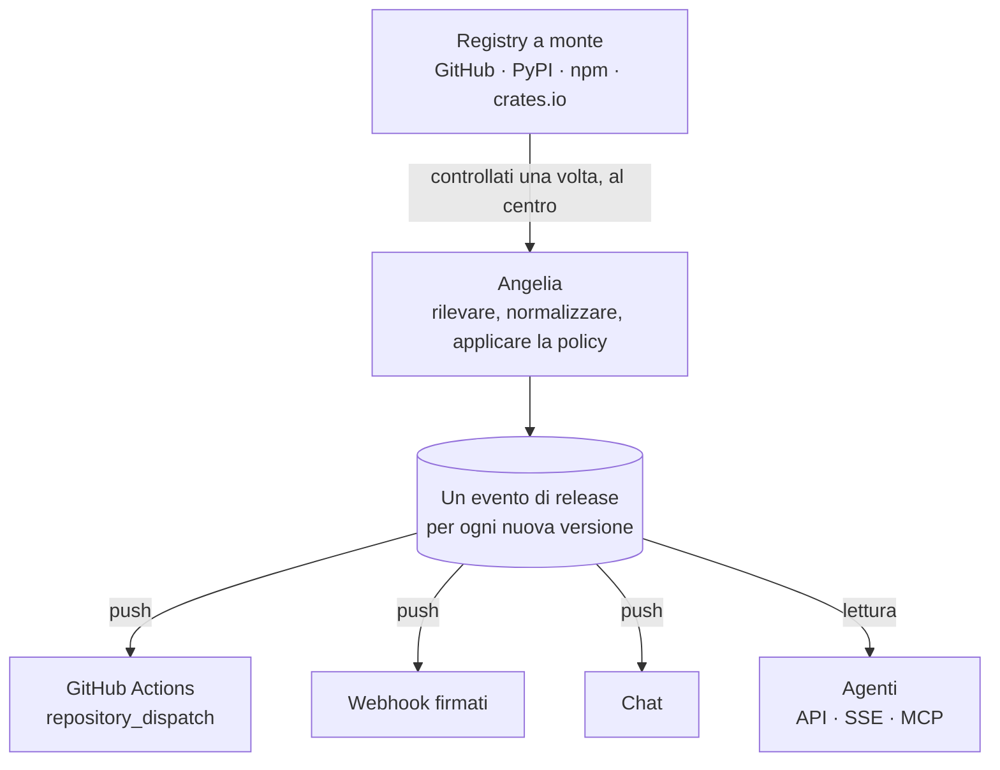
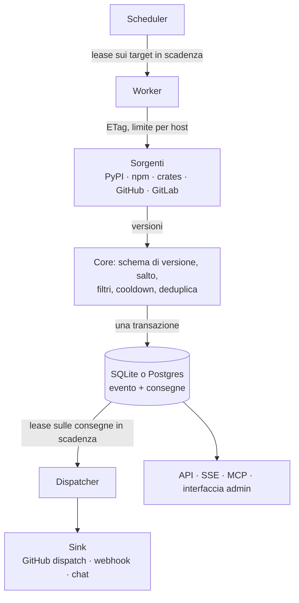

Tutto il software che mantengo poggia su qualcosa che non controllo: una libreria, un framework, una piattaforma. Quando uno di questi pubblica una nuova versione, è esattamente il momento in cui il mio codice può rompersi. Quasi sempre non succede niente. A volte una funzione è stata rinominata, una classe base è cambiata, un'API deprecata è stata finalmente rimossa, e lo scopro dalla segnalazione di un utente una settimana dopo.

È ancora più vero quando quello che si mantiene è **un plugin di un grande progetto**. Un'integrazione di Home Assistant vive dentro Home Assistant: ne importa le classi, ne segue le convenzioni e gira nel suo event loop. Home Assistant pubblica una nuova versione ogni mese, con le beta la settimana prima. Quindi ogni mese le mie integrazioni possono rompersi senza che io cambi una sola riga.

La soluzione sembra semplice: *quando esce una nuova versione, lanciare i test su quella versione*. Ma manca un pezzo. GitHub può avviare un workflow quando succede qualcosa **nel vostro repository** (un push, una pull request, una release che pubblicate). Non può avviarne uno quando succede qualcosa **in quello di qualcun altro**: non esiste nessun evento "home-assistant/core ha pubblicato 2026.11.2" a cui iscriversi. Così tutti fanno polling, controllano a intervalli.

**[Angelia](https://github.com/angelia-dev/angelia)** inverte lo schema. Gli dite da cosa dipendete (i *watch*), lui li controlla in modo efficiente, e quando appare una nuova versione **invia** un evento pulito e firmato a chi ne ha bisogno: un workflow GitHub, un webhook, un canale di chat, un agente IA. Questo articolo spiega perché l'ho costruito, mostra il vero esempio di Home Assistant che gira sulla mia integrazione, e poi racconta come funziona dentro e quanto poco costa farlo girare.


**In breve.** Angelia è un bus di eventi di release self-hosted scritto in Go: **rilevare → normalizzare → consegnare**. Sorveglia PyPI, npm, crates.io e le release di GitHub e GitLab, e invia un [CloudEvent](https://cloudevents.io/) per ogni nuova versione a GitHub (`repository_dispatch`), a webhook firmati, alla chat, o agli agenti tramite un'API di lettura, SSE e MCP. Un solo binario, SQLite o Postgres, Apache-2.0. [Documentazione](https://angelia-dev.github.io/docs/).


## 1. Perché mi serviva: dipendere da release che non si controllano

Mantengo due integrazioni personalizzate per Home Assistant:

- [**Hitachi CSNet Home**](https://github.com/mmornati/home-assistant-csnet-home), che comanda la mia pompa di calore Hitachi tramite la sua API cloud ([la storia del reverse engineering è qui](/reverse-engineering-hitachis-cloud-api-with-ai-from-browser-devtools-to-a-full-home-assistant-integration/), in inglese);
- [**MEL Garbage Collection**](https://github.com/mmornati/home-assistant-mel-garbage-collection), che mostra i giorni di raccolta dei rifiuti della metropoli di Lille come calendario e sensori.

Entrambe hanno lo stesso problema. Sono piccole, cambiano raramente, e dipendono da una piattaforma che cambia **ogni mese**. Un mese fa ho ricostruito la CI di CSNet perché [Claude legga ogni versione di Home Assistant](/it/home-assistant-esce-ogni-mese-claude-legge-le-note-di-rilascio/) e apra una issue con quello che potrebbe rompersi. Quel workflow aveva bisogno di un trigger: *"è uscita una nuova versione di Home Assistant"*.

Lo stesso bisogno si trova ovunque, appena lo si cerca:

- una libreria fissata in `requirements.txt` pubblica una versione minor: si vuole che i test girino su quella versione **prima** che Renovate o Dependabot aprano la PR, o prima che gli utenti aggiornino;
- un'immagine base o un tool a riga di comando usato nella CI riceve un fix di sicurezza: lo si vuole sapere oggi, non alla prossima build programmata;
- un agente IA che mantiene un progetto dovrebbe essere avvisato che qualcosa è cambiato, invece di riesaminare tutto a ogni esecuzione.

La forma comune: **un evento succede a monte, e la reazione appartiene a valle**, in un posto che il monte non conosce.

## 2. Perché il polling da GitHub Actions non è la risposta

Senza un evento a cui iscriversi, il trucco abituale è un workflow programmato. Il mio repository CSNet aveva proprio questo fino alla settimana scorsa, in `ha-release-review.yaml`:

```yaml
# GitHub has no webhook for releases of another repository, so this polls PyPI.
on:
  schedule:
    - cron: '17 */6 * * *'
```

Ogni sei ore parte un runner, installa Python, chiede a PyPI l'ultima versione di Home Assistant, la confronta con quella già analizzata, e in quasi tutte le esecuzioni non fa niente. Funziona, ma ha tre problemi.

**Non è affidabile, e lo dice GitHub.** La [documentazione dell'evento `schedule`](https://docs.github.com/en/actions/reference/workflows-and-actions/events-that-trigger-workflows#schedule) è esplicita: l'evento *"can be delayed during periods of high loads"*, l'inizio di ogni ora è un momento di carico alto, e se il carico è abbastanza alto alcuni job in coda possono essere scartati. In più, in un repository pubblico i workflow programmati vengono disattivati automaticamente dopo 60 giorni senza attività. Un piccolo plugin stabile è esattamente il tipo di repository che resta due mesi senza attività, e a quel punto la sorveglianza si ferma in silenzio.

**È lento per costruzione.** Con un cron ogni sei ore, una versione aspetta in media tre ore prima di essere notata, di più quando l'esecuzione è in ritardo. Controllare ogni cinque minuti invece consuma minuti di runner e quota API per niente il 99% delle volte.

**Non scala con quello da cui si dipende.** Ogni repository controlla ogni dipendenza per conto suo. Due integrazioni che sorvegliano Home Assistant sono due cron che fanno la stessa domanda. Dieci progetti con dieci dipendenze ciascuno sono cento piccoli job di polling, ognuno con il suo stato, il suo token e i suoi bug ("ho già analizzato questa versione?").

Il polling in sé non è sbagliato: qualcuno deve pur interrogare il registry. Il problema è **chi** lo fa e **quanto spesso**. È la parte di cui si occupa Angelia.

## 3. L'idea: invertire lo schema

Angelia fa il polling una volta sola, in modo centralizzato e attento, e lo trasforma in **push**:

1. **Dichiarate dei watch**: "home-assistant/core sulle release GitHub", "requests su PyPI", "serde su crates.io". Ogni watch ha un intervallo, uno schema di versione (SemVer, PEP 440, CalVer…) e una policy (includere o no le pre-release, ignorare le patch, aspettare un cooldown).
2. **Angelia rileva** una nuova versione, la confronta con la precedente e calcola che tipo di cambiamento è: major, minor, patch, pre-release, yank.
3. **Scrive un evento di release immutabile** nel formato [CloudEvents](https://cloudevents.io/), con il pacchetto, la versione, la versione precedente, il tipo di salto, gli URL e le label del watch.
4. **Consegna l'evento** a ogni sottoscrizione che corrisponde: un `repository_dispatch` su un repository GitHub, un webhook firmato, un messaggio in chat, o un feed che gli agenti possono leggere.



Il repository non chiede più "c'è qualcosa di nuovo?" ogni sei ore. Ha semplicemente un workflow che dice *"quando Angelia mi dice che Home Assistant ha pubblicato una versione, testala"*. Niente cron, niente stato, niente logica "già visto" nel repository.

## 4. Un esempio reale: Home Assistant 2026.11.2 e la mia integrazione CSNet

Questa è la [ricetta della documentazione](https://angelia-dev.github.io/docs/recipes/home-assistant-agentic/), che gira davvero sulla mia istanza. Tutta la catena è anche in questo video narrato di 90 secondi (come [i miei altri video](/it/video-narrati-senza-file-video-canvas-javascript/), è disegnato in JavaScript su un canvas, non è un file video; la narrazione e i sottotitoli sono in inglese):

<div style="container-type:inline-size;margin:1.5rem 0">
<iframe src="/videos/angelia-home-assistant/?embed=1&lang=en" title="Home Assistant to an agentic PR" loading="lazy" allow="fullscreen; autoplay" allowfullscreen style="display:block;width:100%;height:calc(56.25cqw + 40px);border:0;border-radius:8px;background:#0d0b2a"></iframe>
</div>

*Premete Play (con l'audio). [Apritelo a pagina intera](/videos/angelia-home-assistant/?lang=en) per avere la lista dei capitoli.*

### Lato Angelia

Un sink (dove inviare), un watch (cosa controllare), una sottoscrizione (quali eventi vanno a quale sink):

```yaml
# watches.yaml
version: 1

sinks:
  - name: csnet-home-ci
    kind: github-dispatch
    config:
      repo: mmornati/home-assistant-csnet-home
      token_ref: gh-dispatch-csnet      # PAT fine-grained: Contents in lettura/scrittura solo su quel repo
      event_type: ha-release

watches:
  - name: home-assistant
    source: github-release
    coordinates: { repo: home-assistant/core }
    scheme: calver                      # 2026.11.2, 2026.12.0b0
    interval: 30m
    labels: { consumer: csnet-home }
    policy:
      prerelease: include               # anche le beta: trovare i problemi prima degli utenti

subscriptions:
  - name: ha-to-csnet-home
    sink: csnet-home-ci
    filter:
      labels: { consumer: csnet-home }
      type: [release.published, release.prerelease]
    policy:
      cooldown: 1h                      # lasciare arrivare il wheel su PyPI; scartarla se ritirata
```

Alcune righe meritano una spiegazione:

- **`scheme: calver`**: le versioni di Home Assistant sono date. Angelia sa che `2026.12.0b0` è una pre-release di `2026.12.0`, e che `2026.11.1 → 2026.11.2` è una patch.
- **`prerelease: include`**: le beta sono il momento in cui un problema costa meno da correggere, una settimana prima che gli utenti ricevano la versione.
- **`cooldown: 1h`**: Home Assistant pubblica la release su GitHub un po' prima che il wheel arrivi su PyPI. Aspettare un'ora vuol dire che la CI può davvero fare `pip install` di quella versione, e una release ritirata entro l'ora non arriva mai alla CI.

Il token è salvato come secret di Angelia (`angelia secret set gh-dispatch-csnet --from-file pat.txt --host api.github.com`), legato all'host dell'API di GitHub, e mai scritto nel file. La mia seconda integrazione, MEL Garbage Collection, ha gli stessi tre blocchi con il suo sink: **lo stesso watch serve entrambe**, e Home Assistant viene controllato una volta sola.

### Lato repository

Il repository riceve un workflow che ascolta solo quel tipo di evento, [`angelia-ha-release.yaml`](https://github.com/mmornati/home-assistant-csnet-home/blob/main/.github/workflows/angelia-ha-release.yaml). Semplificato:

```yaml
name: HA Release from Angelia
on:
  repository_dispatch:
    types: [ha-release]

permissions:
  contents: read

concurrency:                          # una consegna ripetuta porta lo stesso id di evento
  group: angelia-${{ github.event.client_payload.event_id }}

jobs:
  validate:                           # il payload è un input non fidato: prima si verifica
    runs-on: ubuntu-latest
    steps:
      - env:
          PACKAGE: ${{ github.event.client_payload.package }}
          VERSION: ${{ github.event.client_payload.version }}
        run: |
          [ "$PACKAGE" = "home-assistant/core" ] || exit 1
          [[ "$VERSION" =~ ^20[0-9]{2}\.[0-9]+\.[0-9]+(b[0-9]+)?$ ]] || exit 1

  test:                               # installare quella versione esatta di HA e lanciare i test
    needs: validate
    # … installare HA $VERSION, smoke test di import, pytest

  review:                             # avviare la review di Claude una volta per release mensile
    needs: [validate, test]
    # … gh workflow run ha-release-review.yaml -f version="$VERSION"
```

Il vecchio cron di sei ore è stato rimosso nello stesso commit: [*"start HA release checks from Angelia instead of polling PyPI"*](https://github.com/mmornati/home-assistant-csnet-home/commit/dc19cf96ecf4116a51db6b6bbc82fcf6cd448866).

### Cosa è successo il 16 novembre

Home Assistant ha pubblicato la **2026.11.2** lunedì sera. Ecco la cronologia reale, dall'API di GitHub, dall'evento di Angelia e dall'esecuzione di Actions:

| Ora (UTC) | Cosa |
|---|---|
| 20:03:59 | GitHub pubblica la [release 2026.11.2](https://github.com/home-assistant/core/releases/tag/2026.11.2) di `home-assistant/core` |
| 20:04:02 | Angelia la rileva: `patch` da `2026.11.1`, schema `calver` (**3 secondi dopo**, un controllo fortunato; il caso peggiore è l'intervallo di 30 minuti) |
| 20:04 → 21:04 | scorre il cooldown di un'ora della sottoscrizione |
| 21:04:05 | Angelia invia il `repository_dispatch`; GitHub avvia l'[esecuzione del workflow](https://github.com/mmornati/home-assistant-csnet-home/actions/runs/43956230731) |
| 21:04:15 | payload validato |
| 21:05:14 | Home Assistant 2026.11.2 installato, smoke test di import e test unitari passati |
| 21:05:23 | passo di review: la 2026.11 ha già la sua issue di review di Claude, quindi niente di nuovo da aprire |

Dalla release ai test: **un'ora e 84 secondi**, e l'ora è una scelta mia. Con il vecchio cron, la stessa release sarebbe stata notata tra 17 minuti e sei ore dopo, sempre che l'esecuzione programmata non fosse stata ritardata o scartata.

Questo è l'evento come Angelia lo ha registrato e consegnato, nell'interfaccia di amministrazione:


Il payload che riceve il workflow contiene le stesse informazioni: `package`, `version`, `previous_version`, `bump`, `event_id`. L'`event_id` è importante: la consegna è *at least once*, quindi una consegna ripetuta porta lo stesso id e il gruppo `concurrency` del workflow trasforma un duplicato in un nulla di fatto.

## 5. L'interfaccia di amministrazione

Angelia è nato come "solo file YAML e riga di comando", ed è ancora il modo GitOps di configurarlo. Da questa settimana ha anche un'**interfaccia web di amministrazione**, inclusa nel binario e servita sotto `/ui/`, con login GitHub (o qualsiasi provider OpenID Connect) e tre ruoli: viewer, editor, admin.


Il design segue la metafora di una "telescrivente d'agenzia": ogni watch è una casella di un casellario con la sua ultima versione, il tipo di salto e un indicatore fino al prossimo controllo, e ogni release è un foglietto timbrato ROUTINE (patch), BULLETIN (minor) o FLASH (major, o un errore che richiede attenzione). La pagina Events mostra gli ultimi giorni come un nastro perforato, un foro per release, con il CloudEvent accanto. La pagina Deliveries mostra cosa è stato inviato dove, con i tentativi, le dead letter e un pulsante per ripetere l'invio.

L'interfaccia chiama la stessa API REST della riga di comando, con gli stessi controlli di permessi e le stesse tracce di audit. I watch che vengono dal file hanno un badge e non si modificano dal browser: il file resta la fonte di verità.

## 6. Come funziona dentro

Angelia è un solo binario Go con quattro ruoli che possono girare insieme (il default) o separati per scalare: **API**, **scheduler**, **worker** e **dispatcher**. La parte interessante non è la lista delle funzionalità, è il modo in cui evita il lavoro inutile. Un bus di release passa quasi tutta la vita a chiedere "novità?" e a sentirsi rispondere "no", quindi tutto il design punta a rendere quel "no" il più economico possibile.



**Uno scheduler continuo, non a lotti.** Un cron che scorre tutti i watch crea picchi, sbatte contro i limiti di frequenza, e lascia che un registry lento ritardi tutti gli altri. In Angelia ogni target ha il suo `next_check_at`, con un po' di jitter, e i worker prendono in *lease* dal database quelli in scadenza. Su Postgres il lease usa `FOR UPDATE SKIP LOCKED`, quindi più processi possono dividersi il lavoro senza un message broker. Su SQLite se ne occupa un solo processo.

**Coalescing.** I watch puntano a un *target* condiviso. Se cinquanta watch seguono `pypi:requests` (cinquanta team, cinquanta label, cinquanta sink), Angelia fa **una** richiesta, non cinquanta. Le mie due integrazioni Home Assistant condividono un solo controllo.

**Richieste condizionali ovunque.** Ogni target conserva il suo ETag e il suo Last-Modified. Il controllo successivo invia `If-None-Match`, e un registry invariato risponde `304 Not Modified` con un corpo vuoto. Su GitHub, una richiesta autenticata che riceve un 304 [non conta nemmeno nel rate limit](https://docs.github.com/en/rest/using-the-rest-api/best-practices-for-using-the-rest-api#use-conditional-requests-if-appropriate). Nel benchmark qui sotto, **l'83% dei controlli** ha ricevuto un 304.

**Un rate limiter per host a monte.** `api.github.com` ha un token bucket dimensionato sul suo limite reale (4.990 richieste all'ora più un burst di 10 per un token), PyPI e npm hanno il loro. Angelia rallenta prima che il registry debba dire di no, quindi i benchmark non vedono nessuna risposta 429 né 403.

**Sorgenti semplici, un core intelligente.** Un plugin sorgente si limita a elencare versioni: `List(target, stato) → versioni + nuovo ETag`. Il parsing delle versioni, il calcolo del salto, il filtro delle pre-release, il cooldown e la deduplica avvengono una volta sola, nel core, allo stesso modo per ogni ecosistema. L'ordinamento delle versioni ha il suo benchmark, confrontato con l'ordine di ogni registry, perché "2.0.0rc1 è più recente di 2.0.0b3?" è proprio dove si nascondono i bug.

**Evento e consegna sono separati, e scritti insieme.** Una nuova versione crea un evento immutabile e una riga di consegna per ogni sottoscrizione che corrisponde, **nella stessa transazione** del cambio di stato (un outbox transazionale). Il dispatcher poi prende in lease le consegne in scadenza, riprova con backoff, e sposta una consegna che continua a fallire in una lista di dead letter che si può ripetere. Un crash tra "rilevato" e "inviato" non perde niente: il benchmark uccide il processo con `SIGKILL` 100 volte durante le consegne e verifica che ogni consegna arrivi comunque.

**Push e pull.** La CI vuole il push (`repository_dispatch`, webhook firmati con HMAC). Gli agenti spesso non hanno un URL pubblico, quindi *leggono*: un'API di eventi con cursore, uno stream Server-Sent Events, e un server MCP con strumenti come `events_since` e `latest_version`.

**Poche dipendenze, un'impronta piccola.** Go con `CGO_ENABLED=0`, SQLite tramite un driver in Go puro, Postgres tramite `pgx` quando serve alta disponibilità, un'immagine distroless, metriche Prometheus, tracce OpenTelemetry, log JSON. L'interfaccia è in React e TypeScript, compilata con Vite e inclusa con `go:embed`, font compresi, quindi la Content Security Policy permette solo `'self'`.

## 7. Prestazioni: quanto costa sorvegliare 10.000 cose

L'architettura ha fissato obiettivi passa/non passa prima di scegliere Go, e il repository ha un [harness di benchmark](https://github.com/angelia-dev/angelia/tree/main/bench) per verificarli. I benchmark che misurano tempo e memoria girano su una macchina nota: il mio portatile (Apple M4, 16 GB, OrbStack), con Angelia in un container Linux limitato a **1 vCPU e 256 MB di memoria, senza swap**, contro un finto registry che pubblica nuove versioni durante l'esecuzione.

Per questo articolo li ho rilanciati oggi sul `main` attuale (con la nuova interfaccia e il lavoro su Postgres), accanto alla prima esecuzione del 9 novembre:

| Benchmark 1: 10.000 watch, controllati ogni 5 minuti | Obiettivo | 9 nov (`a7fe3ea`) | Oggi (`5890cc2`) |
|---|---|---|---|
| Watch (PyPI, npm, crates.io, GitHub; 2.500 ciascuno) | | 10.000 | 10.000 |
| Ritardo tra scadenza e controllo, P95 | < 2 min | **1,0 s** | **1,1 s** |
| Memoria del container, max | < 100 MB | **45,1 MiB** | **46,0 MiB** |
| CPU, media (su 1 vCPU) | < 20% | **8,1%** | **13,5%** |
| Controlli in 30 minuti | | 60.765 richieste | 60.672 richieste |
| Risposte `304 Not Modified` | | 83% | 83% |
| Errori di rate limit (429 / 403) | 0 | 0 | 0 |

| Benchmark 2: impronta a riposo, 100 watch | Obiettivo | 9 nov | Oggi |
|---|---|---|---|
| Memoria dopo il riscaldamento, max | < 40 MB | **26,6 MiB** | **33,8 MiB** |
| Binario (build di release) | < 40 MB | **23,3 MB** | **30,7 MB** |
| Immagine del container, non compressa | < 50 MB | **39,4 MB** (9,8 MB compressa) | **49,1 MB** (12,0 MB compressa) |

Cosa vogliono dire questi numeri in pratica: **10.000 watch controllati ogni cinque minuti**, circa 33 controlli al secondo, usano **meno memoria di una singola scheda del browser** e, in media, tra l'8% e il 14% di un core. Ogni controllo parte in media meno di un secondo dopo la sua scadenza, quindi niente si accumula. Un server di casa, un Raspberry Pi o il VPS più piccolo possono sorvegliare tutte le dipendenze di tutti i vostri progetti.

Il confronto è anche un avvertimento utile. Tra le due esecuzioni Angelia ha guadagnato l'interfaccia di amministrazione (React, inclusa con i suoi font), lo storage Postgres e il login OpenID Connect. Ritardo e memoria sotto carico non si sono mossi, ma la CPU media è passata dall'8% al 13,5%, il binario da 23 a 31 MB e l'immagine da 39 a 49 MB, **appena sotto l'obiettivo di 50 MB**. Tutti gli obiettivi passano ancora, e la prossima funzionalità che aggiunge peso dovrà compensarlo. È avere il benchmark nel repository che lo rende visibile.

Altri due risultati dell'harness:

- **GitHub con un solo token** (2.000 veri repository pubblici, ogni ora, per 6,5 ore): **nessuna** risposta 403 né 429 da `api.github.com`, al massimo 3.779 richieste conteggiate sul token nell'ora più carica contro un limite di 5.000, con un container allo 0,8% di una CPU in media. Il tasso di risposte ETag era del 60%, meno del 90% atteso, perché la lista delle release di GitHub cambia quando cambiano i contatori di download. È una story di follow-up.
- **Resistenza ai crash** (`kill -9` 100 volte durante le consegne): nessuna consegna persa, sia su SQLite sia su Postgres.

Nemmeno il dispatcher è il collo di bottiglia: con 8 worker e un finto destinatario lento (125 ms per chiamata), un dispatcher consegna circa **60 eventi al secondo**, due sullo stesso Postgres circa 120, cioè il 94% del massimo teorico.

## 8. Costruito anche con gli agenti

Come [Horae](/it/un-umano-una-board-e-un-team-di-agenti/), Angelia è stato costruito soprattutto da agenti IA che seguono una board GitHub Project condivisa, con me come maintainer che valida i ticket, risponde alle domande e approva le release. La board è stata creata il 30 ottobre e la v0.1.0 è stata taggata il 10 novembre. L'articolo precedente racconta quel lato della storia; questo parla di cosa fa il prodotto.

## 9. Provarlo

- **[Documentazione](https://angelia-dev.github.io/docs/)**: installazione, primo evento in pochi minuti, sorgenti, sink, ricette.
- **[angelia-dev/angelia](https://github.com/angelia-dev/angelia)**: il codice, le [release](https://github.com/angelia-dev/angelia/releases) (binari firmati e immagine container), l'architettura e gli ADR.
- **[La ricetta Home Assistant](https://angelia-dev.github.io/docs/recipes/home-assistant-agentic/)**: tutto quello che è mostrato sopra, pronto da adattare alla vostra integrazione.
- **[angelia-dev/actions](https://github.com/angelia-dev/actions)** e **[helm-charts](https://github.com/angelia-dev/helm-charts)**: consumare gli eventi nei workflow, fare il deploy su Kubernetes.

Lo stato, onestamente: è una pre-release giovane (v0.2.0, con la v0.3.0 in release candidate). La modalità push con i file di watch è il percorso più testato; l'API di lettura, MCP e Postgres sono su `main`. Se mantenete un plugin, un'integrazione o una libreria che dipende dalle release di qualcun altro, mi piacerebbe sapere di quali sorgenti e sink avreste bisogno.

La forma è quello che terrei anche senza mai usare Angelia: **rilevare in un punto centrale, consegnare un evento, lasciare che ogni repository reagisca**. La vostra CI non dovrebbe dover chiedere ogni sei ore se il mondo è cambiato. Qualcuno dovrebbe dirglielo.
