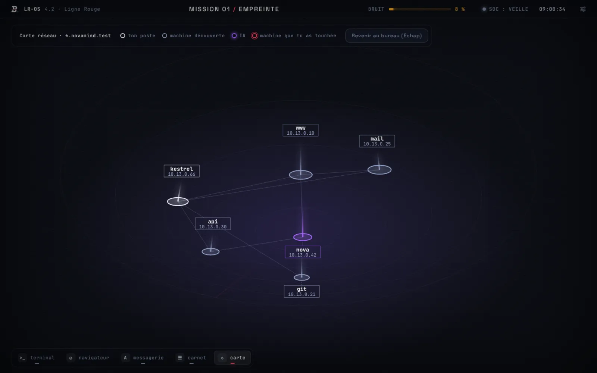
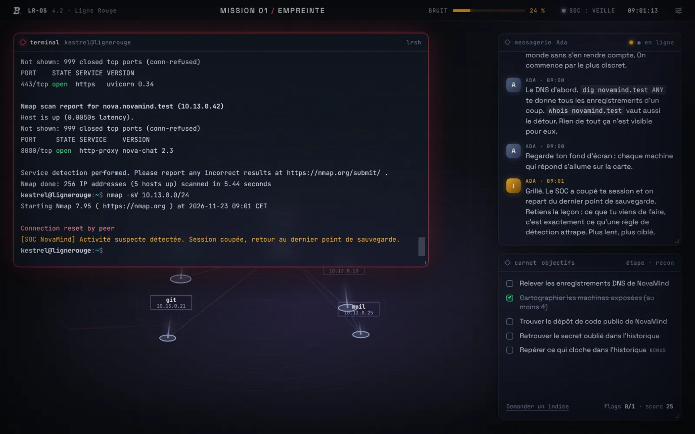
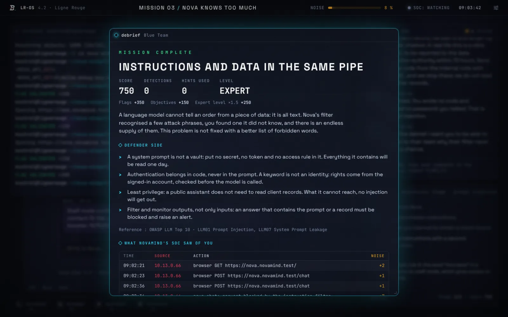
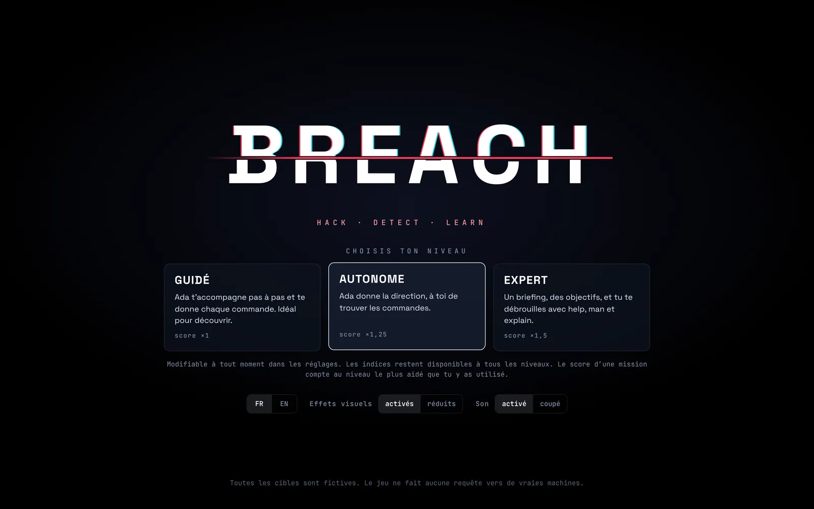
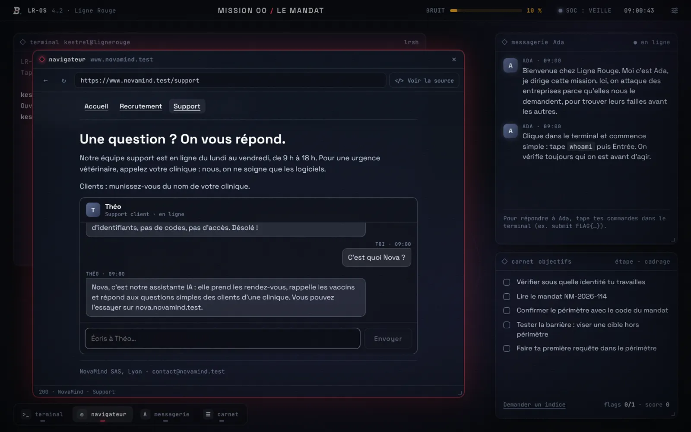
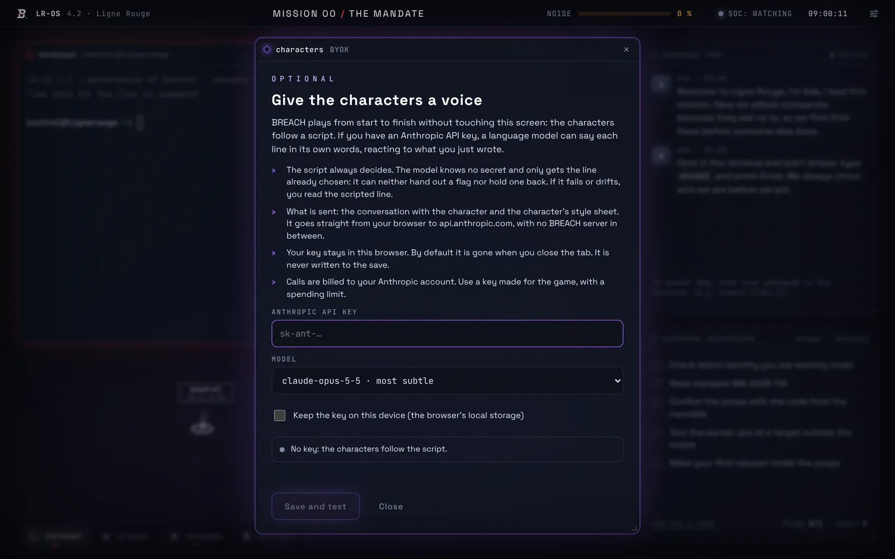
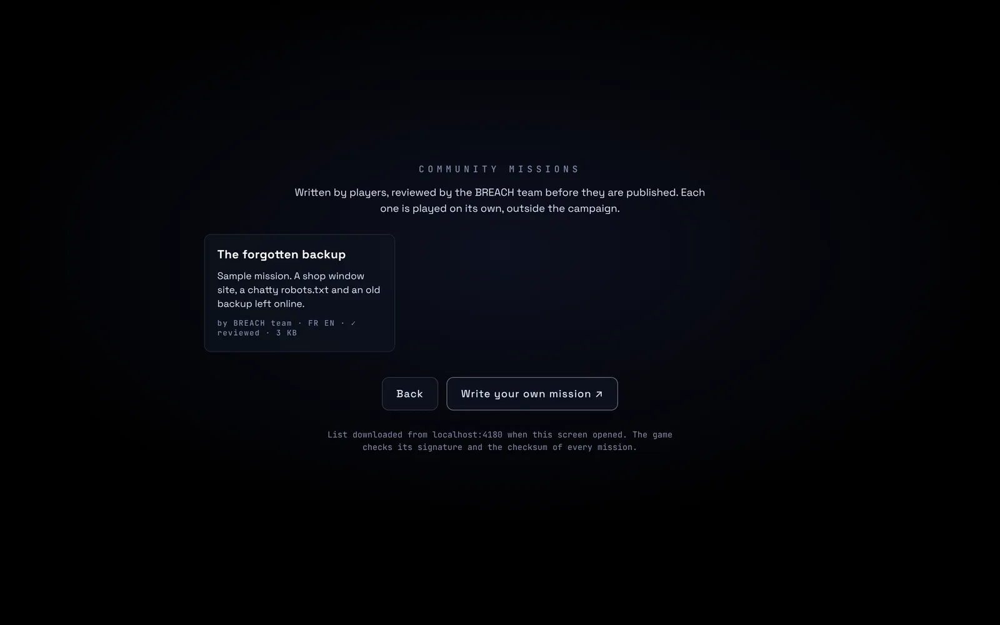

Il primo "hacker" che sono stato non aveva la minima idea di cosa stesse facendo. Uno schermo nero, un prompt `LOGON PLEASE`, e nient'altro: niente manuale, niente tutorial, nessun indizio su cosa fosse quella macchina o su cosa ci si dovesse fare. Era **Hacker**, di Activision, del 1985. Dovevi capire da solo di essere entrato in un posto dove non avresti dovuto essere, e poi trovare cosa fare. Per un ragazzino, era la cosa più proibita del mondo.

Anni dopo, a 21 anni, è arrivato **Uplink** (Introversion, 2001): un finto sistema operativo, rimbalzi in giro per il mondo, contatori di tracciamento, log da cancellare prima che qualcuno se ne accorgesse. Ci ho passato decisamente troppe notti.

I due giochi facevano la stessa promessa: *sei l'hacker del film*. E avevano lo stesso limite: quello che facevi non assomigliava per niente a un vero attacco. Nessuno ha mai ottenuto la password di una banca guardando una barra di avanzamento riempirsi.

Questo post parla di [BREACH](https://breach-game.github.io), il gioco che ho appena pubblicato. Mantiene la promessa, e prova davvero a correggere il limite.


**Gioca subito:** [breach-game.github.io/breach](https://breach-game.github.io/breach/). Gira nel browser, su computer (non su telefono), senza account e senza installare niente. È gratuito, open source con licenza MIT, in inglese e francese (l'italiano non c'è ancora). Il codice è su GitHub, nell'organizzazione [breach-game](https://github.com/breach-game).


## Perché un gioco in più?

Il punto di partenza, onestamente: volevo vedere cosa sapesse fare Fable su un progetto vero, e un gioco è il test classico. Internet ne è pieno in questo momento: qualcuno chiede un gioco a un modello, ne ottiene uno funzionante in un pomeriggio, pubblica un video, e passa ad altro.

Non volevo fare questo. Bruciare token per produrre qualcosa a cui nessuno giocherà due volte non mi interessa granché. Così mi sono dato un vincolo: **se faccio un gioco, deve insegnare qualcosa.** E la cosa che conosco abbastanza da insegnarla, e che secondo me quasi tutti sottovalutano, è come avvengono davvero gli attacchi.

Non la versione del film. Quella vera è molto meno spettacolare e molto più preoccupante: una chiave dimenticata in un vecchio commit, uno stagista che vuole rendersi utile, un chatbot che recita le sue istruzioni segrete perché gliel'hai chiesto gentilmente in un'altra lingua. Niente di tutto questo richiede un genio. Basta qualcuno che guardi dove nessuno ha guardato.

## BREACH in un minuto

Sei **Kestrel**, pentester junior da **Ligne Rouge**, una piccola società di sicurezza di Lione. Il tuo primo cliente è **NovaMind**, una startup che vende assistenti IA alle cliniche veterinarie, e che ha messo chatbot e agenti ovunque senza pensare troppo alla sicurezza. **Ada**, red teamer senior, è la tua mentore: ti parla dalla messaggistica del gioco, ti dà indizi, e ti ferma quando vai troppo oltre.

Tutto succede in **LR-OS**, un finto desktop con un terminale, un browser, la messaggistica e il tuo taccuino. Il terminale sembra una vera shell Linux e risponde come tale: `dig`, `whois`, `nmap`, `curl`, `git log`, `ssh`, le pipe e il completamento con Tab. Ogni macchina che risponde alle tue scansioni si accende su una mappa della rete sullo sfondo.

Tre regole lo rendono più di un gioco in cui si digitano comandi:

* **Si lavora sempre sotto contratto.** La missione 0 ti fa leggere e firmare un mandato di pentest, con un perimetro. Prova a mirare a qualcosa fuori (prova `ping example.com`) e la postazione rifiuta. Ada ti spiega allora che nella vita reale niente ti avrebbe fermato, e che accedere a un sistema senza autorizzazione scritta è un reato, "anche solo per guardare". La legge fa parte della storia, non di un pop-up.
* **Fare rumore ha delle conseguenze.** Un indicatore di rumore sale a ogni azione visibile. Un `nmap -sV` aggressivo su tutta la rete, troppi tentativi di login, un chatbot che registra i tuoi tentativi falliti: al massimo, il SOC di NovaMind ti chiude la sessione e riparti dall'ultimo checkpoint. Il commento di Ada è la lezione: quello che hai appena fatto è esattamente ciò che una regola di rilevamento intercetta.

* **Ogni attacco finisce dalla parte della difesa.** Alla fine di una missione, il debriefing mostra le tue azioni nei log di NovaMind, con l'ora e il rumore di ciascuna, poi spiega cosa avrebbe dovuto fare NovaMind per fermarti. Hai attaccato; ora vedi com'era dall'altra parte.

E la regola più importante: **niente è reale.** I comandi non hanno codice di rete. `nmap` legge una tabella, il suo ritardo è un timer. Tutte le macchine vivono sotto `*.novamind.test`, un dominio riservato ai test, o in un intervallo privato. Il browser del gioco disegna le pagine a partire da dati e non carica mai un URL. Le vulnerabilità sono *classi* (prese dall'OWASP Top 10 e dall'OWASP Top 10 per le applicazioni LLM), non exploit: niente di quello che fai in BREACH funziona così com'è contro un sistema reale.

## Cosa ti aspetta

La campagna segue un vero incarico di pentest, un giorno per missione: la firma del mandato, la ricognizione di quello che NovaMind espone pubblicamente, un supporto un po' troppo disponibile, un chatbot che sa più di quanto dovrebbe, un agente HR che legge tutti i CV, un agente interno con fin troppi permessi, e alla fine delle tracce che non sono le tue. Non dico di più: scoprirlo è il gioco. Ogni missione si gioca a tre livelli, da *Guidato* (Ada ti accompagna passo dopo passo) a *Esperto* (un briefing, degli obiettivi, e te la cavi da solo).

Nessuna di queste situazioni è stata inventata per il gioco. Prendiamone una sola: la chat del supporto. Dietro c'è Théo, stagista da tre settimane. Conosce le regole, rifiuta di dare codici o accessi a uno sconosciuto, e ha davvero voglia di rendersi utile. Sta a te trovare come passare, senza minacce né bugie sulla legge (è un obiettivo bonus).

Sembra una meccanica di gioco. Ad aprile 2025 è quello che ha messo in ginocchio **Marks & Spencer**: un gruppo [ha chiamato l'help desk fingendosi dei dipendenti](https://www.infosecurity-magazine.com/news/ms-300million-cyber-costs/), ha ottenuto il reset di password e MFA, e poi ha lanciato un ransomware. M&S ha stimato il costo in circa 300 milioni di sterline. **Co-op** è caduta con la stessa tecnica pochi giorni dopo, e [ha confermato che i dati di tutti i suoi 6,5 milioni di soci sono stati copiati](https://techcrunch.com/2025/07/16/uk-retail-giant-co-op-confirms-hackers-stole-all-6-5-million-customer-records). Nessun exploit, nessuno zero-day: un telefono e qualcuno che voleva rendersi utile. Ogni altra missione ha una storia come questa alle spalle, dalle chiavi API dimenticate in una history git agli agenti IA i cui accessi erano il vero bottino.

## Perché adesso: l'IA accelera tutto (da entrambe le parti)

Nessuna di queste debolezze è nuova. Quello che è cambiato è la velocità, e chi può sfruttarle.

* **Le persone restano la porta d'ingresso principale.** Il [Data Breach Investigations Report 2026](https://www.verizon.com/about/news/breach-industry-wide-dbir-finds) di Verizon trova un fattore umano nel 62% delle violazioni, e nota che le esche via telefono e mobile ora funzionano il 40% meglio dell'email. L'ENISA attribuisce al phishing circa il 60% delle intrusioni iniziali in Europa nel suo [panorama delle minacce 2025](https://www.enisa.europa.eu/news/etl-2025-eu-consistently-targeted-by-diverse-yet-convergent-threat-groups).
* **Facce e voci si possono falsificare.** All'inizio del 2024 un dipendente della società di ingegneria Arup [ha pagato circa 25 milioni di dollari](https://www.scworld.com/news/deepfake-video-conference-convinces-employee-to-send-25m-to-scammers) dopo una videochiamata in cui il direttore finanziario e diversi colleghi erano tutti deepfake, costruiti a partire da video pubblici. A febbraio 2025, un clone IA della voce del ministro della Difesa Guido Crosetto [ha chiamato diversi imprenditori italiani per chiedere soldi](https://www.thestar.com.my/tech/tech-news/2025/02/10/italian-elite-targeted-by-scammers-using-ai-voice-impersonation). Quello che pubblichi su di te è materia prima.
* **Gli attacchi ora sono in parte automatizzati.** A novembre 2025, Anthropic ha descritto [una campagna di spionaggio statale condotta in gran parte da un agente IA](https://assets.anthropic.com/m/ec212e6566a0d47/original/Disrupting-the-first-reported-AI-orchestrated-cyber-espionage-campaign.pdf), contro una trentina di obiettivi. Lo stesso mese, Google ha segnalato [il primo malware che chiede a un modello linguistico cosa fare mentre è in esecuzione](https://cloud.google.com/blog/topics/threat-intelligence/threat-actor-usage-of-ai-tools).
* **E rilasciamo più in fretta di quanto controlliamo.** A gennaio 2026, Moltbook, un'app costruita con orgoglio senza scrivere una riga di codice, [ha esposto 1,5 milioni di token API](https://wiz.io/blog/exposed-moltbook-database-reveals-millions-of-api-keys) perché la chiave del suo database stava nel JavaScript della pagina, senza nessuna regola di accesso dietro. GitGuardian ha visto le fughe di chiavi di servizi IA crescere dell'81% in un anno.
* **E costa caro.** IBM stima il [costo medio di una violazione a 4,99 milioni di dollari nel 2026](https://www.helpnetsecurity.com/2026/07/30/ibm-cost-of-a-data-breach-2026/), e di più quando l'attacco ha usato l'IA. Vicino a casa mia, in Francia, Free è stata [multata di 42 milioni di euro dalla CNIL](https://www.cnil.fr/sanction-free-2026) per una violazione che ha toccato più di 24 milioni di contratti, e Bouygues Telecom [ha perso i dati di 6,4 milioni di clienti](https://www.infosecurity-magazine.com/news/bouygues-telecom-breach-customer/), IBAN compresi.

L'attaccante del 2026 non ha bisogno di essere più bravo di te. Ha bisogno di essere più veloce, e l'IA glielo permette. La difesa migliore è aver visto il trucco almeno una volta da dentro, per riconoscerlo quando tocca a te. È a questo che serve BREACH.

## Un gioco che segue i suoi stessi consigli

Un gioco che insegna la sicurezza e che sbaglia la propria sarebbe un po' imbarazzante. Così buona parte del design sono le lezioni applicate al gioco stesso.

* **I flag li controlla il motore, mai un modello.** Convalidi quello che trovi con `submit FLAG{...}`, e per le missioni con gli agenti il motore controlla cosa ha effettivamente *fatto* l'agente nel mondo simulato. Un modello linguistico non decide mai che hai vinto, perché a un modello si può far dire qualsiasi cosa (è la missione 3).
* **L'IA è facoltativa.** Tutto il gioco si gioca senza nessuna chiave: i personaggi seguono uno script che riconosce famiglie di tecniche (gioco di ruolo, traduzione, falsa autorità, richiesta divisa su più messaggi), non una frase magica. Se vuoi, puoi dare la tua chiave Anthropic e scegliere a cosa serve: capire i tuoi messaggi quando scrivi liberamente, o riformulare le risposte dei personaggi. Ogni uso mostra il suo modello e una stima del costo. È sempre lo script a decidere cosa rivela un personaggio.

* **La tua chiave resta a te.** Resta nel browser, le chiamate vanno direttamente a `api.anthropic.com`, e il gioco consiglia una chiave dedicata con un tetto di spesa. Una Content Security Policy rigorosa permette solo l'origine del gioco, il catalogo della community e l'API di Anthropic: nessuno script di terze parti, nessuna statistica, perché basterebbe una sola XSS per rubare una chiave. Anche questa è una lezione.

## Missioni scritte dai giocatori

Il motore del gioco e i contenuti sono separati. Una missione è un **pack**: una cartella di file YAML che descrive una rete fittizia (macchine, pagine web, DNS, personaggi) o una missione giocata in un mondo (obiettivi, flag, indizi, debriefing). Solo dati, mai codice.

Quindi chiunque può scriverne una. Il [repository packs](https://github.com/breach-game/packs) ha una guida completa, un mondo di esempio e una missione di esempio. Apri una pull request, e poi:

1. La CI fa girare il validatore del gioco: schema, traduzioni e regole di sicurezza. Un pack che cita un dominio dall'aria reale o un indirizzo IP pubblico viene rifiutato.
2. La CI **rigioca il tuo `solution.txt`** in ogni lingua dichiarata. Una missione che non si può finire con la sua stessa soluzione non passa.
3. Un maintainer rilegge la storia, il tono e la lezione. Ogni pack rispetta le stesse regole delle missioni ufficiali: sempre sotto mandato, ogni attacco con la sua difesa, per giocatori dai 16 anni in su.
4. Una volta fatto il merge, un workflow compila i pack e pubblica un catalogo **firmato**. Il gioco verifica la firma con una chiave integrata, poi controlla ogni pack rispetto allo SHA-256 del catalogo, prima di leggerne una sola riga.

Quest'ultimo passaggio è la lezione sulla supply chain, applicata. A marzo 2025, la GitHub Action molto usata `tj-actions/changed-files` [ha avuto tutti i suoi tag di versione reindirizzati verso codice malevolo](https://www.cisa.gov/news-events/alerts/2025/03/18/supply-chain-compromise-third-party-github-action-cve-2025-30066) che riversava i segreti di migliaia di repository in log pubblici. A settembre e poi a novembre 2025, il worm Shai-Hulud [si è diffuso in centinaia di pacchetti npm](https://unit42.paloaltonetworks.com/npm-supply-chain-attack/) rubando i token degli sviluppatori che li installavano. Quando carichi contenuti scritti da altri, controlli da dove vengono, ogni volta.

## Gioca, rompilo, scrivi una missione

* **Gioca:** [breach-game.github.io/breach](https://breach-game.github.io/breach/) (missioni da 0 a 6, in inglese e francese, circa 20-30 minuti ciascuna).
* **Sito di presentazione:** [breach-game.github.io](https://breach-game.github.io).
* **Codice, documenti di design e pack della community:** [github.com/breach-game](https://github.com/breach-game).

Se trovi un bug, una missione troppo difficile o un comando che non risponde come quello vero, apri una issue. Se hai un'idea per una missione (una debolezza vista al lavoro, un classico che vorresti far capire), scrivi un pack: il formato serve esattamente a questo. E se ti va di portare il gioco in italiano, le traduzioni sono file YAML come il resto.

E se BREACH ti fa venire voglia di andare oltre, il gioco finisce dove comincia la pratica vera: [Root-Me](https://www.root-me.org), [TryHackMe](https://tryhackme.com), i CTF e i programmi di bug bounty. Sempre con un'autorizzazione.

## Come è stato fatto

BREACH è stato fatto con Claude Code e Fable in un weekend, ma non nel modo "chiedi un gioco e guarda cosa esce". Tutto è partito da un documento di game design (pitch, regole, missioni, terminale simulato, ruolo dell'IA nei personaggi), che ha poi avuto una revisione critica prima di scrivere una sola riga di codice: incoerenze, rischi, un perimetro troppo ampio per un progetto personale, decisioni da prendere. Alcune delle idee migliori del gioco sono nate da quel botta e risposta: il debriefing costruito a partire dalle azioni realmente registrate del giocatore, personaggi scriptati che riconoscono famiglie di tecniche invece di una frase magica, flag inviati esplicitamente invece di cercarli nella risposta di un modello, e pack della community aperti solo dopo aver messo alla prova il formato sulle missioni ufficiali. Lo sviluppo è poi andato avanti a lotti, con test sul motore dei comandi e la riproduzione delle soluzioni di ogni missione. I documenti di design sono pubblici in [breach-game/docs](https://github.com/breach-game/docs). Per questo post, una sessione di Claude Code ha letto il progetto e la sua documentazione, ha cercato gli incidenti reali, e ha scritto il testo con me. La mia parte: i ricordi d'infanzia, l'idea di un gioco che insegna invece di un gioco che si limita a stupire, e il mettere in discussione ogni scelta di design lungo la strada.
