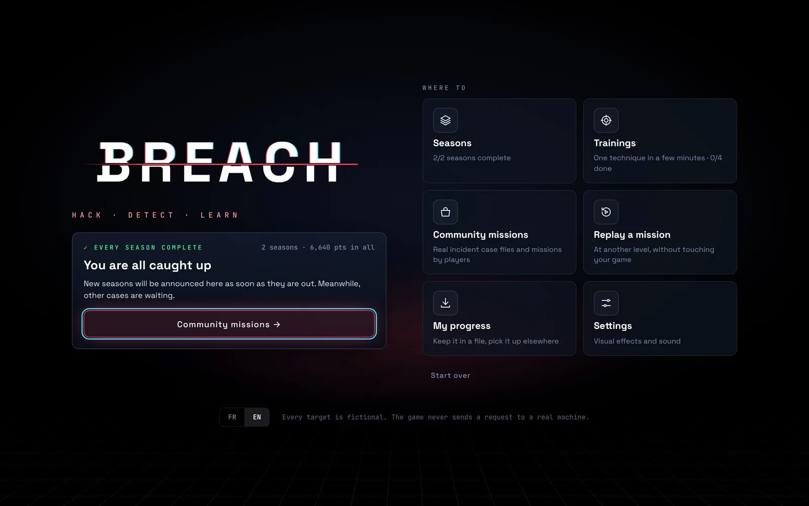
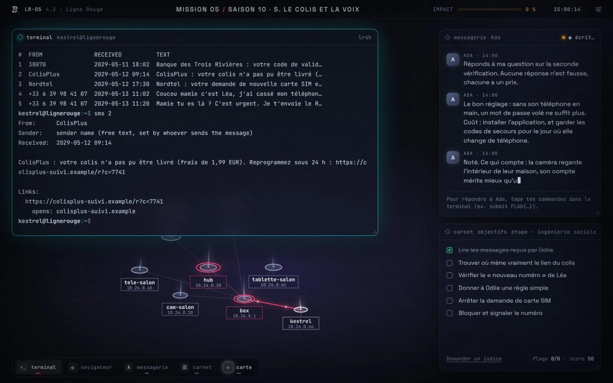
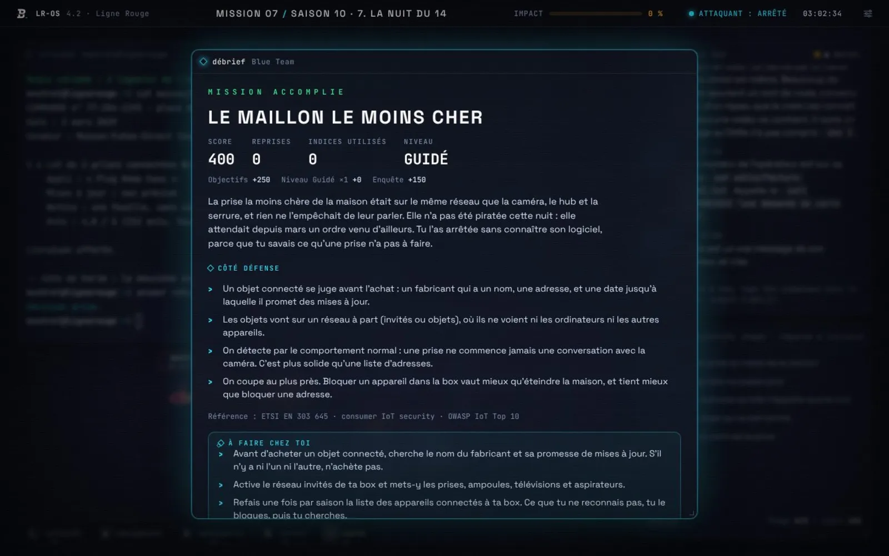
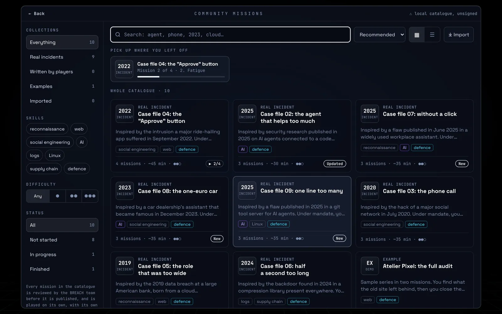
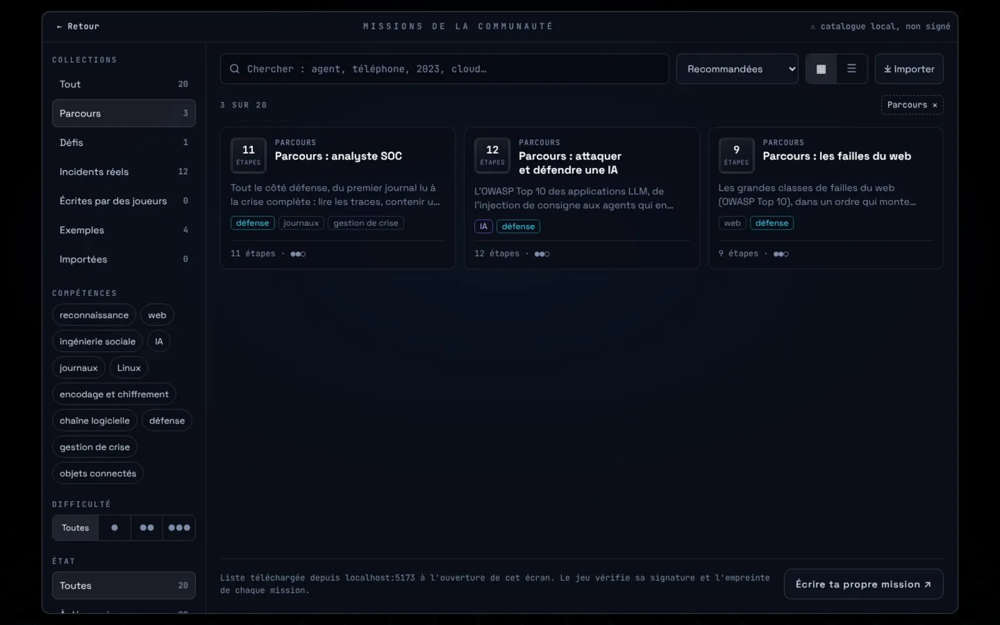

Una settimana fa vi ho parlato di [BREACH](/it/breach-un-nuovo-gioco-di-hacking/), il gioco di hacking che ho fatto per mostrare quanto sono diventati facili gli attacchi veri: una chiave dimenticata in una history git, uno stagista che vuole rendersi utile, un chatbot che recita le sue istruzioni segrete se glielo chiedi gentilmente. All'epoca era una campagna di sette missioni, tutte da NovaMind, la startup piena di agenti IA.

Non è più proprio lo stesso gioco. Mi sono detto "dai, solo un'altra missione" un certo numero di volte, e una settimana dopo la schermata iniziale è così.

Non racconterò tutto (e continuo a non dare nessuna soluzione). Ecco i tre cambiamenti che, secondo me, meritano un secondo sguardo.

## Cosa è cambiato, in numeri

| | Una settimana fa | Oggi |
| --- | --- | --- |
| Campagna principale | 7 missioni | 10, le ultime tre dalla parte della difesa |
| Stagioni | nessuna | altre 11, circa 50 missioni |
| Allenamenti | nessuno | 15 missioni brevi, una tecnica ciascuna |
| Missioni della community | 1 esempio | 46 casi, 15 serie speciali, 11 sfide, 6 percorsi |

È cambiato anche il debriefing. Prima spiegava come difendersi. Ora **rigiochi la difesa**: ritrovi le tue righe nei log, scegli la regola di rilevamento che ti avrebbe beccato, scrivi la correzione, e il gioco rilancia il tuo attacco contro di essa per verificare che fallisca davvero. E in più una piccola carriera: più giochi in autonomia, più fai carriera da Ligne Rouge (con una scrivania più bella, che ovviamente è la motivazione principale).

Le stagioni ora vanno ben oltre l'IA: una catena di build e la dependency confusion, le classiche vulnerabilità web, la risposta a un ransomware in un municipio, un account cloud, un programma di bug bounty, una fattoria verticale con quaranta sensori, l'API di una neobanca, e un finale in cui l'intruso che insegui dal primo giorno attacca la tua stessa società.

## Stagione 10: la casa

È quella di cui vado più fiero, perché è quella che parla a tutti, non solo a chi lavora nell'informatica.

Niente azienda questa volta. Élise ti invita per un weekend perché vorrebbe sapere chi guarda dentro casa sua. Sei dalla parte della difesa, con il consenso della famiglia: il router e la sua lista di dispositivi, il Wi-Fi, una telecamera in salotto, un hub domotico, lampadine e una serratura connesse, il telefono della nonna e gli account di tutti.

Se avete dei genitori, questi messaggi li avete probabilmente già visti. Un pacco bloccato per 1,99 €, un "nuovo numero" di un nipote che ha bisogno di soldi con urgenza, un codice bancario che nessuno ha chiesto. Nel gioco come nella vita vera non sono sofisticati. Funzionano perché arrivano al momento giusto, e perché nessuno ha detto alla nonna che aveva il diritto di riattaccare e richiamare.

La parte che preferisco è la fine di ogni debriefing: una scheda **"Da fare a casa"**. Non una predica, tre o quattro cose da fare la sera stessa sul tuo router, sulla tua telecamera, sul telefono dei tuoi genitori.

## Stagione 12: il prototipo

Nel primo articolo parlavo di Moltbook, l'app "costruita senza scrivere una riga di codice" che ha esposto 1,5 milioni di token. È diventata una stagione.

Tre volontari scrivono in un weekend, con un assistente di codice, un'app di aiuto tra vicini di casa, e quattrocento persone si iscrivono. Il tuo compito: una settimana di audit su quello che l'assistente ha fatto in fretta e che nessuno ha riletto. Poi rileggi il codice generato, scrivi le regole che mancavano, e avvisi i vicini, con i fatti di una vera vulnerabilità che ha colpito app costruite esattamente così nel 2025.

La trovo giusta, questa stagione. Costruisco cose con agenti di codice tutti i giorni, e ricorda che "funziona" e "è sicuro" sono due revisioni diverse.

## Quarantasei casi, quarantasei storie vere

Nel primo articolo, ogni missione era collegata a un incidente vero nel testo. Ora è il contrario: intere serie sono costruite *a partire* da incidenti veri.

I **casi** dello store della community sono brevi serie da due a quattro missioni, ognuna ispirata a un incidente documentato pubblicamente, giocata in un'azienda fittizia perché resti un gioco, e chiusa da una scheda con le fonti che racconta cosa è successo davvero. Alcuni vi diranno qualcosa: Log4Shell, Heartbleed, MOVEit, Equifax, Colonial Pipeline, la videochiamata deepfake di Arup, il blackout mondiale di luglio 2024, la GitHub Action tj-actions. Altri sono meno famosi e altrettanto istruttivi.

Accanto ci sono **serie speciali** su situazioni di tutti i giorni (un badge perso, il Wi-Fi pubblico in viaggio, un adesivo con un QR code su un parchimetro, uno strumento IA usato senza che nessuno lo sappia), **sfide** che si giocano solo in modalità Esperto, e **percorsi** che mettono in fila delle missioni attorno a un tema: mettere in sicurezza la propria casa, l'OWASP Top 10 per le applicazioni LLM, una giornata da analista SOC, i primi passi.

## L'unica cosa che manca: tu

Ecco la parte onesta. Tutte queste missioni della community le ho scritte io. Lo store è pieno, il validatore, la riproduzione delle soluzioni e il catalogo firmato funzionano, c'è un kit per autori e un mondo di esempio. Quello che manca ancora è una missione scritta da **qualcun altro**.

Quindi se al lavoro hai visto una debolezza che tutti dovrebbero capire, o se una notizia ti ha fatto pensare "la gente capirebbe se ci giocasse", il [repository packs](https://github.com/breach-game/packs) spiega come scriverne una. È YAML, niente codice, e il gioco può importare una missione da un file per provarla prima di aprire una pull request. E se ti va di portare il gioco in italiano, le traduzioni sono file YAML come il resto. La prima missione arrivata da fuori avrà una menzione come si deve qui.

* **Gioca:** [breach-game.github.io/breach](https://breach-game.github.io/breach/) (inglese e francese, gratis, senza account).
* **Sito di presentazione:** [breach-game.github.io](https://breach-game.github.io).
* **Codice e pack:** [github.com/breach-game](https://github.com/breach-game).

E se questo weekend hai solo venti minuti, gioca la stagione 10. Poi vai a guardare la lista dei dispositivi collegati al tuo router. Probabilmente troverai una presa che avevi dimenticato.
