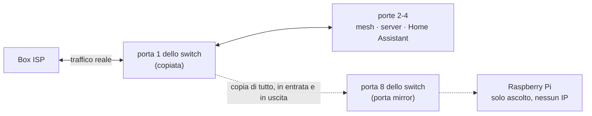
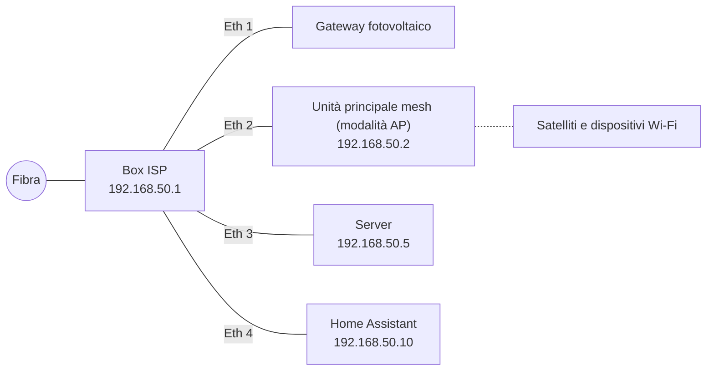
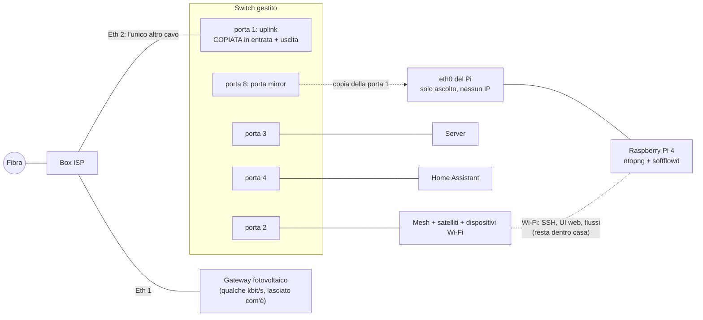
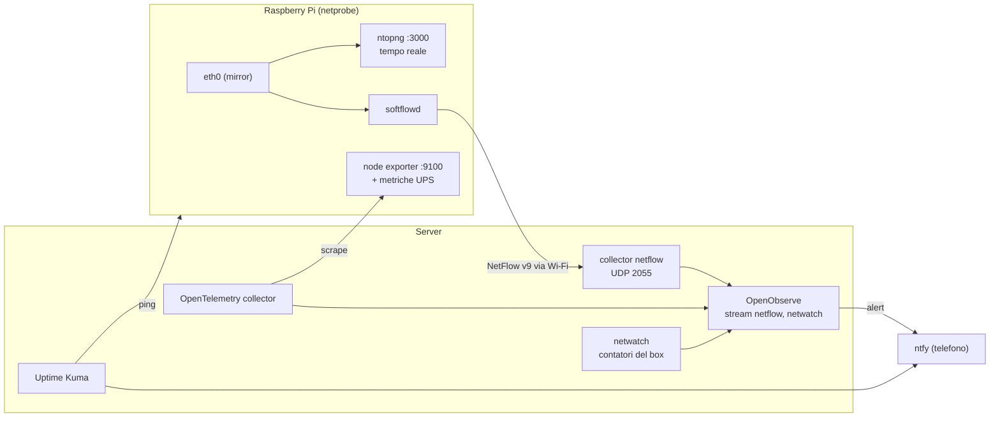
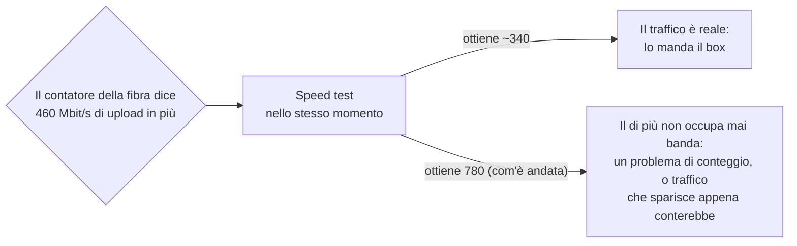

Nell'[articolo precedente](/it/hai-provato-a-spegnere-e-riaccendere-monitorare-la-rete-di-casa/) ho raccontato del reset che ha "sistemato" il Wi-Fi e che, strada facendo, ha fatto sparire dai contatori del box ISP **da 2 a 3 TB al giorno di traffico misterioso**. L'avevo chiuso con un nuovo monitor in Uptime Kuma, "traffico internet normale", e con la sensazione un po' compiaciuta che adesso me ne sarei accorto se fosse tornato.

È tornato la mattina dopo.

Non con un salto, ma con una salita lenta: circa 1 Mbit/s subito dopo il reset, 10 nel pomeriggio, da 30 a 90 la sera, 60 in download e 120 in upload la mattina seguente. Di nuovo l'upload più alto del download, per tutta la notte. E questa volta avevo molti più dati della prima. Con Claude che leggeva OpenObserve tramite MCP, ho potuto escludere il server (tutta la sua scheda di rete muoveva 0,14 Mbit/s in download e 0,34 in upload), Plex (interrogato direttamente tramite la sua API: nessuno stream, nessuna transcodifica) e ogni container. Quello a cui non riuscivo a rispondere era l'unica domanda che contava: **se non è il server, chi è?**

Ogni numero che avevo era **per porta**, mai **per dispositivo**. Per sapere chi parla con chi, bisogna guardare i pacchetti. Questo articolo racconta come l'ho fatto senza toccare la configurazione della rete, con uno switch da 30 euro e un Raspberry Pi che avevo già in un cassetto, e come si inserisce nel setup di Uptime Kuma e OpenObserve della volta scorsa.


**Tutto in questo articolo è pseudonimizzato,** come l'altra volta e con gli stessi nomi finti: la LAN è `192.168.50.0/24`, il box ISP è `.1`, l'unità principale mesh `.2`, il server `.5`, Home Assistant `.10`. Il prefisso IPv6 viene dall'intervallo riservato alla documentazione, e i nomi dei dispositivi sono inventati. I **modelli hardware** (switch, Pi, scheda UPS) sono quelli reali, perché sono la parte che potresti voler copiare. Volumi di traffico, velocità e orari sono le misure reali.


## Cosa riuscivo già a vedere, e cosa no

Dopo la prima indagine avevo aggiunto un'altra fonte: `netwatch` (il watcher DHCP dell'articolo precedente) ora fa anche il login sull'API locale del box ISP ogni 20 secondi e legge i contatori di byte di ciascuna delle sue porte: la fibra, le quattro porte Ethernet e il suo Wi-Fi. Questo mi dava il seguente quadro:

| Fonte | Risponde a | Non risponde a |
|---|---|---|
| Box ISP, contatore della fibra | Quanto passa sulla fibra | Chi |
| Box ISP, contatori per porta | Quale **porta** del box lo trasporta | Quale dispositivo dietro la mesh su quella porta, e dove va |
| Scheda di rete del server, metriche dei container | Se la sorgente è il server | Niente sugli altri 70 dispositivi |
| Home Assistant (integrazione della mesh) | Quale dispositivo è su quale access point, il suo segnale | Quanto trasferisce |

E quel quadro era molto strano: la fibra trasportava decine di Mbit/s, a volte più di 300, mentre **tutte le porte LAN del box insieme restavano sotto i 7 Mbit/s** e il suo Wi-Fi a zero. O il traffico nasceva dentro il box stesso, o i contatori delle porte del box mentivano (alcuni box ISP inoltrano il traffico in hardware senza contarlo sulle porte LAN). C'è un solo modo per distinguere le due spiegazioni: **mettere sul cavo qualcosa che conti per conto suo.**

### Le opzioni che ho considerato

*   **Staccare le cose una alla volta e guardare il grafico.** Gratis, e funziona se il colpevole è evidente. Ma il traffico arrivava a raffiche, avrebbe lasciato la casa senza rete a ogni test, e non ti dice *dove* va il traffico.
*   **La UI del box ISP.** La mia mostra un elenco di dispositivi, non il traffico per dispositivo.
*   **ARP spoofing** da un Pi o dal server, per far passare da lì il traffico di ogni dispositivo. Non richiede hardware, ma no: funziona solo in IPv4 (il mio ISP fornisce anche IPv6, che lo aggirerebbe), mette un Pi sul percorso di tutta la casa, e non vede il traffico generato dal box stesso, che era uno dei due sospettati.
*   **Un bridge in linea**: un Pi con due porte Ethernet sul cavo. Stessa visibilità di un mirror, ma se il Pi si blocca, la casa resta offline.
*   **Port mirroring.** Uno switch copia tutto il traffico di una porta su un'altra porta, dove un dispositivo di cattura ascolta. Il dispositivo di cattura non è sul percorso: se va in crash, nessuno se ne accorge. Niente sulla rete cambia indirizzo o configurazione. È quello che ho scelto.

## Il port mirroring in un'immagine

A uno switch gestito si può dire: "ogni frame che entra o esce dalla porta 1, mandane una copia anche dalla porta 8". Il dispositivo sulla porta 8 riceve traffico che non è indirizzato a lui; ascolta soltanto, non risponde mai, e su quella porta non ha nemmeno bisogno di un indirizzo IP.



Il trucco è scegliere **quale** porta copiare. Se la porta 1 è l'**unico** cavo tra la casa e il box ISP, allora ogni byte tra qualsiasi dispositivo di casa e internet ci passa, e il Pi ne riceve una copia completa, IPv4 e IPv6, cablato e Wi-Fi. Il traffico che resta dentro casa (un telefono che guarda Plex dal server, Home Assistant che parla con il server) viene commutato localmente e non attraversa mai la porta 1, ed è esattamente quello che vuoi: meno roba da elaborare, e comunque non ha niente a che fare con la bolletta internet.

## L'hardware

### Uno switch capace di fare mirroring (questa è la parte importante)

**Non tutti i dispositivi sanno copiare una porta, e quello che hai già probabilmente non ne è capace.** Il mio box ISP no. Neanche la mia mesh, e in modalità access point comunque non servirebbe. Gli switch non gestiti non possono farlo per definizione: non hanno alcuna configurazione. Serve uno switch **gestito** o **"smart"**, e la funzione di solito si chiama *Port Mirroring*, a volte *SPAN* o *Monitor port*. Controlla la scheda tecnica prima di comprare.

Io ho usato un **TP-Link TL-SG608E**: 8 porte Gigabit, senza ventola, circa 3 W, sui 30 euro, della gamma "Easy Smart" di TP-Link, che supporta il port mirroring dalla sua UI web. La **E** finale conta: il TL-SG108 e il TL-SG105 senza la E sembrano identici ma non sono gestiti, quindi non possono fare mirroring. Il TL-SG605E da 5 porte può fare lo stesso lavoro se conti bene le porte: uplink, mesh, server, Home Assistant e porta mirror ne occupano esattamente cinque, e non ti resta niente per altro. Io ho preso quello da 8.

### Un Raspberry Pi 4 o più recente

Il Pi fa tre cose: riceve la copia, la mostra in tempo reale (ntopng) e la riassume in record di flusso per OpenObserve (softflowd). Il modello conta più di quanto sembri:

| Modello | Utilizzabile? | Perché |
|---|---|---|
| **Pi 5** | sì | Il margine più ampio |
| **Pi 4** | **sì** | La sua Ethernet integrata è un **vero Gigabit** su un controller dedicato, ha USB 3, quattro core a 64 bit, e l'immagine di ntopng ci gira. 4 GB sono comodi, 2 GB bastano per una casa |
| Pi 3 B+ | no | La sua porta "Gigabit" passa per l'USB 2, quindi in pratica circa 300 Mbit/s: perderebbe la maggior parte della copia durante qualsiasi download grosso |
| Pi 1, 2, 3 B | no | Ethernet a 100 Mbit/s, e i più vecchi non fanno girare software a 64 bit |

**Il Gigabit qui non è un lusso.** La mia fibra è 1 Gbit/s in download *e* 1 Gbit/s in upload. La porta mirror riceve la copia di entrambe le direzioni su un solo cavo, e la scheda del Pi deve starle dietro. Una porta di cattura a 100 Mbit/s scarterebbe in silenzio la maggior parte della copia appena qualcuno scarica un gioco, e concluderesti che non è successo niente. (Anche con il Gigabit c'è un limite fisico, ne parlo nella sezione sui limiti.)

La seconda cosa importante è che **il Pi ha bisogno di due interfacce di rete**. La porta Ethernet collegata alla porta mirror ascolta e basta: non ha indirizzo e non deve mai inviare niente. Quindi serve qualcos'altro per SSH, la pagina web di ntopng e i record di flusso inviati al server. Su un Pi 4 è gratis: **il suo Wi-Fi**. Il traffico di gestione fa Pi → mesh → switch → server e resta dentro casa, quindi non attraversa mai la porta copiata e non sporca mai la misura. È leggero (una sessione SSH, una pagina web, qualche kbit/s di record di flusso), e se il Wi-Fi cade per un attimo la cattura continua; si fermano solo la UI e l'export. Se preferisci un cavo, un adattatore USB 3 Gigabit su una porta libera dello switch fa lo stesso lavoro.

Il mio è il Pi 4 (4 GB) su cui girava Home Assistant prima che si spostasse su una macchina sua, con quello che aveva già: una scheda **Geekworm X857** con un SSD mSATA da 128 GB (il Pi fa il boot da lì, che sopporta le scritture continue molto meglio di una scheda SD) e un hat UPS **Geekworm X708** con celle 18650. L'UPS è facoltativo. Il suo unico vero vantaggio: in caso di blackout, il Pi si spegne in modo pulito invece di corrompere il disco.

### Lista della spesa

| Oggetto | Note |
|---|---|
| Switch gestito con port mirroring | Qui un TL-SG608E; va bene qualsiasi switch la cui scheda tecnica dica "port mirroring" |
| Raspberry Pi 4 (2 GB+) o Pi 5 | Serve un sistema operativo a 64 bit |
| Alimentatore ufficiale | 15 W per un Pi 4, 27 W per un Pi 5; entrambi sono schizzinosi |
| SSD su USB 3 o una buona microSD A2 | Un SSD dura di più con le scritture continue di ntopng |
| Case con ventola, o dissipatori | ntopng tiene la CPU occupata |
| Cavi patch **Cat 5e o Cat 6** | Controllali. Ne parlo più sotto |
| *Facoltativo:* adattatore USB 3 Gigabit | Solo se non vuoi gestire il Pi via Wi-Fi |

## Il cablaggio

Prima, il server e Home Assistant erano collegati direttamente al box ISP, accanto alla mesh. È la configurazione domestica più comune, e la trappola è che **copiare il cavo tra box e mesh mostrerebbe solo i dispositivi Wi-Fi**: il server e Home Assistant non ci passerebbero mai.



Dopo, **lo switch è l'unico cavo verso il box ISP**, e tutto si collega allo switch:



| Porta dello switch | Va a | Ruolo |
|---|---|---|
| 1 | Box ISP, Ethernet 2 | Uplink, **copiata** |
| 2 | Unità principale mesh (la sua porta WAN, come prima) | |
| 3 | Server | |
| 4 | Home Assistant | |
| 5, 6, 7 | libere | Qualsiasi cosa cablata in futuro (o l'adattatore USB del Pi) |
| 8 | Pi, porta Ethernet **integrata** | Porta mirror: riceve la copia |

Niente cambia indirizzo: il box ISP distribuisce gli stessi IP di prima, e le prenotazioni DHCP restano valide. Ricablare costa cinque minuti senza internet. Per non creare mai un loop, fallo in quest'ordine: stacca dal box la mesh, il server e Home Assistant; collegali alle porte 2, 3 e 4; poi collega la porta 1 al box. Controlla che un telefono abbia internet e che il server risponda.


**Controlla la velocità del link, non solo la spia.** Il primo cavo che ho usato tra lo switch e il Pi negoziava a **100 Mbit/s**. Entrambe le estremità annunciavano solo 10/100: il cavo aveva due coppie funzionanti su quattro, che bastano per il Fast Ethernet ma non per il Gigabit. Tutto "funzionava", e il Pi avrebbe perso in silenzio la copia sopra i 100 Mbit/s. `sudo ethtool eth0 | grep Speed` sul Pi deve dire `1000Mb/s`. Un cavo Cat 6 ha risolto.


## Configurare lo switch

Gli switch Easy Smart hanno una piccola UI web. I passaggi, prima di ricablare qualsiasi cosa:

1.  **Primo login.** Collega allo switch solo un portatile. Senza un server DHCP nei paraggi, lo switch ripiega su `192.168.0.1`: dai al portatile un indirizzo fisso come `192.168.0.10/24` e apri `http://192.168.0.1`. Il login di default è `admin`/`admin`, e ti obbliga subito a impostare una nuova password. Mettila nel tuo password manager.
2.  **Impostazione IP.** Lascia attivo il DHCP (il default). Una volta sulla LAN, riceve un indirizzo dal box ISP; prenotagliene uno lì (il mio è `192.168.50.3`), così lo ritrovi in seguito.
3.  **Monitoring → Port Mirror.** Attiva il mirroring, **mirroring port = 8**, e per la **porta 1** imposta sia **Ingress** sia **Egress** su *Enable*. Lascia disattivate tutte le altre porte. Applica.
4.  Lascia il resto ai valori di default: niente VLAN, niente QoS. La prevenzione dei loop attiva va benissimo.

Tre cose che mi hanno sorpreso:

*   **Il mirroring era disattivato di fabbrica**, anche se ero convinto di averlo impostato. Dopo il ricablaggio, il Pi vedeva solo i broadcast. Rileggi sempre l'impostazione dopo averla applicata.
*   **Non c'è un pulsante "Salva".** Gli switch Easy Smart applicano e conservano le modifiche immediatamente.
*   **La pagina Firmware Upgrade ha un pulsante "Ready" che sembra indicare un aggiornamento in attesa.** Non è così. Riavvia lo switch in una modalità di upload che aspetta un file firmware che hai scaricato tu, e **mentre aspetta, lo switch non fa passare traffico**: tutta la casa va offline. Il mio ha già l'unico firmware che TP-Link pubblica per la sua versione hardware. Controlla la pagina di download del produttore, e premilo solo con un file in mano.

## Preparare il Pi

### Il sistema

Con **Raspberry Pi Imager**, scrivi **Raspberry Pi OS Lite (64-bit)**. Nelle impostazioni dell'Imager: un hostname (il mio è `netprobe`), il tuo utente, **SSH solo con la tua chiave pubblica**, il fuso orario e la tua rete **Wi-Fi**. Avvialo **senza il cavo Ethernet**, vicino a un'unità della mesh, prenota il suo indirizzo Wi-Fi nel box ISP (il mio è `192.168.50.30`), poi:

```bash
sudo apt update && sudo apt full-upgrade -y
sudo apt install -y unattended-upgrades tcpdump ethtool
ip -br link   # eth0 = integrata (il mirror), wlan0 = Wi-Fi (gestione)

# Il risparmio energetico del Wi-Fi fa cadere ogni tanto SSH e l'export dei flussi: disattivalo
sudo nmcli con mod "$(nmcli -g NAME,TYPE con show --active | grep wireless | cut -d: -f1)" \
  802-11-wireless.powersave 2
```

Se hai un SSD, è il momento di spostarci il sistema e impostare l'ordine di boot (`rpi-eeprom-config`, `BOOT_ORDER=0xf14`: prima USB, poi la scheda SD).

### L'interfaccia in solo ascolto

Questa è la parte chiave della configurazione del Pi. `eth0` deve attivarsi, accettare ogni frame (modalità promiscua, perché i frame copiati non sono indirizzati al Pi) e non avere **nessun indirizzo proprio**, né IPv4 né IPv6, così da non inviare mai un singolo pacchetto sulla porta mirror:

```bash
# Un profilo NetworkManager senza alcun IPv4 né IPv6
sudo nmcli con add type ethernet ifname eth0 con-name mirror \
  ipv4.method disabled ipv6.method disabled
sudo nmcli con up mirror

# Cintura e bretelle: niente nemmeno indirizzo IPv6 link-local
echo "net.ipv6.conf.eth0.disable_ipv6 = 1" | sudo tee /etc/sysctl.d/90-mirror-eth0.conf

# Modalità promiscua a ogni boot
echo 'ACTION=="add", SUBSYSTEM=="net", KERNEL=="eth0", RUN+="/usr/sbin/ip link set eth0 promisc on"' \
  | sudo tee /etc/udev/rules.d/90-mirror-promisc.rules
sudo ip link set eth0 promisc on
```

Ora collega `eth0` alla porta 8 dello switch e verifica che la copia arrivi:

```bash
sudo ethtool eth0 | grep -E 'Speed|Duplex'   # 1000Mb/s, Full
sudo tcpdump -ni eth0 -c 20                  # traffico di ALTRI dispositivi, non solo del Pi
```

Se `tcpdump` mostra solo broadcast (ARP, DHCP, mDNS), il mirroring sullo switch non è attivo.

### ntopng, la vista in tempo reale

L'attuale Raspberry Pi OS è basato su Debian 13, che non include più ntopng. ntop pubblica un'**immagine Docker ARM64** ufficiale con build settimanali e Redis incluso. Lo faccio girare con un piccolo file compose:

```yaml
services:
  ntopng:
    image: ntop/ntopng_arm64.dev:latest
    container_name: ntopng
    restart: unless-stopped
    network_mode: host          # deve vedere eth0 direttamente
    cap_add: [NET_ADMIN, NET_RAW]
    volumes:
      - ntopng-data:/var/lib/ntopng   # serie temporali
      - ntopng-redis:/var/lib/redis   # utenti e preferenze (!)
    command:
      - -i
      - eth0                    # la porta mirror
      - -w
      - "3000"
      - --community             # l'edizione gratuita
      - --local-networks
      - 192.168.50.0/24,2001:db8:50::/64   # cosa significa "casa", IPv4 e IPv6
      - -n
      - "1"                     # dà un nome agli host locali da DHCP e mDNS

volumes:
  ntopng-data: { external: true }
  ntopng-redis: { external: true }
```

```bash
sudo apt install -y docker.io docker-compose && sudo usermod -aG docker "$USER"   # esci e rientra
docker volume create ntopng-data && docker volume create ntopng-redis
docker-compose up -d
```

**Il secondo volume è quello che tutti dimenticano.** ntopng tiene utenti e preferenze nel suo Redis. La mia prima versione rendeva persistenti solo le serie temporali, il che significava che al successivo aggiornamento dell'immagine si sarebbe azzerato tutto, password di amministratore compresa, tornando a `admin`/`admin`.

Apri `http://192.168.50.30:3000`, fai il login con `admin`/`admin`, imposta una password vera. Poi quattro preferenze che contano per un mirror:

| Impostazione | Valore | Perché |
|---|---|---|
| Interface → **Mirrored Traffic** | on | La porta mirror riceve soltanto. Senza questa opzione, ntopng si lamenta di "RX only traffic" e interpreta male le connessioni |
| **DHCP range** | `192.168.50.2-192.168.50.199` | Dice a ntopng quali indirizzi vengono assegnati dinamicamente |
| **Local broadcast domain hosts identifier** | MAC address | I dispositivi mantengono il loro storico quando cambia il loro indirizzo DHCP. Funziona perché, con la mesh in modalità AP e il box come unico router, il cavo copiato porta i veri indirizzi MAC dei dispositivi |
| **Speed** dell'interfaccia | 1000 | Per i grafici di utilizzo |

Si trovano nella UI, oppure direttamente in Redis: `docker exec ntopng redis-cli set ntopng.prefs.ifid_0.is_traffic_mirrored 1`, poi `redis-cli save` e un riavvio. ntopng suggerirà anche di configurare le "Emergency notifications": l'ho ignorato, perché gli alert passano già da OpenObserve e ntfy, e un secondo sistema di alerting sopra aggiunge soprattutto rumore.


**Il Pi vede tutto ciò che attraversa l'uplink in chiaro:** nomi DNS, HTTP semplice, quale dispositivo parla con quale servizio e quando. Trattalo come la macchina più sensibile della casa. Solo chiavi SSH, aggiornamenti automatici, ntopng mai pubblicato attraverso il tunnel, e un firewall. Una security review automatica ha scoperto che la porta di ntopng rispondeva su **tutti** gli indirizzi del Pi, **compreso il suo indirizzo IPv6 pubblico**, con davanti solo il firewall IPv6 del box ISP. Ora una tabella nftables lascia raggiungere la porta 3000 solo alla rete IPv4 di casa e la porta delle metriche solo al server, e le blocca entrambe in IPv6. E poi: su quel cavo ci sono anche le persone con cui vivi. Diglielo.


```nft
table inet netprobe {
  chain input {
    type filter hook input priority filter; policy accept;
    tcp dport 9100 ip saddr 192.168.50.5 accept      # node exporter: solo il server
    tcp dport 9100 iifname "lo" accept
    tcp dport 9100 drop
    tcp dport 3000 ip saddr 192.168.50.0/24 accept   # ntopng: solo IPv4 di casa
    tcp dport 3000 iifname "lo" accept
    tcp dport 3000 drop                              # anche in IPv6
  }
}
```

È una tabella a sé, senza `flush ruleset`, quindi le regole che aggiunge Docker restano intatte.

### softflowd, per lo storico in OpenObserve

L'edizione gratuita di ntopng è ottima in tempo reale, e conserva poco storico. Per "cosa è successo martedì scorso alle 3 di notte", accanto a tutto il resto in OpenObserve, il Pi riassume anche la copia in record **NetFlow** con [softflowd](https://github.com/irino/softflowd): un record per connessione, con indirizzi, porte, protocollo, byte e pacchetti, ogni minuto per le connessioni lunghe.

```bash
sudo apt install -y softflowd
sudo tee /etc/softflowd/default.conf >/dev/null <<'EOF'
interface=eth0
options=-n 192.168.50.5:2055 -v 9 -t maxlife=60 -T full
EOF
sudo systemctl enable --now softflowd@default
```

Sul server non mi è servito un nuovo strumento: l'**OpenTelemetry Collector** ha un receiver `netflow`. Un container collector dedicato ascolta su UDP 2055 e scrive ogni flusso come record di log in uno stream `netflow` di OpenObserve, conservato 30 giorni:

```yaml
receivers:
  netflow:
    scheme: netflow
    hostname: 0.0.0.0
    port: 2055

processors:
  # Solo il Pi può alimentare questo stream. La porta è aperta alla LAN, quindi scarta tutto il resto.
  # (Una sorgente falsificata passa comunque: questo ferma un exporter vagante, non un attaccante determinato.)
  filter/netprobe:
    logs:
      log_record:
        - attributes["flow.sampler_address"] != "192.168.50.30"
  # Elimina i campi di routing che una rete di casa non usa mai (numeri AS, next hop BGP, VLAN...)
  attributes/slim:
    actions:
      - action: delete
        pattern: ^flow\.(src_as|dst_as|bgp_next_hop|next_hop|src_vlan|dst_vlan|in_if|out_if|ip_tos)$

exporters:
  otlp_http:
    endpoint: http://openobserve:5080/api/default
    headers:
      Authorization: "Basic ${env:OO_BASIC_AUTH}"   # un utente di solo ingest
      stream-name: netflow
```

Anche quel filtro viene dalla security review: senza di lui, qualsiasi dispositivo sulla LAN poteva inviare flussi finti e inquinare lo storico.

## Collegarlo a Uptime Kuma e OpenObserve

Un dispositivo di cattura che smette di catturare in silenzio è peggio di niente: leggeresti "la casa è tranquilla" da un grafico che è semplicemente vuoto. Quindi il Pi riceve lo stesso trattamento di tutto il resto dell'articolo precedente.



**Uptime Kuma**: un altro monitor ping, "netprobe (traffic-mirror Pi)", nel gruppo 🌐 Internet e rete, così "il Pi è giù" compare nello stesso posto di "la mesh è giù".

**Alert di OpenObserve**, sullo stesso topic ntfy degli altri:

| Alert | Scatta quando |
|---|---|
| `network_mirror_silent` | Nessun flusso ricevuto da 15 minuti: il Pi, softflowd, il cavo o l'impostazione di mirroring dello switch sono spariti |
| `netprobe_silent` | Nessuna metrica dal Pi da 10 minuti |
| `netprobe_on_battery` / `netprobe_battery_low` | Rete elettrica persa / sotto il 30 % a batteria (l'hat UPS pubblica il suo stato come metriche) |
| `netprobe_ssd_full` | Il disco del Pi oltre l'85 % |

**SLO**: "freschezza di netflow" e "raggiungibilità di netprobe" si sono aggiunti agli SLO di rete (DHCP, internet, mesh, DNS), solo in dashboard. Per le cose urgenti la notifica la manda già Kuma.

**Due nuove schede nella dashboard Rete**: una per il Pi stesso (CPU, temperatura, SSD, batteria e alimentazione dell'UPS) e **"Flussi (mirror)"**: download e upload nel tempo, i dispositivi di casa più attivi, gli host internet più contattati, i servizi principali, e il pannello per cui è stato costruito tutto questo, **mirror contro fibra**. I nomi dei dispositivi vengono da una join con l'inventario dei dispositivi di netwatch, quindi le tabelle dicono `laptop-01` invece di un indirizzo. La query dei dispositivi più attivi è questa:

```sql
SELECT
  CASE WHEN source_address LIKE '192.168.50.%' THEN source_address
       ELSE destination_address END                         AS device,
  SUM(CASE WHEN destination_address LIKE '192.168.50.%'
           THEN flow_io_bytes ELSE 0 END) / 1e6             AS mb_down,
  SUM(CASE WHEN source_address LIKE '192.168.50.%'
           THEN flow_io_bytes ELSE 0 END) / 1e6             AS mb_up
FROM netflow
WHERE (source_address LIKE '192.168.50.%') <> (destination_address LIKE '192.168.50.%')
GROUP BY device
ORDER BY mb_down + mb_up DESC
LIMIT 15
```

(Quella vera conta come "casa" anche il prefisso IPv6, ed esclude broadcast e multicast, che attraversano l'uplink ma non escono mai di casa.)

## Cosa mostra ntopng

Una volta che la copia arriva, ntopng è la parte divertente. Alcune cose per cui lo uso.

**"Chi sta usando internet in questo momento?"** *Hosts*, ordinati per throughput. Clicca su un dispositivo: i suoi interlocutori, le sue **applicazioni** (il motore nDPI di ntopng riconosce Netflix, YouTube, iCloud, WhatsApp, Zoom, gli speed test e qualche centinaio di altre dal traffico stesso, non dal DNS), i paesi con cui parla e i suoi flussi in tempo reale.

**La prima sera, dispositivo per dispositivo.** Ecco il conteggio di 27 minuti, dai flussi in OpenObserve, con quello che ntopng e i proprietari degli indirizzi di destinazione dicevano di ciascuno:

| Dispositivo | Download | Upload | Cosa stava facendo |
|---|---|---|---|
| `laptop-01` | 462 MB | 207 MB | Soprattutto **uno speed test**: porta 8080 verso server di diversi ISP e di un provider di hosting, lo schema classico di uno speed test molto noto, inclusi 185 MB di upload verso un solo server. Più Claude, che scriveva questo articolo. |
| `phone-03` | 333 MB | 7 MB | Una grande CDN, di quelle da cui scaricano molte app. Un po' di traffico attraverso un'altra CDN che corrisponde a iCloud Private Relay di Apple |
| `laptop-02` | 254 MB | 14 MB | Un download da 83 MB da un cloud pubblico, Apple, due CDN |
| `work-laptop` | 51 MB | 18 MB | Tutto attraverso un **proxy di sicurezza aziendale**: dal punto di vista della casa, un portatile di lavoro parla esattamente con una sola azienda |
| Server | 18 MB | 22 MB | Il provider VPN, il tunnel Cloudflare per i siti pubblici, Plex |
| Home Assistant | 11 MB | 2 MB | Normali integrazioni cloud |
| Tutto il resto | meno di 5 MB ciascuno | | |

**Circa 1,1 GB in download e 0,3 GB in upload, per tutta la casa.** Tieni a mente questo numero.

**Dispositivi chiacchieroni.** Il volume non è l'unica cosa da guardare. Un bridge per telecamere chiedeva al cloud del suo produttore lo stesso nome DNS **circa 20 volte al minuto**. Banda trascurabile, ma è il genere di cosa che riempie i log DNS, scarica la batteria di un dispositivo a batteria, o fa pensare a un loop di retry.

**Il kill switch della VPN, verificato.** Nell'articolo precedente ho spiegato che i container dietro la VPN non hanno rete se la VPN è giù. Dal mirror, il traffico di quei container appare solo come il server che parla con l'indirizzo del provider VPN, mai direttamente con nient'altro. È la prova, vista dall'esterno del server, che il progetto funziona.

**Dispositivi sconosciuti.** netwatch invia una notifica push quando entra in rete un indirizzo MAC che non ha mai visto. Il passo successivo ora è a un clic: apri quell'indirizzo in ntopng e guarda con chi parla, e quanto, prima di decidere se approvarlo o bloccarlo.

**I limiti di quello che sa riconoscere.** Telefoni e Mac usano sempre più DNS cifrato o iCloud Private Relay, quindi i nomi DNS sul mirror dicono poco di loro. nDPI di ntopng aiuta (riconosce molte applicazioni da TLS e dagli schemi di traffico), ma il traffico cifrato mostra **chi parla con chi e quanto**, mai il contenuto. Ed è giusto così.

## Allora, chi usava la fibra?

Nessuno in casa.

Il mirror e i contatori delle porte del box ISP sono d'accordo tra loro, e in completo disaccordo con il contatore della fibra:

| Stessi 30 secondi | Mbit/s |
|---|---|
| Tutto quello che i dispositivi di casa si sono scambiati con internet (il mirror, 649 pacchetti/s) | **4** |
| Le porte LAN del box ISP, secondo i suoi contatori | 5,6 |
| La **fibra** del box ISP | **106 in download, 78 in upload** |

Prima, la stessa sera: circa 2 Mbit/s sul mirror mentre la fibra trasportava da 30 a 95 in download e da 20 a 66 in upload, con picchi di 383 e 385. E in quei 27 minuti della tabella per dispositivo, la casa ha mosso circa 1,1 GB in download e 0,3 GB in upload, mentre il contatore della fibra mostrava circa **16 GB in download e 24 GB in upload**. Più del 90 % di quello che passava sulla fibra non ha mai raggiunto un solo cavo di casa.

Due piste che si sono rivelate sbagliate, perché meritano anche loro un posto nell'articolo:

*   **Una DMZ dimenticata.** Il box aveva una DMZ (e quattro port forward) che puntava a un indirizzo che non esiste più da quando la mesh ha smesso di fare da router. Una spiegazione molto plausibile per del traffico non richiesto che rimbalza in giro. Claude l'ha disattivata tramite l'API del box, ha misurato, e il traffico non è cambiato per niente. Resta comunque disattivata, visto che puntava al nulla.
*   **Carrier-grade NAT.** La pagina delle impostazioni del box menziona il CGN, con cui un ISP condivide un unico IPv4 pubblico tra molti clienti. Il traffico di altri clienti poteva passare dal mio box? No: il box ha un suo IPv4 pubblico (non uno dell'intervallo condiviso `100.64.0.0/10`), il tunnel che userebbe il CGN è inattivo, e anche con il CGN la condivisione degli indirizzi avviene nella rete dell'ISP, non nel tuo box.

A quel punto ero pronto a scrivere "è il box stesso a mandarlo e riceverlo" e a chiamare il mio ISP. Poi mi sono fatto una domanda che avrei dovuto farmi dall'inizio.

### Chi misura la fibra?

**Il box. Solo il box.** Ogni numero sulla "fibra" in questa storia, compreso il grafico dell'articolo precedente, viene dal box ISP che parla di se stesso: netwatch legge i contatori della sua interfaccia fibra tramite l'API locale, e Home Assistant legge i contatori dello stesso box via UPnP. Due strumenti, un solo testimone. Il mirror e i contatori delle porte dicono che la casa usa pochi Mbit/s, e solo il contatore della fibra dice che la linea ne trasporta centinaia. Quindi ci sono due spiegazioni molto diverse:

1.  **Il traffico è reale**, e lo produce il box stesso: un difetto del firmware, un loop, un servizio che gira sul box.
2.  **Il contatore è sbagliato**, e sulla fibra non passa niente di insolito.

Dall'interno non puoi distinguere queste due ipotesi leggendo altri contatori dello stesso box. Ti serve una misura che il box non produce.

Un primo indizio era già in OpenObserve: netwatch fa un ping a un resolver pubblico ogni minuto, e la latenza è rimasta a **1–2 ms** mentre il box dichiarava da 100 a 190 Mbit/s di upload. Un link saturo si vede dalla latenza. Ma è solo un indizio: su una fibra con circa 800 Mbit/s di upload, 190 non si vedrebbero per forza.

### Lo speed test come testimone indipendente

Il test pulito è **usare la banda che il box dice già occupata.** È l'upload il lato che conta: con la mia offerta arriva al massimo a circa 800 Mbit/s. Se il box stesse davvero spingendo 300 Mbit/s in upload, uno speed test lanciato nello stesso momento non potrebbe ottenere più di circa 500. Se lo speed test va a piena velocità mentre il contatore dichiara centinaia di Mbit/s di upload "in più", quel di più non è sulla fibra.

Ne ho lanciato uno dal server, verso un server di test dentro la rete del mio ISP: **919 Mbit/s in download, 776 in upload, 0,9 ms**. 919 è più o meno tutto quello che una porta Gigabit Ethernet può trasportare, e 776 è circa il 97 % del limite di upload. Il mirror ha catturato il test (782 MB in upload, 469 MB in download, in linea con i dati dello speed test più l'overhead dei protocolli), così Claude ha potuto confrontarlo con i contatori del box sugli stessi 40 secondi:

| Stessi 40 s | Download | Upload |
|---|---|---|
| Speed test, visto sul mirror | 3,75 Gbit | 6,25 Gbit |
| La porta del box verso lo switch (il suo contatore) | 3,9 Gbit | 6,3 Gbit |
| **Il contatore della fibra del box** | **12,6 Gbit** | **8,1 Gbit** |

Il contatore della porta corrispondeva al test entro pochi punti percentuali: il box conta correttamente il suo lato LAN. Il contatore della fibra dichiarava di più, come al solito. Ma un test solo non bastava: l'upload "in più" arrivava a raffiche, e in quei 40 secondi era basso per caso (circa 45 Mbit/s).

Così Claude ha lanciato **sei speed test di fila** dal server, nell'arco di circa cinque minuti, ciascuno abbinato al contatore della fibra per i suoi secondi:

| Test | Download (Mbit/s) | Upload (Mbit/s) |
|---|---|---|
| 1 | 921 | 768 |
| 2 | 920 | 764 |
| 3 | 922 | 779 |
| 4 | 914 | 766 |
| 5 | 914 | 780 |
| 6 | 922 | 775 |

Piena velocità, sei volte su sei. Nel frattempo il contatore della fibra dichiarava in media circa **150 Mbit/s di upload in più**, con picchi da 200 a 460. In una pausa di 15 secondi tra due test, senza nessun test in corso e niente in casa che trasmetteva, ha segnalato **464 Mbit/s di upload**: circa 870 MB in 15 secondi che nessuno ha mandato. **Il test 5 è partito proprio in quel momento, e ha ottenuto 780.** Se sulla linea ci fossero stati davvero 460 Mbit/s di upload, avrebbe ottenuto circa 340.



### Cosa può essere questo traffico

Cosa è dimostrato: **qualunque cosa mostri il contatore della fibra, non costa mai un solo Mbit/s di banda.** Cosa non lo è: se esista davvero. Solo l'ISP può vedere il suo lato della linea. Ma alcune spiegazioni si adattano ai dati molto meglio di altre:

*   **Un bug nelle statistiche del box (la più probabile).** Nei router domestici è sorprendentemente facile sbagliare i contatori. Il traffico inoltrato da un motore di accelerazione hardware può saltare del tutto i contatori delle interfacce di un router ([un esempio TP-Link](https://community.tp-link.com/en/home/forum/topic/796192)), e alcuni motori di accelerazione contano di nuovo la stessa connessione ogni volta che viene delegata all'hardware ([un bug F5](https://cdn.f5.com/product/bugtracker/ID562406.html)). I contatori possono sbagliare in entrambe le direzioni. Su un box come il mio, l'interfaccia "fibra" è un link virtuale tra il router e la parte ottica, che è proprio dove vive questo tipo di conteggio. E non è nemmeno un semplice errore di unità: il rapporto tra fibra e porte cambia continuamente (3,2× in download e 1,3× in upload durante il primo test), mentre un errore tra bit e byte darebbe un ×8 costante.
*   **Il traffico in download dei vicini.** Su una fibra GPON, il **downstream** è un broadcast: ogni box sullo stesso albero ottico riceve lo stesso segnale, e ciascuno tiene solo i frame etichettati per lui (e i payload unicast sono cifrati, quindi non può leggere quelli degli altri; [l'introduzione a GPON di Cisco](https://www.cisco.com/c/en/us/support/docs/switches/catalyst-pon-series/216230-understand-gpon-technology.html) lo spiega bene). Un contatore posto prima di quel filtro conterebbe i download dei vicini. Un utente di un forum ha suggerito proprio questo per questo box. È plausibile per il lato download, ma **non può spiegare l'upload**: in upstream, ogni box trasmette solo nei propri intervalli di tempo, quindi non c'è niente dei vicini da contare. E qui l'anomalia più grande era proprio l'upload.
*   **Vero traffico di fondo del box che si fa da parte all'istante** davanti a qualsiasi altra cosa. Non è impossibile, ma centinaia di Mbit/s che spariscono nel momento esatto in cui parte uno speed test, sei volte di fila, è parecchia cortesia per un firmware.

Io scommetto sulla prima. E cambia anche la storia dell'[articolo precedente](/it/hai-provato-a-spegnere-e-riaccendere-monitorare-la-rete-di-casa/): i "da 2 a 3 TB al giorno" venivano dallo stesso contatore, quindi è molto possibile che non siano mai esistiti nemmeno quelli, e che il reset di fabbrica abbia solo azzerato un contatore.

### Cosa cambia

*   **Il contatore della fibra non è più considerato affidabile.** Il controllo "traffico internet normale" di Uptime Kuma leggeva lo stesso contatore, quindi poteva diventare rosso senza che ci fosse niente di sbagliato. Lo sto spostando sulla somma delle porte LAN del box, che corrispondeva al mirror e allo speed test entro pochi punti percentuali.
*   **Il dato che conta è quello che usano i dispositivi:** il mirror, o la somma delle porte. Il pannello "mirror contro fibra" resta sulla dashboard, come traccia di quanto si sbagliano le statistiche del box.
*   **La domanda per l'ISP ora è precisa:** "il mio box segnala da 100 a 460 Mbit/s di upload che nessun dispositivo manda, eppure gli speed test vanno a piena velocità; cosa mostrano i *vostri* contatori per la mia linea?" Qualunque risposta è utile: un box che manda davvero traffico va sostituito, e un box con statistiche sbagliate merita una segnalazione di bug del firmware.
*   **Un dettaglio di misura:** netwatch legge la fibra e le porte a qualche secondo di distanza, quindi un singolo campione da 20 secondi può non tornare durante una breve raffica (una volta una porta mostrava perfino più della fibra). Confronta su un minuto o più. I pannelli della dashboard fanno già la media su 5 minuti.

Senza il mirror, avrei continuato a dare la caccia a un dispositivo indisciplinato che non esiste. Senza gli speed test, avrei chiamato il mio ISP per segnalare del traffico che, molto probabilmente, non esiste nemmeno lui. La lezione è la stessa dell'articolo precedente, un livello più in profondità: **un contatore è un testimone, non la verità. Prima di credergli, trova un secondo testimone che non abbia i suoi stessi interessi.**

## Limiti e buone pratiche

*   **Capacità della copia.** La porta 1 trasporta fino a 1 Gbit/s **in ciascuna direzione**, e la porta mirror può inviare 1 Gbit/s **in totale**. Durante un download *e* un upload contemporanei a piena velocità, lo switch scarta alcune *copie*: ntopng in quel momento conta meno del reale. Il traffico vero non ne risente mai. Per una casa è un caso limite; se per te non lo è, copia ingress ed egress su due porte diverse, o guarda verso un network TAP.
*   **Lo switch ora è sul percorso** di tutto il traffico cablato. È senza ventola e semplice, ma se un giorno muore, rimetti i tre cavi sul box come nell'immagine del "prima".
*   **Il Pi non è sul percorso.** Se va in crash, non se ne accorge nessuno tranne gli alert.
*   **Non può vedere dentro il box.** Il traffico generato dal box stesso, e i dispositivi sul **Wi-Fi del box**, non attraversano mai il cavo copiato. È proprio questo che ha reso il confronto decisivo, ma tieni spento il Wi-Fi del box se hai una mesh, o avrai un punto cieco. (Durante l'indagine ho trovato il mio riacceso. I contatori di netwatch non mostravano niente sopra, quindi non era il colpevole, ma è una radio in più per niente.)
*   **Un solo router.** Funziona così bene perché il box è l'unico router e la mesh gira in modalità AP: il cavo copiato mostra i veri indirizzi e MAC dei dispositivi. Dietro un secondo router che fa NAT, vedresti un solo indirizzo per tutto ciò che sta dietro.
*   **Privacy.** Vedi il riquadro qui sopra. È un microscopio puntato sulla tua famiglia.

**Una variante più economica senza Pi:** collega un adattatore USB 3 Gigabit al server, cablalo alla porta mirror, e fai girare lì ntopng e softflowd in container. Risparmi il Pi, ma metti il carico della cattura sulla macchina che già fa girare tutto, e un'interruzione del server si porta giù anche la vista sul traffico.

## Se vuoi cominciare

1.  **Prima procurati i contatori per porta.** L'API del router, UPnP o Home Assistant: metti in grafico quanto trasporta il collegamento a internet. Nella maggior parte dei casi non ti servirà altro.
2.  **Compra uno switch capace di fare mirroring.** Cerca "port mirroring" nella scheda tecnica, e controlla la lettera alla fine del nome del modello.
3.  **Fai dello switch l'unico cavo verso il box.** Copia quella porta, in entrambe le direzioni.
4.  **Un Pi 4 o più recente, con `eth0` in solo ascolto e il Wi-Fi per la gestione.** Controlla che `ethtool` dica 1000.
5.  **ntopng per la vista in tempo reale, softflowd per lo storico.** Rendi persistente il Redis di ntopng, metti un firewall davanti alla sua porta.
6.  **Monitora il monitor.** Un ping in Uptime Kuma, un alert "nessun flusso da 15 minuti".
7.  **Confronta il mirror con la fibra.** Quando non sono d'accordo, sai dove guardare.
8.  **Trova un secondo testimone per i numeri che ti spaventano.** Uno speed test è gratis: se la linea va ancora a piena velocità mentre un contatore dice che è occupata, il contatore sbaglia.

## Come è stato realizzato

Una lunga sessione di Claude Code con Opus 5.5, nello stesso repository git che contiene la configurazione Coolify del server, nell'arco di circa un giorno. È cominciata con un "perché la rete consuma più di ieri?" chiesto tramite l'MCP di OpenObserve, e Claude ha fatto il lavoro di eliminazione: i container, la scheda del server, Plex tramite la sua API, poi l'API del box ISP una volta che avevo fatto il login nella sua UI nel pannello del browser. È stato Claude a proporre la porta mirror invece dell'ARP spoofing e di un bridge in linea, a scrivere la guida all'hardware (correggendo la mia prima scelta di switch, che aveva una porta in meno del necessario per il piano iniziale), e poi a fare il resto via SSH: il sistema del Pi sull'SSD, un sostituto degli script del produttore dell'UPS che non girano su Debian 13, l'interfaccia in solo ascolto, ntopng, softflowd, il collector, le schede della dashboard, gli alert e gli SLO. Ha configurato il mirroring dello switch tramite i suoi form web una volta che avevo fatto il login, e ha impostato le preferenze di ntopng tramite il suo Redis senza bisogno della mia password. Quando ho chiesto da dove venissero davvero i numeri della fibra, ha proposto di usare gli speed test come testimone indipendente, ne ha lanciati sei dal server e ha confrontato ciascuno con i contatori del box, secondo per secondo, e ha cercato spiegazioni nei forum e nella documentazione GPON. Le security review automatiche su ogni commit hanno trovato i due problemi descritti sopra (la porta dei flussi aperta alla LAN, ntopng sull'IPv6 pubblico), ed entrambi sono stati corretti in giornata. Per questo articolo, una sessione separata ha letto quella sessione e il repository e ha scritto la bozza del testo con ogni identificativo pseudonimizzato. La mia parte: comprare lo switch, spostare i cavi (due volte, per colpa del cavo con due coppie rotte), digitare le password e, presto, chiamare il mio ISP con una domanda molto migliore di quella che avevo.
