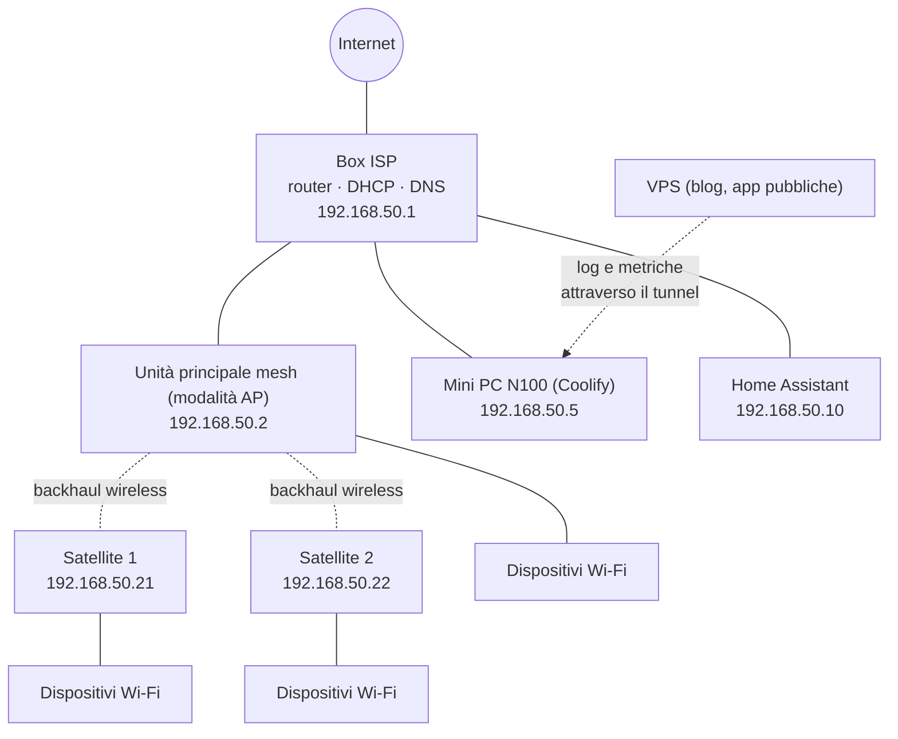
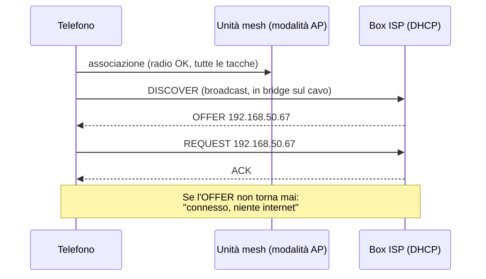
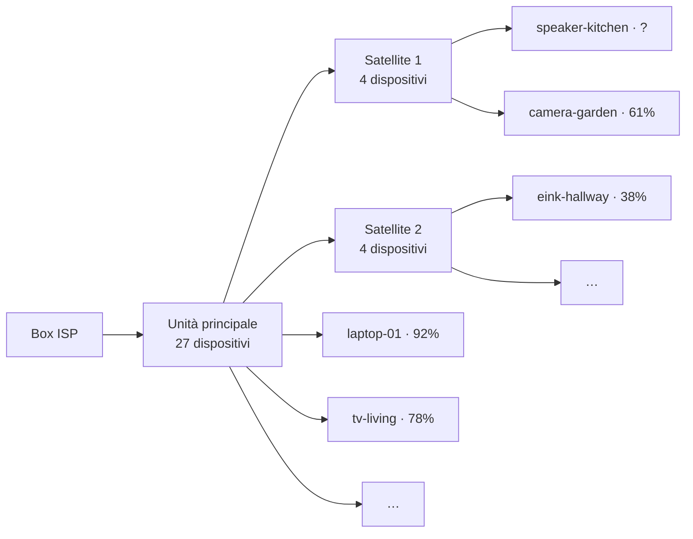

Ogni famiglia ha un reparto IT. Nella mia sono io, e i ticket arrivano di persona: *"Il Wi-Fi non funziona."* *"Plex si è di nuovo bloccato."* *"La TV dice che non c'è internet ma il mio telefono va."*

Per anni la mia risposta standard è stata quella di Roy in *The IT Crowd*: **"Hai provato a spegnere e riaccendere?"** Riavvia il box, riavvia la mesh, riavvia il server se non basta. Funziona sorprendentemente spesso. Ma ha un grosso problema: quando funziona, **non scopri mai cosa era rotto**. E a volte è proprio il riavvio a rompere le cose.

Nelle ultime settimane, con Claude Code a fare la maggior parte della digitazione, ho trasformato il mio home server in qualcosa che sa rispondere a tre domande prima che io tocchi un pulsante di accensione:

1.  **È su?** — Uptime Kuma, organizzato per "cosa guardare quando questo diventa rosso".
2.  **Perché è giù?** — OpenObserve, con log e metriche dal server, dai container e da Home Assistant.
3.  **Perché quel dispositivo non si connette?** — un piccolo watcher DHCP sul cavo, e la visione della mesh Wi-Fi di Home Assistant.

E poi una quarta cosa che non avevo previsto: una volta riuniti tutti quei dati in un unico posto, Claude poteva leggerli tramite MCP. L'ultima sezione di questo articolo è un alert reale scattato *mentre lo stavo scrivendo*, risolto dalla chat.


**Tutto in questo articolo è pseudonimizzato.** Gli indirizzi di rete, gli indirizzi MAC, i nomi host, i nomi di dominio e i nomi dei dispositivi qui sotto non sono quelli reali. Li ho sostituiti in modo coerente (lo stesso dispositivo mantiene lo stesso nome finto dall'inizio alla fine), quindi le storie e i numeri tornano comunque. Latenze, livelli di segnale, conteggi e volumi di traffico sono le misure reali. Ho anche lasciato fuori alcuni servizi che girano sulla stessa macchina ma non hanno nulla a che fare con la rete.


## Il setup in breve

Niente di esotico, e probabilmente simile a quello che molti hanno in casa:

*   **Il box dell'ISP** è il router, il server DHCP e il DNS forwarder di tutta la casa.
*   **Una mesh Wi-Fi** (un'unità principale e due satelliti) gira in **modalità access point**: fa da bridge tra i client Wi-Fi e la LAN cablata e non fa né routing né DHCP per conto suo. Una rete, un server DHCP, niente doppio NAT.
*   **Un mini PC con un Intel N100** (16 GB di RAM) fa girare tutto il self-hosted, gestito con [Coolify](/migrating-from-hashnode-to-hugo-with-coolify/): Plex e i suoi compagni, un container VPN, qualche app personale, il reverse proxy, Authentik per il single sign-on e un tunnel Cloudflare per le parti raggiungibili dall'esterno.
*   **Home Assistant** gira su una macchina sua e sa molte cose sulla rete senza che nessuno glielo chieda (ne riparliamo più avanti).
*   **Una piccola VPS** ospita questo blog e alcune app pubbliche. Anche lei manda i suoi log a casa.



## Livello 1: Uptime Kuma, organizzato per cosa guardare

[Uptime Kuma](https://github.com/louislam/uptime-kuma) è lo strumento di monitoraggio più semplice che conosca: un container, una UI web, e un monitor sono tre campi. La trappola è che è *così* semplice che finisci con ottanta monitor in un'unica lista piatta, e quando sei di loro diventano rossi insieme non sai comunque da dove cominciare.

Così ho riorganizzato i miei attorno a una sola domanda: **quando questo è rosso, cosa vado a guardare?**

| Gruppo | Cosa contiene |
|---|---|
| 🌐 Internet e rete | Ping del box ISP, ping internet, DNS tramite il box, risoluzione dei nomi pubblici, l'unità mesh ed entrambi i satelliti, salute del DHCP, "i client Wi-Fi ottengono un IP", "traffico internet normale" |
| 🚪 Accesso pubblico | Controlli end-to-end attraverso Cloudflare → tunnel → proxy → SSO: la pagina di login deve contenere la sua parola chiave, un'app protetta deve rispondere con un redirect al login |
| 🔐 Edge | Il reverse proxy, il container del tunnel, il server SSO, il worker e il database |
| 🎬 Media | Plex (HTTP **e** container), Tautulli, il gestore delle richieste, i server di e-book |
| 🔒 VPN | Il container VPN, e la salute di ciò che dipende da lui |
| 🤖 App | Le mie app e i loro worker in background |
| 🧰 Piattaforma | Coolify, il server di notifiche, il proxy del socket Docker, la condivisione file, il backup settimanale |
| 💾 Salute del server | Utilizzo disco di ogni mount, memoria |
| 🏡 Smart home | Home Assistant (locale e remoto), MQTT |

Due tag attraversano i gruppi: `public` per tutto ciò che è esposto su internet e `critical` per quelle poche cose che si portano giù tutto il resto (router, internet, proxy, tunnel, SSO, VPN, dischi, memoria, backup). Gli alert vanno a un [ntfy](https://ntfy.sh) self-hosted, quindi arrivano come notifiche push sul mio telefono.

L'ordine dei gruppi conta più di quanto sembri. Se "ping del box ISP" è rosso, niente di quello che sta sotto ha significato. Se la rete è verde ma "Accesso pubblico" è rosso, è il tunnel o il proxy. Se è rossa una sola app, è quell'app. **La dashboard si legge dall'alto in basso come un albero di troubleshooting.**

Alcune cose che ho imparato strada facendo:

*   **Controlla end-to-end, non solo "il container sta girando".** Un container può essere su mentre la rotta del proxy verso di lui è rotta. I miei controlli pubblici passano per il percorso reale, dall'esterno, e si aspettano la risposta *giusta*: un'app protetta deve fare redirect al login SSO. Un `200` lì sarebbe in realtà un problema di sicurezza.
*   **Plex ha due monitor.** Un controllo HTTP sull'endpoint web *e* un controllo Docker sul container. Plex gira sulla rete dell'host con la transcodifica hardware, e ha più di un modo di essere "mezzo vivo".
*   **La VPN è una dipendenza, non un servizio.** I container che devono parlare solo attraverso la VPN ne condividono il network namespace: **niente VPN, niente rete**, per progetto. Quindi il monitor che conta non è "il container VPN sta girando" ma "le cose dietro di lui riescono davvero a raggiungere l'esterno". Se il tunnel cade, restano al buio invece di finire sulla mia connessione reale, e Kuma me lo dice.
*   **I monitor push sono dei dead-man switch.** Utilizzo disco, memoria, il backup settimanale e il job di aggiornamento non vengono interrogati: sono loro a fare *push* verso Kuma, e Kuma diventa rosso quando il push non arriva in tempo. Questo intercetta sia "il backup è fallito" sia "il job di backup è morto e nessuno se n'è accorto".
*   **Un check verde può mentire.** Il mio job di aggiornamento settimanale segnalava successo mentre due pull di immagini erano in realtà falliti (un rate limit del registry), perché leggeva lo stato del servizio 30 secondi dopo aver chiesto un riavvio, quando i vecchi container stavano ancora girando. La soluzione non è stata un nuovo monitor ma una domanda migliore: controllare l'ora di creazione dei container, non solo "sta girando".

## Livello 2: OpenObserve, per il "perché"

Uptime Kuma mi dice *che* qualcosa è rosso. Non mi dice *perché*, e non ha memoria di cosa è successo alle 3 di notte. Per questo ho installato [OpenObserve](https://openobserve.ai), un singolo binario che memorizza log, metriche e trace e ha sopra una UI decente e SQL.

Lo alimentano tre agent, che girano tutti accanto a lui sul mini PC:

| Agent | Cosa invia |
|---|---|
| **Vector** | I log di ogni container (etichettati con il container e la risorsa Coolify), e l'access log del reverse proxy |
| **OpenTelemetry Collector** | Metriche dell'host (CPU, memoria, dischi, rete), metriche per container, le metriche Prometheus del proxy e del server SSO, l'endpoint Prometheus di Home Assistant, e un endpoint OTLP per le mie app |
| **Un piccolo shipper di eventi di Home Assistant** | Ogni cambio di stato ed evento di Home Assistant, come un record JSON ciascuno |

La VPS usa la stessa configurazione di Vector e del Collector e invia via HTTPS attraverso il tunnel, verso una rotta di ingest che accetta solo `POST` su pochi percorsi, con un token di sola scrittura.

Alcune scelte che si sono rivelate importanti:

*   **Oscura prima di inviare.** Vector rimuove query string, token negli URL e i pattern di segreti più comuni da *ogni* campo prima che qualcosa venga scritto. I log sono il posto dove i segreti vanno a farsi dimenticare.
*   **Retention per stream.** I log dei container e gli access log restano 30 giorni, gli eventi di Home Assistant 30 giorni, tutto il resto 90. I dati vivono sull'NVMe del server e sono esplicitamente *usa e getta*: le dashboard e le definizioni degli SLO sono script Python in un repository git, quindi posso ricostruirle in un minuto.
*   **Misura prima il volume.** Prima di installare qualsiasi cosa, ho misurato il volume grezzo dei log: circa 25 MB al giorno per tutti i container di casa, più 6 per il proxy. Un home server non è un problema di big data, ed è questo che ha reso ragionevole uno strumento a singolo binario.
*   **Gli alert restano in Uptime Kuma.** Anche OpenObserve ha gli alert, e li uso per qualche notifica di burn rate degli SLO, ma il percorso principale per le notifiche resta Kuma → ntfy. Un solo posto da guardare quando il telefono vibra.

## Livello 3: "Il telefono dice connesso, ma non funziona niente"

Questo è il ticket più frustrante, e quello che il riavvio "risolve" più spesso.

Quando un dispositivo entra in una rete Wi-Fi, prima parla con l'access point (la parte radio) e poi chiede alla rete un indirizzo con il **DHCP**: manda in broadcast un `DISCOVER`, un server DHCP risponde con un `OFFER`, il dispositivo invia un `REQUEST` e il server conferma con un `ACK`. Se questo secondo passaggio fallisce, il telefono mostra tutte le tacche del Wi-Fi e un avviso "nessuna connessione a internet". Dal punto di vista del telefono, il Wi-Fi va bene. **È la rete che non risponde.**



Le cose che vanno storte lì sono classiche, e invisibili dal dispositivo:

*   il server DHCP è lento, sovraccarico o bloccato (ne parlo più sotto);
*   compare **un secondo server DHCP** — per esempio un'unità mesh tornata in modalità router dopo un aggiornamento firmware o un reset di fabbrica — e distribuisce indirizzi su una subnet diversa;
*   il pool di indirizzi è pieno;
*   il dispositivo è al limite della copertura radio e i suoi broadcast non arrivano.

Nessuno di questi si vede con un ping. Così ho costruito un piccolo agent, `netwatch`, che sta **sul cavo** (rete dell'host sul mini PC, perché deve inviare e sentire i broadcast) e fa tre cose:

| Controllo | Come | Cosa intercetta |
|---|---|---|
| **Probe DHCP attivo**, ogni 60 s | Invia un `DISCOVER` da un MAC finto, amministrato localmente, raccoglie ogni `OFFER` e non invia mai un `REQUEST` (nessun lease viene preso) | Il box ISP che non risponde o risponde lentamente; **qualunque altro server DHCP che risponde** |
| **Osservazione DHCP passiva** | Ascolta ogni broadcast DHCP sulla LAN. La mesh porta in bridge i broadcast dei client Wi-Fi sul cavo, quindi da lì sono visibili | Un client che invia 3 `DISCOVER` in 2 minuti ("connesso ma senza IP"), i `NAK`, un server abusivo che risponde a un client reale |
| **Ping e DNS** | Il box ISP, l'unità mesh, entrambi i satelliti, Home Assistant, internet; DNS tramite il box e tramite il resolver di sistema | Un'unità che sparisce dalla LAN, perdita di pacchetti, un satellite lento |

Ogni risultato va in uno stream di OpenObserve (un record per evento, con un `kind`), e due di loro alimentano monitor push di Uptime Kuma: **"DHCP in salute"** e **"i client Wi-Fi ottengono un IP"**. Entrambi hanno un heartbeat di 2 minuti, quindi diventano rossi anche se muore l'agent stesso.

In un giorno normale sembra noioso, ed è proprio questo il punto. Nell'ultima settimana: 313 probe, ciascuno con risposta da esattamente un server, in circa 5 ms (il primissimo dopo un riavvio impiega circa un secondo, mentre il box verifica che l'indirizzo sia libero); ogni unità pingata ha risposto, ogni volta.

| Destinazione | RTT medio | Peggiore | Down |
|---|---|---|---|
| Box ISP | 1,1 ms | 16,6 ms | 0 |
| Unità principale mesh | 0,7 ms | 13,6 ms | 0 |
| Satellite 1 | **17,5 ms** | 52,0 ms | 0 |
| Satellite 2 | 4,0 ms | 9,2 ms | 0 |
| Home Assistant | 0,2 ms | 0,4 ms | 0 |

Il satellite 1 quattro volte più lento del satellite 2 è il genere di cosa che non noti mai finché non la metti in un grafico. Entrambi usano un backhaul wireless; il satellite 1 è semplicemente più lontano, dietro più muri. Non c'è niente di rotto, ma adesso so quale spostare se qualcuno si lamenta di quella parte della casa.


**I nomi dei dispositivi sono input controllato da un attaccante.** Un watcher DHCP legge i nomi host che i dispositivi annunciano di sé, e questi finiscono in log, alert e dashboard. Una security review automatica della prima versione ha trovato tre problemi reali: un server DHCP finto poteva spacciarsi per il box ISP dichiarandone l'IP (ora è fissato anche il MAC), un'ondata di MAC casuali poteva far crescere all'infinito la tabella dei client (ora è limitata), e i nomi host finivano negli alert così com'erano (ora ridotti a lettere, cifre, `.`, `_` e `-`, al massimo 32 caratteri). Una settimana dopo la stessa review ha scoperto che il tooltip della mappa nella dashboard renderizzava i nomi dei dispositivi come HTML. Chiunque sia sul tuo Wi-Fi può scegliere il nome del proprio dispositivo.


Uno script per Mac lo completa per il lato radio, che un cavo non può vedere: registra ogni 10 secondi su quale unità mesh si trova il portatile, il suo segnale e la sua latenza, e può catturare ogni server DHCP che risponde dal lato Wi-Fi.

## Il reset che ha "sistemato" tutto

Ecco la storia che mi ha convinto che tutto questo ne valeva la pena.

Una mattina, diversi dispositivi non riuscivano a entrare nel Wi-Fi. Tutte le tacche, nessun indirizzo. Ho fatto quello che fanno tutti: reset di fabbrica del box ISP, riconfigurazione, e tutto è tornato a funzionare. Ticket chiuso, Roy sarebbe stato fiero.

Solo che questa volta la rete era sorvegliata, e il grafico del traffico internet del box (dall'integrazione UPnP di Home Assistant, che legge i contatori del box ogni 30 secondi) raccontava una storia molto più strana:

| Periodo | Download | Upload |
|---|---|---|
| Domenica durante il giorno | 230–350 Mbit/s | 270–375 Mbit/s |
| Domenica notte | ~120 Mbit/s | ~150 Mbit/s |
| Lunedì mattina, prima del reset | ~50 Mbit/s | ~70 Mbit/s |
| **Dopo il reset** | **~3 Mbit/s** | **~1,5 Mbit/s** |

Sono **da 2 a 3 TB al giorno**, con **l'upload più alto del download, anche alle 3 di notte.** Nessuna famiglia fa una cosa del genere. Ho chiesto a Claude di confrontarlo con tutto il resto dei dati raccolti, e ha escluso uno alla volta i sospetti ovvi: i container del server avevano mosso pochi Mbit/s, il traffico VPN era minimo, e la mesh in modalità AP conta solo il proprio traffico di gestione. Ha ricostruito il throughput dal contatore grezzo dei byte per escludere un errore di unità di misura: i numeri erano reali.

La spiegazione più probabile è traffico che passava *attraverso* il box in entrambe le direzioni — un loop tra il box e la mesh, o traffico locale instradato attraverso di lui — e contato due volte. Il reset ha cancellato qualunque configurazione lo causasse, e molto probabilmente anche il problema del DHCP. Non posso dimostrarlo: c'era solo un giorno di storico prima del reset, e niente mostra il traffico per dispositivo.

Ma la parte importante è questa: **senza il grafico, il riavvio avrebbe "sistemato" il Wi-Fi, e non avrei mai saputo che il box stava spingendo terabyte al giorno da chissà quanto tempo.** Quindi adesso c'è un monitor apposta. Ogni 5 minuti, uno script calcola la media del throughput del box negli ultimi 30 minuti, e il monitor Kuma "traffico internet normale" diventa rosso sopra i 50 Mbit/s di upload sostenuto o i 200 di download. L'ho rigiocato sui vecchi dati prima di fidarmi: verde adesso, rosso domenica pomeriggio, rosso lunedì alle 4 di notte.


**Perché il mio speed test non si vedeva.** Subito dopo il reset ho fatto uno speed test a circa 400 Mbit/s, e il grafico mostrava… 205. Il sensore UPnP è la differenza tra due letture di un contatore, a 30 secondi di distanza: un picco di 15 secondi mediato su 30 secondi è alto la metà. Conosci la risoluzione del tuo sensore prima di fidarti di un picco, o della sua assenza.


### …e il riavvio che ha rotto tutto

Spegnere e riaccendere può anche essere la causa. Qualche giorno prima, dopo un riavvio, **tutti i servizi pubblici sono andati giù insieme.** Il tunnel era su, i container erano su, ma il reverse proxy era semplicemente sparito.

I log lo dicevano in una riga: `all predefined address pools have been fully subnetted`. La configurazione di default di Docker ha spazio solo per 31 reti bridge, e Coolify ne crea una per risorsa, più altre per alcune reti compose. Finché il proxy girava, nessuno si era accorto che erano in uso tutte e 31. Quando è ripartito, non è riuscito a riottenere una rete, e non è tornato su. La soluzione è stata un pool di indirizzi più grande nel `daemon.json` di Docker (256 reti piccole in un intervallo che non si sovrappone alla LAN) e una pulizia delle reti lasciate da vecchi setup. La lezione è finita nel monitoraggio: il proxy è nel gruppo `critical`, e dopo ogni riavvio c'è una breve checklist delle cose che notoriamente non tornano su da sole.

## Home Assistant è un sensore di rete

Non mi aspettavo che questa parte fosse la più utile. Home Assistant parla già con il box e con la mesh per i suoi motivi, quindi **sa** già molte cose sulla rete:

*   l'**integrazione UPnP** sul box ISP fornisce throughput e contatori internet (il grafico qui sopra);
*   l'**integrazione del produttore della mesh**, anche con la mesh in modalità AP, fornisce per ogni dispositivo: se è connesso, il suo segnale, la velocità del link e **su quale access point si trova**, più CPU e memoria delle unità;
*   e ogni dispositivo con un IP e un'integrazione (telecamere, prese, display, speaker) riporta il proprio segnale Wi-Fi.

Tutto questo finisce in OpenObserve per due strade: l'endpoint Prometheus di Home Assistant (letto dal collector, scartando le metriche di servizio per entità, circa 2.400 serie), e lo shipper di eventi, che scrive **ogni cambio di stato**. Il secondo richiede attenzione: contiene presenza, posizioni e abitudini. Usa un token di amministratore (solo gli admin possono iscriversi a tutti gli eventi), maschera token, password e PIN dell'allarme, tiene gli attributi come un'unica stringa JSON così che 4.000 entità non diventino 4.000 colonne, e lo stream vive solo 30 giorni, dietro SSO.

Sopra a tutto questo ho costruito una dashboard "Rete". La mia scheda preferita risponde alla domanda a cui risponde l'app del produttore della mesh sul mio telefono, ma con lo storico: **chi è su quale unità?**



In OpenObserve è un albero radiale (un pannello custom ECharts) in cui ogni dispositivo è colorato in base al segnale, accanto a una tabella e all'elenco degli **spostamenti recenti tra unità**. Due cose sono venute fuori nella prima ora:

*   **Uno smart speaker faceva ping-pong** tra il satellite 1 e il satellite 2 ogni pochi minuti. Si trova quasi esattamente a metà strada tra i due. È un buon candidato per le sue occasionali disconnessioni, e spostarlo un po' verso uno dei due è una soluzione migliore di qualsiasi riavvio.
*   **La mesh riporta 0% di segnale quando non lo sa**, cosa che succede spesso per i dispositivi sui satelliti. La mia prima tabella "segnale Wi-Fi più debole" aveva un minimo fisso a 0. Adesso zero significa "non riportato" e viene mostrato in grigio.

## Debug con Claude, tramite MCP

Questa è la parte che ha cambiato il mio modo di lavorare. Sia OpenObserve sia Home Assistant espongono un **server MCP**, quindi Claude può interrogarli direttamente: SQL su qualsiasi stream di OpenObserve, e lo stato live delle entità di Home Assistant. Niente copia-incolla di screenshot, niente export di CSV. Faccio la domanda, Claude scrive la query, legge la risposta e scrive la query successiva.

L'indagine sul traffico qui sopra è stata fatta così. Ma l'esempio migliore è successo mentre scrivevo questo articolo: **"i client Wi-Fi ottengono un IP" è diventato rosso.**

Ecco, un po' condensato, come è andata.

**1. Cosa dice netwatch?** L'ultimo record `clients_status` elencava un client bloccato, un dispositivo che si annunciava come `eink-hallway`. I suoi eventi appena prima:

```sql
SELECT _timestamp, msg, requested_ip, server_id
FROM netwatch
WHERE client_mac = 'aa:bb:cc:00:00:2a'
ORDER BY _timestamp
```

| Ora | Evento |
|---|---|
| 16:07:38.7 | `discover` |
| 16:07:39.2 | `discover` |
| 16:07:40.2 | `discover` → **client_stuck** (3 in 120 s) |
| 16:07:40.6 | `request` 192.168.50.41 dal server 192.168.50.1 |
| 16:07:40.7 | `request` 192.168.50.41 dal server 192.168.50.1 |

Quindi non era davvero bloccato: due secondi e tre tentativi dopo, stava chiedendo un indirizzo *al box ISP*, il che significa che aveva ricevuto un'offerta. Lento, ma non in errore. Il probe DHCP di un minuto dopo ha avuto risposta in 5 ms: il server stava bene.

**2. È un caso isolato?** Dalla tarda mattinata, lo stesso dispositivo aveva fatto esattamente la stessa cosa, `discover` poi `request` per lo stesso indirizzo, **ogni 20 minuti come un orologio**. Quello non è un problema di rete, è una pianificazione.

**3. Cosa sa Home Assistant di questo dispositivo?** Claude è passato agli eventi di Home Assistant in OpenObserve:

```sql
SELECT _timestamp, entity_id, state
FROM home_assistant
WHERE str_match(entity_id, 'eink_hallway')
ORDER BY _timestamp DESC
```

| Ora | Sensore | Valore |
|---|---|---|
| 16:07:51 | `boot_count` | 1341 |
| 16:07:51 | `wifi_signal` | **−82 dBm** |
| 15:47:32 | `boot_count` | 1340 |
| 15:47:32 | `wifi_signal` | −81 dBm |
| 15:06:56 | `wifi_signal` | −61 dBm |
| 13:25:32 | `wifi_signal` | −57 dBm |
| prima | `boot_reason` | `timer` |
| prima | `battery` | 38% |

Eccolo. `eink-hallway` è un **display e-paper a batteria**, un ESP32 che si sveglia dal deep sleep ogni 20 minuti (`boot_reason: timer`, con il contatore dei boot che sale di uno ogni volta), si collega al Wi-Fi da zero, chiede un indirizzo, aggiorna lo schermo e torna a dormire. Uno scambio DHCP nuovo 72 volte al giorno. La maggior parte del tempo il suo segnale è tra −57 e −67 dBm e lo scambio richiede millisecondi. A −82 dBm, che è al limite dell'utilizzabile, gli sono serviti tre `DISCOVER`, ed è esattamente la regola dei "3 in 2 minuti" che netwatch usa per segnalare un client bloccato.

**4. Quindi qual è la soluzione?** Non un riavvio. Le opzioni che Claude ha messo sul tavolo:

*   dare al display un **IP statico e il BSSID/canale dell'access point** nel firmware, così dopo il risveglio salta la maggior parte del lavoro di DHCP e di scansione — più veloce, e meglio anche per la batteria;
*   spostare un po' lui, o il satellite: −82 dBm su un dispositivo appeso a un muro è un problema di posizionamento;
*   insegnare a netwatch i **dispositivi dormienti noti**, dispositivi che legittimamente fanno uno scambio DHCP completo a ogni risveglio, così che uno lento non mi faccia arrivare una notifica.

Il tutto ha richiesto pochi minuti, la maggior parte passati a leggere. Senza i dati, la risposta onesta a "perché è scattato l'alert?" sarebbe stata "non ne ho idea, adesso è di nuovo verde". Senza MCP, sarei stato io a saltare tra due UI, scrivere SQL a mano e strizzare gli occhi su timestamp in due fusi orari diversi.


**Dare a un'AI accesso al tuo monitoraggio significa darle accesso a casa tua.** Lo stream di eventi di Home Assistant contiene quando le persone entrano ed escono. Tengo le connessioni MCP sulla mia macchina, quella di OpenObserve usa un service account dedicato, e dashboard e dati stanno dietro SSO. Prima di collegare qualsiasi cosa, decidi cosa ti va bene che un modello legga, e pseudonimizza prima di pubblicare, come fa questo articolo.


## Se vuoi cominciare

Non ti serve tutto questo. Se dovessi ricominciare, in ordine:

1.  **Uptime Kuma e ntfy.** Un pomeriggio. Raggruppa i monitor per "cosa guardare quando è rosso", metti in cima il router e internet, e aggiungi **monitor push** per tutto ciò che gira a orari pianificati (backup, aggiornamenti). Già questo risponde alla maggior parte delle domande "sono io o è rotto?".
2.  **Controlla il percorso completo.** Almeno un monitor che passi esattamente da dove passa un utente esterno, e che si aspetti la risposta *giusta*, non solo un `200`.
3.  **Attiva quello che Home Assistant sa già.** Se lo hai, le sue integrazioni del router e della mesh sono monitoraggio di rete gratuito. Metti in grafico il throughput e il segnale per dispositivo, anche solo con lo storico integrato.
4.  **Log e metriche in un unico posto**, quando hai un "perché" a cui non sai rispondere. OpenObserve aveva la taglia giusta per un home server; Grafana con Loki e Prometheus è l'altra scelta ovvia.
5.  **Osserva il DHCP dal cavo** se hai una mesh e qualcuno si lamenta di "connesso ma niente internet". È l'unico guasto che nient'altro vede.
6.  **Poi collega un assistente ai dati.** È molto più bravo di me alle 11 di sera a incrociare due stream e notare un ritmo di 20 minuti.

E tieniti il riavvio. Resta una soluzione perfettamente valida. Assicurati solo che, la prossima volta, tu sappia cosa ha sistemato.

## Come è stato realizzato

Diverse sessioni di Claude Code con Opus 5.5, nell'arco di circa tre settimane, su un repository git che contiene la configurazione Coolify del server. Claude ha lavorato via SSH sul server (senza sudo) e in un browser in cui facevo io il login ogni volta che serviva una UI; ha scritto i file compose, le configurazioni di Vector e del Collector, l'agent netwatch (a partire da una prima versione abbozzata in una chat), le dashboard come script Python e i monitor di Uptime Kuma. Una security review automatica girava su ogni modifica, e le sue scoperte sono il riquadro di avviso qui sopra. Claude ha anche indagato sull'anomalia di traffico e sul blackout dovuto al pool di indirizzi partendo dai dati. Per questo articolo, una sessione separata ha letto quelle sessioni e il repository, ha interrogato OpenObserve e Home Assistant tramite MCP (è da lì che viene, dal vivo, l'indagine sul display e-paper), e ha scritto la bozza del testo con ogni identificativo pseudonimizzato. La mia parte: scegliere cosa monitorare e cosa lasciare fuori, fare il login dove serviva, decidere le soglie, e fare il reset di fabbrica. Certe abitudini sono dure a morire.
