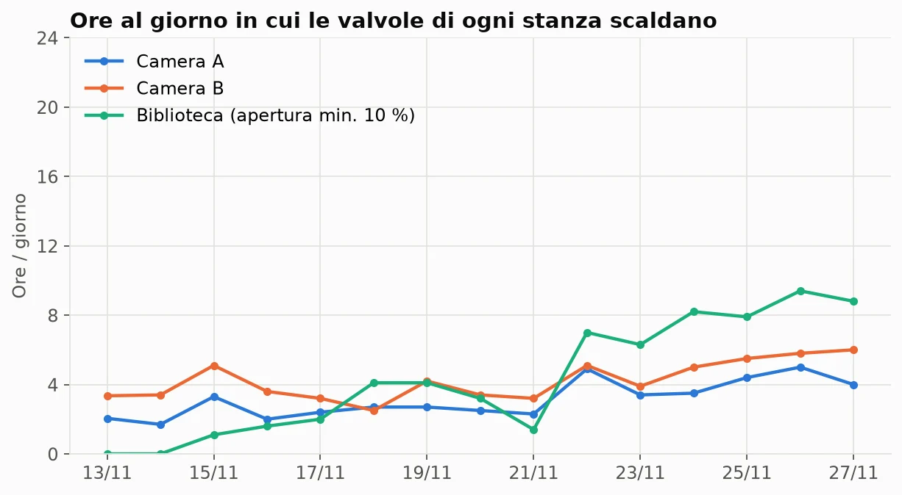

Tre settimane fa ho raccontato come [abbiamo scoperto, con Claude, che i due circuiti della mia pompa di calore erano invertiti da cinque anni](/it/cinque-anni-di-circuiti-invertiti-la-mia-pompa-di-calore-rivista-con-claude/). Il riscaldamento a pavimento del piano terra era comandato dal termostato del piano di sopra, i radiatori ricevevano acqua a 25 °C, e la valvola miscelatrice che "non funzionava in automatico" obbediva al circuito sbagliato. Una volta rimessa a posto la configurazione, la casa ha finalmente scaldato come doveva.

Ma rimettere a posto i circuiti era solo il primo passo. Con una pompa di calore ogni grado d'acqua in più si paga in rendimento, e ora che avevo dati puliti volevo sapere **qual era la temperatura dell'acqua appena sufficiente**. È l'argomento di questa piccola serie:

1.  **La curva climatica, regolata con i dati** (questo articolo): come funziona una curva climatica, quali segnali dicono che l'acqua è troppo calda, cosa abbiamo cambiato.
2.  **Una valvola per stanza, e una pompa di calore che ascolta solo la richiesta**: le automazioni Home Assistant che regolano ogni camera del piano di sopra e comandano la pompa di calore, con il numero di movimenti delle valvole e quanto costa in batterie.
3.  **Il bilancio, un anno dopo**: comfort e consumi confrontati con l'inverno scorso, a temperature esterne comparabili. Questo dovrà aspettare qualche settimana di freddo vero, per confrontare cose confrontabili.

## La curva climatica, in due minuti

Una pompa di calore non produce calore: lo **sposta** dall'aria esterna all'acqua del riscaldamento. Più la differenza tra le due è grande, più lavora per ogni kWh di calore. Per questo si cerca sempre l'acqua più fredda possibile: l'ordine di grandezza citato spesso è **dal 2 al 3% di rendimento (COP) guadagnato per ogni grado d'acqua in meno**.

Però una casa perde più calore quando fuori fa freddo. La **curva climatica** (*OTC* per Hitachi) fa da collegamento: dà la temperatura dell'acqua da produrre in funzione della temperatura esterna. Se fa mite, l'acqua può essere tiepida; se gela, serve acqua più calda.

Sulla mia Yutaki ogni circuito ha la sua curva, che esiste in due forme:

*   **per punti**: due punti (per esempio "acqua a 50 °C quando fuori ci sono −10 °C" e "acqua a 21 °C quando ci sono +20 °C"), una retta tra i due, e un tratto piatto oltre;
*   **per curva**: una retta che parte da 20 °C d'acqua con 20 °C fuori e sale di una **pendenza** (da 0,2 a 2,2) per ogni grado esterno in meno. Con una pendenza di 0,6 si chiede acqua a 32 °C quando fuori ci sono 0 °C.

Entrambe si possono spostare in blocco (*offset*), e la pompa di calore aggiunge una **compensazione ambiente**: quando la stanza del termostato è sotto il set point, spinge l'acqua un po' più in alto. Abbiamo misurato l'effetto il 17 nov.: **circa 2 °C d'acqua in più per ogni grado di set point** (set point 17-18 °C → acqua a 32-33 °C, 19 °C → 36 °C, 20 °C → 37 °C).

Un ultimo punto cambia tutto in una casa con due circuiti: **c'è un solo compressore**. La pompa di calore produce l'acqua per il circuito che chiede la temperatura più alta, e il pavimento (C2) poi raffredda la sua miscelandola con il ritorno, grazie alla valvola a tre vie. A casa mia sono quindi i **radiatori del piano di sopra (C1) a fissare la temperatura dell'acqua di tutta la casa**. Il pavimento, invece, ha bisogno solo di circa 31 °C con 0 °C fuori. Ogni grado in più chiesto dai radiatori è un grado che la pompa di calore produce per niente.

I punti verdi sono i set point reali dell'acqua della pompa di calore, in media giornaliera, durante l'ondata di freddo di fine novembre: seguono la curva dei radiatori quasi al grado. È proprio lei a comandare.

Un dettaglio pratico: CSNet dice che *tipo* di curva usa ogni circuito, ma non i suoi valori. Dalla versione 2.14 dell'[integrazione CSNet](https://github.com/mmornati/home-assistant-csnet-home) si possono ricopiare i valori del comando nelle opzioni, e Home Assistant mostra allora, per ogni circuito, la temperatura dell'acqua che la curva chiede in quel momento. È questo che permette di vedere su un grafico se la pompa di calore segue la sua curva o se qualcos'altro la spinge.

## I segnali che dicono che l'acqua è troppo calda

Nessuno ti dice "la tua curva climatica è troppo alta". Ma una casa ben strumentata lo mostra in diversi modi, ed è incrociando questi segnali che siamo andati avanti.

**1. Il tempo di apertura delle valvole.** Dall'11 nov. ogni radiatore del piano di sopra ha una valvola connessa che regola sul sensore della sua stanza (i dettagli nel prossimo articolo). Se le stanze tengono il set point mentre le valvole sono chiuse quasi sempre, vuol dire che ogni minuto di apertura porta molto calore: l'acqua è più calda del necessario. Dal 12 al 14 nov. le valvole delle camere erano aperte solo **dal 6 al 13% del tempo**.

**2. Riscaldamenti brevi che superano il set point.** Quando una valvola si apre, una camera guadagna mezzo grado in un quarto d'ora, poi continua a salire dopo la chiusura, perché il radiatore resta caldo. Risultato: un dente di sega di quasi un grado attorno al set point. Con acqua meno calda le aperture sono più lunghe e la temperatura più stabile.

**3. La velocità di riscaldamento di ogni stanza.** Home Assistant ora registra ogni episodio di riscaldamento (inizio, durata, temperatura all'inizio e alla fine, temperatura esterna) e ne ricava una velocità di riscaldamento mediana per stanza. Oggi: **2,4 °C/h per una camera, 1,3 °C/h per l'altra, 0,9 °C/h per la biblioteca**. La stanza più lenta è quella che fissa il limite inferiore: se l'acqua diventa troppo fredda, è lei che la mattina non arriverà più al set point.

**4. Il tempo di preriscaldamento al mattino.** Le camere passano dai 18 °C della notte ai 19 °C al risveglio. Con un preriscaldamento di 90 minuti ci arrivano in circa un'ora. C'è ancora margine.

**5. La differenza tra quello che chiede il pavimento e quello che produce la pompa di calore.** A fine novembre, con 0 °C fuori, la pompa di calore produceva acqua a 40 °C per un pavimento che ne chiedeva 31. Tutta la differenza era per i radiatori.

## Cosa abbiamo cambiato, in ordine

Quattro regolazioni in due settimane. Il grafico qui sotto le colloca rispetto alla temperatura esterna, al set point dell'acqua della pompa di calore e al suo COP di ogni giorno (calore prodotto diviso per l'elettricità misurata dal contatore della pompa di calore).

| Data | Regolazione | Perché |
|---|---|---|
| 11 nov. | Circolatore: velocità fissa 100% → regolazione ΔT | Portata troppo alta, differenza mandata/ritorno di 1-2 °C invece di 5. Il consumo da ferma è passato da circa 240 W a 130 W. |
| 11 nov. | Circuiti rimessi a posto | Vedi [l'articolo precedente](/it/cinque-anni-di-circuiti-invertiti-la-mia-pompa-di-calore-rivista-con-claude/). L'acqua sale di circa 12 °C a parità di temperatura esterna: i radiatori ricevono finalmente di che scaldare. |
| 14 nov. | Curva dei radiatori: **60 → 50 °C a −10 °C** (21 °C a +20 °C invariato) | Valvole aperte dal 6 al 13% del tempo, biblioteca a 21 °C con un set point di 19. |
| 16 nov. | Home Assistant comanda il set point CSNet del piano di sopra | Il termostato a muro chiedeva calore tutta la notte mentre tutte le valvole erano chiuse. |
| 25 nov. | Margine della pompa di calore: **1 → 0,5 °C** | Le valvole scaldavano 3-5 h al giorno, ma la pompa di calore restava in richiesta 15-17 h. |

L'11 novembre il set point dell'acqua sale di colpo: è il prezzo dei radiatori che finalmente scaldano. Il 14 la nuova curva lo fa riscendere di 4-5 °C. Dal 21 in poi è il freddo a farlo risalire, seguendo la nuova curva.

Quello che salta all'occhio sulla curva del COP è soprattutto la **temperatura esterna**: poco più di 3 con 9-10 °C fuori (17-20 novembre), intorno a 2,2 con 0 °C. Per isolare l'effetto della regolazione bisogna confrontare giorni alla stessa temperatura. Il 14 e il 22 novembre hanno avuto entrambi 2,2 °C di media fuori:

| | 14 nov. (curva a 60 °C) | 22 nov. (curva a 50 °C) |
|---|---|---|
| Set point medio dell'acqua | 38,6 °C | 37,7 °C |
| COP del giorno | 2,12 | 2,28 (+7,5%) |
| Elettricità della pompa di calore | 53,0 kWh | 46,0 kWh (−13%) |
| Piano di sopra (media) | 20,1 °C | 18,5 °C |
| Piano terra (media) | 19,3 °C | 19,5 °C |

Questa tabella va letta onestamente. La differenza di set point dell'acqua è più piccola di quanto farebbe pensare la curva (0,9 °C), perché il 14 Home Assistant non comandava ancora il set point del termostato e la compensazione ambiente entrava in gioco. E buona parte del 13% viene dal fatto che **il piano di sopra era surriscaldato il 14**: 20,1 °C di media, con la biblioteca a 21 °C. Il 22 il piano di sopra è al suo set point, con la notte a 18 °C. È proprio questo lo scopo: smettere di produrre calore che nessuno ha chiesto.

Per il margine del 25 novembre **non ho ancora un effetto misurabile**: il set point medio dell'acqua è passato da 40,3 °C il 24 a 39,7 °C il 25, poi 40,2 e 40,1 °C nei giorni seguenti, con un po' più di freddo fuori ogni giorno. A questo livello vince il rumore delle singole giornate. Vedremo su più settimane.

## Fin dove si può scendere?

Il miglior indicatore resta il primo: quanto tempo scaldano le valvole ogni giorno?

Anche nella settimana più fredda (circa 0 °C di media, −3 °C di notte), le valvole delle camere scaldano solo **dalle 4 alle 6 ore al giorno**. La biblioteca sale a 8-9 ore, ma è anche la stanza che si scalda più lentamente, e la sua valvola non si chiude mai del tutto (resta aperta al 10% perché l'acqua possa sempre circolare da qualche parte). In altre parole, i radiatori restano chiusi tre quarti del tempo mentre fuori gela. L'acqua a 40 °C è ancora più calda del necessario.

Il metodo che seguirò, invece di un grande salto:

1.  **Abbassare il punto freddo della curva dei radiatori di 2-3 °C alla volta** (50 → 47 °C a −10 °C, poi forse 45 °C), lasciando com'è il punto a +20 °C.
2.  **Aspettare almeno una settimana**, per avere giorni freddi e giorni miti.
3.  **Tenere d'occhio tre numeri**: le ore di riscaldamento delle valvole (saliranno, ed è voluto), la camera più lenta al risveglio (deve arrivare a 19 °C entro i 90 minuti di preriscaldamento), e il COP a parità di temperatura esterna.
4.  **Fermarsi quando la stanza più lenta comincia a non farcela** nelle mattine di gelo, e risalire di un gradino.

L'obiettivo non è avere le valvole sempre aperte: bisogna tenere un margine per le mattine di freddo intenso e per le riprese dopo una notte a 18 °C. Ma 4 ore su 24 con 0 °C sono chiaramente troppo poche. I risultati di queste prove saranno nel terzo articolo.

Resta anche un difetto che la curva climatica da sola non correggerà: il compressore parte **2-3 volte all'ora** per cicli di 8-13 minuti. La pompa di calore (20 kW) è sovradimensionata per una casa che chiede in media 5-6 kW quando gela. Un'acqua meno calda allunga un po' i cicli, ma sarà un argomento a parte.

## Cosa mi porto a casa

Una curva climatica non si regola una volta per tutte seguendo la tabella dell'installatore. Quella dei miei radiatori (60 °C a −10 °C) c'era dall'installazione e nessuno l'aveva mai messa in discussione: con i circuiti invertiti, tanto, non serviva a niente.

Quello che è cambiato è avere **segnali che rispondono alla domanda**: valvole che dicono per quanto tempo scaldano, sensori che misurano la velocità di riscaldamento di ogni stanza, un contatore che dà il COP del giorno. Con questi, regolare la curva climatica non è più una questione di sensazioni ("stasera fa un po' fresco"), è un ciclo: si abbassa, si misura, si tiene o si torna indietro.

## Come è stato fatto

Diverse sessioni di Claude Code con Opus 5.5, distribuite su due settimane, nel repository dell'integrazione CSNet e in quello della mia configurazione Home Assistant. Claude ha letto lo storico di Home Assistant (tramite OpenObserve, che riceve tutti gli eventi e le metriche di HA, e tramite una copia in sola lettura del database del recorder per le statistiche a lungo termine), ha calcolato i tempi di apertura delle valvole e i COP giornalieri, ha proposto ogni modifica con i numeri che la giustificavano, e ha scritto le automazioni e i sensori (velocità di riscaldamento, set point della pompa di calore, curva climatica nell'integrazione). Le regolazioni della pompa di calore vera e propria le ho fatte a mano sul comando, fotografando prima ogni schermata. Questo articolo è stato scritto in un'altra sessione, a partire da quei dati e dalle note di quelle sessioni; i grafici sono stati generati dagli stessi dati.
