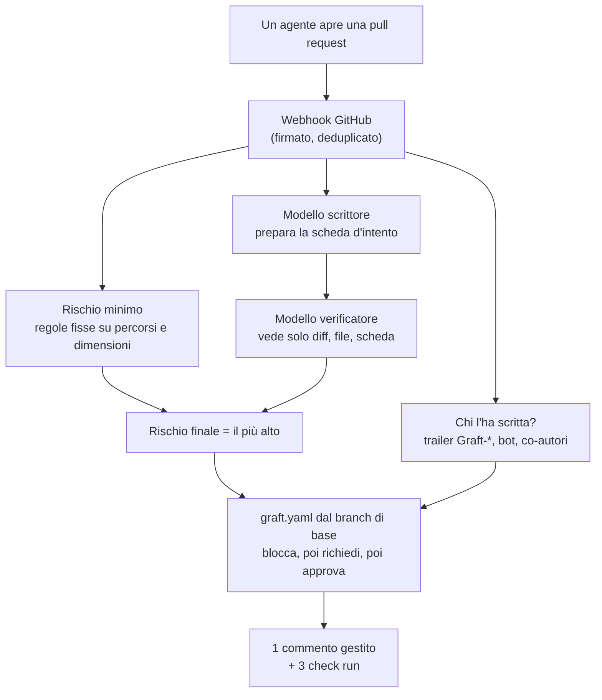

Il 13 ottobre Anthropic ha spiegato [perché ha sostituito git](https://www.anthropic.com/engineering/redesigning-source-control) per il suo monorepo. I numeri sono enormi, e quasi tutte le discussioni che ho letto parlavano di quelli: petabyte, mirror, cache. Ma la parte dell'articolo che mi è rimasta in testa è una piccola frase sulle persone. I loro ingegneri continuano a revisionare ogni modifica al nuovo sistema, ma guardano **l'intento della modifica**, non ogni singola riga.

È per quella frase che ho costruito **[Graft](https://github.com/mmornati/graft)**. La settimana scorsa è diventato pubblico: la release [v0.0.1](https://github.com/mmornati/graft/releases/tag/v0.0.1), un [sito di documentazione](https://mmornati.github.io/graft/), un video narrato e un test end-to-end che gira contro GitHub vero. Questo articolo racconta cosa fa, e soprattutto il cambiamento che prova a portare nella code review: **leggere una scheda preparata dagli agenti e controllata da un secondo modello, prima di leggere il codice.**

Come Graft stesso sia stato costruito in una notte da un team di agenti è un'altra storia, con i suoi numeri, raccontata in [Sei settimane in una notte](/it/sei-settimane-in-una-notte-costruire-un-prodotto-nellera-degli-agenti/). Qui parlo del prodotto.

## 1. Cosa ha costruito Anthropic, e perché

L'articolo in breve:

- Le modifiche unite sono passate da circa **2.500 al giorno a maggio 2026 a più di 30.000 al giorno a settembre**.
- La storia del branch principale pesa quasi **100 GB**, e una working copy compressa più di **25 GB**. La sola CI fa circa **25 milioni di checkout al giorno**. Scaricati nel modo normale, sarebbero più di **600 PB di traffico git al giorno**.
- Hanno provato tutto quello che git offre per i repository grandi (clone shallow, sparse checkout, promisor remote) e i soliti workaround. Nel momento peggiore gestivano **diverse centinaia di mirror git interni**.
- Così, in **cinque mesi**, sono passati a **Scion**, un sistema interno: il server tiene l'unica copia autorevole, gli oggetti sono indirizzati per contenuto e serviti da cache a più livelli, e i checkout sono parziali o addirittura virtuali, con i file scaricati solo quando vengono letti.

Altri due punti contano di più per tutti noi.

Primo, **non si è rotto solo lo storage, ma anche il workflow pensato per le persone.** A quel ritmo non sono riusciti a tenere una merge queue con un lock globale, quindi testano dopo il merge e prima del deploy, e lasciano a Claude la correzione dei conflitti che questo permette. Fanno anche girare agenti Claude che sorvegliano ciascuno la salute di un componente. E il lavoro degli ingegneri si è spostato: fissare i vincoli, revisionare l'intento, e molto spesso dire "no" all'IA quando viola una regola del sistema per seguire uno schema.

Secondo, **Scion non è in vendita.** Anthropic scrive che non è un sostituto di git per l'uso generale, che sarebbe difficile offrirlo in una forma utile ad altri, e che ha senso solo per monorepo davvero enormi. Ma si aspetta anche che questo tipo di problemi arrivi a molte più aziende nei prossimi **sei-dodici mesi**.

## 2. Perché a quasi nessuno serve uno Scion

Rileggendo l'articolo, ho diviso le sue lezioni in due livelli. Questa divisione è diventata la tesi della [spec dell'MVP](https://mmornati.github.io/graft/docs/spec/mvp-spec/) di Graft.

| Livello | Cos'è | Chi dovrebbe risolverlo | Chi ha il problema |
|---|---|---|---|
| **Storage e trasporto** | API di storia lato server, checkout parziali e virtuali, cache indirizzate per contenuto | GitHub, GitLab, git stesso | una manciata di aziende con monorepo grandi come quello di Anthropic |
| **Workflow** | revisionare l'intento di una modifica, regole di approvazione che conoscono il rischio, test dopo il merge, agenti che sorvegliano un componente | oggi non lo offre nessuno | ogni team in cui gli agenti aprono la maggior parte delle pull request |

Se siete un team da 20 a 500 ingegneri su GitHub, il vostro repository sta benissimo in git. I clone vanno bene. Quello che non regge più è la **capacità di review**: decine di pull request di agenti al giorno, ognuna letta riga per riga da una persona, partendo da una descrizione scritta proprio dall'agente che si sta giudicando.

La tesi quindi è semplice: **lasciare lo storage alle forge e prendersi il livello del workflow.** Graft si appoggia sui repository GitHub che avete già. Non c'è niente da migrare, e non salva niente di quello che git salva già.

## 3. Graft v0.0.1: cos'è

Graft è una GitHub App con un piccolo servizio (Node 24, TypeScript, Postgres 17). Per ogni pull request pubblica **un commento gestito e tre check run** (`graft/provenance`, `graft/intent`, `graft/policy`) che rispondono a quattro domande:

1. **Chi l'ha scritta.** Un agente (quale, con quale modello, per quale task, in quale sessione) o una persona. Gli agenti aggiungono i trailer git `Graft-Agent`, `Graft-Model`, `Graft-Task` e `Graft-Session`, oppure li aggiunge un hook di commit; contano anche gli account bot, i login configurati e i co-autori agenti.
2. **Cosa dice di fare.** Un modello scrittore prepara una **scheda d'intento**: l'obiettivo in una frase, i cambiamenti di comportamento osservabili e le modifiche che l'obiettivo non spiega. Il testo della PR viene dall'agente giudicato, quindi è racchiuso come dato, mai seguito come istruzione.
3. **Se il diff corrisponde.** Un modello **verificatore** vede solo il diff, l'elenco dei file e la scheda (non il titolo, non la descrizione, non la issue) e controlla ogni affermazione. Regole fisse su percorsi e dimensioni fissano un **rischio minimo** (`trivial`, `logic`, `sensitive`). **Un modello può alzare la classe, mai abbassarla.**
4. **Cosa dice la policy.** Il `graft.yaml` del repository, letto **solo dal branch di base** (una PR non può allentare le proprie regole), dice se la modifica verrebbe approvata in automatico, se servirebbero persone o un team preciso, o se verrebbe bloccata. Vince il blocco, poi il requisito, poi l'approvazione.



Adesso la parte importante: **cos'è davvero la v0.0.1**. È la fine della costruzione della **fase 0, la modalità ombra**: Graft riporta e non impone mai niente. Ogni check di Graft si chiude con `neutral`, un "approverebbe" non è un'approvazione, e l'appartenenza ai team non viene verificata. La protezione dei branch resta esattamente com'è.

| Nella v0.0.1 (costruito) | Non ancora (fase 1, prevista) |
|---|---|
| Provenienza da trailer, bot, login e co-autori | `graft/policy` come check obbligatorio, con approvazioni dalle review vere e appartenenza ai team |
| Schede d'intento con scrittore, verificatore e rischio minimo; 👍/👎 e i pulsanti "Card is accurate / Card is wrong" | Nuova valutazione a ogni push e review, approvazioni scadute, un'etichetta "break-glass" con audit log |
| Motore di policy `graft.yaml`, **solo in report**, con una CLI e un lint in CI | Una **guardia post-merge** che trova il colpevole dai risultati della CI e apre una PR di revert |
| Set di valutazione (`pnpm eval`) con un set sintetico controllato in CI | Un **server MCP** minimo per gli agenti (`open_change`, `report_provenance`, `get_status`, `get_policy`) |
| Kit per i pilota: onboarding, policy di partenza, misura di riferimento dei tempi di review, report della soglia al 90% | Revisione di sicurezza, cinque pilota e una seconda soglia |
| Test end-to-end contro una vera sandbox, o completamente offline | |

La privacy è una regola di progetto, non un'opzione: nessun contenuto di file, diff, titolo o descrizione di PR viene salvato o finisce nei log. Graft tiene percorsi, SHA, numeri e la prosa del modello. Per scrivere e verificare una scheda, il diff e il testo della PR vengono inviati all'API di Anthropic, e i team pilota lo accettano prima per iscritto. Senza chiave API, Graft gira lo stesso, con il solo rischio minimo calcolato dalle regole.

## 4. Il vero cambiamento: leggere la scheda prima del codice

Questa è la parte a cui tengo di più. Oggi la review di una pull request di un agente funziona così: apri la PR, leggi una descrizione che l'agente ha scritto sul proprio lavoro, poi leggi il diff riga per riga per capire se la descrizione era vera. La descrizione è la cosa meno affidabile della pagina, ed è la prima che leggiamo.

Graft inverte l'ordine. Il reviewer apre la PR e la prima cosa che vede è una scheda **verificata sul diff da un modello che non ha mai visto la descrizione**, una classe di rischio **che nessun modello ha potuto abbassare** e un verdetto di policy **che la PR non poteva modificare**.

Ecco un esempio. È inventato, su un repository fittizio, ma l'impaginazione segue il commento che Graft mostra (in inglese). La pull request si intitola "Fix typo in pace docstring" e la descrizione dice "Fixes a typo. No behaviour change." (È vicina a uno degli scenari del test end-to-end, che pianta proprio questo tipo di descrizione ingannevole.)

> **Graft**
>
> **Intent**
>
> > ⚠️ **The verifier disagrees with this card.** Read the diff instead of relying on the card.
> >
> > - The goal is unsupported: the diff also changes how pace is rounded and raises a limit.
> > - Missing from the card: `MAX_PACE_MIN` goes from 15 to 20.
>
> **Goal:** Fix a typo in the docstring of the pace calculation.
>
> **Risk:** `logic` · rules `trivial` · writer `trivial` · verifier `logic`
>
> **Behavior changes**
>
> - Paces are now truncated to two decimals instead of rounded (`math.floor(x * 100) / 100`).
>
> **Out-of-scope edits:** `docs/guide.md` (a second typo fix the goal does not mention)
>
> **Policy:** Would require 1 human · report only
>
> *Esempio illustrativo, repository fittizio.*

Senza leggere una riga di codice, il reviewer sa già tre cose: la descrizione mente per omissione, in una PR "di refuso" si nascondono due veri cambiamenti di comportamento, e la policy vuole una persona. Adesso apre il diff **per controllare due righe precise**, non per scoprire cosa fa la PR.

Come cambia la giornata, passo per passo:

| Prima | Con Graft |
|---|---|
| Leggere la descrizione dell'agente | Leggere la scheda d'intento: obiettivo, cambiamenti di comportamento, modifiche fuori ambito, rischio e da dove arriva |
| Leggere tutto il diff per capire cosa fa | Leggere il diff per **confermare** la scheda, partendo da quello che il verificatore ha segnalato |
| Ogni PR aspetta le stesse persone | La policy smista: la documentazione `trivial` potrebbe passare da sola, `auth/**` richiede il team di sicurezza, un agente che tocca `secrets/**` viene bloccato |
| "Chi l'ha scritto?" vuol dire scorrere i commit | La provenienza mostra in cima agente, modello, task e sessione |
| Nessuno misura se i riassunti sono buoni | I reviewer valutano ogni scheda con 👍/👎 o con un pulsante, e la precisione viene calcolata |

La parte di policy è un piccolo file YAML. Qualche regola dalla [policy di esempio](https://github.com/mmornati/graft/blob/main/docs/examples/graft.yaml):

```yaml
version: 1
default:
  require: { humans: 1 }
rules:
  - name: docs-only
    match: { risk: trivial, only_paths: ["docs/**", "*.md"] }
    approve: auto
  - name: infra-and-auth
    match: { paths: ["infra/**", "**/auth/**"] }
    require: { humans: 1, team: security }
  - name: agent-sensitive
    match: { author: agent, risk: sensitive }
    require: { humans: 2 }
  - name: no-agent-secrets
    match: { paths: ["secrets/**"], author: agent }
    block: true
```

La [guida di onboarding](https://mmornati.github.io/graft/docs/pilots/onboarding/) ha tre file di partenza (servizio di prodotto, piattaforma, libreria), e `pnpm graft policy check graft.yaml` li valida in CI.

**E l'approvazione automatica?** Qui voglio essere prudente. "Le PR banali si approvano da sole" è il tipo di funzione che suona benissimo finché un riassunto sbagliato non fa passare una modifica cattiva. Per questo la fase 0 non impone **niente**. Graft dice solo cosa *farebbe*, e i reviewer votano le schede. Le regole verranno applicate solo se le schede si dimostrano accurate su veri team pilota: almeno il **90% dei voti dei reviewer idonei** deve dire "accurata", con un intervallo di Wilson, minimi di voti, votanti, installazioni e giorni, e un esito positivo che deve reggere anche senza il votante più attivo. Contano solo i reviewer con permessi reali sul repository, mai l'autore della PR. Gli obiettivi dell'MVP sono una **quota del 30%** di PR che potrebbero essere unite senza persone e il **50% di tempo di review in meno** per ogni PR di agente, rispetto a un riferimento misurato prima del pilota. Sono obiettivi, non risultati: dati dai pilota ancora non ce ne sono.

## 5. Il video

Il repository ha un tour narrato di due minuti e mezzo (in inglese): il problema della review, i tre ruoli (l'agente, il reviewer, chi gestisce la piattaforma), il percorso dal webhook ai check run, le quattro risposte, e un capitolo "A new way of working" sulla giornata del reviewer. Come i miei [altri video su canvas](/it/video-narrati-senza-file-video-canvas-javascript/), non è un file video: ogni fotogramma è disegnato in JavaScript, sopra una voce sintetica Kokoro.

<div style="container-type:inline-size;margin:1.5rem 0">
<iframe src="https://mmornati.github.io/graft/videos/graft-explained/?embed=1&lang=en" title="Graft, explained" loading="lazy" allow="fullscreen; autoplay" allowfullscreen style="display:block;width:100%;height:calc(56.25cqw + 40px);border:0;border-radius:8px;background:#f3f5f1"></iframe>
</div>

*Premete Play (con l'audio). Per ora la narrazione esiste solo in inglese. [Apritelo nella sua pagina](https://mmornati.github.io/graft/videos/graft-explained/) per i capitoli e i sottotitoli. Tutte le organizzazioni, le persone e le pull request che mostra sono fittizie.*

## 6. Il test di integrazione

I test unitari e di integrazione usano delle imitazioni (fake) di GitHub e del modello. Ma un fake codifica delle ipotesi: che i commenti creati dall'App abbiano il suo id, che le reaction si possano leggere con i suoi permessi, che un webhook riconsegnato riusi lo stesso id di consegna. Se un'ipotesi è sbagliata, tutti i test restano verdi e la produzione si rompe. Per questo Graft ha un **test end-to-end in condizioni reali**, `pnpm graft e2e`, che controlla quelle ipotesi contro GitHub vero ([docs](https://mmornati.github.io/graft/docs/e2e/), [runbook](https://mmornati.github.io/graft/docs/e2e/runbook/)).

Cosa fa un'esecuzione:

- **10 scenari** in un repository sandbox dedicato: un refuso corretto da un agente, una modifica alla configurazione della CI, la descrizione ingannevole qui sopra, un tentativo di prompt injection con una menzione e dell'HTML nel testo, una PR che modifica `graft.yaml`, un secondo commit su una PR aperta, una PR umana in bozza con review e force-push, i voti e l'idoneità dei reviewer (con un secondo account "esterno" facoltativo), un push su `main` che cambia la policy, e una riconsegna di webhook. Più **2 scenari di riferimento facoltativi** che misurano i tempi di review in modalità simulazione.
- **Cinque invarianti dopo ogni scenario**: ogni check di Graft è `neutral`, c'è esattamente un commento di Graft per PR, nessuna stringa sentinella piantata finisce nel database di Graft, `pilot doctor` è OK, e il consumo di token è registrato.
- **21 controlli di ipotesi** che finora avevano "confermato" solo i fake. Ognuno che passa spunta la sua voce nella lista dei compiti per le persone.
- Un **report** Markdown e JSON per scenario, osservato contro atteso, con link, tempi e costo.

Ci vogliono **circa 40 minuti**, quasi tutti di attesa di webhook e schede. Con un modello vero, la spesa è limitata da `--max-cost-usd`, **5 USD di default**: il runner calcola un limite superiore per tutto il piano e si rifiuta di partire se supera il tetto.

Siccome questo runner scrive su GitHub con token veri, la maggior parte del suo codice serve a non fare danni:

- la sandbox deve essere elencata in `e2e/sandboxes.json` **e** contenere un file marcatore con il proprio nome;
- ogni richiesta non-GET di ogni client passa da un hook che la rifiuta prima dell'invio se non è diretta alla sandbox; il repository sorgente da cui è stata copiata non può mai essere un bersaglio;
- la sessione del runner sul database è in sola lettura, e token, chiavi e segreto del webhook vengono oscurati in ogni output;
- **gli agenti non lo lanciano mai contro GitHub.** Gli agenti che l'hanno costruito e revisionato hanno usato solo la modalità offline. Lanciare un'esecuzione reale è compito di una persona, dopo aver letto il runbook.

Quello che è stato verificato finora è il lato offline. `pnpm graft e2e run --only-offline` esegue la stessa suite contro un "mondo" GitHub finto, il modello finto e un vero database di test, e scrive un vero report: tutti gli scenari passano, e due ipotesi (la lettura delle reaction ogni 15 minuti e la conservazione dei webhook per un'ora) restano "non verificate", come previsto, perché hanno bisogno di tempo reale. La suite completa, test unitari e di integrazione contro un vero Postgres, conta **882 test in 85 file**, tutti verdi in CI sul commit della release.


**Risultati reali: non ancora.** Qui arriveranno i numeri della prima esecuzione contro la vera sandbox GitHub (scenari passati, ipotesi confermate o smentite, durata, costo del modello). Quell'esecuzione richiede che una persona registri l'App, crei la sandbox e i token e la lanci, e non è ancora successo. Aggiornerò questo articolo con il report vero.


## 7. I limiti, onestamente

- **Solo modalità ombra.** Non si impone niente. Un "approverebbe" non approva niente. La guardia post-merge e il server MCP sono previsti, non costruiti.
- **Nessun dato dai pilota.** La soglia del 90%, il 30% e il 50% sono obiettivi. Finché due team pilota non avranno votato le schede per qualche settimana, non so se sono abbastanza buone.
- **Il test reale non è ancora girato.** Ventuno ipotesi su GitHub sono ancora testate solo contro i fake. L'esecuzione offline prova che il runner funziona, non che GitHub si comporta come i fake.
- **Il vostro codice va a un modello.** I diff e il testo delle PR vengono inviati all'API di Anthropic per scrivere e verificare la scheda. Graft non li salva, ma per un team è una decisione vera, e l'accordo di pilota indica i termini di conservazione.
- **Ancora nessuna licenza.** Il repository è pubblico, ma una licenza non è ancora stata scelta; per ora tutti i diritti sono riservati.
- **Solo GitHub.** GitLab e Bitbucket sono fuori dall'ambito dell'MVP.

## 8. Provatelo

- **Avviatelo offline in meno di cinque minuti**: Node 24, pnpm 11 e Docker, senza App e senza chiave API. La pagina [getting started](https://mmornati.github.io/graft/docs/getting-started/) ha tutti i passaggi.
- **Leggete la [documentazione](https://mmornati.github.io/graft/)**, partendo dalle [schede d'intento](https://mmornati.github.io/graft/docs/features/intent-cards/) e dalla [policy](https://mmornati.github.io/graft/docs/features/policy/).
- **Fate da pilota.** La fase 0 ha bisogno di due team pilota: da 20 a 500 ingegneri, su GitHub, dove gli agenti aprono la maggior parte delle pull request, e disposti a valutare le schede per almeno quattro settimane. Se è il vostro caso, aprite una issue sul [repository](https://github.com/mmornati/graft).

Anthropic ha dovuto ricostruire il controllo di versione per la velocità con cui i suoi agenti scrivono codice. La maggior parte di noi non ci arriverà. Ma l'altra metà della loro storia, ingegneri che revisionano l'intento e dicono "no" invece di leggere ogni riga, arriverà da tutti. Preferisco costruire quella metà sopra git piuttosto che aspettarla.
