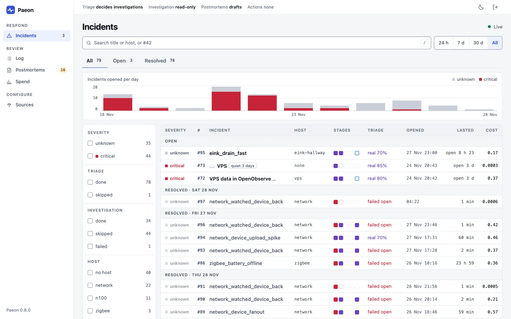
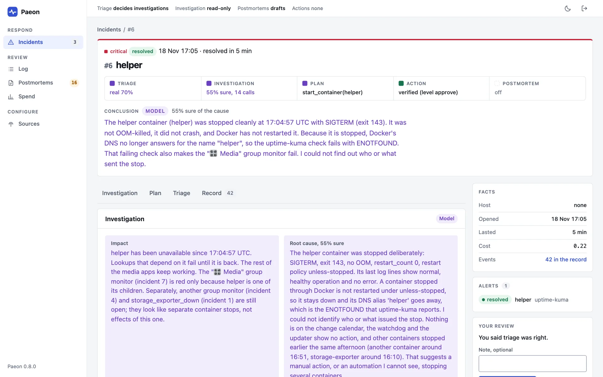
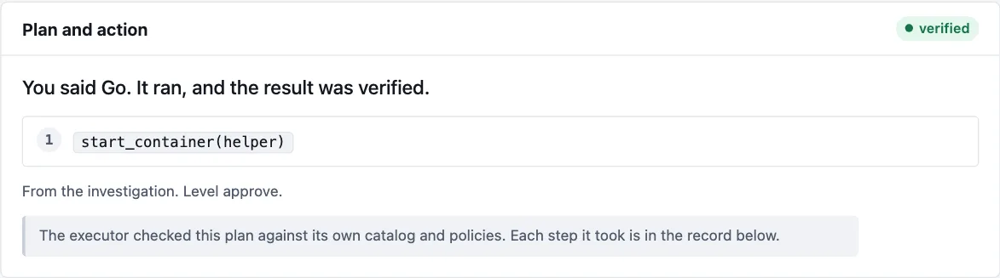
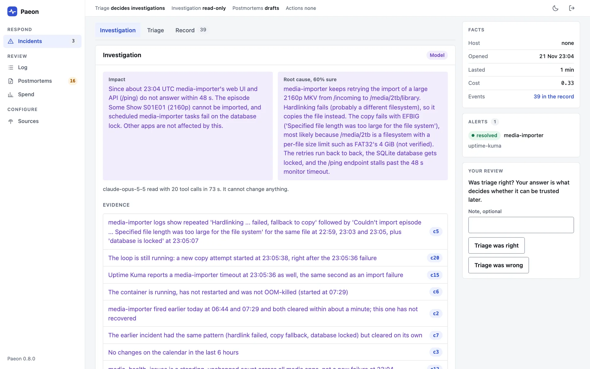
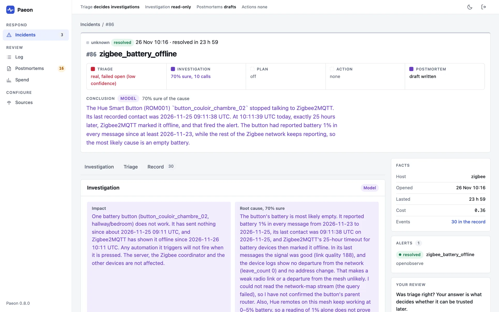
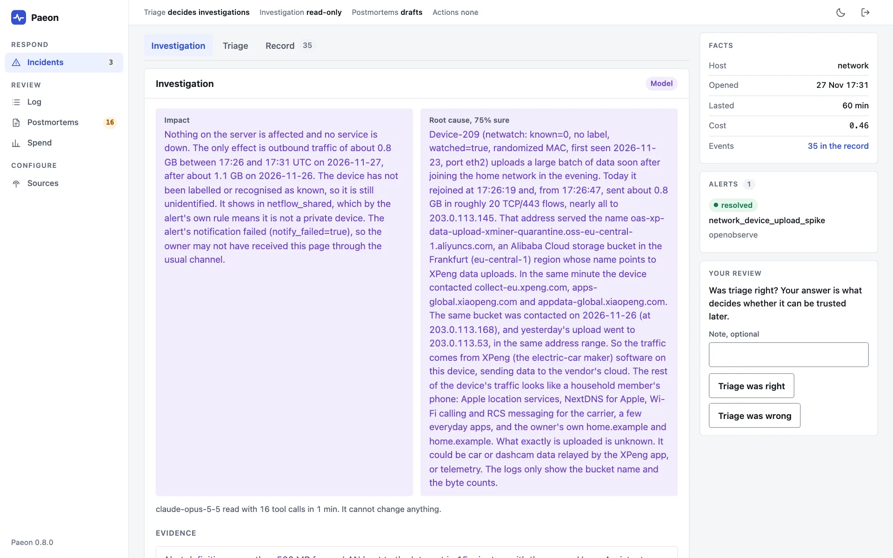

Dieci giorni fa ho presentato [Paeon](/it/paeon-un-collega-di-reperibilita-per-il-mio-server-di-casa/), il collega di reperibilità che ho costruito per il mio server di casa. Quell'articolo era prudente: tutti gli screenshot venivano da dati di demo, e dicevo chiaramente che la parte che *agisce* non aveva girato abbastanza a lungo per considerarla collaudata.

Adesso sì. Paeon gira sul mio server dal 18 novembre, con alert veri, modelli veri e soldi veri. Questo articolo è il resoconto: cosa ha trovato, cosa ha mancato, quanto è costato, e cosa ho cambiato per colpa sua. Lo dico subito: quasi tutto quello che ho cambiato non era Paeon. Erano i miei alert.


**Gli screenshot qui sotto vengono dal server vero**, non da dati di demo. Ho fatto girare la console in locale su una copia del log degli eventi, dove ho tolto o rinominato quello che è privato: indirizzi, nomi di dominio, nomi dei dispositivi, e una parte del mio stack multimediale che preferisco tenere per me. Quindi `media-importer` o `helper` non sono i veri nomi dei container. La loro storia invece è vera.


## Prima i numeri

Tra il 18 e il 28 novembre:

| | |
|---|---|
| Incidenti | **97** (da 107 alert scattati) |
| Indagini | **42**, di Claude Opus, con strumenti in sola lettura |
| Verdetti di triage | **89**, di Claude Haiku |
| Piani proposti | 13, di cui **2 eseguiti dopo il mio Go**, entrambi verificati |
| Bozze di postmortem | 37 |
| Costo dei modelli, tutte le fasi | **13,48 USD**, di cui **0,04 USD** per il triage |

Due cose saltano all'occhio in questa tabella, e riassumono tutto l'articolo.

**Il triage non costa quasi niente.** 89 verdetti per quattro centesimi. Tutti i soldi vanno nelle indagini. Quindi il compito del triage non è essere furbo, ma decidere bene *chi merita un'indagine*.

**I 97 incidenti non erano 97 problemi.** Tutt'altro.

## Il weekend andato storto (quasi apposta)

Sabato 21 novembre ho fatto un po' di manutenzione a mano: un riavvio la mattina, un deploy, poi un nuovo deploy delle mie app multimediali alle 07:29 che non ho annunciato a Paeon. La domenica sono partiti gli aggiornamenti settimanali. Aggiungete un'interruzione del Wi-Fi, una CPU carica e un sensore Zigbee di cattivo umore, e Paeon ha aperto **39 incidenti in due giorni**.

Domenica mattina ho chiesto a Claude Code di leggerli tutti, con il loro triage e le loro indagini, e di ordinarli per causa. La risposta è stata piuttosto umiliante:

* **3 su 34** (gli incidenti del weekend, dal #24 al #57) avevano davvero bisogno di me;
* 12 venivano dalla mia manutenzione, fatta a mano e non annunciata;
* 11 erano monitor *di gruppo* di uptime-kuma, che ripetevano quello che un monitor figlio aveva già detto: Paeon faceva il triage (e a volte l'indagine) due volte sullo stesso guasto;
* 5 erano piccole interruzioni DHCP del router del mio operatore;
* 4 erano alert con soglie semplicemente troppo basse.

E i soldi sono andati di conseguenza: 2,23 USD il sabato e 2,25 la domenica, sopra il mio budget di 2 USD al giorno. La protezione contro le tempeste di alert (al massimo 2 indagini all'ora) ha dovuto saltarne 13.

Il modello non era il problema. Le indagini erano quasi sempre *giuste*: quando un alert scattava perché un container si riavviava durante la mia manutenzione, l'indagine diceva esattamente questo. Il problema era che pagavo un modello potente per dirmi cose che sapevo già, o che non valeva la pena sapere.

## Cosa ho cambiato nei miei alert

Questa è la parte che consiglierei a tutti, con o senza un'IA in reperibilità. Paeon legge ogni alert come se contasse, e scrive perché è scattato. Dopo una settimana, è una revisione brutalmente onesta del vostro monitoring.

* **Sonda DHCP:** una sola risposta mancata faceva scattare un alert di guasto. Nei dati, 55 dei 61 «fallimenti» tra il 9 e il 19 novembre erano una singola sonda mancata. Adesso la sonda riprova una volta, come fa un vero client.
* **`netwatch_errors`:** scattava con *un* errore in 30 minuti. Adesso ne servono tre.
* **Alert CPU:** aveva un silenzio di 6 ore, quindi Paeon teneva l'incidente aperto 6 ore, e ogni triage di rete in quella finestra vedeva un «incidente aperto collegato» e si innervosiva. Adesso il silenzio è di 1 ora.
* **Alert sul traffico del router:** eliminato. Il contatore fibra del router segna da 600 a 1.400 Mbit/s ora dopo ora, mentre la casa ne usa pochi. Un alert su un contatore sbagliato è solo rumore. Tengo i dati, non l'alert.
* **Monitor di gruppo:** non notificano più Paeon. Basta il monitor figlio.
* **I lavori previsti sono annunciati, con una fine.** I miei script di aggiornamento e di backup dicevano già a Paeon «aggiornamenti settimanali iniziati». Non dicevano mai quando erano *finiti*, quindi il triage leggeva ogni riavvio come «cambiamento ancora in corso». Adesso ogni annuncio ha un'ora di fine.

## Cosa ha imparato anche Paeon

La stessa revisione ha portato tre cambiamenti in Paeon, usciti come 0.7.0 e 0.8.0 il 22:

* **Le finestre di manutenzione trattengono i loro incidenti.** Quella domenica, l'identity provider si è riavviato durante gli aggiornamenti settimanali alle 05:07, ha aperto due incidenti, mandato due notifiche e pagato due indagini, per un servizio che stava bene un minuto dopo. Adesso un incidente che si apre in una finestra di manutenzione aspetta che la finestra si chiuda; poi Paeon ricontrolla ogni alert con la sua sorgente. Se è finito, si chiude in silenzio. Se no, parte l'indagine, e le si dice cosa era ancora rotto dopo la manutenzione.
* **Al triage si dice cosa non può vedere.** 39 dei primi 56 verdetti erano sotto la soglia di confidenza, quindi venivano *forzati* a «reale», come previsto. Leggendo le motivazioni, il modello piccolo ripeteva che non vedeva «il risultato della query dell'alert», perché il codice gli diceva che quel risultato mancava. Adesso il triage riceve la query dell'alert, e gli si dice che il risultato non fa mai parte di quello che vede: la sua assenza non è un motivo per dubitare.
* **Niente più indagini ripetute.** `investigation.repeat_hours`: un alert indagato di recente non viene indagato di nuovo, e il salto dice quale incidente lo è stato.

## La settimana dopo

Dal 23 al 27 novembre, con i nuovi alert e Paeon 0.8:

| | 21–22 nov. | 23–27 nov. |
|---|---|---|
| Incidenti al giorno | **19,5** | **6,8** |
| Costo dei modelli al giorno | **2,24 USD** | **1,26 USD** |
| Verdetti forzati a «reale» (confidenza bassa) | 65 % | 41 % |
| Indagini saltate dalla protezione anti-tempesta | 13 | 1 |
| Indagini saltate perché ripetute | – | 5 |

Le interruzioni DHCP, i `netwatch_errors`, i monitor di gruppo e la «tempesta» Zigbee sono semplicemente spariti dalla lista. E metà di quello che resta è una storia a sé, più sotto.

## Cosa ha trovato davvero

Le statistiche sono belle, ma quello che mi ha convinto sono alcuni incidenti in cui Paeon ha fatto esattamente quello per cui l'ho costruito.

### Un container avviato dal telefono

La sera del 18, un piccolo container di supporto usato dalle mie app multimediali è andato giù. Paeon ha raggruppato i due alert (il check del container e quello del suo gruppo), il triage ha detto *reale*, e l'indagine ha trovato qualcosa per cui a me sarebbero serviti qualche minuto e un computer: il container era stato **fermato in modo pulito** (SIGTERM, codice di uscita 143), non era andato in crash, non era stato ucciso per mancanza di memoria, e Docker non l'avrebbe riavviato da solo per via della sua policy `unless-stopped`. Ha anche escluso l'updater e il watchdog, e ha detto onestamente che non riusciva a trovare *chi* avesse mandato lo stop.

Il piano aveva un passo che corrispondeva al mio catalogo, `start_container(helper)`. Ho premuto **Go** sul telefono, l'executor l'ha avviato, ha verificato che fosse in salute, e l'alert si è risolto da solo. Cinque minuti dal primo alert, senza aprire un computer.

È l'unica volta in dieci giorni che un'azione proposta da un modello è stata davvero eseguita sul mio server. E va benissimo così. È quello che prometteva il primo articolo, e ha funzionato al primo colpo.

### Il disco FAT32 che avevo dimenticato

La sera del 21, un'app che importa grossi file video nella mia libreria ha smesso di rispondere al suo health check. L'indagine ha letto i suoi log e ha trovato un loop: ogni 90 secondi l'app provava a importare lo stesso file 4K, la copia falliva con *«Specified file length was too large for the file system»*, il suo database SQLite restava bloccato, e l'health check andava in timeout.

La causa proposta, al 60 %: il disco di destinazione è *molto probabilmente* un file system con una dimensione massima per file, *«come i 4 GiB di FAT32 (non verificato)»*. Non poteva verificarlo, perché Paeon non ha accesso alla macchina. Quindi il primo passo del suo piano era una frase per me: lanciare `df -T` e controllare il file system. L'ho fatto la mattina dopo. Il disco era davvero `vfat`, un vecchio disco USB formattato tanto tempo fa, e me ne ero completamente dimenticato.

Ecco la parte scomoda. **Paeon l'ha trovato quattro volte.** Gli incidenti #44 e #56, e di nuovo tramite i loro monitor di gruppo #45 e #57: la stessa diagnosi ogni volta, circa 1,20 USD di indagini, mentre io facevo altro. La diagnosi era giusta dalla prima volta, e nessuno ha agito. È da qui che è nato `repeat_hours`: se la risposta è la stessa, non serve pagarla di nuovo, basta rimandare all'incidente precedente. Il 22 alle 10:58 la cartella è passata su un disco ext4, l'importazione è andata a buon fine, e gli errori si sono fermati.

### Una pila scarica? Non proprio

Non tutto è spettacolare. Il 26, un pulsante Zigbee del corridoio è andato offline. L'indagine ha notato che segnalava l'1 % di batteria in ogni messaggio da tre giorni, che il suo segnale radio era buono fino alla fine, e che il resto della rete mesh stava bene: *«la causa più probabile è una pila scarica»*, al 70 %.

Solo che non ho cambiato nessuna pila. E l'indagine aveva già scritto la riserva da sola, alla fine della causa: *«i telecomandi Hue di questa rete continuano a funzionare tra lo 0 e il 5 % di batteria, quindi una lettura dell'1 % da sola non prova che la pila sia scarica»*. Il suo piano elencava perfino altri sette interruttori tra lo 0 e il 7 %, tutti funzionanti. La percentuale di batteria che riportano questi interruttori semplicemente non è molto affidabile, e un'indagine seria lo dice invece di trasformarla in una certezza.

Un ultimo dettaglio dal log: l'incidente si è «risolto» esattamente 24 ore dopo l'apertura. Non perché il pulsante sia tornato, ma perché è finita la finestra dell'alert. Un incidente risolto non è sempre un problema sistemato.

## Il dispositivo che continuava a tornare (ero io)

Il 24 novembre ho aggiunto nuovi alert sopra il [mirror del traffico](/it/chi-usa-davvero-la-mia-fibra-copiare-il-traffico-di-casa-su-un-raspberry-pi/): un dispositivo sconosciuto in rete, un dispositivo sorvegliato che ritorna, un dispositivo che manda più di 500 MB in 15 minuti. Paeon può indagarli con i dati dei flussi, tranne che per alcuni dispositivi di casa che sono esclusi apposta da quello che può leggere.

Quasi subito è comparso un dispositivo sconosciuto con un indirizzo MAC casuale. Entrava in rete la sera, usciva, tornava. E due volte, subito dopo essersi collegato, ha **mandato circa 1 GB** verso un solo indirizzo, sulla porta 443.

L'indagine ha fatto quello che avrei fatto io, ma meglio. Ha guardato i nomi risolti dal dispositivo e i nomi TLS nel suo traffico, e ha trovato la destinazione: un bucket di storage su Alibaba Cloud, regione di Francoforte, con un nome che contiene **«xp-data-upload»**, contattato insieme ai server di **XPeng**, il costruttore di auto elettriche. Il resto del traffico sembrava quello di un telefono: servizi Apple, chiamate Wi-Fi dell'operatore, qualche app di tutti i giorni.

Il dispositivo sconosciuto era **il mio iPhone**. iOS dà a ogni rete Wi-Fi un indirizzo MAC privato e casuale, quindi per il mio monitoring di rete era uno sconosciuto. E torna tutto: guido una XPeng. Ogni volta che rientro a casa e il telefono si collega al Wi-Fi, l'app XPeng manda centinaia di megabyte al cloud del costruttore.

Cosa c'è dentro? Non lo so ancora. L'informativa privacy europea di XPeng parla di «dati telematici» (stato della batteria e della ricarica, chilometraggio, velocità, posizione) e di identificativi del dispositivo, ma niente che spieghi un gigabyte mandato dal telefono dopo ogni viaggio. Metriche di guida? Dati delle telecamere? Log? Merita un'indagine a parte, con una richiesta in base al Data Act europeo (che permette al proprietario di un'auto di chiedere i dati che l'auto produce) e uno sguardo a cosa esce dal telefono. **Sarà l'argomento di un prossimo articolo.**

Per Paeon, la lezione è più semplice. Il modello aveva ragione, gli alert avevano ragione, e comunque si trattava della maggior parte dei 17 incidenti di rete della settimana, e di circa 3 USD di indagini, per un dispositivo che è mio. La correzione è una riga nella mia lista dei dispositivi conosciuti.

## Cosa mi ha mostrato Paeon sui miei alert

Da quegli incidenti di rete è uscita un'ultima cosa, ed è quella che mi ha sorpreso di più. In un'indagine, una frase alla fine dell'impatto: *«La notifica dell'alert è fallita (`notify_failed=true`), quindi il proprietario potrebbe non aver ricevuto questo avviso dal canale abituale.»*

Ho controllato. **Tutti i 15 scatti dei nuovi alert di rete non erano riusciti a notificare.** Nessuno era arrivato sul mio telefono tramite OpenObserve. Il motivo più probabile: alla nuova destinazione ntfy creata dal mio script manca l'header di autorizzazione che aggiungo a mano sulle altre. Paeon era l'unico a vedere quegli alert.

Nel primo articolo scrivevo «tenete il vostro sistema di alert, Paeon non lo sostituisce». Lo penso ancora. Ma un secondo paio d'occhi che legge i metadati dell'alert ha trovato un buco nel primo.

## Cosa non ha funzionato

Per essere onesti, alcune cose sono andate meno bene.

* **Indagare quello che non si può leggere è uno spreco.** Due alert sul mio display e-ink (un riavvio inatteso, una batteria che si scarica in fretta) leggono lo stream di Home Assistant, che Paeon non ha il permesso di leggere. Entrambe le indagini sono finite con *«Not found»*, confidenza 10 %, per circa 0,47 USD. L'hanno detto onestamente, e l'allow-list ha fatto il suo lavoro. Ma Paeon potrebbe sapere *prima* di pagare che la query dell'alert legge uno stream che non può vedere.
* **Un Go ha bisogno di qualcuno che lo dica.** Questa settimana un runbook mi ha chiesto il Go due volte, in momenti in cui non guardavo il telefono. Entrambe le richieste sono scadute dopo 30 minuti, e il problema si è risolto da solo ore dopo. «Approve» è sicuro, ma aiuta solo se c'è qualcuno ad approvare.
* **I postmortem vanno letti.** Il triage legge solo i postmortem che ho segnato come rivisti. Ho 22 bozze in attesa. Ogni bozza non letta è un problema noto che il triage non può riconoscere come noto. Questo dipende da me.
* **Un picco di CPU di 6 ore, ogni uno o due giorni.** Il media server fa i suoi lavori in background (probabilmente miniature e analisi dei media) per circa 6 ore, regolarmente, di notte. L'indagine ha trovato lo schema nello storico di 7 giorni e ha detto *non riavviare niente*. Giusto, ma l'alert scatterà di nuovo finché non programmo bene quei lavori o non insegno all'alert a riconoscerli.

## Cosa vi direi adesso

I consigli del primo articolo valgono ancora. Dieci giorni di alert veri aggiungono qualche riga:

* **La vostra prima settimana è una revisione dei vostri alert, non dell'IA.** Leggete ogni incidente con il suo motivo. Correggete gli alert che scattano per niente prima di accusare il modello di essere nervoso.
* **Annunciate ogni cambiamento, con una fine.** Un nuovo deploy fatto a mano alle 7:29 e non annunciato mi è costato otto incidenti.
* **Guardate dove vanno i soldi.** Il triage non è niente; le indagini sono tutto. I risparmi migliori sono venuti dall'indagare di meno (niente ripetizioni, niente manutenzione, niente monitor di gruppo), non da modelli più economici.
* **Aspettatevi di imparare cose che non avevate chiesto.** Un disco FAT32 dimenticato, una notifica rotta, un'auto che parla con il suo cloud tramite il mio telefono. Niente di tutto questo era il motivo per cui ho costruito Paeon.

Paeon è su [GitHub](https://github.com/mmornati/paeon), ora alla 0.8.0, con tutto quello che è descritto qui.

## Come è stato fatto

La revisione del weekend è stata una sessione di Claude Code che ha letto gli incidenti e i postmortem sul server e li ha ordinati per causa. Una seconda sessione ha confrontato ogni proposta con il codice di Paeon e ha scritto la 0.7.0 e la 0.8.0, e una terza ha modificato gli alert sul server. Per questo articolo, una sessione di Claude Code ha copiato il log degli eventi dal server (in sola lettura), ha confrontato le settimane prima e dopo, ha controllato il disco FAT32, ha costruito una copia anonimizzata del log, ci ha fatto girare la console in locale per gli screenshot, e ha scritto il testo. La mia parte: decidere cosa valeva la pena correggere, spostare la cartella fuori dal disco FAT32, e riconoscere il mio telefono.
