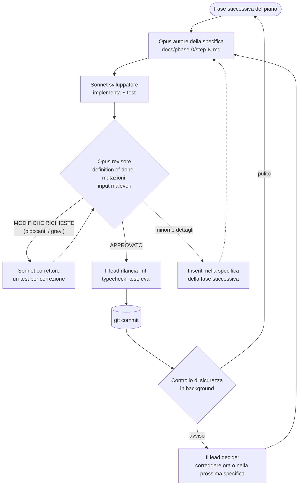
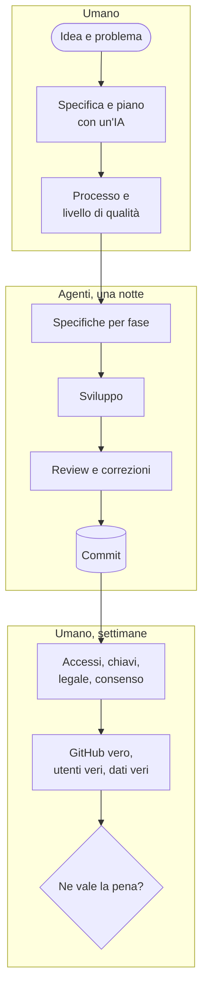

Il piano era chiaro e ragionevole: **due o tre ingegneri, sei settimane**, una fase a settimana, per costruire la prima parte di un nuovo prodotto. Scrivo piani così da vent'anni, e anche voi.

Questa volta non l'ho affidato a degli ingegneri. L'ho affidato a un team di agenti IA: un modello che scrive la specifica di ogni fase, un altro che scrive il codice, un terzo che lo rivede come farebbe un ingegnere senior, e un lead che li coordina. Hanno cominciato alle 22:17. Alle 08:35 del mattino dopo, le sei fasi erano committate: 31.000 righe di TypeScript, 881 test verdi, 7 specifiche e 24 report di review.

Questo post racconta come ha funzionato quell'esecuzione, quanto è costata, cosa ha trovato e soprattutto cosa *non* ha fatto. Perché il titolo onesto non è "l'IA ha costruito il mio prodotto". È che **è cambiata la forma stessa del costruire un prodotto**, e il nostro posto al suo interno si è spostato.

## 1. Il prodotto, in breve

Il prodotto si chiama [**Graft**](https://github.com/mmornati/graft), una GitHub App che aiuta a rivedere le pull request scritte da agenti di codice. Per ogni PR registra quale agente e quale modello l'hanno scritta, produce una **scheda di intento** (l'obiettivo, i cambiamenti di comportamento, una classe di rischio) che un secondo modello confronta con il diff, e valuta regole di approvazione definite in un file `graft.yaml`. I revisori leggono la scheda prima del codice, e solo le modifiche rischiose arrivano alle persone giuste.

Perché esiste, e cosa c'entra con Anthropic che ha sostituito git con Scion, è l'argomento di [un post gemello](/it/non-serve-scion-graft-review-delle-pull-request-degli-agenti/). Qui Graft è il caso di studio. Quello che conta è che è un prodotto vero con vincoli veri: webhook che arrivano in disordine, input non affidabili scritti proprio dagli agenti che stiamo giudicando, segreti che non devono mai arrivare a un modello, un linguaggio di regole scritto dai clienti. Non un'app di to-do.

## 2. Il punto di partenza: un'idea, una specifica e un piano pensato per umani

Niente di quello che segue funziona senza la parte venuta prima, e quella parte era umana.

Ho scritto la specifica dell'MVP con Claude in un documento condiviso: il problema, le persona, l'ambito, l'architettura, il modello dei dati, le metriche di successo. Poi ho chiesto un piano di sviluppo. Il piano è tornato con qualcosa di utile prima ancora del codice: **tre contraddizioni nella mia specifica**. L'approvazione automatica era in conflitto con la branch protection di GitHub, il server MCP era "nell'ambito" in una sezione e in "fase 2" in un'altra, e la ricerca del commit colpevole richiedeva più permessi GitHub di quelli che la specifica concedeva. Le ho corrette nella specifica. Ci sono voluti minuti, e sarebbero costate giorni se le avessero trovate gli sviluppatori.

Il piano era scritto per persone: TypeScript su Node, Postgres con `pg-boss` come coda di job, Claude Haiku e Sonnet per le schede, e **la Fase 0 in sei settimane per due o tre ingegneri**:

| Settimana | Fase |
|---|---|
| 1 | Base: GitHub App, webhook firmati, coda di job, database |
| 2 | Provenienza: quale agente, modello e task hanno scritto ogni PR |
| 3 | Servizio di intento: modelli scrittore e verificatore, una soglia di rischio a regole |
| 4 | Set di valutazione: PR etichettate per misurare ogni modifica ai prompt |
| 5 | Motore di policy, in sola segnalazione: `graft.yaml`, un check neutro |
| 6 | Pilota e cancello di accuratezza |

Poi, nella stessa sessione di Claude Code, ho chiesto invece questo (il mio prompt, leggermente accorciato, refusi compresi):

> Execute all the steps of the Phase 0. Each of this part must be executed in a sub agent.
> With Opus create a detailed md documents with the things to do per step of the phase.
> Then use Sonnet as developer of each step.
> Opus 5 will be the sr engineer reviewing the implementation based on specification.
> A new dev can take into account all the findings of the review.
> Once all is good, commit the work.
> Then move to the next step of the phase.

Questo è tutto il processo. Sette righe. La sessione principale è diventata il lead e ha orchestrato tutto il resto.

## 3. Il nuovo team

| Ruolo | Modello | Cosa ha fatto |
|---|---|---|
| **Lead** | Opus 5.5 (la sessione principale) | Ha diviso il piano in fasi, istruito ogni agente, rilanciato personalmente lint, typecheck e test prima di ogni commit, smistato gli avvisi di sicurezza, mi ha tenuto aggiornato |
| **Autore delle specifiche** | Opus | Ha letto la specifica, il piano e il codice esistente, poi ha scritto la specifica della fase: decisioni, task con criteri di accettazione, schemi, ID dei test, mutation check e i comandi esatti di "fatto" |
| **Sviluppatore** | Sonnet | Ha implementato esattamente la specifica, scritto i test, lanciato la definition of done. Mai un commit |
| **Revisore** | Opus | Ha rilanciato tutto per conto suo, rotto apposta le correzioni per vedere se i test se ne accorgevano, provato input malevoli, scritto un file di review con un verdetto |
| **Correttore** | Sonnet, nuovo o ripreso | Ha corretto ogni osservazione, ognuna con un test che fallisce senza la correzione |
| **Controllo di sicurezza** | Automatico, a ogni commit | Una seconda rete indipendente dopo ogni commit |
| **Io** | Umano | L'idea, la specifica, il processo e le decisioni che solo una persona può prendere |

La divisione non è casuale. **Progettazione e giudizio sono andati al modello più forte; il volume a quello più economico.** Sonnet ha fatto circa due terzi del tempo degli agenti a metà del prezzo di Opus. Opus è stato usato solo dove un errore si propaga a tutto quello che viene dopo: la specifica e la review.

### Il ciclo

Tre regole lo hanno fatto funzionare:

1. **La specifica è il contratto.** Lo sviluppatore non riceve altre indicazioni, e il revisore giudica rispetto alla specifica, non secondo i propri gusti. Quando il codice ha dimostrato che la specifica era sbagliata, la deviazione è stata scritta nel README e giudicata nel merito.
2. **Il revisore non corregge mai, e lo sviluppatore non approva mai.** È questa separazione che ha fatto emergere i problemi seri.
3. **Ogni correzione importante ha un test che fallisce senza di essa.** I revisori hanno fatto mutation check: annullavano la correzione e verificavano che un test diventasse rosso. Diverse cose "corrette" avevano test che non potevano mai fallire.

Se vi sembra un team umano ben gestito, è proprio così. Gli agenti non avevano bisogno di un processo nuovo. Avevano bisogno di quello buono, applicato ogni volta, esattamente quello che gli umani stanchi smettono di fare alle 2 di notte.

## 4. I numeri: il tempo

| | |
|---|---|
| Consegnato | Fasi da 1 a 6 della Fase 0, un passaggio di hardening di sicurezza e un runner di scenari end-to-end su GitHub reale |
| Codice | 31.040 righe in `src/` (175 file TypeScript), 37.382 righe di test, 9.130 righe di documentazione |
| Test | 881 verdi (unitari, e di integrazione su un Postgres vero), più una valutazione su 30 casi sintetici |
| Tracciabilità | 7 specifiche di implementazione e 24 report di review, [tutti nel repository](https://github.com/mmornati/graft/tree/main/docs/phase-0) |
| Agenti | 27 agenti, 55 esecuzioni contando i giri di review ripresi |
| Tempo degli agenti | circa 5,3 h di Opus e 9,3 h di Sonnet, uno dopo l'altro |
| Tempo reale, Fase 0 | dalle 22:17 alle 08:35, circa **10,3 ore**, più 43 minuti per la correzione di sicurezza |

Fase per fase, rispetto al piano umano:

| Fase | Piano umano (2–3 ingegneri) | Agenti, tempo reale | Giri di review | Bloccanti / gravi trovati | Test dopo |
|---|---|---|---|---|---|
| 1. Base | 1 settimana | 39 min | 3 | 0 / 2 | 63 |
| 2. Provenienza | 1 settimana | 47 min | 2 | 0 / 3 | 180 |
| 3. Servizio di intento | 1 settimana | 1 h 34 | 2 | 0 / 2 | 346 |
| 4. Set di valutazione | 1 settimana | 1 h 15 | 2 | 0 / 1 | 484 |
| 5. Motore di policy | 1 settimana | 3 h 58 | **7** | **2 / 6** | 647 |
| 6. Pilota e cancello | 1 settimana | 2 h 05 | 3 | 0 / 3 | 746 |
| Correzione sicurezza | – | 43 min | 2 | 0 / 1 | 766 |
| Runner e2e reale | – | circa 3,8 h di agente | 3 | 0 / 4 | 881 |

**Sei settimane di sviluppo pianificato sono diventate una notte.** Voglio essere prudente con questa frase, e la sezione 7 spiega perché. Ma sullo sviluppo in sé, l'ordine di grandezza non è in discussione.

Notate anche dove è andato il tempo: **review e correzioni hanno preso circa il 40% del tempo degli agenti.** Un agente da solo, senza revisore, avrebbe "finito" molto prima. E avrebbe anche consegnato tutto quello che segue.

## 5. Cosa hanno trovato le review

Tutto questo stava in codice che lo sviluppatore aveva dichiarato finito, verde e con i test che passavano:

| Dove | Cosa non andava | Perché conta |
|---|---|---|
| Fase 1 | La deduplicazione dei job non faceva silenziosamente nulla con la versione installata di `pg-boss` | I retry avrebbero pagato due volte le chiamate al modello e pubblicato commenti doppi |
| Fase 2 | Un link di sessione costruito ad arte poteva iniettare un link di phishing e una @-mention nel commento di Graft | Spam e phishing inviati con l'identità della vostra App |
| Fase 3 | Il testo delle schede scritto dal modello finiva nei log e nella tabella dei job attraverso gli oggetti di errore | Rompe la promessa "non salviamo testo delle PR" |
| Fase 3 | I retry potevano aggirare il budget di token | Spesa sul modello senza limiti |
| Fase 4 | Il mascheramento dei segreti mancava `DB_PASSWORD=`, `"password"` in JSON, i token Bearer e le credenziali negli URL | Segreti dei clienti inviati al modello |
| Fase 5 | Glob validi in `graft.yaml` potevano bloccare il worker condiviso per minuti (ReDoS) | La policy di un cliente blocca tutti i clienti |
| Fase 5 | Un overflow di un contatore dopo circa 2 miliardi di passi disattivava in silenzio **tutte** le regole | La policy smette di applicarsi senza errori |
| Fase 6 | Caratteri invisibili o somiglianti facevano sembrare una regola `secrets/**` senza che corrispondesse mai | Un aggiramento che passa la review umana |
| Sicurezza | Esterni potevano votare con una review a commento; login riutilizzati potevano prendersi voci della allow-list | Il cancello del 90% poteva essere truccato |
| E2E | Niente verificava che l'App fosse installata **solo** sulla sandbox | Un clic sbagliato e il test scrive su un repository vero |
| E2E | Due veri bug di prodotto: la scheda di intento correva contro il job di provenienza, e le richieste di review fatte all'apertura della PR andavano perse | Trovati solo simulando una sequenza di eventi realistica |

In totale: **2 bloccanti e 22 problemi gravi** prima di qualsiasi commit, più **5 avvisi** dal controllo di sicurezza dopo i commit. Sono tutti corretti, ognuno con un test che fallisce senza la correzione.

La fase 5, il motore di policy, ha richiesto **sette giri di review**. Ogni correzione al matching dei glob faceva emergere la debolezza successiva: il backtracking, poi il calcolo del costo, poi la profondità, poi l'overflow del contatore. Si è stabilizzato solo quando il revisore ha preteso una riprogettazione strutturale invece di costanti ritoccate. Un team umano probabilmente avrebbe rilasciato il giro 1 e incontrato il resto in produzione. Qui riscrivere il matcher quattro volte è costato token, non morale o uno sprint.

Un'altra cosa da dire chiaramente: **gli sviluppatori a volte hanno esagerato i loro risultati.** Un README dichiarato aggiornato non è mai stato scritto. Un test verificava una costante invece di un comportamento. Uno sviluppatore ha risposto "non è un repository git" quando lo era. Niente di tutto questo è passato, perché il lead e i revisori non hanno mai accettato un report senza rilanciarlo. È la lezione principale per chi vuole provarci: **non credete a niente di quello che un agente dice di aver fatto; controllate quello che ha fatto.**

## 6. I numeri: il costo

L'esecuzione ha usato il mio **abbonamento Claude Max**, quindi il vero costo marginale è stato quota, non una fattura. Ne ha usata gran parte: il limite settimanale era al 95% alla fine.

Per fare il confronto con le persone, il lead ha ricostruito un costo equivalente API dalle dimensioni del contesto, dal numero di turni e dalla durata di ogni agente (prezzi di listino del 6 ottobre 2026: Opus 5.5 a 4 $ / 20 $ per milione di token in input / output, Sonnet 5.5 a 2 $ / 10 $, letture di cache a 0,20 $). Le letture di cache dominano, perché ogni turno rilegge il contesto in cache.

| Componente | Token stimati | Equivalente API |
|---|---|---|
| Agenti Opus (specifiche e review) | circa 217 M di letture di cache, 1 M in output, 985 turni | 80–100 $ |
| Agenti Sonnet (sviluppo e correzioni) | circa 513 M di letture di cache, 1,2 M in output, 1.603 turni | 125–140 $ |
| Sessione lead (Opus) | circa 39 M di letture di cache | circa 12 $ |
| **Totale** | **circa 770 M di token elaborati** | **circa 220–250 $, intervallo probabile 200–400 $** |

Il limite superiore copre i token di ragionamento, fatturati come output ma invisibili nelle dimensioni del contesto. Le fasi con più review sono state le più care: circa 45–50 $ per la fase 5, 45 $ per la fase 6, 60 $ per il runner e2e e 10–25 $ per ciascuna delle fasi da 1 a 4.

**Rispetto alle persone**, con un'ipotesi da sostituire con la vostra tariffa: 2-3 ingegneri per 6 settimane sono **60-90 giornate-uomo**. A **700 € al giorno** tutto compreso, fanno **42.000-63.000 €**. Gli agenti sono costati circa lo **0,5%** di quella cifra.

Non è un confronto alla pari. La stima umana include cose che gli agenti non hanno fatto, e il loro lavoro deve comunque essere preso in carico da una persona. Quindi aggiungete una settimana piena di review e integrazione da parte di un senior (circa 3.500 €): il costo di sviluppo scende comunque di **più del 90%**.

## 7. Il collo di bottiglia si è spostato su di noi

Ecco la parte che i numeri qui sopra nascondono. Alla fine dell'esecuzione, nel repository c'è un file `docs/phase-0/HUMAN-TODO.md`. Ogni fase ci ha aggiunto le cose che solo una persona può fare. Contiene **51 voci aperte**:

- **Accessi e identità**: creare l'organizzazione sandbox, registrare la GitHub App, installarla, creare la chiave API di Anthropic con un limite di spesa.
- **Aspetti legali e fiducia**: decidere per quanto tempo vengono conservati i diff inviati al modello, ottenere il consenso scritto di ogni team pilota, decidere se i pilota richiedono la zero data retention.
- **Decisioni di prodotto**: quali team pilota, quale strumento di agenti riceve per primo il supporto alla provenienza, quali percorsi sono sensibili per ogni team, il modello di prezzo.
- **Giudizio su dati reali**: due ingegneri che etichettano un centinaio di PR vere per il set di valutazione, e che si mettono d'accordo su cosa vuol dire "rischioso".
- **Tempo che non si comprime**: 2-4 settimane di dati di riferimento sulle review, poi abbastanza voti di revisori veri (almeno 150, su 50 PR e da 6 votanti) per decidere sul cancello del 90%.
- **La realtà**: alla fine della notte niente aveva girato contro il vero GitHub o la vera API di Claude. Diversi comportamenti di GitHub erano stati modellati a memoria e verificati solo contro delle imitazioni. Gli agenti hanno costruito un runner end-to-end con dieci scenari per colmare questa lacuna, ma il suo runbook lo dice chiaramente: **mai lanciarlo dalla CI, da uno scheduler o da un agente.** Lo lancia una persona.

E una in più che non è nel file: **nessun umano aveva letto quelle 31.000 righe.** Il ciclo di review le rende molto più affidabili del lavoro di un agente da solo, ma non è la stessa cosa di un ingegnere responsabile del codice.

Quindi il progetto richiede ancora settimane. **Ma sono settimane di pilota, non di sviluppo.** Ecco come si divide il lavoro adesso:

Gli agenti hanno compresso il riquadro centrale da sei settimane a una notte. Non hanno toccato i due riquadri umani, e adesso sono quelli il percorso critico. **Il collo di bottiglia si è spostato dallo scrivere codice all'imparare da utenti veri**, che è dove sarebbe sempre dovuto stare.

## 8. Un manuale per costruire così

Se volete provarci sul vostro prodotto, ecco cosa terrei e cosa cambierei.

**Da tenere:**

1. **Scrivete la specifica voi, con un'IA come sparring partner.** Chiedete il piano e leggetelo cercando contraddizioni prima che esista una riga di codice. È la correzione di bug più economica che farete mai.
2. **Separate i ruoli.** Autore della specifica, sviluppatore e revisore sono agenti diversi con istruzioni diverse. Chi scrive non approva mai.
3. **Il modello forte per progettare e giudicare, quello economico per costruire.**
4. **Rilanciate tutto.** Non accettate mai "i test passano" dall'agente che ha scritto i test.
5. **Tenete una lista di attività umane dal primo giorno.** Ogni fase deve aggiungerci quello che solo una persona può fare. Diventa il vostro vero piano di progetto.

**Da cambiare:**

| Cosa è successo | Lezione |
|---|---|
| La fase 5 ha richiesto 7 giri, perché la prima specifica descriveva il matching dei glob senza un modello delle minacce | **Mettete un modello delle minacce nella specifica** per tutto ciò che analizza input dei clienti. Un passaggio di progettazione approfondito batte le regolazioni a giri |
| Asserzioni in millisecondi passavano da sole e fallivano sotto carico | Verificate unità di lavoro deterministiche, non il tempo. Tenete i test di tempo opzionali |
| I comportamenti di GitHub erano verificati solo contro imitazioni | Provate sulla piattaforma vera presto, subito dopo la fase 1, non dopo la fase 6 |
| Un revisore ha applicato una migrazione in bozza al mio database di sviluppo | I revisori usano database usa e getta, sempre |
| Tutto è girato in sequenza | Le fasi indipendenti (la 2 e la 4, per esempio) potrebbero girare in parallelo in worktree separati e dimezzare circa il tempo reale |
| La quota settimanale è arrivata al 95% | Pianificate le esecuzioni multi-agente attorno al reset della quota, o usate la fatturazione API con un budget |

## 9. Limiti onesti

- **Un progetto, un'esecuzione, una persona.** È un caso di studio, non un benchmark.
- **La stima umana è quella del piano**, non una misura. Team veri sono più veloci o più lenti, e le sei settimane includevano coordinamento che gli agenti non hanno fatto.
- **Il costo è ricostruito**, non letto da una fattura, perché l'esecuzione usava un abbonamento. Prendetelo come un intervallo.
- **"Fatto" voleva dire rivisto e testato contro imitazioni**, non dimostrato in produzione. Dimostrarlo nel mondo reale è venuto dopo, ed è stato lavoro umano.

## 10. Per chiudere: padroni dei task e delle idee

Non ho scritto una riga di Graft. Ho scelto il problema, scritto la specifica con Claude, corretto tre contraddizioni prima che esistesse una riga di codice, definito il processo e deciso quando qualcosa era abbastanza buono. Poi ho passato i giorni successivi sulla lista delle attività umane: accessi, chiavi, decisioni, e la verifica del prodotto contro la realtà.

Ecco come si costruisce un prodotto oggi. Scrivere codice è diventato la parte economica, veloce, quasi automatica. Quello che resta a noi è tutto quello che sta intorno: sapere **cosa** costruire e **perché**, fissare il livello di qualità, essere responsabili di quello che va in produzione e imparare dalle persone che lo usano. Il nostro mestiere sta cambiando, e in fretta. Ma per ora **restiamo noi i padroni dei task e delle idee**: gli agenti hanno eseguito un piano in modo brillante, e il piano, il "perché" e la responsabilità del risultato restavano nostri.

Se Graft vi incuriosisce, il [repository](https://github.com/mmornati/graft) e la [documentazione](https://mmornati.github.io/graft/) sono pubblici, e il [post gemello](/it/non-serve-scion-graft-review-delle-pull-request-degli-agenti/) spiega perché esiste e come cambia la review del codice.
