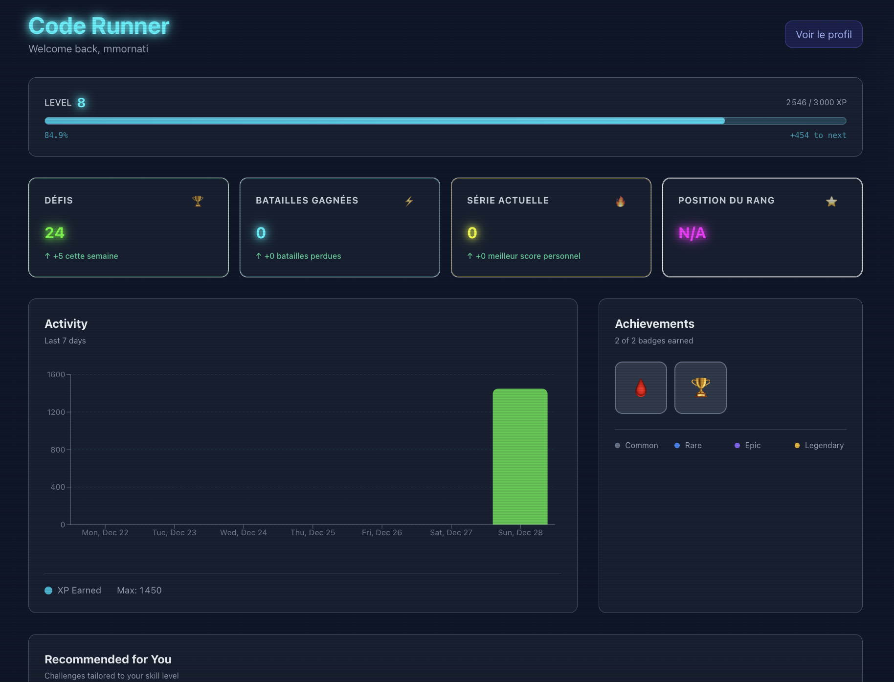
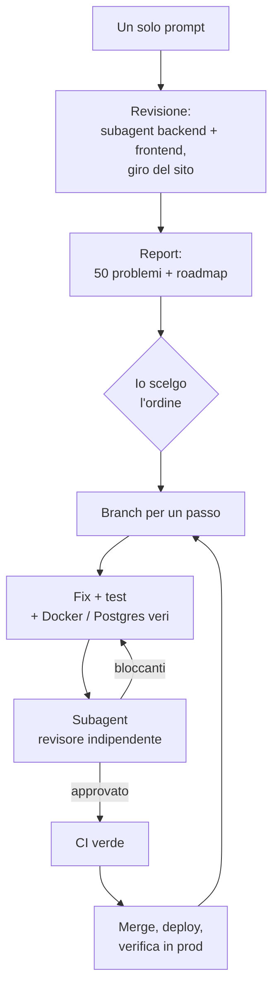

A dicembre 2025 ho costruito [Cyber Code Academy](https://play.pygame.ovh/), un piccolo gioco per imparare Python, per mio figlio e i suoi compagni. L'ho fatto in cinque giorni con **Cursor** e **GitHub Copilot**, in quello che chiamavo ["pure vibe coding"](/building-cyber-code-academy-a-pure-vibe-coding-experiment/). Poi, a gennaio, ho usato **Antigravity** per [scrivere penetration test su misura](/vibe-coding-custom-penetration-tests-when-ai-becomes-your-security-partner/), e ho scritto un intero articolo su [come era stata messa in sicurezza la sandbox Python](/securing-python-code-execution-how-we-protected-our-server-from-untrusted-code/) (articoli in inglese).

Il mio obiettivo era la sicurezza prima di tutto, anche se la posta in gioco è bassa. Nell'app non ci sono dati personali (solo uno username), e sul server non c'è niente di prezioso. Volevo vedere quanto vale l'IA nei controlli di sicurezza, e verificavo io stesso quello che produceva. Nel primo articolo avevo perfino scritto che la sicurezza *"sembrava gestita da sola"*.

L'app sta per compiere un anno. Prima di decidere se lasciarla attiva, ho guardato i numeri. Sono piccoli (49 account, 756 invii), ma qualcuno la usa ancora. Così ho provato un esperimento: **cosa pensa di questo codice un modello più giovane di un anno, e molto più forte?** Ho aperto Claude Code con **Opus 5.5** e ho scritto un solo prompt.

La risposta, più o meno: *WTF*.

## 1. Cosa vuol dire "i modelli di un anno fa"

Non ricordo esattamente quale modello ci fosse dietro ogni sessione di Cursor o Copilot. Cambiavo spesso, e a volte sceglieva lo strumento per me. Questo era il menù a dicembre 2025:

| Produttore | Modelli disponibili a dicembre 2025 |
|---|---|
| Anthropic | Claude Sonnet 4.5 (settembre), Haiku 4.5 (ottobre), **Opus 4.5** (24 novembre) |
| OpenAI | GPT-5 (agosto), GPT-5.1 e GPT-5.1-Codex-Max (novembre), **GPT-5.2** (11 dicembre) |
| Google | **Gemini 3 Pro** (18 novembre), il modello predefinito di Antigravity, uscito lo stesso giorno |
| Cursor | Composer 1, il modello di coding fatto in casa da Cursor (ottobre) |
| Cina | DeepSeek V3.2, Kimi K2 Thinking (Moonshot), MiniMax M2, GLM-4.6 (Z.ai, poi GLM-4.7 il 22 dicembre), Qwen3-Coder (Alibaba) |

Erano i migliori modelli del loro tempo. Opus 4.5 è stato il primo modello sopra l'80% su SWE-bench Verified (80,9%). Quindi questa non è una storia di strumenti deboli. È una storia di quanto è cambiato in un anno.


**Cosa vuol dire "un solo prompt" qui.** Un solo messaggio ha avviato ogni sessione. Ho comunque risposto alle domande del modello: quale redesign scegliere, in che ordine correggere, e fare io il login su Coolify quando gli servivano i log del server (non può digitare password). Tutti i bug qui sotto sono corretti e mergiati (il piano di gameplay alla fine è ancora da fare), e niente è mai stato provato come attacco contro la produzione.


## 2. Il prompt

Ecco il prompt completo, errori compresi (l'ho scritto in inglese):

> Make a full review of the project to identify all the improvements, security fix, ...
> Then using the /impeccable:impeccable skill propose a complete graphical refactor in a WOW effect mode in line with the style of the project.
> You can see the pages on https://play.pygame.ovh/ (I can log you in to make a check everywhere)

In breve: una revisione completa del progetto (miglioramenti, fix di sicurezza…), poi un redesign grafico "effetto WOW" con lo skill di design Impeccable. Sul redesign torno dopo. La prima metà ha prodotto questo.

Una decina di minuti dopo, la sessione aveva:

- lanciato due code review in parallelo, una sul backend e una sul frontend, ciascuna con il proprio subagent;
- visitato il sito online, pagine pubbliche e pagine con login;
- pubblicato un report con **50 problemi: 2 critici, 12 alti, 22 medi, 14 bassi**, più una roadmap.

Le prime righe del suo riassunto:

> **Chiunque può gestire le sfide senza fare login.** [...] L'ho confermato nel codice ma non l'ho provato contro la produzione.
>
> **Il codice dell'utente può falsificare i propri risultati.** Può uscire dai builtins ristretti, stampare una finta riga `{"passed": true}`, e superare qualsiasi sfida o battaglia.

## 3. I due bug critici

### Chiunque poteva modificare il catalogo

`POST`, `PUT` e `DELETE /api/v1/challenges` non avevano **nessuna autenticazione**. Con `curl`, chiunque poteva cancellare tutte le sfide, o pubblicare una sfida da 1000 XP senza test. E una sfida senza test veniva sempre superata.

Nessun exploit furbo: solo tre endpoint senza `Depends(require_admin)`. La sezione admin aveva il suo [articolo](/behind-the-scenes-the-admin-section-of-cyber-code-academy/), e le *pagine* admin controllavano il ruolo. L'API dietro no. I penetration test di gennaio coprivano la manipolazione dei JWT, la SQL injection e le evasioni dalla sandbox. Nessuno ha provato a chiamare l'endpoint senza token.

### Qualsiasi studente poteva falsificare i propri risultati

Questo fa più male, perché ci avevo scritto un articolo intero. La sandbox esegue il codice dello studente con un dizionario `__builtins__` ristretto. L'articolo spiegava perché `getattr(__builtins__, 'exec')` fallisce: `__builtins__` è un dict con solo funzioni sicure, non il vero modulo. È vero. Ma una funzione built-in si ricorda il modulo da cui viene:

```python
print.__self__   # il vero modulo builtins, con exec, __import__, open...
```

In più, il codice dello studente girava **nello stesso interprete dei test**, e il backend leggeva **l'ultima riga JSON stampata** come risultato. Quindi il codice non aveva nemmeno bisogno di uscire dalla sandbox. Poteva stampare una riga di risultato che diceva che tutti i test erano passati. Lo stesso trucco permetteva di leggere i test nascosti.

I penetration test di gennaio controllavano esattamente l'attacco descritto nell'articolo di gennaio, e quell'attacco falliva. Nessuno, né umano né IA, si è fatto la domanda successiva.

La correzione ha ricostruito l'harness:

- il programma dello studente e ogni test girano in **processi figli separati**;
- per i confronti come `assert add(2, 3) == 5`, il valore viene confrontato **nel processo padre**, così la risposta attesa non arriva mai al codice dell'utente;
- il risultato finale porta un **nonce per esecuzione**, e il backend ignora tutte le altre righe;
- l'harness si marca come non-dumpable, quindi un figlio non può leggerne la memoria via `/proc`;
- i container hanno un limite di PID, `no-new-privileges`, un tmpfs `noexec`, e vengono uccisi al timeout.

Poi la sessione ha attaccato la propria correzione in un container vero. Un risultato falsificato è stato rifiutato. `/proc/1/mem` ha restituito `PermissionError`. Le fork bomb sono state uccise, senza container dimenticati. Tutto questo ora è uno smoke test nella CI.

## 4. I bug "stupidi"

I bug critici hanno una storia. La maggior parte degli altri sono bug che qualsiasi revisore attento avrebbe visto. I modelli di allora, e io, no.

| Bug | Cosa faceva |
|---|---|
| Il rate limiter usava la **prima** voce di `X-Forwarded-For` | Quella voce viene dal client: cambiando l'header si avevano tentativi di login illimitati |
| …e si **spegneva** quando Redis non era raggiungibile | In produzione Redis non era raggiungibile: aveva una password, e il backend si collegava senza |
| 15 sfide caricate con `padawan`, `knight`, `master` | L'API accetta solo `initiate`/`hacker`/`elite`/`legend`, quindi quelle pagine davano errore HTTP 500 |
| `get_current_user` caricava l'utente in una sessione DB già chiusa | Ogni modifica all'utente corrente veniva **persa in silenzio** |
| Le serie di giorni (streak) **non venivano mai calcolate** | I badge delle serie erano impossibili da ottenere (lo screenshot di dicembre qui sotto mostra "serie attuale: 0") |
| Una battaglia si poteva vincere in 0 ms | Il tempo veniva dal client, e senza chiamare `/start` non c'era nessun tempo |
| Due invii corretti nello stesso momento | Entrambi contavano come primo successo: XP doppi |
| Una route gratuita per gli indizi accanto a quella a pagamento | Segnava gli indizi come rivelati senza farli pagare, poi la route a pagamento li dava gratis |
| Token di login in `localStorage` | Qualsiasi XSS poteva rubare un refresh token di lunga durata |
| `create_admin.py` senza `--password` | Ripiegava su un hash `admin123` scritto nel codice |
| Il container dell'API girava come root con il socket Docker montato | Root sull'API voleva dire root sull'host |
| Niente CI, 158 test falliti su `main` | Un file di test aveva perfino dei marcatori di conflitto git committati, quindi pytest non riusciva a caricarlo |
| Lo storico delle battaglie | Ogni battaglia compariva due volte |
| La dashboard | Mostrava chiavi grezze come `dashboard.dashboardActivity.title` |
| Ctrl+Invio nell'editor | Keycode sbagliato, e dietro una closure non aggiornata |



Due dei problemi in produzione (i 500 e la classifica vuota) si spiegavano solo con i log del server. La sessione mi ha chiesto di fare login su Coolify nel browser integrato, poi ha letto da sola i traceback: `input_value='padawan'` per uno, `redis.exceptions.AuthenticationError` per l'altro. Ha anche contato, tramite l'API pubblica, quante sfide erano coinvolte (15 su 180).

## 5. Come ha corretto tutto

Ho chiesto una pull request per ogni passo della roadmap, ognuna revisionata da **un subagent separato** che riceve il diff e gli obiettivi ma non le conclusioni dell'autore, poi il merge quando la CI è verde. La sessione ha seguito questo ciclo per un giorno:



I passi, in ordine:

1. **Hotfix di sicurezza:** autenticazione sul CRUD delle sfide, il nuovo harness della sandbox, il rate limiter, e la prima CI.
2. **Seguiti di sicurezza:** quello che il revisore indipendente ha trovato nel passo 1.
3. **Fix di produzione:** una migrazione per le 15 sfide rotte più un vincolo `CHECK`, le traduzioni, gli header di sicurezza (HSTS, CSP), e errori dell'API leggibili.
4. **Integrità del gioco:** lock di riga e incrementi SQL per gli XP, tempi delle battaglie misurati dal server, refresh token monouso, username unici senza distinzione tra maiuscole e minuscole, le serie di giorni, e lo stesso lavoro bcrypt al login che lo username esista o no.
5. **Hardening del backend:** rifiuto di partire con segreti JWT di default, uno script di migrazione che ferma l'avvio invece di "continuare comunque", niente più `str(e)` in 29 risposte di errore, e `bcrypt` al posto di passlib, non più mantenuto.
6. **Un gateway di esecuzione:** l'unico container con il socket Docker. Le sue opzioni sono fisse (niente rete, sola lettura, `cap-drop ALL`), quindi anche con un token rubato si può solo eseguire codice nella sandbox. Con il gateway, l'API gira come utente senza privilegi e senza socket. La sessione ha anche *scartato* la soluzione ovvia, un proxy generico del socket Docker, perché chiunque lo raggiunga può avviare un container privilegiato.
7. **Autenticazione:** il refresh token è passato in un cookie `HttpOnly; Secure; SameSite=Strict` e l'access token resta in memoria, con una migrazione che non disconnette nessuno.
8. **Test:** i 158 test backend in quarantena corretti e tornati nella CI (431 che passano), e tutte le suite frontend che girano.
9. **Il redesign:** le fondamenta del design, poi quattro parti (più sotto).

Sono **13 pull request mergiate in circa 24 ore**, ognuna con test, una revisione, e l'elenco di cosa è stato verificato a mano, come la migrazione eseguita su un vero Postgres 15 o le race condition rigiocate su Postgres 16.

### Dove il modello più forte ha sbagliato

Non era perfetto, e voglio essere preciso su questo.

- **Correggere un bug ne ha attivato un altro.** Quando `get_current_user` ha iniziato a usare la sessione DB della richiesta, le modifiche all'utente sono state finalmente salvate. Compresa una penalità sugli indizi addebitata a *ogni* apertura. Il passo 1 era stato mergiato solo con il suo primo commit, quindi questo bug è stato attivo in produzione per circa due ore. La sessione se n'è accorta sulla versione in produzione e ha reso urgente la PR successiva.
- **Il suo primo lock non bloccava.** Nel passo sull'integrità, il revisore indipendente ha dimostrato su un vero Postgres che una battaglia si poteva ancora completare due volte: `SELECT ... FOR UPDATE` restituiva l'oggetto già caricato nell'identity map di SQLAlchemy, senza ricaricarlo. Corretto e riverificato con esecuzioni concorrenti.
- **Una race condition nella pulizia dei processi** della nuova sandbox è stata segnalata dalla revisione di sicurezza automatica che gira a ogni commit. Corretta con un ciclo atomico `kill(-1)`.
- **Il primo dry-run in produzione di uno script sui dati è andato in crash**, prima di scrivere qualsiasi cosa, perché un modello del database non era importato.

Nessuno di questi problemi ha toccato gli utenti a lungo, grazie a come era organizzato il lavoro: un revisore che non ha scritto il codice, database veri invece di mock, e niente merge con la CI rossa. Un modello più forte sbaglia ancora. Serve quel metodo per accorgersene.

## 6. Il redesign

La seconda metà del prompt chiedeva un redesign "WOW". Lo skill di design mi ha fatto qualche domanda su chi usa l'app (adolescenti e adulti principianti), poi ha proposto tre direzioni in una pagina di scelta. Ho scelto **Holo Deck**:

- ogni sfida è una carta da collezione;
- la difficoltà è la rarità della carta;
- superare una sfida rende la carta olografica, con un riflesso che segue il cursore;
- i test si accendono uno a uno prima che la carta si giri.

Prima le fondamenta del design (token, una finestra di dialogo accessibile, contrasti WCAG AA). Poi quattro parti: la home page, il catalogo delle sfide come un raccoglitore, il player della sfida come un tavolo da gioco, e le battaglie contro i fantasmi. Ogni parte ha avuto una revisione di design e una di codice. La home page adesso è quella che vedete nell'immagine in cima a questo articolo. Confrontatela con lo screenshot di dicembre più sopra.

Una precisazione: la generazione di immagini dello skill è fallita (la sua chiave API era senza credito), quindi tutto il redesign è stato costruito in codice, non a partire da mockup generati.

## 7. Il secondo prompt: gli esercizi stessi

La prima sessione ha corretto la piattaforma. Oggi ho aperto una seconda sessione sui contenuti:

> can you make a review on the list of challenges, tests, ... review and fix several if needed and then propose a full rework, additions, ... to have a good an complete website making a cool way to learn python.

In breve: rivedere l'elenco delle sfide e dei test, correggerne alcuni se serve, poi proporre una revisione completa perché il sito diventi un modo divertente di imparare Python.

Si è collegata al database di produzione, ha esportato le **198 sfide**, e ha scritto un harness che valuta ogni soluzione di riferimento e ogni codice di partenza con il vero esecutore. Poi ha rigiocato tutti i **756 invii** dello storico.

Le soluzioni di riferimento erano tutte corrette. **I test e le consegne no.** Tutti quegli esercizi erano stati generati dall'IA e rivisti (troppo in fretta) da me.

- **Le consegne non dicevano cosa controllavano i test.** *String with Spaces* controlla una variabile `message` che nessuno aveva chiesto di creare: 6 tentativi riusciti su 41. *AND Operator* si aspetta il testo `In range`, che non compare da nessuna parte nella consegna: 2 su 10. *Grade Calculator* non dice mai quali sono le soglie dei voti. La consegna francese di un esercizio chiede `'Hello, World !'`, con lo spazio francese prima del `!`, e il test si aspetta la versione inglese.
- **Molti esercizi si superavano senza risolverli.** 87 delle 180 sfide pubblicate passavano stampando semplicemente la risposta attesa. Nessuna aveva un test nascosto. *Print Empty Line* passava con un file vuoto.
- **Il correttore era troppo severo.** Uno spazio a fine riga faceva fallire una risposta giusta, per esempio la griglia `print('*', end=' ')` di *Nested Loops*.
- **Vecchi bug di correzione.** A dicembre e gennaio, del codice corretto è stato segnato come sbagliato (23 invii corretti identici su *Fix Indentation Error*). Nel codice di oggi era già corretto, ma 8 studenti non hanno mai avuto i loro punti.
- **Esegui e Invia non erano d'accordo.** Il pulsante Esegui nel browser permette `import math`, ma il correttore all'invio no: il codice poteva funzionare e poi fallire.
- **La sfida del giorno non è mai partita.** Sei badge dipendono da lei, ma il suo feature flag è spento e non c'è nessun worker per i job in background.

Le correzioni sono curate quanto quelle della prima sessione: una sola funzione `normalize_output()` condivisa da Esegui e Invia, e **83 correzioni di contenuto** con **115 nuovi test nascosti**. I valori attesi sono calcolati dalle soluzioni di riferimento, con i builtins della sandbox. Prima di scrivere nel database, lo script valuta ogni sfida corretta: la soluzione deve passare e il codice di partenza deve fallire. Ha fatto un backup della tabella, un dry-run contro la produzione, poi ha applicato le correzioni e lanciato un secondo dry-run, che non ha trovato più niente da cambiare.

Rigiocare i vecchi invii con i nuovi test ha trovato un'altra cosa che mi piace molto: un `find_max` di uno studente che parte da `0` e fallisce su una lista di soli numeri negativi. Era stato accettato, perché i vecchi test usavano solo numeri positivi. È un classico errore da principiante, ed è proprio quello che l'esercizio dovrebbe insegnare.

La sessione si è chiusa con un piano in quattro fasi per far venire voglia di tornare: attivare la sfida del giorno, import sicuri, una prima lezione guidata, esercizi "indovina l'output", stelle di padronanza, una campagna con una storia, leghe settimanali. È il prossimo passo.

## 8. Un pilota meno bravo, e modelli che andavano pilotati

Per essere onesti con i modelli di allora, anche chi li pilotava stava imparando. A dicembre 2025 stavo scoprendo questo modo di lavorare, e di sicuro non ero un bravo "pilota di IA". Quei modelli avevano bisogno di molta guida per fare un buon lavoro:

- file di regole e lunghe istruzioni in `AGENTS.md`;
- prompt brevi e precisi, un compito alla volta;
- un elenco esplicito di cosa controllare ("prova l'evasione con `getattr`", "prova la SQL injection sul login").

Gliene ho data una parte, non tutta. Hanno fatto quello che chiedevo, e quello che chiedevo era troppo stretto. I penetration test di gennaio ne sono un buon esempio: hanno trovato e corretto tutti gli attacchi che avevo elencato *io*.

I prompt di questo articolo sono l'opposto: un messaggio vago, con errori, e dei "..." dove dovrebbero esserci i dettagli. Il metodo l'ha costruito il modello da solo. Ha diviso la revisione tra subagent, letto i log, controllato i dati in produzione, scritto una roadmap, fatto le domande che contavano, e attaccato le proprie correzioni. Un anno fa avrei dovuto scrivere tutto questo nel prompt, o in uno skill.

I benchmark raccontano la stessa storia:

| | Fine 2025 | Oggi (novembre 2026) |
|---|---|---|
| SWE-bench Verified | Opus 4.5: 80,9%, il primo modello sopra l'80% | Saturo: Opus 5 viene dato intorno al 96% |
| SWE-bench Pro, più difficile e meno contaminato | Gemini 3 Pro: circa 43% | Opus 5.5: 89,9% |
| Orizzonte temporale METR (durata dei compiti che un modello completa una volta su due) | Opus 4.5: circa 5 ore | Circa 12 ore già a inizio 2026, con un raddoppio ogni 3–4 mesi circa |

Anthropic presenta Opus 5.5, uscito il 22 settembre 2026, come particolarmente bravo nei lavori lunghi come gli audit di un'intera codebase. I tester dicono che continua a scavare oltre la prima risposta plausibile. È quello che ho visto qui. La tabella mescola fonti diverse, e i benchmark non sono la mia app: leggetela come una tendenza, non come una misura. Fonti: [Anthropic, Opus 4.5](https://www.anthropic.com/claude/opus), [Anthropic, Opus 5.5](https://www.anthropic.com/claude-opus-5-5), [BenchLM, Opus 5.5](https://benchlm.ai/models/claude-opus-5-5), [Developers Digest, classifiche SWE-bench](https://www.developersdigest.tech/benchmarks/swe-bench), [Vals.ai SWE-bench Verified](https://www.vals.ai/benchmarks/swebench), [METR, Time Horizon 1.1](https://metr.org/blog/2026-01-29-time-horizon-1-1/) e [METR, Frontier Risk Report](https://metr.org/blog/2026-05-19-frontier-risk-report/).

## 9. Cosa mi porto via

- **"La sicurezza sembrava gestita da sola"** era falso, e il modo in cui era falso è interessante. I modelli di allora hanno messo in sicurezza esattamente quello che chiedevo (l'evasione dal namespace, i JWT, la SQL injection) e hanno testato esattamente quello. I buchi critici erano un passo più in là: un endpoint senza controllo, e un risultato che veniva dall'output dell'attaccante stesso.
- **Il modello più forte non si è fermato al mio modello di minaccia.** Ha letto tutto il codice, il deploy, i log e i dati, e per ogni pezzo si è chiesto: "chi può arrivare qui, e di cosa si fida il backend?"
- **Il metodo ha contato quanto il modello.** Una PR per passo, un revisore indipendente, Postgres e Docker veri invece di mock, e un dry-run prima di toccare la produzione. È questo che ha trovato gli errori del nuovo modello stesso.
- **Anche i contenuti erano generati dall'IA, e nessuno li aveva confrontati con gli studenti veri.** La sessione che ha guardato gli invii reali ha trovato più problemi di qualsiasi revisione del codice.
- **Meno guida, non zero guida.** Ho dato un solo prompt, ma ho comunque scelto l'ordine, fissato le regole di revisione, fatto le modifiche sul server e seguito le PR. La differenza è che adesso guido il lavoro invece di scriverne il metodo.
- **Il verdetto:** l'app resta online. Con 13 PR, una sandbox di cui adesso mi fido, esercizi più giusti e un nuovo design, è un'app molto migliore di un anno fa.

## Come è stato costruito

Due sessioni di Claude Code con Opus 5.5, ognuna avviata dal prompt citato sopra. La prima (*Project review and graphical refactor*) è andata dalla sera del 2 novembre alla sera del 3 novembre e ha prodotto il report e 13 pull request (correzioni e redesign), con subagent revisori indipendenti e una sessione separata per le ultime parti del redesign. La seconda (*Python learning platform review and rework*) ha richiesto circa mezz'ora e ha prodotto la revisione dei contenuti, il fix del correttore e le 83 correzioni delle sfide applicate in produzione. Il mio ruolo: rispondere alle sue domande, fare login dove serviva, fare le modifiche di configurazione sul server, e seguire le pull request man mano.
