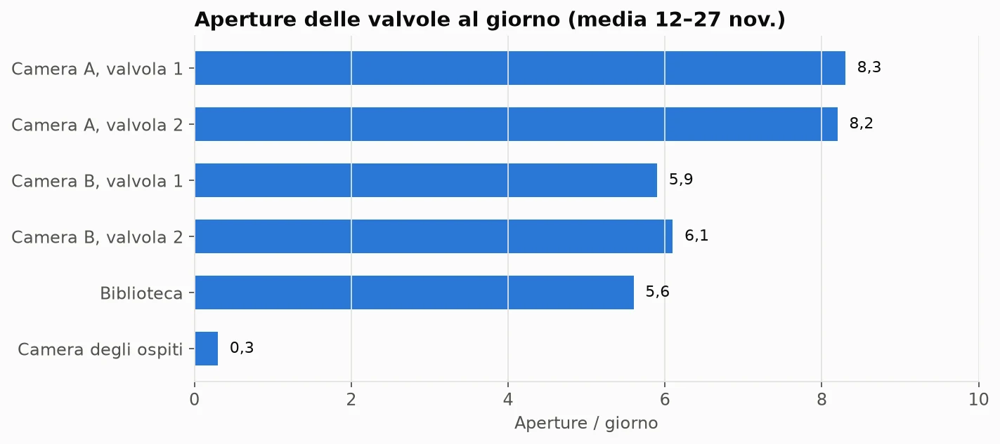
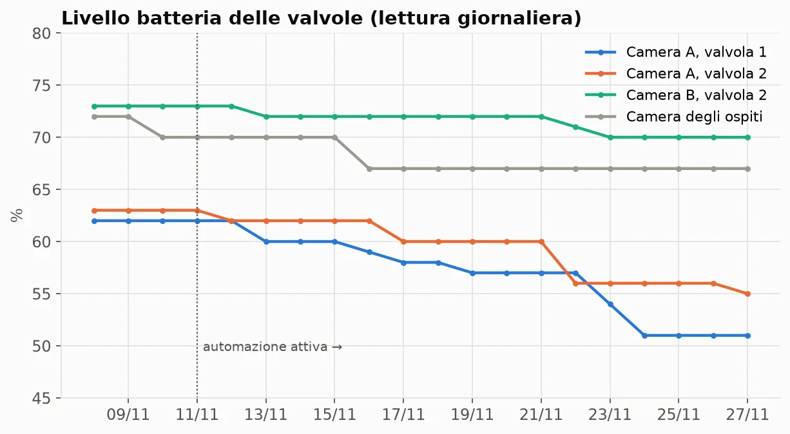

Nel [primo articolo di questa serie](/it/la-curva-climatica-della-mia-pompa-di-calore-regolata-con-i-dati/) ho raccontato come abbiamo regolato la curva climatica della mia pompa di calore partendo dai dati. Parecchi di quei dati venivano dalle **valvole dei radiatori del piano di sopra**: quanto tempo scaldano, a che velocità ogni stanza sale di temperatura. Tre settimane fa quelle valvole non davano niente di tutto questo. Questo articolo racconta come sono diventate il cuore del riscaldamento del piano di sopra.

Per ricordare: la casa ha due circuiti su un'unica pompa di calore Hitachi, un riscaldamento a pavimento al piano terra (C2) e dei radiatori al piano di sopra (C1), [rimessi a posto l'11 novembre](/it/cinque-anni-di-circuiti-invertiti-la-mia-pompa-di-calore-rivista-con-claude/). Al piano di sopra ci sono quattro stanze riscaldate: due camere dei bambini (due radiatori ciascuna), una camera degli ospiti e una biblioteca, dove si trova il termostato a parete della pompa di calore per questo circuito.

## Il punto di partenza: valvole che non regolavano niente

Ognuno dei sei radiatori del piano di sopra ha una valvola termostatica Zigbee **Sonoff TRVZB**, collegata a Home Assistant tramite Zigbee2MQTT. Sulla carta, quindi, ogni stanza poteva avere la sua temperatura. Nei fatti, l'11 novembre, i dati raccontavano un'altra storia:

*   le valvole misuravano la temperatura con **il proprio sensore, attaccato al radiatore**. Leggeva da 22 a 25 °C in camere a 19 °C. Perché le stanze scaldassero comunque, i loro setpoint erano stati spinti a 22-27 °C: erano semplicemente **spalancate, sempre**;
*   il termostato a parete della biblioteca, impostato a 19,5 °C, leggeva 18-18,5 °C di notte e **chiedeva calore quasi in continuazione**. La temperatura del piano di sopra dipendeva solo dalla curva climatica;
*   tutte le camere stavano a 18,5-19,5 °C giorno e notte, occupate o no.

L'idea è stata far lavorare insieme i due livelli: **ogni stanza regola la propria temperatura**, e **la pompa di calore scalda il piano di sopra solo se una stanza ne ha bisogno**.

```
sensori delle stanze ──► setpoint per stanza ──► valvole TRVZB (sensore della stanza)
                             │
                             └──► richiesta del piano ──► setpoint CSNet ──► pompa di calore
```

## Primo livello: ogni valvola regola sulla sua stanza

### Il sensore della stanza, non quello del radiatore

La TRVZB sa usare una temperatura esterna: si imposta il suo selettore del sensore su `remote_temperature` e si scrive la temperatura della stanza nel suo ingresso `external_temperature_input`. Un'automazione lo fa per ogni valvola, a partire dal sensore Zigbee della sua stanza (le due valvole di una camera ricevono lo stesso valore):

*   a ogni variazione del sensore di 0,1 °C o più;
*   **ogni 30 minuti**, anche senza variazioni: senza questo battito, la valvola considera il valore scaduto e torna da sola sul suo sensore interno (`remote_source_offline`);
*   all'avvio di Home Assistant, e appena una valvola torna sul suo sensore interno (succede qualche minuto dopo un riavvio di Zigbee2MQTT).

Se il sensore della stanza si guasta (non disponibile, muto, o con un valore assurdo), la valvola torna sul sensore interno con un setpoint di emergenza a 24 °C, visto che quel sensore legge da 3 a 6 °C in più, e Home Assistant mi manda un avviso.

### Lo scarto di riapertura

La TRVZB è tutto o niente: aperta o chiusa. Di default si riapre quando la temperatura scende **1 °C sotto il setpoint**. Una camera impostata a 18 °C di notte scendeva quindi a 17 °C prima di scaldare. L'automazione mantiene questo parametro (`temperature_accuracy`) a **−0,4 °C** sulle valvole delle camere. La temperatura oscilla così tra il setpoint meno 0,4 °C e un po' sopra il setpoint, perché il radiatore continua a scaldare dopo la chiusura.

### Un setpoint per stanza, in base all'ora e alla presenza

Per ogni stanza, un sensore template calcola il setpoint, insieme a una modalità e al motivo della scelta, prendendo la prima regola che si applica:

| Ordine | Situazione | Modalità | Setpoint predefinito |
|---|---|---|---|
| 1 | Modalità vacanza della casa | eco | 16 °C |
| 2 | Camera degli ospiti non occupata | eco | 16 °C |
| 3 | Finestra aperta (calo brusco di temperatura) | antigelo | 12 °C |
| 4 | Dalle 22:00 alla sveglia meno il preriscaldamento | notte | 18 °C |
| 5 | Un'ora prima della notte (camere) | prima di dormire | 19,5 °C |
| 6 | Altrimenti | comfort | 19 °C |

La sveglia è alle 06:30 nei giorni di scuola (un sensore segue il calendario scolastico francese della zona B) e alle 08:30 negli altri giorni. Il **preriscaldamento** parte 90 minuti prima: all'inizio era di 45 minuti, e le camere arrivavano a 19 °C solo un'ora, un'ora e mezza dopo la sveglia. La camera degli ospiti resta a 16 °C finché non si accende un interruttore «camera degli ospiti occupata»; a quel punto segue il profilo di una camera dei bambini in un giorno senza scuola.

Un dettaglio che ha contato: l'interruttore «vacanze» di un bambino vuol dire «è a casa e non parte presto per la scuola», non «la sua camera è vuota». La sua camera segue allora la sveglia delle 08:30 invece di passare a 16 °C. Solo la modalità vacanza di tutta la casa la svuota.

Tutte le impostazioni (temperature, orari, preriscaldamento, scarto) sono helper modificabili dalla dashboard, e le automazioni non hanno nessun numero scritto nel codice. Per risparmiare le batterie, il setpoint viene inviato a una valvola solo se cambia di almeno 0,25 °C.

### La biblioteca, la stanza a parte

Al piano di sopra **non c'è un bypass idraulico**. Se tutte le valvole si chiudono mentre la pompa di calore fa circolare acqua nel circuito, l'acqua non ha dove andare. E il termostato a parete della pompa di calore è in biblioteca: deve sentire il calore. La valvola della biblioteca regola quindi sul suo sensore come le altre, ma **non si chiude mai del tutto**. L'apertura minima è passata dal 30% al 20%, poi al **10%**: al 30% la stanza restava a 20,5-21,4 °C con un setpoint di 19 °C, a valvola «chiusa».

Ecco com'è una giornata in una camera, il 27 novembre, con una media di −1 °C fuori:


Si vede tutto il sistema: il preriscaldamento alle 05:00 che porta la camera da 17,4 a 19,4 °C in mezz'ora, il dente di sega della giornata (la valvola si apre per un quarto d'ora, la stanza guadagna quasi un grado, poi riscende piano), il setpoint «prima di dormire» alle 21:00 e la notte a 18 °C. Si vede anche che l'acqua è ancora un po' troppo calda: aperture così brevi e un superamento del genere sono proprio quello che il [primo articolo](/it/la-curva-climatica-della-mia-pompa-di-calore-regolata-con-i-dati/) propone di correggere abbassando ancora la curva climatica.

## Secondo livello: la pompa di calore scalda il piano di sopra solo se una stanza lo chiede

Con valvole che regolavano davvero, restava un problema: il termostato a parete della biblioteca continuava a decidere da solo quando la pompa di calore scaldava il piano di sopra. Tra il 13 e il 16 novembre ha **chiesto calore tutta la notte**, mentre tutte le valvole delle camere erano chiuse. L'acqua della pompa di calore restava così 6 °C più calda di quanto servisse al pavimento, per niente.

Dal 16 novembre è Home Assistant a pilotare il setpoint di quel termostato:

*   un sensore binario `chauffage_etage_demande` (richiesta di riscaldamento del piano di sopra) si accende quando **una valvola di una stanza attiva sta scaldando** (con, come riserva, una stanza a più di 0,7 °C sotto il suo setpoint). Si spegne solo dopo **15 minuti senza richiesta**, così i radiatori finiscono il loro ciclo e il circuito non fa cicli brevi;
*   quando c'è una richiesta, il setpoint CSNet diventa **la temperatura letta dal termostato + 0,5 °C** (1 °C fino al 25 novembre);
*   senza richiesta, diventa **la lettura − 1 °C**;
*   viene riscritto solo se si sposta di almeno 0,5 °C.

Perché «lettura ± qualcosa» invece di un setpoint fisso? Perché il termostato a parete non serve più a misurare il comfort: la biblioteca ha la sua valvola e il suo setpoint. Fa da **interruttore**, e il modo più affidabile per accenderlo o spegnerlo è mettere il suo setpoint appena sopra o appena sotto quello che legge.

Il giorno dopo i dati hanno portato una sorpresa: abbassare il setpoint **non ferma il circuito C1**. La richiesta del circuito e il suo circolatore sono rimasti accesi tutta la notte. In compenso, il setpoint sposta la temperatura dell'acqua, di circa 2 °C per grado: 37 °C d'acqua per un setpoint di 20 °C, 32-33 °C per 17-18 °C. Il pilotaggio è quindi meno «acceso/spento» del previsto, ma abbassa l'acqua quando nessuno ha freddo, ed è questo che conta per il rendimento. La prima versione contava anche una stanza «in richiesta» appena scendeva 0,4 °C sotto il suo setpoint, il che la teneva accesa troppo spesso: dal 17 novembre decide la valvola.

L'automazione ha tre modalità: `actif` (scrive in CSNet), `observation` (calcola senza scrivere) e `manuel` (non tocca niente). Quando esce dalla modalità attiva, rimette un setpoint di emergenza di 19 °C. Non cambia mai la modalità della pompa di calore, e non scrive niente se il termostato non è in riscaldamento. In pratica invia **da 22 a 31 setpoint al giorno** al cloud CSNet, poco più di uno all'ora, e ogni scrittura viene annotata nel registro di Home Assistant con il motivo.

## Quello che la casa impara strada facendo

Due sensori registrano quello che succede, senza pilotare niente per ora:

*   **le sveglie**: per ogni camera, la prima luce accesa la mattina (bagno escluso: il cane fa scattare i sensori di movimento tutte le notti, quindi sono esclusi), suddivisa per giorno della settimana e per tipo di giorno (scuola o no). Il sensore dà la mediana delle ultime sei mattine di ogni tipo. I dati di novembre hanno mostrato che un bambino si alza verso le 06:00-06:15 nei giorni di scuola, non alle 06:30 come previsto, e verso le 07:35 nel fine settimana, non alle 08:30;
*   **la velocità di riscaldamento** di ogni stanza: ogni episodio di riscaldamento viene registrato (inizio, durata, temperatura all'inizio e alla fine, temperatura esterna, minuti per guadagnare 0,5 °C), e il sensore tiene la mediana degli ultimi dodici. Oggi: **2,4 °C/h** per una camera, **1,3 °C/h** per l'altra, **0,9 °C/h** per la biblioteca. Il pavimento del piano terra, invece, è troppo lento per guadagnare 0,5 °C durante un episodio: la sua inerzia si conta in ore.

Il prossimo passo è usarli: un preriscaldamento calcolato per ogni camera a partire dalla sua sveglia appresa e dalla sua velocità di riscaldamento, invece di 90 minuti per tutti. Una camera che sale a 2,4 °C/h non ha bisogno di un'ora e mezza per guadagnare un grado.

## Quante volte si muovono le valvole, e quanto costa in batterie

Era la domanda che mi preoccupava di più: una valvola che regola davvero si muove molto più di una valvola bloccata spalancata, e ogni movimento del motore si paga in batterie.



In media sui primi 16 giorni, ogni valvola delle camere si apre **da 6 a 8 volte al giorno** (e si chiude altrettante). La camera A, che si scalda più in fretta, fa i cicli più numerosi e più brevi. La camera degli ospiti, a 16 °C e non occupata, non si apre quasi mai. I setpoint, invece, cambiano solo **2 o 3 volte al giorno** (notte, preriscaldamento, prima di dormire). Il resto del traffico radio è la temperatura della stanza, inviata a ogni variazione di 0,1 °C e ogni 30 minuti.



Il risultato è abbastanza chiaro, anche se la percentuale di batteria di queste valvole è grossolana e avanza a gradini:

*   le due valvole della camera A, le più attive, perdono **circa lo 0,5% al giorno** da quando gira l'automazione (dal 62-63% al 51% e al 55% in due settimane). Allo stesso ritmo, la più scarica sarà vuota tra circa tre mesi, quindi verso la fine dell'inverno;
*   le valvole che si muovono meno perdono dallo 0,1 allo 0,2% al giorno;
*   prima dell'11 novembre, quando le valvole restavano aperte, i livelli si muovevano appena.

È il prezzo di una regolazione fine, e lo trovo ragionevole: un set di batterie a inverno per le valvole più sollecitate. Se diventa un fastidio ci sono due leve: allargare lo scarto di riapertura (−0,4 °C → −0,6 °C: meno cicli, un po' più di oscillazione) e diradare il battito della temperatura esterna. E anche una curva climatica più bassa aiuterà: cicli di riscaldamento più lunghi vogliono dire meno aperture.

## E il comfort?

È la parte più semplice da riassumere. Da metà novembre le camere restano tra **18,5 e 19,5 °C** di giorno e attorno ai **18 °C di notte**, praticamente sul setpoint, anche durante la settimana di gelo di fine novembre (−3 °C al mattino presto). Al piano terra il soggiorno è tra 19 e 20 °C **l'87% del tempo**, contro il 69% del 9 e 10 novembre. La biblioteca, che stava a 21 °C tutto il giorno, è tornata al suo setpoint.

## Cosa mi porto a casa

Delle valvole termostatiche connesse non regolano niente da sole se misurano la temperatura nel posto sbagliato. Pensavo di avere un riscaldamento «stanza per stanza»: in realtà avevo sei valvole aperte e un termostato a parete che decideva tutto. Sono servite tre cose per farlo funzionare: **il sensore della stanza** in ogni valvola, **un setpoint che dipende dalla vita della casa**, e **una pompa di calore che ascolta le stanze** invece di un solo termostato.

E, come spesso succede, la cosa più utile non era prevista all'inizio: queste valvole sono diventate il miglior sensore della casa per capire se l'acqua è troppo calda.

Il terzo e ultimo articolo farà il bilancio dell'inverno: comfort e consumi su tutta la stagione, confrontati con l'inverno scorso (il [primo articolo](/it/la-curva-climatica-della-mia-pompa-di-calore-regolata-con-i-dati/) ne dà già un primo confronto), con i risultati dei prossimi abbassamenti della curva climatica.

## Come è stato fatto

Diverse sessioni Claude Code con Opus 5.5, tra l'11 e il 25 novembre, nel repository della mia configurazione Home Assistant. Claude ha analizzato lo storico (valvole, sensori delle stanze, termostato CSNet, luci per le sveglie), proposto il piano a due livelli, scritto il package `chauffage_etage` e le macro Jinja, con test che rigiocano i dati reali nell'immagine Home Assistant di produzione prima di ogni pull request. Ogni correzione (scarto di riapertura, apertura minima della biblioteca, preriscaldamento, richiesta basata sulle valvole, margine della pompa di calore) è partita da una rilettura dei dati dei giorni precedenti. Le risposte alle domande sulla vita della casa (a che ora si alzano i bambini, il cane, le vacanze) venivano da me. I numeri e i grafici di questo articolo sono stati estratti dallo storico di Home Assistant in un'altra sessione.
