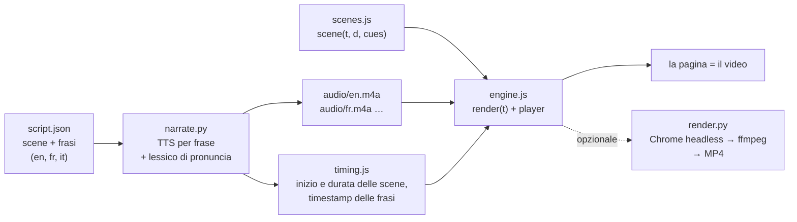

Meno di due settimane fa [ai-running-coach](/it/ai-running-coach-cinque-giorni-dopo-chat-materiale-mappa-video/) ha avuto la sua serie video: **"Il Sentiero"** ("Le Sentier"), un trailer e 20 episodi, uno per funzionalità, narrati in francese e in inglese. Sono circa 35 minuti di video per lingua. Non ho mai aperto un editor video, non ho mai registrato lo schermo e non ho mai parlato in un microfono.

Nessuno di questi è un file video. Ogni "video" è una pagina web: **ogni frame è disegnato in JavaScript su un canvas** a partire dal solo tempo trascorso, sopra una traccia di narrazione prodotta da un motore text-to-speech. Gran parte del codice l'ha scritta Claude Code, a partire da prompt del tipo "fammi un video che spieghi questa funzionalità".

Mi hanno chiesto come funziona, quindi questo articolo racconta il metodo. Parlo dell'idea, delle opzioni gratuite per la voce fuori campo (e delle trappole sulle licenze, che contano più della qualità della voce), di quello che mi hanno insegnato 21 episodi e di prompt che potete riutilizzare. Ora tutto è impacchettato in due skill di Claude Code in **[canvas-video-skill](https://github.com/mmornati/canvas-video-skill)**, e la sezione 6 ripercorre passo passo, con i comandi della skill, l'esempio qui sotto, realizzato su un altro progetto.

## 0. Prima il risultato

Ecco l'esempio costruito per questo articolo: un video esplicativo di 80 secondi su [leanproxy-mcp](https://github.com/mmornati/leanproxy-mcp), il mio firewall dei token per MCP. È narrato in inglese, francese e italiano, e gira direttamente dentro questa pagina:

<div style="container-type:inline-size;margin:1.5rem 0">
<iframe src="https://mmornati.github.io/canvas-video-skill/leanproxy-mcp/?embed=1&lang=it" title="leanproxy-mcp in 80 secondi" loading="lazy" allow="fullscreen; autoplay" allowfullscreen style="display:block;width:100%;height:calc(56.25cqw + 40px);border:0;border-radius:8px;background:#f3f5f1"></iframe>
</div>

*Premete Play (con l'audio attivo). Potete cambiare lingua dalla barra di controllo o attivare i sottotitoli. [Apritelo a pagina intera](https://mmornati.github.io/canvas-video-skill/leanproxy-mcp/?lang=it) per avere l'elenco dei capitoli.*

Qualche numero:

- **2 MB** per le tre lingue: circa 40 KB di JavaScript e JSON, più circa 600 KB di audio AAC per lingua. Un export MP4 della sola versione inglese pesa 3,6 MB.
- **Circa 900 righe di JavaScript**: il motore riutilizzabile (circa 500 righe, nessuna dipendenza) e le otto scene di questo video (389).
- **0 euro**: la voce è [Kokoro](https://huggingface.co/hexgrad/Kokoro-82M), un modello a pesi aperti (Apache-2.0) che gira sulla CPU di un portatile.
- **Hosting:** una cartella di file statici su GitHub Pages, accanto alla skill che l'ha prodotta ([`docs/leanproxy-mcp/`](https://github.com/mmornati/canvas-video-skill/tree/main/docs/leanproxy-mcp)). Niente YouTube, niente player di terze parti.

### Come averlo: canvas-video-skill

Il motore, gli script, il template, il flusso di lavoro per la pronuncia e le note sulle licenze che trovate più sotto sono tutti in **[canvas-video-skill](https://github.com/mmornati/canvas-video-skill)**, un plugin di Claude Code con due skill:

- **`canvas-video`** guida l'agente lungo tutto il metodo: fatti, storyboard, scaffolding, voce, scene, controllo visivo, incorporamento.
- **`narration-lexicon`** trova e corregge le parole pronunciate male con Whisper, invece che con le vostre orecchie.

```text
/plugin marketplace add mmornati/canvas-video-skill
/plugin install canvas-video@canvas-video-skill
```

Poi chiedete un video. Gli script funzionano anche senza agente, o con un altro agente: sono semplici file Python eseguiti con `uv`, e il video in sé è HTML e JavaScript.

## 1. L'idea: un video è una funzione del tempo

Tutta la tecnica si regge su una sola regola: **ogni frame è una funzione pura del tempo**. Una scena è una funzione `scene(t, d, cues)` che disegna, da zero, come appare lo schermo `t` secondi dopo l'inizio della scena. Non conserva stato nascosto e non usa casualità senza seed. Lo stesso `t` dà sempre gli stessi pixel.

Questa regola da sola fornisce tutto quello che serve a un player video:

- **Riprodurre** significa chiamare `render(t)` a ogni frame di animazione.
- **Spostarsi nel video** significa chiamare `render(t)` con un altro `t`.
- **Esportare** in MP4 significa chiamare `render(t)` 30 volte per ogni secondo di video in un browser headless e passare i PNG a ffmpeg. Non è mai in tempo reale, quindi nessun frame va mai perso.

Poi c'è la voce. La narrazione è scritta in uno `script.json`, frase per frase, scena per scena. Uno script sintetizza ogni frase, misura quanto dura e calcola la timeline: **è la voce a dettare il ritmo, l'animazione si adatta**. Una scena dura quanto ciò che vi viene detto, più un po' di respiro.



Due dettagli lo fanno sembrare un vero video.

**Le animazioni si agganciano alle frasi, non ai secondi.** `timing.js` fornisce a ogni scena l'inizio e la fine di ciascuna frase. Una scena non dice mai "mostra il contatore a 3,2 s". Dice "mostra il contatore quando inizia la seconda frase". Così la stessa scena funziona in inglese, francese e italiano, anche se la narrazione italiana dura 13 secondi in più:

```js
function sTax(t, d, cues) {
  const a2 = at(cues, 1, 7.7);              // inizio della 2ª frase (fallback 7,7 s)
  const k = seg(t, a2, a2 + 0.8);            // da 0 a 1 in 0,8 s a partire da quel momento
  panel(700, 470, 500, 46, { alpha: k });    // la "context window" compare in dissolvenza
  // …
}
```

**L'audio è l'orologio di riferimento.** Mentre la narrazione è in riproduzione, il player legge il tempo dall'elemento `<audio>` invece che dall'orologio di sistema, così voce e immagine non vanno mai fuori sincrono, nemmeno su una macchina lenta o in una scheda nascosta:

```js
if (soundOn && !a.paused && a.readyState >= 3) { t = a.currentTime; t0 = now - t * 1000; }
```

Perché non fare semplicemente un MP4? Si può, è un comando solo (sezione 7). Ma la versione pagina ha vantaggi concreti per la documentazione:

- **Le lingue costano poco.** Traducete le frasi in `script.json` e rigenerate: le scene si ricalcolano i tempi da sole. Sul video di leanproxy, la maggior parte dello sforzo per ogni lingua è andata nel controllo della pronuncia.
- **Si può revisionare.** Una modifica a un video è un diff in una pull request. Quando una funzionalità cambia, l'agente modifica una frase e una scena, e la CI verifica che la narrazione sia stata rigenerata.
- **È minuscolo e self-hosted**, come visto sopra.
- **Il testo resta testo.** Sottotitoli, capitoli e trascrizione nascono dallo stesso script.

## 2. Anatomia di un video

Il motore vive nella skill, in [`skills/canvas-video/engine/`](https://github.com/mmornati/canvas-video-skill/tree/main/skills/canvas-video/engine). È una versione ridotta e generica di quello di ai-running-coach, senza le parti specifiche della serie (l'intro col pettorale, l'arco d'arrivo, il gestore degli screenshot). Un video è una cartella accanto:

| File | Scritto da | Ruolo |
|---|---|---|
| `index.html` | a mano (10 righe) | carica il motore, il timing e le scene |
| `script.json` | voi o l'agente | scene, capitoli e testo parlato, per lingua |
| `lexicon.json` | voi o l'agente | correzioni di pronuncia (solo sul parlato, sottotitoli intatti) |
| `scenes.js` | l'agente, quasi sempre | una funzione di disegno per scena, poi `VIDEO.create({...})` |
| `timing.js` | **generato** | durate delle scene e timestamp delle frasi, per lingua |
| `audio/<lang>.m4a` | **generato** | la traccia di narrazione |

Lo script è il contratto tra la voce e l'immagine:

```json
{"id": "router", "min": 6,
 "en": ["Clients without their own tool search get a router: four tools, three hundred and eighteen tokens.",
        "The model searches every server, and loads only the tool it needs."],
 "fr": ["Les clients sans recherche d'outils intégrée reçoivent un routeur : quatre outils, trois cent dix-huit tokens.", "…"],
 "it": ["I client senza una ricerca degli strumenti integrata ricevono un router: quattro strumenti, trecentodiciotto token.", "…"]}
```

I numeri sono scritti in lettere di proposito. I motori TTS leggono "318" correttamente quasi sempre, ma un "10,049" scritto all'inglese può uscire in francese come "dieci, zero quarantanove", perché lì la virgola è il separatore decimale. Le parole non sono mai ambigue.

Il motore offre alle scene un piccolo vocabolario: `text`, `para`, `panel`, `pill`, `terminal` (con righe digitate e cursore), `arrow`, `packets` (puntini che scorrono lungo un filo), `highlight`, `callout`, `check`, più funzioni di easing e un generatore casuale con seed. Per i video esplicativi basta. Per qualsiasi altra cosa, la scena ha a disposizione il `ctx` grezzo del canvas.

Gli strumenti sono una manciata di script Python eseguiti con `uv`, quindi nel progetto non viene installato nulla:

- [`new_video.py`](https://github.com/mmornati/canvas-video-skill/blob/main/skills/canvas-video/scripts/new_video.py) crea lo scheletro di un video che si riproduce già prima che scriviate una sola scena.
- [`narrate.py`](https://github.com/mmornati/canvas-video-skill/blob/main/skills/canvas-video/scripts/narrate.py) si occupa della voce, del timing e del `--check` usato dalla CI.
- [`render.py`](https://github.com/mmornati/canvas-video-skill/blob/main/skills/canvas-video/scripts/render.py) produce i provini a contatto, le immagini fisse in PNG e l'export MP4.
- [`verify.py`](https://github.com/mmornati/canvas-video-skill/blob/main/skills/narration-lexicon/scripts/verify.py) e [`try_words.py`](https://github.com/mmornati/canvas-video-skill/blob/main/skills/narration-lexicon/scripts/try_words.py) controllano e correggono la pronuncia.

Il video in sé è al 100% HTML, CSS e JavaScript.

## 3. La voce: le opzioni gratuite, e quali si possono pubblicare

È qui che è finita la maggior parte del tempo su ai-running-coach, ed è qui che il panorama è cambiato di nuovo **ieri**.

### Cosa è successo alla serie

- La prima narrazione usava **Kokoro**. Funziona offline, ma la sua unica voce francese suona robotica.
- La PR #161 è passata a **edge-tts**, che dà accesso gratis e senza account alle voci neurali Microsoft della funzione "Leggi ad alta voce" di Edge. Remy e Andrew Multilingual suonano benissimo, e le usano il trailer e gli episodi dall'1 al 15.
- Ieri, mentre narravo gli episodi dal 16 al 20, edge-tts ha iniziato a rispondere **HTTP 403**. Non succede solo a me: la [issue #490 di edge-tts](https://github.com/rany2/edge-tts/issues/490) è stata aperta il 10 ottobre. Le segnalazioni arrivano da Francia, Europa centrale e Regno Unito; dal Nord America funziona ancora. La nuova versione di Edge parla con un nuovo host con un nuovo formato di token, e una correzione non c'è ancora.
- Gli episodi dal 16 al 20 sono stati narrati con Kokoro, quindi ora la serie mescola due voci.

Quel disservizio mi ha ricordato una cosa su cui avevo sorvolato. **edge-tts non è mai stato coperto da una licenza.** Usa un endpoint privato del browser. L'audio suonava professionale, ma niente mi autorizzava a pubblicarlo. Così ho rifatto la ricerca come si deve, con un solo vincolo: **gratuito e pubblicabile**.

### Le opzioni a ottobre 2026

**Modelli locali a pesi aperti** (girano sulla vostra macchina, niente account, niente quote):

| Motore | Licenza dell'audio che pubblicate | EN / FR / IT | Note |
|---|---|---|---|
| [Kokoro-82M](https://huggingface.co/hexgrad/Kokoro-82M) | Apache-2.0: OK, uso commerciale compreso | EN eccellente, FR 1 voce (B-), IT 2 voci (C) | Minuscolo, veloce su CPU. La migliore qualità per le sue dimensioni in inglese. Python (`kokoro`, `kokoro-onnx`) e JavaScript ([`kokoro-js`](https://www.npmjs.com/package/kokoro-js), Node e browser, solo voci inglesi). |
| [Chatterbox Multilingual](https://github.com/resemble-ai/chatterbox) | MIT: OK. Ogni file contiene un watermark inudibile "Perth" | EN, FR, IT e altre 20 | Clonazione della voce da un campione. Gira su Apple Silicon (MPS). |
| [Kyutai Pocket TTS](https://huggingface.co/kyutai/pocket-tts) | CC-BY-4.0: OK **citando Kyutai**; vietato clonare qualcuno senza consenso | EN, FR, IT, DE, ES, PT | Novità del 2026: 100M di parametri, tempo reale sulla CPU di un portatile. Download con accesso su richiesta. |
| [Kyutai TTS 1.6B](https://huggingface.co/kyutai/tts-1.6b-en_fr) | CC-BY-4.0 (citazione) | EN, FR | Francese molto buono. Su Mac tramite MLX. |
| [Qwen3-TTS](https://huggingface.co/Qwen/Qwen3-TTS-12Hz-1.7B-CustomVoice) | Apache-2.0 | EN, FR, IT e altre 7 | Ottimo, clonazione da 3 s di audio, ma vuole una GPU. |
| [Piper](https://github.com/OHF-Voice/piper1-gpl) | Motore GPL-3.0 (non copre il vostro audio), ma **ogni voce ha la licenza del proprio dataset**: controllate la sua model card | Moltissime voci | Affidabile, un po' robotico, gira su un Raspberry Pi. |

Attenzione alle **trappole del non commerciale**: alcuni dei modelli aperti con la resa migliore vietano proprio l'uso che ci interessa (un video di prodotto o di marketing). Tra questi Fish Audio S2, Voxtral TTS, F5-TTS (i pesi), Spark-TTS, XTTS-v2 (e Coqui non esiste più per vendervi una licenza), OuteTTS 1B e Breeze TTS 2 (attualmente al primo posto nella classifica dei modelli a pesi aperti). Leggete la licenza dei *pesi*, non solo quella del codice.

**Piani gratuiti ufficiali nel cloud** (serve un account, e l'audio è coperto da licenza):

| Servizio | Quota gratuita | Note |
|---|---|---|
| [Azure AI Speech F0](https://azure.microsoft.com/en-us/pricing/details/cognitive-services/speech-services/) | 500.000 caratteri al mese | **Le stesse voci che usava edge-tts**, legalmente. L'intera serie di ai-running-coach sta intorno ai 31.000 caratteri. |
| [Google Cloud TTS](https://cloud.google.com/text-to-speech/pricing) | 1M caratteri/mese di Chirp 3 HD (le sue voci migliori), 4M Standard, 4M WaveNet | Richiede un account di fatturazione (una carta registrata). |
| [Gemini API TTS](https://ai.google.dev/gemini-api/docs/pricing) | Piano gratuito sui modelli Flash TTS | Voci guidate da un prompt testuale; limiti di frequenza stretti. |
| [Amazon Polly](https://aws.amazon.com/polly/pricing/) | Crediti per i nuovi account (fino a 200 $) | Le vecchie quote "12 mesi gratis" valgono solo per gli account creati prima di luglio 2025. |
| [Cloudflare Workers AI](https://developers.cloudflare.com/workers-ai/models/melotts/) | 10.000 neuron/giorno, circa 9 ore di audio MeloTTS | Francese e inglese, niente italiano; qualità datata. |

I piani gratuiti dei servizi commerciali non sono un'opzione per questo uso: **ElevenLabs Free** vieta l'uso commerciale e impone "elevenlabs.io" nel titolo di ciò che pubblicate, il piano gratuito di Cartesia non include una licenza commerciale, e OpenAI non ha proprio un piano TTS gratuito.

**Integrati nel vostro computer**, il ripiego quando nient'altro funziona:

- **`say` di macOS** è ottimo per le bozze e per le prove di timing: zero installazione, voci dignitose in tutte le lingue. Ma la licenza di macOS (sezione 2F della SLA di Tahoe) consente le voci di sistema solo "for your personal, non-commercial use" (cioè per uso personale e non commerciale) e vieta esplicitamente di pubblicarne le registrazioni. **Usatelo, non pubblicatelo.**
- Per le voci naturali di **Windows** non ho trovato alcuna autorizzazione alla pubblicazione.
- **espeak-ng** (Linux, macOS, Windows) sembra uscito dal 1995, ma è software GPL che non avanza alcuna pretesa sul vostro audio: è il ripiego a costo zero che avete davvero il diritto di pubblicare.

Il `narrate.py` della skill supporta quattro motori: `kokoro` (predefinito), `azure` (il piano gratuito ufficiale), `espeak` (il ripiego pubblicabile) e `say` (bozze). Quello di ai-running-coach ha anche `edge`, `chatterbox` e `kyutai`. Aggiungere un motore richiede una classe di 15 righe: prende una frase, scrive un WAV.

### Cosa sceglierei io

- **Solo inglese:** Kokoro. Difficile fare di meglio con 82M di parametri, ed è l'unico che gira anche in JavaScript.
- **Francese e italiano, in locale:** Chatterbox Multilingual, oppure Pocket TTS se potete citare Kyutai.
- **Le voci migliori, gratis:** Azure F0, 500k caratteri al mese, ufficialmente. È la strada naturale per rinarrare la serie di ai-running-coach di nuovo con una sola voce.
- **Bozze:** `say`, poi si cambia motore per la versione finale. Visto che il timing è calcolato sull'audio reale, cambiare motore fa semplicemente riadattare le scene.

Per questo articolo ho usato di proposito Kokoro in tutte e tre le lingue, così potete sentire dove è eccellente (l'inglese) e dove mostra i suoi limiti (le voci francese e italiana sono valutate B- e C dal suo stesso autore).

## 4. Cosa mi hanno insegnato 21 episodi

**Il vero lavoro è la pronuncia, e non si può controllare a orecchio.** Dopo tre ascolti si sente quello che ci si aspetta. Trascrivete la traccia con Whisper (`faster-whisper` gira in locale) e fate il diff con lo script. La skill `narration-lexicon` lo automatizza: ritaglia ogni frase dalla traccia grazie ai timestamp, la trascrive da sola e la confronta con lo script. Sul video di leanproxy ha scovato:

- "your AI client" sentito come "your iClient";
- "binaire Go" sentito come "binergo";
- "LeanProxy" in italiano sentito come "L'improxia";
- "Homebrew" in francese sentito come "Chromebook". Questo mi era sfuggito ascoltando tutta la traccia.

Ognuno è stato corretto con una voce di una riga in `lexicon.json` (una grafia alternativa, oppure fonemi IPA grezzi per Kokoro: `"AI": "[[ˌeɪˈaɪ]]"`) o riformulando la frase. I sottotitoli mantengono il testo originale.

**Non ogni differenza è un problema della voce.** Nel report finale, tutte le 15 frasi inglesi corrispondono. Le differenze che restano in francese e in italiano sono omofoni ("surcoût" sentito come "sur coût", "Mesuré" come "Mesurée") o pregiudizi linguistici di Whisper stesso: in una frase italiana, "LeanProxy" torna indietro come una parola dall'aria italiana anche quando la voce lo pronuncia bene. La skill insegna all'agente a distinguere questi casi invece di "correggere" una voce che è già giusta.

**Kokoro legge ad alta voce i propri marcatori di lingua.** Quando una frase francese contiene una parola inglese, espeak (che Kokoro usa per i fonemi) la racchiude tra marcatori di cambio lingua: `(en)kˈoʊtʃ(fr)`. kokoro-onnx toglie le parentesi ma non le lettere, quindi la voce diceva letteralmente "en coach fr". La soluzione è un parametro (`language_switch="remove-flags"`), ed è in `narrate.py`.

**Lasciate che sia la voce a dettare il timing, mai il contrario.** Il primo trailer era muto, con durate delle scene regolate a mano. Quando è arrivata la narrazione, le durate hanno iniziato a essere calcolate dall'audio: nessuna frase viene mai tagliata, e una traduzione o un cambio di motore fanno semplicemente riadattare le scene.

**Fate del determinismo un test.** ai-running-coach ha un test di lint che fallisce se una scena usa `Math.random()` o `Date.now()`. Basta un frame non deterministico e l'export MP4 non corrisponde più a quello che si vede nel browser.

**Fate di una narrazione non aggiornata un errore di CI.** `narrate.py --check` usa solo la libreria standard. Confronta un'impronta dello script, della voce e del lessico con quella salvata in `timing.js`. Se cambiate una frase e vi dimenticate di rigenerare, la CI ve lo dice.

**Scrivete l'audio in modo atomico.** Con più agenti che rigenerano in parallelo, una traccia poteva essere letta mentre era scritta a metà. Lo script la scrive in un file temporaneo e poi la sposta al suo posto.

**Agenti in parallelo e file condivisi non vanno d'accordo.** Gli episodi sono stati costruiti da più sessioni di Claude Code in parallelo. Ognuna aggiungeva la sua riga all'elenco condiviso degli episodi in `engine.js`, quindi ogni branch andava in conflitto con tutti gli altri. Tenete i registri condivisi minuscoli, oppure generateli.

**Usate dati fittizi, e ditelo sullo schermo.** I video di ai-running-coach usano "Camille", un'atleta demo generata dalle fixture dei test, così non pubblico mai i miei dati di salute. Il video di leanproxy usa solo numeri presi dal benchmark del progetto stesso, con le condizioni di test stampate accanto.

## 5. Prompt da riutilizzare

Le sessioni che hanno costruito "Il Sentiero" non esistono più: la prima girava in una sandbox nel cloud, e quelle locali nel frattempo sono state ripulite. Quello che segue è riscritto a partire dalle descrizioni delle pull request e generalizzato, così funziona su qualsiasi progetto.

Con la skill installata, per lo più non vi servono: le sue istruzioni codificano esattamente questi passaggi, e basta l'ultimo prompt. Restano utili senza la skill, con un altro agente, o per capire cosa la skill fa fare all'agente.

Li lascio in inglese, così come li ho scritti: funzionano allo stesso modo in qualsiasi lingua.

**Avviare il motore** (il primissimo video):

```text
I want a ~80 s presentation video of this project that is NOT a video file:
a single HTML page where every frame is drawn on a 16:9 canvas by a pure
function render(t) of the elapsed time. No framework, no build step, no
third-party requests (bundle the fonts with their licences). Expose
window.renderFrame(t) and window.videoReady so a script can export an MP4
frame by frame with headless Chrome + ffmpeg. Read the README and the docs
first, use the project's real colours, and never invent a feature.
```

**Trasformarlo in una serie narrata:**

```text
Turn the trailer into a series: one short episode per feature, half demo,
half documentation, sharing one engine (player, chapters, subtitles,
drawing helpers). Each episode has a script.json with the scenes and the
narration in FR and EN. Generate the voice offline, compute each scene's
duration from the audio (the voice sets the pace), and expose the sentence
timestamps so animations can start when a sentence starts. Add a CI check
that fails when the narration is stale. Propose the episode list first.
```

**Quando la voce suona male:**

```text
The French voice sounds robotic. Make the narration script support several
TTS engines behind a --engine flag, render one scene with each engine for
A/B listening (--sample), and tell me the licence of the audio each one
produces: I must be allowed to publish it.
```

**Correggere la pronuncia senza tirare a indovinare:**

```text
Transcribe every narration track with faster-whisper and diff it against
script.json. For each word that comes out wrong, add an entry to
lexicon.json (respelling, or IPA for Kokoro), regenerate, and transcribe
again until the transcript matches. Don't change the subtitles.
```

**Aggiungere un episodio** (quello che ho usato di più):

```text
New episode for the feature in PR #<n>: read the PR and the docs page,
propose 6-8 scenes with the narration in FR and EN, wait for my OK, then
build it, regenerate the narration, render stills of every scene so you
can check the layout yourself, and update the gallery.
```

**Un video sul progetto di qualcun altro** (l'esempio qui sotto):

```text
Make an ~80 s narrated explainer of github.com/<owner>/<repo> for my blog,
in EN, FR and IT, with a free voice I'm allowed to publish. Use only facts
and numbers from the repo (README, docs, benchmarks), with their test
conditions on screen. Use the project's visual identity. Check the
pronunciation with Whisper, render stills of every scene and fix the
layout before showing me anything.
```

La parte che conta in tutti: **chiedete all'agente di guardare il proprio output.** Renderizzare immagini fisse di ogni scena e rileggerle come immagini, e trascrivere l'audio, è ciò che trasforma "compila" in "si vede e si sente bene".

## 6. Passo passo: il video di leanproxy-mcp con la skill

Ecco come è stato realizzato il video in cima a questo articolo. L'ho costruito prima con Claude Code, poi ho impacchettato i passaggi, gli script e i controlli nella skill, quindi questo è esattamente ciò che la skill ora fa fare a un agente. I percorsi sono relativi alla cartella `skills/` del plugin; l'agente esegue questi comandi da solo, e potete eseguirli anche a mano.

**1. Installare la skill e chiedere.**

```text
/plugin marketplace add mmornati/canvas-video-skill
/plugin install canvas-video@canvas-video-skill

> Make an ~80 s narrated explainer of github.com/mmornati/leanproxy-mcp, in EN, FR and IT,
  with a free voice I'm allowed to publish. Only facts from the repo.
```

**2. Prima i fatti.** La skill fa leggere all'agente il repository, il sito di documentazione e i risultati dei benchmark prima di ogni altra cosa. La prima cosa che ha trovato è stata una trappola: la descrizione su GitHub dice ancora "50-80%", mentre i dati attuali e misurati sono *dal 65 al 94% di token in meno per sessione*, *10.049 → 318 token* di carico statico e *0 su 3* segreti piazzati trapelati. I miei due articoli precedenti sul progetto riportavano numeri ancora più vecchi. Il video usa solo i risultati attuali dell'harness e stampa sullo schermo le condizioni ("make harness · 5 mock servers · 118 tools · upper bounds").

**3. Lo storyboard, approvato prima di costruire.** Otto scene: la tassa dello schema, il costo, il proxy, la modalità router, il governatore delle risposte, il firewall, le misure, l'installazione. Circa 170 parole in inglese, numeri scritti in lettere, funzionalità opt-in presentate come opt-in. Una volta approvato, diventa `script.json`.

**4. Lo scheletro.**

```bash
python3 canvas-video/scripts/new_video.py docs/leanproxy-mcp --title "leanproxy-mcp in 80 seconds" --langs en,fr,it
```

Questo copia il motore condiviso `engine/` accanto al video, insieme a un template che si riproduce già.

**5. Generare la voce.**

```bash
uv run --with kokoro-onnx --with soundfile canvas-video/scripts/narrate.py docs/leanproxy-mcp
```

```text
leanproxy-mcp [en] 77.9 s (kokoro/af_heart)
leanproxy-mcp [fr] 81.8 s (kokoro/ff_siwis)
leanproxy-mcp [it] 90.9 s (kokoro/im_nicola)
```

**6. Controllare la pronuncia** con la skill `narration-lexicon`:

```bash
uv run --with faster-whisper --with num2words narration-lexicon/scripts/verify.py docs/leanproxy-mcp
uv run --with kokoro-onnx --with soundfile --with faster-whisper --with num2words \
  narration-lexicon/scripts/try_words.py docs/leanproxy-mcp --lang fr \
  "Installez-le avec Homebrew, lancez" "Installez-le avec Home Brew, lancez"
```

`verify.py` elenca le frasi che non tornano indietro correttamente, con il diff parola per parola. `try_words.py` pronuncia alcune grafie candidate con la voce stessa del video e le ritrascrive. La vincitrice finisce in `lexicon.json`, poi si rinarra e si riverifica. Per le tre lingue ci sono voluti alcuni giri e circa un quarto d'ora.

**7. Scrivere le scene, poi guardarle.** L'identità visiva viene dal `DESIGN.md` del progetto stesso: la palette "checkpoint scanner", con l'ambra per i token che si pagano, il verde acqua per ciò che è passato, e il rosso solo per le parentesi angolari attorno a qualcosa che è stato intercettato. Il logo, un arco da scanner, è ridisegnato in otto righe di codice canvas. Poi l'agente renderizza un provino a contatto di ogni scena in ogni lingua e rilegge le immagini:

```bash
uv run --with playwright canvas-video/scripts/render.py docs/leanproxy-mcp --sheet
```

Quel passaggio ha scovato un blocco ambra che copriva il varco, una percentuale sovrapposta all'etichetta di una barra, e le legature del font per il codice che trasformavano `--stdio` in "—stdio" nella scena del terminale. Nessuno di questi problemi sarebbe emerso in una code review.

**8. Pubblicare.** La cartella è fatta di file statici: vive nella `docs/` del repository della skill, servita da GitHub Pages, e questo articolo la incorpora con un `iframe` che punta a `?embed=1&lang=en` (`lang=fr` e `lang=it` nelle versioni francese e italiana dell'articolo). `narrate.py --check` gira nella CI del repository, quindi una frase modificata senza rigenerare la voce fa fallire la build.

## 7. E quando serve un MP4

YouTube, LinkedIn o una pagina di release non possono eseguire il vostro JavaScript. Per questi casi:

```bash
uv run --with playwright canvas-video/scripts/render.py docs/leanproxy-mcp --lang en              # 1080p MP4
uv run --with playwright canvas-video/scripts/render.py docs/leanproxy-mcp --lang en --burn-subs  # social media
```

Sul mio MacBook renderizza i 2.337 frame della versione inglese in **24 secondi** e produce un file da 3,6 MB, con la narrazione inserita senza ricodifica. Gli stessi pixel del browser, per costruzione.

## E adesso

- Riportare una sola voce, con licenza, su tutti i 21 episodi de "Il Sentiero" (Azure F0 è il candidato ovvio).
- Provare Pocket TTS e Chatterbox per francese e italiano nel prossimo video.
- Forse una versione Node di `narrate.py` con `kokoro-js`, per i progetti che non vogliono neanche una riga di Python (per ora solo voci inglesi).
- Nuovi motori nella skill: ognuno è una classe di 15 righe, e le pull request sono benvenute.

Link:

- 🧩 [canvas-video-skill](https://github.com/mmornati/canvas-video-skill): le due skill, il motore, gli script e gli esempi ([demo dal vivo](https://mmornati.github.io/canvas-video-skill/))
- 🎬 [Il video di leanproxy-mcp, a pagina intera](https://mmornati.github.io/canvas-video-skill/leanproxy-mcp/?lang=it)
- 🏃 ["Il Sentiero", la serie di ai-running-coach](https://mmornati.github.io/ai-running-coach/videos/)
- 🛡️ [leanproxy-mcp su GitHub](https://github.com/mmornati/leanproxy-mcp)
